# COMPENDIO TOTAL Y CANÓNICO DE LA WIKI SIIU
## Sistema de Información para la Investigación Universitaria — Universidad de Antioquia

> **Documento Consolidado Monolítico (All-in-One)**  
> **Propósito:** Archivo único diseñado para ingesta directa de contexto completo por Agentes Inteligentes (Gemini, Claude, GPT), auditoría documental y lectura fuera de línea sin dependencias de red ni enlaces rotos.  
> **Contenido Integrado:** Manuales de roles, 8 macroprocesos operativos, 31 guías e instructivos fidedignos transcritos íntegramente, síntesis didáctica y textos maestros de las 21 normas institucionales, mapas MOC y glosarios.

---


================================================================================
# 1. MANUALES DE ROLES Y GOBERNANZA
================================================================================


------------------------------------------------------------
## [DOCUMENTO]: Rol_Investigador.md
*Ruta canónica original: `docs/01_ROLES/Rol_Investigador.md`*
------------------------------------------------------------

# Manual Operativo: Rol Investigador Principal y Tutor

El **Investigador Principal (IP)** o **Coordinador de Proyecto (CP)** es el líder académico y técnico del proyecto ante la Universidad de Antioquia y ante los entes financiadores. En el **SIIU**, el IP administra sus iniciativas desde la postulación hasta el cierre final.

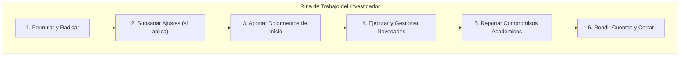


---

## 1. Responsabilidades Centrales

1. **Matrícula y Calidad de la Información:** Registrar adecuadamente la metodología, el cronograma, el presupuesto detallado y la caracterización complementaria (ODS, Misión de Sabios, G8).
2. **Atención a Requerimientos del Centro:** Si la propuesta es devuelta para ajustes en la etapa técnica formal, responder dentro del plazo límite asignado.
3. **Gestión de Trámites Administrativos:** Solicitar oportunamente prórrogas de tiempo o traslados presupuestales antes de que expiren los plazos o se agoten los recursos.
4. **Tutoría de Jóvenes Investigadores:** Matricular el cupo adjudicado y registrar la hoja de vida del estudiante seleccionado verificando las condiciones bancarias.
5. **Cumplimiento de Compromisos:** Cargar en los tiempos estipulados los informes de avance, informes finales y evidencias de productos de investigación.

---

## 2. Rutas Rápidas en el Menú del SIIU

| Acción | Ruta en el Menú SIIU |
| :--- | :--- |
| **Inscribir nuevo proyecto en convocatoria** | `Convocatorias >> Inscripción >> Proyectos en convocatoria` |
| **Inscribir proyecto con financiación externa** | `Convocatorias >> Inscripción >> Proyectos inscritos` |
| **Matricular primer proyecto (investigador nuevo)** | `Convocatorias >> Inscripción >> Primer proyecto` |
| **Consultar o ajustar propuesta devuelta** | `Convocatorias >> Proyectos en proceso >> Estado: Pendiente Actualización >> Acciones (...) >> Editar` |
| **Matricular cupo de Joven Investigador** | `Convocatorias >> Inscripción >> Cupos joven investigador` |
| **Registrar hoja de vida de estudiante JI** | `Trámites administrativos >> Seguimiento mis proyectos >> Seleccionar cupo >> Botón: Hoja de vida JI` |
| **Radicar solicitud de prórroga o cambio de rubro** | `Trámites administrativos >> Nueva solicitud o Novedad >> Solicitud` *(para proyectos internos)* |
| **Radicar novedad con aval externo** | `Trámites administrativos >> Nueva solicitud o Novedad >> Novedad` *(para proyectos externos)* |
| **Cargar o entregar compromisos académicos** | `Trámites administrativos >> Seguimiento mis proyectos >> Botón: Compromisos` |
| **Descargar constancia personal de participación** | `Constancias >> Participación en proyectos >> Seleccionar cédula >> Ver constancia` |

---

## 3. Puntos de Control Críticos para el Investigador

!!! warning "Alerta de archivos adjuntos"
    - **Nombre del archivo:** Máximo 30 caracteres, sin tildes, sin eñes (`ñ`), sin caracteres especiales (`#`, `$`, `%`, `&`, `/`) y sin espacios excesivos.
    - **Formato:** Exclusivamente **PDF**.
    - **Error común:** Nombrar archivos largos como *"INFORME_FINAL_PROYECTO_DE_INVESTIGACION_2024_APROBADO_VERSION_FINAL.pdf"*. El sistema truncará el archivo y generará error de guardado. Usa: *"InformeFinal_2024.pdf"*.

!!! danger "Jóvenes investigadores: cuentas bancarias"
    - **Cuentas NO permitidas:** Nequi, Daviplata, Ahorro a la Mano, Bancolombia Agroseguro.
    - **Cuentas permitidas:** Cuenta de ahorros tradicional a nombre del estudiante.
    - **Nota:** La Universidad **no emite cartas para apertura de cuentas bancarias** para Jóvenes Investigadores porque no se trata de un contrato laboral, sino de un estímulo económico.

!!! note "Cambio de rubro presupuestal"
    - No intentes trasladar presupuesto desde un rubro cuyo saldo actual sea \$0.
    - El proyecto debe encontrarse en estado **En ejecución**.

---

## :material-link: Guías Detalladas de Interés
- [Ecosistema de Comités y Gobernanza](Ecosistema_Comites_Gobernanza.md): Interacción con Comité de Departamento, Comité Técnico y Consejo de Facultad.
- [Matricula Proyectos](../02_PROCESOS_CLAVE/Matricula_Proyectos.md): Paso a paso de inscripción en convocatorias y proyectos inscritos.
- [Evaluacion y Aval](../02_PROCESOS_CLAVE/Evaluacion_y_Aval.md#subsanacion-y-ajustes-de-proyectos-devueltos): Cómo responder al Centro si devuelven tu proyecto.
- [Programa Joven Investigador](../02_PROCESOS_CLAVE/Programa_Joven_Investigador.md): Guía completa de cupos, hojas de vida y prórrogas de JI.
- [Modificaciones y Tramites](../02_PROCESOS_CLAVE/Modificaciones_y_Tramites.md): Cómo tramitar prórrogas y cambios de presupuesto.
- [CheatSheet Investigador](../03_GUIAS_RAPIDAS_CHEAT_SHEETS/CheatSheet_Investigador.md): Ficha de referencia rápida y rutas express.

------------------------------------------------------------
## [DOCUMENTO]: Rol_Centro_Investigacion.md
*Ruta canónica original: `docs/01_ROLES/Rol_Centro_Investigacion.md`*
------------------------------------------------------------

# Manual Operativo: Rol Centro de Investigación y Extensión

Los **Centros de Investigación y de Extensión** de las Facultades, Escuelas e Institutos de la Universidad de Antioquia son los nodos de articulación técnico-académica. Tienen la potestad de validar formalmente las propuestas, interactuar con los pares evaluadores, avalar iniciativas ante el CODI o Comités de Extensión, y aprobar los trámites administrativos de los proyectos adscritos.

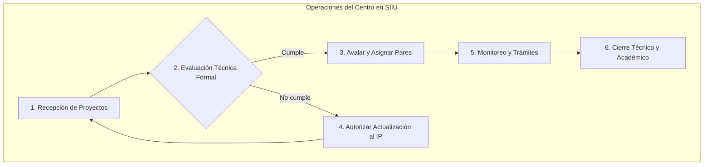


---

## 1. Responsabilidades Centrales

1. **Evaluación Técnica Formal:** Comprobar si la propuesta cumple las condiciones habilitantes definidas en los Términos de Referencia de la convocatoria.
2. **Autorización de Ajustes:** Devolver al IP las propuestas que requieran subsanación formal, delimitando con precisión las secciones abiertas y fijando una fecha límite improrrogable.
3. **Gestión de Evaluadores Pares:** Seleccionar y asignar pares evaluadores idóneos (internos o externos) según el área de conocimiento y temática del proyecto.
4. **Aval Institucional:** Emitir el aval de la unidad académica para que el proyecto pueda continuar a las instancias centrales (Vicerrectoría / CODI).
5. **Aprobación de Solicitudes Administrativas:** Analizar las solicitudes de prórroga, cambios de rubro o modificaciones de participantes radicadas por los investigadores.
6. **Supervisión de Compromisos y Cierre:** Revisar los informes técnicos de avance y el informe final antes de ordenar el cierre formal del proyecto.

---

## 2. Rutas Rápidas en el Menú del SIIU

| Acción | Ruta en el Menú SIIU |
| :--- | :--- |
| **Realizar Evaluación Técnica de Proyectos** | `Convocatorias >> Proyectos en evaluación >> Filtros >> Acciones (...) >> Realizar evaluación técnica` |
| **Solicitar Actualización / Devolver a Investigador** | `Convocatorias >> Proyectos en evaluación >> Evaluación técnica >> Marcar "No cumple" >> Botón: Autorizar actualización` |
| **Asignar Evaluadores Pares al Proyecto** | `Convocatorias >> Aval de proyectos >> Seleccionar proyecto >> Botón: Asignar evaluador` |
| **Avalar Proyecto post-evaluación** | `Convocatorias >> Aval de proyectos >> Seleccionar proyecto >> Emitir Aval` |
| **Aprobar Solicitudes Administrativas** | `Trámites administrativos >> Flujo de procesos administrativos y novedades >> Consulta >> Acciones (...) >> Aprobar / Rechazar` |
| **Revisar Compromisos Académicos Entregados** | `Trámites administrativos >> Seguimiento proyectos >> Seleccionar proyecto >> Botón: Compromisos` |
| **Generar Cierre del Proyecto** | `Trámites administrativos >> Seguimiento proyectos >> Seleccionar proyecto >> Botón: Cierre de proyecto` |
| **Generar Constancia de Proyectos por Grupo** | `Constancias >> Proyectos por Grupo de Investigación` |
| **Consultar Historial Completo de Proyectos del Centro** | `Convocatorias >> Reportes >> Historial de Proyecto` *(o `Reportes >> Historial de Proyecto`)* |

---

## 3. Procedimiento Clave: Devolución para Actualización

Cuando un proyecto no cumple con todas las condiciones formales en la revisión inicial del Centro:

1. Ingrese a la evaluación técnica y marque con **"No cumple"** la condición respectiva.
2. Presione **GUARDAR**. El sistema habilitará el botón **`Autorizar actualización`**.
3. En la ventana emergente:
   - Seleccione el tipo de evaluación.
   - Defina la **Fecha y Hora límite** para que el investigador corrija.
   - Marque con exactitud las **secciones habilitadas** (ej. Presupuesto, Metodología, Documentos soporte). Las secciones no seleccionadas permanecerán bloqueadas para el investigador.
   - Redacte en el campo **Cambios solicitados** las instrucciones claras (máximo 400 caracteres).
4. Presione **AUTORIZAR ACTUALIZACIÓN** y confirme el diálogo de seguridad.
5. El proyecto pasará a estado **Pendiente de actualización** y se notificará automáticamente al investigador por correo institucional.

---

## :material-link: Guías Detalladas de Interés
- [Ecosistema de Comités y Gobernanza](Ecosistema_Comites_Gobernanza.md): Competencias del Comité Técnico y articulación con Consejos y CODI.
- [Evaluacion y Aval](../02_PROCESOS_CLAVE/Evaluacion_y_Aval.md): Protocolo completo de evaluación técnica, devolución y asignación de pares.
- [Modificaciones y Tramites](../02_PROCESOS_CLAVE/Modificaciones_y_Tramites.md#aprobacion-en-centro): Cómo gestionar y aprobar solicitudes administrativas en el Centro.
- [Cierre y Liquidacion](../02_PROCESOS_CLAVE/Cierre_y_Liquidacion.md): Protocolo de verificación de compromisos y trámite de cierre.
- [CheatSheet Centro](../03_GUIAS_RAPIDAS_CHEAT_SHEETS/CheatSheet_Centro.md): Ficha de referencia rápida y criterios de control.

------------------------------------------------------------
## [DOCUMENTO]: Rol_Vicerrectoria.md
*Ruta canónica original: `docs/01_ROLES/Rol_Vicerrectoria.md`*
------------------------------------------------------------

# Manual Operativo: Rol Vicerrectoría de Investigación

La **Vicerrectoría de Investigación** (junto con la **Vicerrectoría de Extensión**) ejerce la administración global del **SIIU**, define las políticas operativas, parametriza convocatorias, avala las solicitudes que requieren decisión de instancias superiores (CODI) y formaliza tanto el inicio como la liquidación presupuestal de los proyectos.

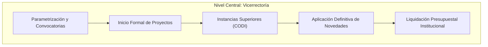


---

## 1. Responsabilidades Centrales

1. **Configuración de Convocatorias:** Parametrizar cronogramas, términos de referencia, montos máximos, rubros permitidos, formularios dinámicos y criterios de evaluación.
2. **Configuración de Flujos de Trámites:** Establecer las rutas de aprobación por tipo de trámite (Centro -> Instancia -> Vicerrectoría) y los permisos asociados.
3. **Formalización del Inicio de Proyectos:** Verificar la radicación de contratos, pólizas de garantía (cumplimiento, salarios, calidad), convenios y la asignación del Centro de Costos financiero antes de emitir el Acta de Inicio Formal.
4. **Aval de Instancias Superiores:** Tramitar las solicitudes que requieren aprobación del Comité para el Desarrollo de la Investigación (CODI) o Comités Centrales.
5. **Aplicación en Firme de Solicitudes:** Una vez avaladas por las instancias, ejecutar el botón **APLICAR** para que los cambios presupuestales o de tiempo impacten las tablas maestras del sistema.
6. **Liquidación y Cierre Financiero:** Emitir el acta de liquidación definitiva tras comprobar la legalización del 100% de los recursos ante la División Financiera.

---

## 2. Rutas Rápidas en el Menú del SIIU

| Acción | Ruta en el Menú SIIU |
| :--- | :--- |
| **Configurar una Nueva Convocatoria** | `Configuración >> Convocatorias >> Gestión de convocatorias >> Nueva convocatoria` |
| **Configurar Flujos de Trámites Administrativos** | `Configuración >> Flujo de trámites >> Configuración trámites` |
| **Inicio Formal de Proyectos** | `Trámites administrativos >> Inicio formal de proyectos >> Seleccionar proyecto >> Registrar pólizas/contrato >> Generar Acta` |
| **Avalar y Aplicar Solicitudes Administrativas** | `Trámites administrativos >> Flujo de procesos administrativos y novedades >> Consulta >> Instancia: Vicerrectoría >> Botón: Avalar / Aplicar` |
| **Cambiar Responsable del Proyecto** | `Trámites administrativos >> Cambiar responsable del proyecto >> Buscar proyecto >> Seleccionar nuevo docente` |
| **Aprobar Cupos de Joven Investigador** | `Convocatorias >> Gestión cupos >> Aprobación cupos JI` |
| **Cierre y Liquidación Institucional** | `Trámites administrativos >> Seguimiento proyectos >> Cierre de proyecto >> Liquidación final` |
| **Generar Reportes Analíticos Consolidados** | `Convocatorias >> Reportes >> Información básica de proyectos` |

---

## 3. El Paso Clave: Avalar vs Aplicar Solicitudes

En el SIIU, una solicitud puede estar **Aprobada** o **Avalada**, pero **NO se hace efectiva** hasta que la Vicerrectoría presiona **APLICAR**:

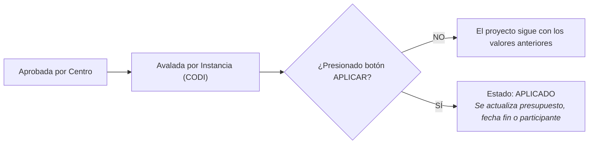


!!! info "Regla de aplicación"
    Mientras una solicitud no esté en estado **APLICADO**, el presupuesto del proyecto no se moverá, la fecha de terminación no se extenderá y el nuevo participante no aparecerá en las constancias.

---

## :material-link: Guías Detalladas de Interés
- [Inicio Formal](../02_PROCESOS_CLAVE/Inicio_Formal.md): Protocolo de inicio, validación de pólizas y emisión de acta.
- [Modificaciones y Tramites](../02_PROCESOS_CLAVE/Modificaciones_y_Tramites.md#aplicacion-en-vicerrectoria): Aval y aplicación de trámites administrativos.
- [Cierre y Liquidacion](../02_PROCESOS_CLAVE/Cierre_y_Liquidacion.md#liquidacion-en-vicerrectoria): Liquidación institucional.
- [Catalogo Normativo 31 Docs](../04_GLOSARIO_Y_CONCEPTOS/Catalogo_Normativo_31_Docs.md): Relación completa con los 31 documentos fuente.

------------------------------------------------------------
## [DOCUMENTO]: Ecosistema_Comites_Gobernanza.md
*Ruta canónica original: `docs/01_ROLES/Ecosistema_Comites_Gobernanza.md`*
------------------------------------------------------------

# Ecosistema de Comités y Gobernanza de la Investigación

El desarrollo de las actividades de investigación y extensión en la Universidad de Antioquia no opera de manera aislada dentro del sistema informático; el **SIIU** es el reflejo digital de un entramado de decisiones colegiadas y normativas amparadas en el **Acuerdo Superior 204 de 2001** (Sistema Universitario de Investigación) y el **Estatuto General (Acuerdo Superior 01 de 1994)**.

Cada estado, aval, novedad o liquidación dentro del SIIU responde a competencias delegadas en distintos órganos de gobierno y cuerpos colegiados.

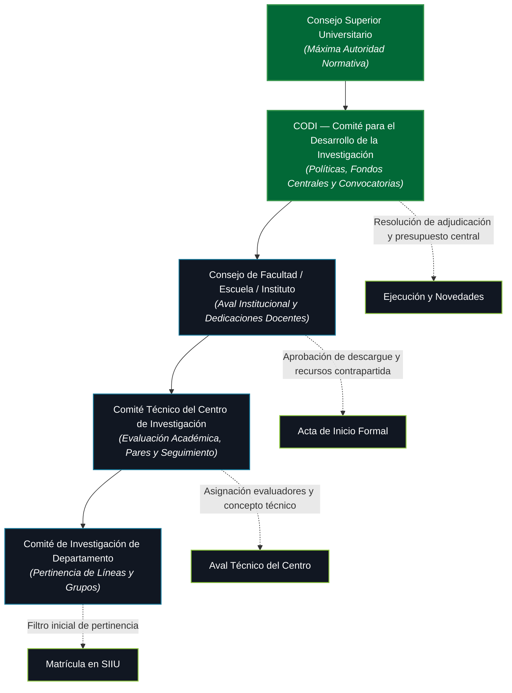

---

## 1. Instancias Colegiadas y su Función en el SIIU

### A. Comités de Investigación por Departamento
- **Nivel:** Unidad académica básica (Departamentos académicos).
- **Integrantes clave:** Jefe de Departamento y Coordinadores de los Grupos de Investigación adscritos.
- **Competencias operativas:**
  1. Revisar la pertinencia de las propuestas postuladas en relación con las líneas activas de los grupos.
  2. Verificar la disponibilidad y capacidad real de dedicación horaria de los profesores proponentes.
  3. Emitir el primer visto bueno que permite al proponente solicitar el aval del Centro de Investigación.

### B. Comité Técnico del Centro de Investigación y Consultorías (CIC)
- **Nivel:** Unidad Académica Mayor (Facultad, Escuela o Instituto) — Regulado por el **Acuerdo Superior 204 de 2001**.
- **Integrantes:**
  - Decano o su delegado (Presidente).
  - Jefe o Director del Centro de Investigación (Secretario).
  - Coordinador de Grupos de Investigación.
  - Coordinadores de Programas de Posgrado (Maestría y Doctorado).
  - Representante de los investigadores con proyectos activos.
  - Representante de Extensión.
- **Acciones directas en el SIIU:**
  - **Revisión Técnico-Formal:** Validación de requisitos de convocatoria, formatos, pólizas y contrapartidas.
  - **Asignación de Evaluadores Pares:** Selección de pares internos o externos calificados para emitir juicio valorativo.
  - **Consolidación de Conceptos:** Emisión del concepto favorable que habilita al Consejo de Facultad a expedir el aval institucional.
  - **Seguimiento a Compromisos y Novedades:** Conceptuar sobre solicitudes de prórrogas de tiempo, cambios de rubro presupuestal o sustitución de coinvestigadores.

### C. Consejo de Facultad
- **Nivel:** Máxima autoridad directiva de la unidad académica.
- **Integrantes:** Decano, Vicedecano, Jefes de Departamento, Director de Centro, Representante Profesoral y Representante Estudiantil.
- **Impacto directo en el flujo SIIU:**
  - **Aprobación de Dedicaciones:** Autoriza formalmente las horas semanales de dedicación lectiva y de investigación de los docentes vinculados al proyecto (Art. 21, AS 083/1996).
  - **Expedición de Avales:** Emite la resolución o acta de aval institucional requerida para la radicación ante convocatorias externas (Minciencias, SGR, agencias internacionales).
  - **Ordenación del Gasto Delegada:** En cabeza del Decano para la suscripción de contratos, órdenes de servicio y convenios derivados del proyecto (Art. 47, AS 121/1997).

### D. CODI (Comité para el Desarrollo de la Investigación)
- **Nivel:** Central — Presidido por la Vicerrectoría de Investigación.
- **Competencias:**
  - Establecer los términos de referencia de las convocatorias internas (programáticas, menor cuantía, apoyo a grupos y fondos de sostenibilidad).
  - Asignar el presupuesto central y dirimir discrepancias en las evaluaciones.
  - Aprobar prórrogas extraordinarias o liquidaciones unilaterales que superen las atribuciones de los Centros.

---

## 2. Comités de Soporte Especializado y Requisitos Previos

En proyectos con componentes de riesgo ético, social o ambiental, el **SIIU** exige adjuntar certificaciones previas emitidas por comités especializados antes de autorizar el desembolso presupuestal:

| Comité Especializado | Objeto de Evaluación | Requisito en SIIU |
| :--- | :--- | :--- |
| **Comité de Ética de la Investigación (Humanos)** | Ensayos clínicos, encuestas biomédicas, tratamiento de datos sensibles, interacción con comunidades vulnerables. | Consentimientos informados y aval ético formal cargado en pestaña *Documentos Soporte*. |
| **Comité Institucional para el Cuidado y Uso de Animales (CICUA)** | Experimentación con modelos animales, bioterios y fauna silvestre. | Certificado de cumplimiento de protocolos de bienestar animal. |
| **Comité de Bioética y Bioseguridad** | Manipulación de microorganismos patógenos, material genético recombinante y agentes biológicos. | Plan de manejo de residuos y bioseguridad en laboratorio avalado. |
| **Comité de Propiedad Intelectual** | Resultados susceptibles de patente, secreto industrial, software o licenciamiento tecnológico (RR 49544/2022). | Acuerdo de titularidad compartida y cesión de derechos de autor patrimoniales. |

---

## 3. Matriz de Trazabilidad: Estado del SIIU vs. Instancia Responsable

| Estado en el SIIU | Instancia Responsable | Documento o Acto Asociado |
| :--- | :--- | :--- |
| **En Formulación** | Investigador Principal / Grupo | Propuesta técnica en borrador |
| **Enviado Centro** | Gestor del Centro / Auxiliar Técnico | Lista de chequeo habilitante |
| **Pendiente Actualización** | Investigador Principal | Subsanación de observaciones |
| **Avalado Centro** | Comité Técnico del Centro / Consejo | Acta de Comité Técnico |
| **En Evaluación Pares** | Evaluadores Pares (Internos / Externos) | Formulario de calificación |
| **Aprobado** | CODI / Ente Financiador Externo | Resolución de adjudicación |
| **Inicio Formal** | Centro de Investigación y Decanatura | Acta de Inicio, Pólizas y Centro de Costos |
| **En Ejecución (Novedad)** | Comité Técnico / Vicerrectoría | Solicitud de Prórroga o Traslado |
| **Finalizado** | Comité Técnico del Centro | Informes y Acta de Cumplimiento |
| **Liquidado** | Decano / Vicerrectoría de Investigación | Acta de Liquidación y Paz y Salvo Presupuestal |

---

## 4. Enlaces de Interés y Rutas Operativas Relacionadas

- Consulta el **[Rol del Investigador Principal](Rol_Investigador.md)** para conocer las rutas de radicación.
- Consulta el **[Rol del Centro de Investigación](Rol_Centro_Investigacion.md)** para el trámite de revisiones y avales.
- Consulta el **[Acuerdo Superior 204 de 2001](../05_MARCO_NORMATIVO/AS_204_2001_Sistema_Universitario_Investigacion.md)** para la estructura jurídica completa del SUI.

================================================================================
# 2. PROCESOS CLAVE DEL CICLO DE VIDA DEL SIIU
================================================================================


------------------------------------------------------------
## [DOCUMENTO]: Matricula_Proyectos.md
*Ruta canónica original: `docs/02_PROCESOS_CLAVE/Matricula_Proyectos.md`*
------------------------------------------------------------

# Proceso Clave: Matrícula e Inscripción de Proyectos

!!! tip "En simple: ¿qué es matricular?"
    Es **inscribir tu propuesta en el SIIU** para que la Universidad la reconozca. Tienes 3 caminos: **convocatoria interna** (plata UdeA), **proyecto inscrito** (plata externa ya ganada) o **primer proyecto** (primera vez en el sistema). Llena 8 pestañas y presiona **Enviar a Centro**. Tiempo típico: 30-60 min si ya tienes el texto y el PDF listos.

    | Palabra técnica | En simple |
    |---|---|
    | Convocatoria vigente | Concurso abierto con fechas activas |
    | Recursos frescos / efectivo | Plata en dinero |
    | Contrapartida / especie | Lo que la UdeA pone sin dinero (horas, laboratorios) |
    | Radicación | Enviar formalmente y obtener código ej. `2024-XXXXX` |

El proceso de matrícula en el **SIIU** es la puerta de entrada para todas las iniciativas científicas, tecnológicas, artísticas y de extensión en la Universidad de Antioquia.

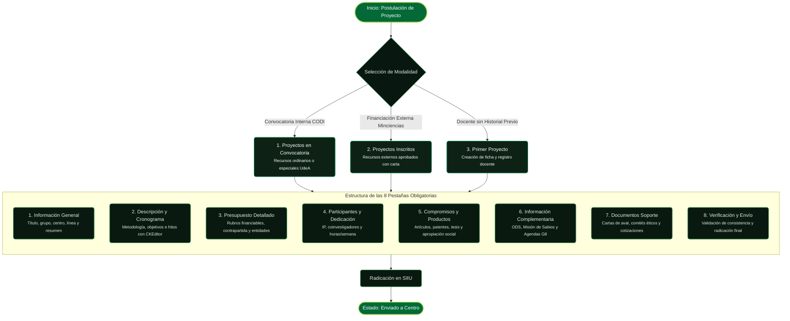


---

## 1. Modalidades de Matrícula

### Convocatoria Interna
- **Aplica para:** Convocatorias programáticas, de menor cuantía, apoyo a grupos o fondos especiales financiados con recursos de la Universidad (CODI, BUP).
- **Ruta SIIU:** `Convocatorias >> Inscripción >> Proyectos en convocatoria`
- **Requisito previo:** La convocatoria debe encontrarse en estado **Vigente** y dentro de las fechas fijadas en el cronograma.
- :material-book: Guía oficial: [VI-GU-24](../archivo_maestro/VI-GU-24.md)

### Proyectos Inscritos (Financiación Externa)
- **Aplica para:** Proyectos aprobados por entidades externas (Ministerio de Ciencia, Tecnología e Innovación - Minciencias, Sistema General de Regalías - SGR, agencias internacionales, contratos de I+D con empresas) que requieren administración y aval de la UdeA.
- **Ruta SIIU:** `Convocatorias >> Inscripción >> Proyectos inscritos`
- **Particularidad:** Requiere adjuntar la carta formal de asignación de recursos o contrato del ente financiador externo.
- :material-book: Guía oficial: [VI-GU-18](../archivo_maestro/VI-GU-18.md)

### Primer Proyecto
- **Aplica para:** Profesores o investigadores que postulan su primera propuesta en el sistema SIIU y no cuentan con registro histórico previo.
- **Ruta SIIU:** `Convocatorias >> Inscripción >> Primer proyecto`
- :material-book: Guía oficial: [VI-GU-17](../archivo_maestro/VI-GU-17.md)

---

## 2. Las 8 Pestañas del Formulario de Matrícula

### Pestaña 1: Información General
- Título del proyecto (claro y conciso).
- Tipo de investigación (Básica, Aplicada, Desarrollo Tecnológico).
- Centro administrativo que gestionará la propuesta.
- Grupo de investigación principal que avala la postulación (y grupos secundarios si es intergrupal).
- Duración estimada en meses.

### Pestaña 2: Descripción y Cronograma
- Resumen ejecutivo, planteamiento del problema, justificación, marco teórico, objetivos generales y específicos, metodología y resultados esperados.
- Uso del editor de texto enriquecido: consultar [#editor-ckeditor](#editor-ckeditor).
- Cronograma de actividades distribuido por bimestres o semestres.

### Pestaña 3: Presupuesto Detallado
- Desglose por rubros permitidos en la convocatoria (Personal, Materiales e insumos, Equipos, Salidas de campo, Servicios técnicos, Publicaciones, etc.).
- Discriminación de fuentes:
  - **Recursos Frescos / Efectivo:** Dinero líquido aportado por la convocatoria o financiador.
  - **Recursos en Especie / Contrapartida:** Horas de dedicación docente, uso de laboratorios o equipos institucionales.

### Pestaña 4: Participantes y Dedicación
- Investigador Principal (IP) / Coordinador.
- Coinvestigadores (docentes de planta, ocasionales, de cátedra o externos).
- Estudiantes de pregrado o posgrado y personal técnico.
- **Dato obligatorio:** Dedicación en horas semanales por participante.

### Pestaña 5: Compromisos y Productos
- Productos académicos comprometidos según la tipología Minciencias:
  - Generación de Nuevo Conocimiento (Artículos Q1-Q4, libros, capítulos).
  - Desarrollo Tecnológico e Innovación (Patentes, software registrado, prototipos).
  - Apropiación Social del Conocimiento (Talleres, eventos, cartillas).
  - Formación de Talento Humano (Dirección de tesis de maestría o doctorado, trabajos de grado).
- Fechas estimadas de entrega para cada producto.

### Pestaña 6: Información Complementaria
Obligatoria según las directrices institucionales de planeación:
- **Objetivos de Desarrollo Sostenible (ODS):** Seleccionar los ODS a los que tributa la investigación y las metas específicas.
- **Focos de la Misión de Sabios:** Clasificar la propuesta en uno de los 8 focos estratégicos del país.
- **Agendas Regionales G8:** Identificar áreas temáticas de impacto en el departamento.
- **Caracterización Socioeconómica:** Población beneficiaria directa e indirecta.
- :material-book: Guía oficial: [VI-GU-16](../archivo_maestro/VI-GU-16.md)

### Pestaña 7: Documentos Soporte
- Carta de aval del grupo de investigación firmada por el coordinador.
- Aval del Comité de Ética o Bioética (si aplica para experimentación animal o con humanos).
- Términos de referencia firmados, cotizaciones o cartas de intención de cofinanciadores.
- **Regla:** Archivos exclusivamente en formato PDF, tamaño controlado y nombres cortos (máx. 30 caracteres, sin tildes ni símbolos).

### Pestaña 8: Enviar al Centro
- Verificación automática de campos obligatorios.
- Botón **"Enviar a Centro"**: genera el código de proyecto provisional del SIIU (ej. `2024-XXXXX`) y envía la propuesta a la bandeja del Centro de Investigación.

---

## 3. Editor de Texto (CKEditor) en SIIU

El editor integrado permite dar formato a la formulación metodológica. Para evitar errores de guardado o problemas de renderizado:

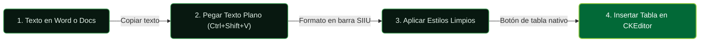


!!! tip "Reglas para el CKEditor ([VI-GU-25](../archivo_maestro/VI-GU-25.md))"
    1. **No copiar directamente estilos complejos de Word:** Los metadatos ocultos de MS Word (`mso-*`) pueden corromper el campo HTML y bloquear el guardado. Pega el texto plano y da formato en el SIIU.
    2. **Tablas:** Usa el botón de tabla propio del editor, define bordes sencillos y evita combinar celdas complejas.
    3. **Ecuaciones y fórmulas:** Insértalas como texto matemático plano o imágenes debidamente referenciadas.
    4. **Guardado frecuente:** Presiona el botón de guardar periódicamente para no perder avances por expiración de sesión.

---

## :material-link: Próximo Paso en el Flujo
Una vez enviado el proyecto, el Centro de Investigación realizará la revisión habilitante:
Consulta **[Evaluacion y Aval](../02_PROCESOS_CLAVE/Evaluacion_y_Aval.md)**.

------------------------------------------------------------
## [DOCUMENTO]: Evaluacion_y_Aval.md
*Ruta canónica original: `docs/02_PROCESOS_CLAVE/Evaluacion_y_Aval.md`*
------------------------------------------------------------

# Proceso Clave: Evaluación Técnica, Aval y Subsanación

!!! tip "En simple: ¿qué pasa después de enviar?"
    Tu Centro revisa que todo esté completo. Si algo falla, te lo **devuelve con instrucciones** (estado **Pendiente Actualización**): corriges solo lo indicado y reenvías. Si todo está bien, te da el **aval** y asigna evaluadores pares que califican. No es un rechazo definitivo: es un ciclo de corrección.

Una vez que el Investigador Principal radica su propuesta en el SIIU, se inicia la fase de control de calidad institucional, compuesta por la **revisión técnica formal del Centro**, el ciclo de **subsanación de inconsistencias** y la **evaluación académica por pares**.

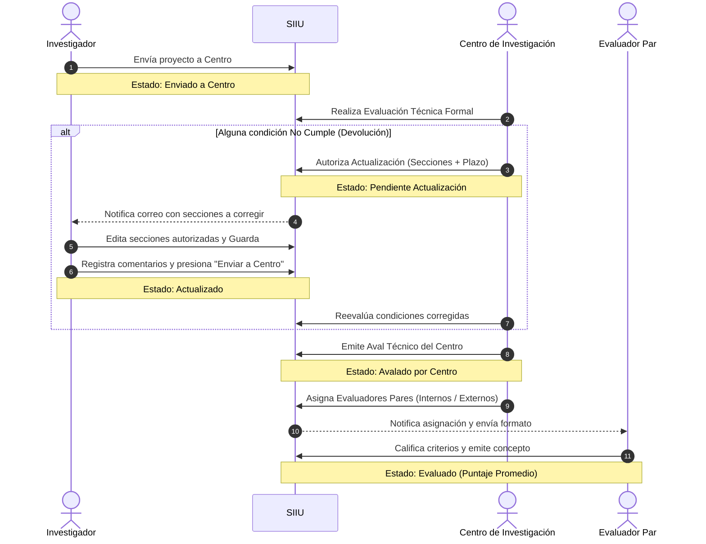


---

## 1. Evaluación Técnica de Centro

El Centro de Investigación o Extensión revisa el cumplimiento de los Términos de Referencia de la convocatoria.

- **Ruta SIIU:** `Convocatorias >> Proyectos en evaluación >> Filtros de consulta >> Acciones (...) >> Realizar evaluación técnica`
- **Condiciones Evaluadas:**
  - Pertenencia del equipo investigador al grupo avalador.
  - Dedicación horaria semanal coherente con la normativa de vinculación docente.
  - Estructuración del presupuesto según los topes de la convocatoria.
  - Soportes éticos y de comités pertinentes.
- **Opciones de Calificación por Condición:**
  - `Cumple`
  - `No cumple`
  - `No aplica`
- :material-book: Guía oficial: [VI-GU-08](../archivo_maestro/VI-GU-08.md)

---

## 2. Devolución para Ajustes (Rol Centro)

Si una o más condiciones son marcadas como **"No cumple"**, el Centro no debe rechazar la propuesta inmediatamente, sino abrir un periodo de subsanación:

1. Al guardar la evaluación con un "No cumple", presione el botón **`Autorizar actualización`**.
2. Parámetros de configuración obligatorios:
   - **Evaluación:** Tipo de evaluación formal.
   - **Fecha y Hora Límite:** Plazo improrrogable concedido al investigador para corregir.
   - **Secciones del proyecto:** Seleccionar las pestañas específicas que requieren ajuste (ej. Presupuesto, Metodología, Documentos Soporte).
   - **Cambios solicitados:** Texto explicativo detallado con las observaciones técnicas (hasta 400 caracteres).
3. Presione **AUTORIZAR ACTUALIZACIÓN** y confirme la alerta.
4. El proyecto queda en estado **Pendiente de actualización**.
- :material-book: Instructivo oficial: [VI-IN-12](../archivo_maestro/VI-IN-12.md)

---

## 3. Subsanación y Ajustes de Proyectos Devueltos (Rol Investigador)

Cuando el IP recibe notificación de devolución:

1. **Ruta SIIU:** `Convocatorias >> Proyectos en proceso >> Estado: "Pendiente Actualización" >> Acciones (...) >> Editar`
2. **Revisión de Observaciones:** En la pestaña *Información general* verá un banner azul con el plazo límite y las secciones autorizadas. Ingrese a la pestaña **`Actualización`** para leer en detalle los comentarios del Centro.
3. **Edición:** Diríjase a las secciones habilitadas, realice las correcciones solicitadas y presione **GUARDAR**.
4. **Registro de Respuestas:** Regrese a la pestaña **`Actualización`**, despliegue las opciones de *Comentarios*, haga clic en **Editar**, describa los cambios realizados y guarde.
5. **Reenvío:** Vaya a la pestaña final **`Enviar`**, presione **"Enviar a Centro"** y confirme.
6. El proyecto pasa a estado **Actualizado** para que el Centro proceda con la aprobación final.
- :material-book: Instructivo oficial: [VI-IN-05](../archivo_maestro/VI-IN-05.md)

---

## 4. Asignación de Evaluadores Pares

Una vez subsanadas las observaciones y emitido el aval del Centro:

- **Ruta SIIU:** `Convocatorias >> Aval de proyectos >> Seleccionar proyecto >> Asignar evaluador`
- **Criterios de Asignación:**
  - Evaluador Interno (docente UdeA de otra unidad académica sin conflicto de interés).
  - Evaluador Externo (investigador nacional o internacional registrado en el banco de evaluadores).
  - Definición del número de evaluadores (habitualmente 2 evaluadores titulares y 1 de desempate).
- **Consolidación de Calificaciones:** El sistema calcula automáticamente el promedio ponderado de las evaluaciones registradas.
- :material-book: Guía oficial: [VI-GU-06](../archivo_maestro/VI-GU-06.md)

---

## 5. Configuración de Convocatorias (Rol Vicerrectoría)

La Vicerrectoría de Investigación es la responsable de parametrizar las reglas de juego de cada convocatoria:

- **Ruta SIIU:** `Configuración >> Convocatorias >> Gestión de convocatorias`
- **Parámetros configurables:**
  - Fechas de apertura, cierre de inscripción, evaluación de centros y publicación de resultados.
  - Rubros presupuestales financiables y porcentajes máximos por rubro.
  - Criterios de evaluación y ponderaciones de la rúbrica de calificación.
  - Formatos y documentos soporte obligatorios.
- :material-book: Guía oficial: [VI-GU-07](../archivo_maestro/VI-GU-07.md)

---

## :material-link: Próximo Paso en el Flujo
Una vez aprobado el proyecto por el Comité o CODI:
Consulta **[Inicio Formal](../02_PROCESOS_CLAVE/Inicio_Formal.md)**.

------------------------------------------------------------
## [DOCUMENTO]: Inicio_Formal.md
*Ruta canónica original: `docs/02_PROCESOS_CLAVE/Inicio_Formal.md`*
------------------------------------------------------------

# Proceso Clave: Inicio Formal de Proyectos

La aprobación de un proyecto en una convocatoria no autoriza de manera automática el gasto de los recursos ni el reconocimiento oficial de tiempos. Para ello se requiere el **Inicio Formal**, un hito administrativo y legal que marca el paso del estado **Aprobado** al estado **En ejecución**.

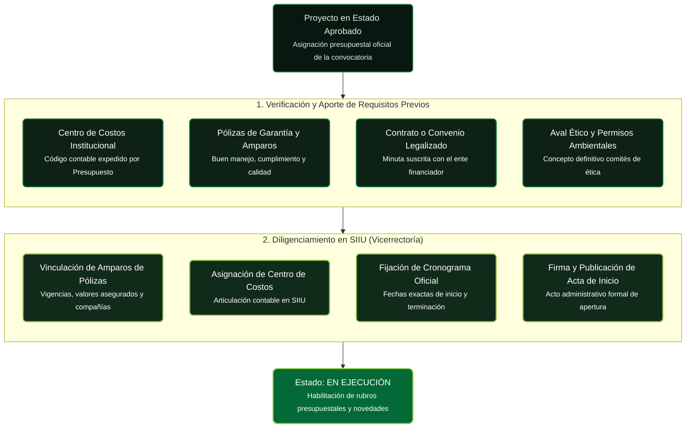


---

## 1. Requisitos Previos al Inicio Formal

Antes de tramitar el acta de inicio formal en el SIIU, se deben consolidar los siguientes instrumentos:

1. **Centro de Costos (Centro Administrativo / Financiero):** Código contable asignado por el Departamento de Presupuesto para la ejecución de los recursos en el sistema financiero institucional.
2. **Pólizas de Garantía (cuando aplique por cuantía o convenio externo):**
   - Amparo de Buen Manejo y Correcta Inversión del Anticipo.
   - Amparo de Cumplimiento del Contrato.
   - Amparo de Salarios, Prestaciones Sociales e Indemnizaciones.
   - Amparo de Calidad de los Bienes o Servicios.
3. **Contratos o Convenios Interinstitucionales:** En proyectos con financiación externa o convenios marco entre universidades o empresas.
4. **Aval Ético Definitivo:** Certificación expedida por el Comité de Ética de la Investigación (humana o animal) correspondiente.

---

## 2. Diligenciamiento del Inicio Formal en el SIIU (Rol Vicerrectoría)

- **Ruta SIIU:** `Trámites administrativos >> Inicio formal de proyectos`
- :material-book: Guía oficial: [VI-GU-15](../archivo_maestro/VI-GU-15.md)

### Pasos Operativos:
1. **Búsqueda del Proyecto:** Localizar el proyecto en estado **Aprobado**.
2. **Pestaña Pólizas y Contratos:**
   - Registrar la aseguradora, número de póliza, fecha de expedición, fecha de vigencia y valores asegurados por cada amparo.
   - Adjuntar el PDF de la póliza aprobada por la Dirección Jurídica o División de Asesoría Jurídica.
3. **Pestaña Centro de Costos:**
   - Vincular el código financiero alfanumérico generado en el sistema central de presupuesto.
4. **Pestaña Fechas Oficiales:**
   - **Fecha de Inicio Formal:** Día oficial a partir del cual rige la vigencia legal del proyecto.
   - **Fecha de Terminación Oficial:** Calculada automáticamente con base en los meses de duración aprobados.
5. **Generación del Acta de Inicio:**
   - El sistema compila la información y genera el documento formal del **Acta de Inicio**.
   - Se legalizan las firmas del Investigador Principal, el Jefe de Centro y el Delegado de la Vicerrectoría.
6. Al presionar **CONFIRMAR INICIO FORMAL**, el proyecto adquiere formalmente el estado **En ejecución**.

---

## 3. ¿Qué ocurre si se vence el plazo sin iniciar?

!!! danger "Vencimiento del plazo de inicio"
    Si los trámites de pólizas o contratos toman más tiempo del reglamentario, el proyecto puede caer en estado **No iniciado** o ser **Cancelado**.  
    Para evitar esto, el Investigador Principal debe solicitar oportunamente una **Prórroga de Inicio** mediante el menú de trámites administrativos mientras el proyecto aún figure en estado **Aprobado**.  
    Consulta: [Modificaciones y Tramites](../02_PROCESOS_CLAVE/Modificaciones_y_Tramites.md#prorroga-de-proyecto).

---

## :material-link: Próximo Paso en el Flujo
Con el proyecto **En ejecución**, se habilitan las compras, contrataciones, solicitudes de cambio de presupuesto y adición de tiempo:
Consulta **[Modificaciones y Tramites](../02_PROCESOS_CLAVE/Modificaciones_y_Tramites.md)** y **[Gestion Compromisos](../02_PROCESOS_CLAVE/Gestion_Compromisos.md)**.

------------------------------------------------------------
## [DOCUMENTO]: Modificaciones_y_Tramites.md
*Ruta canónica original: `docs/02_PROCESOS_CLAVE/Modificaciones_y_Tramites.md`*
------------------------------------------------------------

# Proceso Clave: Modificaciones y Trámites Administrativos

Durante la ejecución de un proyecto es habitual requerir ajustes de calendario, variaciones presupuestales o cambios en la composición del equipo de trabajo. El SIIU canaliza estas modificaciones mediante **Trámites Administrativos** auditables.

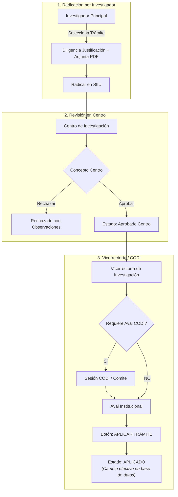


---

## 1. Tipos Principales de Trámites

### Prórroga de Proyecto
Permite extender el horizonte temporal del proyecto.
- **Prórroga de Inicio:** Se tramita con el proyecto en estado **Aprobado**. Evita que el proyecto sea cancelado por demoras en contratos, pólizas o comités de ética.
- **Prórroga de Ejecución:** Se tramita con el proyecto en estado **En ejecución**. Extiende la fecha oficial de finalización para culminar actividades experimentales o redactar informes finales.
- **Campos requeridos:** Número de meses solicitados, nueva fecha estimada de terminación, justificación técnica y cronograma reprogramado en PDF.
- :material-book: Guía oficial: [VI-GU-23](../archivo_maestro/VI-GU-23.md)

### Cambio de Rubro / Modificación Presupuestal
Permite trasladar saldos entre los rubros aprobados o abrir nuevos subrubros para responder a necesidades reales de compra o contratación.
- **Condiciones obligatorias:**
  1. El proyecto debe estar en estado **En ejecución**.
  2. El rubro origen ("rubro padre") **debe tener saldo disponible mayor a \$0**. No es posible trasladar recursos desde rubros con saldo agotado.
  3. No se pueden superar los topes porcentuales fijados en la convocatoria para rubros restrictivos (ej. gastos de viaje, papelería).
- **Campos requeridos:** Rubro origen, rubro destino, valor a trasladar, justificación y matriz presupuestal comparativa en PDF.
- :material-book: Guía oficial: [VI-GU-20](../archivo_maestro/VI-GU-20.md)

### Cambio o Inclusión de Participantes
Modifica la nómina del proyecto:
- Salida de un coinvestigador (por retiro voluntario, finalización de contrato o graduación).
- Ingreso de nuevos docentes, investigadores colaboradores o estudiantes.
- Ajuste de dedicación horaria semanal de los participantes existentes.
- **Campos requeridos:** Datos de identificación, tipo de vinculación, rol dentro del proyecto, horas semanales y carta de aceptación / renuncia en PDF.
- :material-book: Guía oficial: [VI-GU-19](../archivo_maestro/VI-GU-19.md)

### Cambio de Responsable del Proyecto
Procedimiento especial y de alta relevancia institucional cuando el Investigador Principal original no puede continuar al frente de la dirección científica del proyecto (por licencia, renuncia, incapacidad médica prolongada, año sabático o fuerza mayor).
- **Condición:** El nuevo responsable propuesto debe pertenecer al mismo grupo de investigación o unidad académica y cumplir con los requisitos de idoneidad y vinculación de la convocatoria.
- :material-book: Guía oficial: [VI-GU-01](../archivo_maestro/VI-GU-01.md)

---

## 2. Aprobación en Centro (Rol Centro de Investigación)

- **Ruta SIIU:** `Trámites administrativos >> Flujo de procesos administrativos y novedades >> Consulta`
- **Operación:**
  1. Filtrar las solicitudes en estado **Pendiente de Aprobación**.
  2. Desplegar el menú de acciones (`...`) del trámite respectivo.
  3. Revisar la justificación y descargar el archivo PDF adjunto.
  4. Seleccionar la decisión: **Aprobar** o **Rechazar**.
  5. Si se rechaza, es obligatorio registrar el motivo técnico del rechazo.
  6. Si se aprueba, la solicitud pasa a estado **Aprobada Centro** y se enruta automáticamente hacia la Vicerrectoría.
- :material-book: Guía oficial: [VI-GU-12](../archivo_maestro/VI-GU-12.md)

---

## 3. Aplicación en Vicerrectoría (Rol Vicerrectoría)

- **Ruta SIIU:** `Trámites administrativos >> Flujo de procesos administrativos y novedades >> Consulta >> Instancia: Vicerrectoría`
- **Operación:**
  1. Revisar las solicitudes avaladas por los Centros.
  2. Si el trámite requiere decisión de CODI (prórrogas superiores a 6 meses, adiciones presupuestales mayores, relevo de IP), registrar el número de acta y fecha de la sesión del comité.
  3. Emitir el **Aval de Vicerrectoría**.
  4. Presionar el botón **`APLICAR`**: Este paso es **decisivo e irreversible**. Al hacer clic en Aplicar, el motor de base de datos del SIIU recalcula los saldos de los rubros, actualiza la fecha de fin en el cronograma o sustituye la cédula del responsable.
- :material-book: Guía oficial: [VI-GU-13](../archivo_maestro/VI-GU-13.md)

---

## 4. Configuración de Flujos de Trámites (Rol Administrador Central)

Permite a la Vicerrectoría definir qué instancias deben intervenir para cada tipo de trámite (ejemplo: determinar si un cambio de rubro menor requiere solo Centro o si debe escalar a CODI):
- **Ruta SIIU:** `Configuración >> Flujo de trámites >> Configuración trámites`
- :material-book: Guía oficial: [VI-GU-14](../archivo_maestro/VI-GU-14.md)

---

## :material-link: Próximo Paso en el Flujo
Para coordinar el cumplimiento de compromisos y plazos de entrega:
Consulta **[Gestion Compromisos](../02_PROCESOS_CLAVE/Gestion_Compromisos.md)**.

------------------------------------------------------------
## [DOCUMENTO]: Gestion_Compromisos.md
*Ruta canónica original: `docs/02_PROCESOS_CLAVE/Gestion_Compromisos.md`*
------------------------------------------------------------

# Proceso Clave: Gestión de Compromisos Académicos

!!! tip "En simple: ¿qué son los compromisos?"
    Son **lo que prometiste entregar** (informes, artículos, tesis, patentes). Cada uno tiene fecha y estado: **Pendiente → En revisión → Aprobado**. Subes el PDF, presionas **Confirmar entrega** y el Centro lo aprueba o lo devuelve. Si solo necesitas más días para UN entregable, pide **plazo en compromisos** (no prórroga de todo el proyecto).

Los **Compromisos** representan las obligaciones científicas, tecnológicas y de formación pactadas por el Investigador Principal en la formulación de la propuesta (informes de avance, informe final, artículos, ponencias, tesis dirigidas, patentes o prototipos).

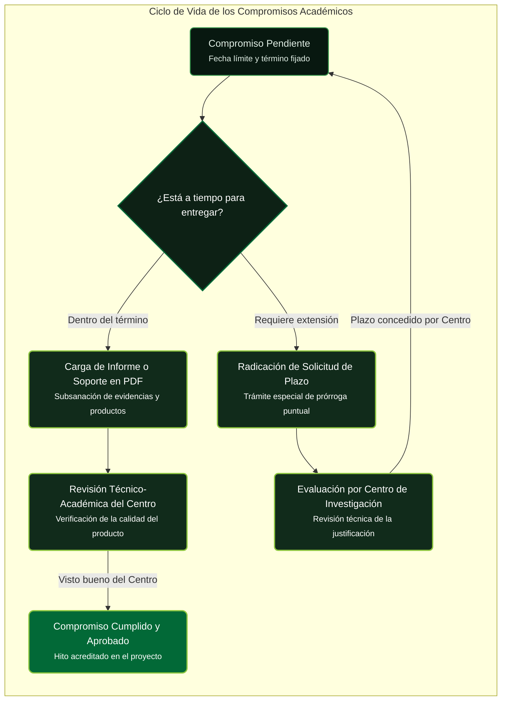


---

## 1. Tipos de Compromisos en el SIIU

1. **Informes de Avance (Parciales):** Reportes periódicos de ejecución técnica y presupuestal exigidos en convocatorias o contratos de larga duración (anuales o semestrales).
2. **Informe Final:** Documento técnico exhaustivo que compila los resultados, conclusiones, publicaciones y balance presupuestal definitivo.
3. **Productos Científicos y Tecnológicos:** Artículos publicados o aceptados en revistas indexadas (Scopus / WoS), libros de investigación, registros de software ante la DNDA, solicitudes de patente ante la SIC o actas de sustentación de trabajos de grado de pregrado y posgrado.

---

## 2. Entrega y Carga de Compromisos (Rol Investigador)

- **Ruta SIIU:** `Trámites administrativos >> Seguimiento mis proyectos >> Seleccionar proyecto >> Botón: Compromisos`
- **Pasos Operativos:**
  1. El sistema despliega la lista de todos los compromisos del proyecto con sus fechas límite de entrega y su estado actual (*Pendiente*, *En revisión*, *Aprobado*, *Atrasado*).
  2. Ubique el compromiso a entregar y presione el botón **Acciones (...) >> Entregar compromiso**.
  3. Diligencie el resumen del avance o descripción del producto.
  4. Adjunte el soporte documental en formato **PDF** (ej. artículo en PDF, certificado de aceptación editorial, acta de sustentación, informe final firmado).
  5. Presione **CONFIRMAR ENTREGA**. El compromiso pasa a estado **Enviado para revisión** del Centro de Investigación.
- :material-book: Guía oficial: [VI-GU-09](../archivo_maestro/VI-GU-09.md)

---

## 3. Solicitud de Plazo en la Entrega de Compromisos

Cuando por razones metodológicas o demoras editoriales no es posible entregar un compromiso específico en la fecha estipulada, pero **NO se requiere prorrogar el tiempo general del proyecto**, se utiliza este trámite específico:

- **Ruta SIIU:** `Trámites administrativos >> Nueva solicitud o Novedad >> Solicitud >> Tipo: Solicitud de plazo en compromisos`
- **Operación:**
  1. Seleccionar el proyecto respectivo.
  2. Seleccionar el compromiso puntual sobre el cual se solicita la ampliación.
  3. Ingresar la nueva fecha propuesta de entrega.
  4. Justificar detalladamente los motivos del retraso y adjuntar el soporte en PDF.
  5. Radicar para revisión del Centro de Investigación y posterior aval de la Vicerrectoría.
- :material-book: Guía oficial: [VI-GU-22](../archivo_maestro/VI-GU-22.md)

---

## 4. Revisión y Aprobación en Centro (Rol Centro de Investigación)

- **Ruta SIIU:** `Trámites administrativos >> Seguimiento proyectos >> Seleccionar proyecto >> Botón: Compromisos`
- **Operación:**
  1. Revisar los compromisos en estado **Enviado para revisión**.
  2. Descargar y auditar el archivo PDF de soporte.
  3. Seleccionar la acción:
     - **Aprobar Compromiso:** Marca el hito como cumplido al 100%.
     - **Rechazar / Devolver:** Si el documento no cumple con los estándares de rigor técnico o no corresponde a lo comprometido. Se registra la observación para que el investigador vuelva a cargar la versión corregida.
- :material-book: Guía oficial: [VI-GU-09](../archivo_maestro/VI-GU-09.md)

---

## :material-link: Próximo Paso en el Flujo
Una vez aprobados el 100% de los compromisos e informes, el proyecto queda habilitado para el cierre definitivo:
Consulta **[Cierre y Liquidacion](../02_PROCESOS_CLAVE/Cierre_y_Liquidacion.md)**.

------------------------------------------------------------
## [DOCUMENTO]: Programa_Joven_Investigador.md
*Ruta canónica original: `docs/02_PROCESOS_CLAVE/Programa_Joven_Investigador.md`*
------------------------------------------------------------

# Proceso Clave: Programa Joven Investigador

El **Programa Joven Investigador (JI)** de la Universidad de Antioquia es una estrategia de fomento a la vocación científica mediante pasantías remuneradas con estímulo económico para estudiantes destacados de pregrado y recién graduados.

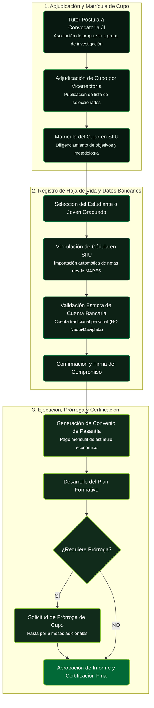


---

## 1. Matrícula de Cupos de Joven Investigador (Rol Tutor)

Una vez publicados los resultados de la convocatoria institucional de Jóvenes Investigadores:

- **Ruta SIIU:** `Convocatorias >> Inscripción >> Cupos joven investigador`
- **Pasos:**
  1. Identificar la convocatoria específica del Programa Joven Investigador.
  2. Diligenciar la información del plan de trabajo asociado al proyecto marco.
  3. Indicar el objetivo de formación, metodología de acompañamiento del tutor y productos esperados (informe final y artículo/ponencia).
  4. Radicar la matrícula del cupo para validación de la Vicerrectoría.
- :material-book: Guía oficial: [VI-GU-10](../archivo_maestro/VI-GU-10.md)

---

## 2. Registro de Estudiante / Hoja de Vida JI

Una vez asignado el cupo, el tutor debe vincular formalmente al estudiante seleccionado:

- **Ruta SIIU:** `Trámites administrativos >> Seguimiento mis proyectos >> Centro: TODOS >> Código de cupo >> Consultar >> Botón: Hoja de vida JI`
- :material-book: Instructivo oficial: [VI-IN-06](../archivo_maestro/VI-IN-06.md)

### Secciones de la Hoja de Vida:
1. **Datos Personales:** Al ingresar la cédula del estudiante, el SIIU se comunica con el sistema central **MARES** y precarga nombres, apellidos, lugar de nacimiento y fecha de nacimiento.
   - *Nota:* Si algún dato personal está errado, debe actualizarse primero en MARES en la oficina de Admisiones y Registro.
2. **Ubicación de Residencia:** Asignar Continente, País, Departamento y Municipio mediante la ventana emergente de ubicación.
3. **Información Académica:** Precargada desde MARES (carrera, semestre actual, fecha de inicio y finalización del semestre lectivo).
4. **Datos de Cuenta Bancaria:** Se deben ingresar los datos exactos para el giro mensual del estímulo económico:
   - Banco.
   - Número de cuenta.
   - Tipo de cuenta (Ahorros).

---

## Reglas Bancarias Inquebrantables para Jóvenes Investigadores

!!! danger "Prohibición estricta de billeteras digitales"
    Por directriz de la División de Tesorería de la Universidad de Antioquia:
    - :material-close-circle: **NO se permiten:** Cuentas Nequi, Daviplata, Bancolombia Ahorro a la Mano ni cuentas de Agroseguro.
    - **SÍ se permiten:** Únicamente **cuentas de ahorros tradicionales** radicadas en entidades financieras legalmente vigiladas por la Superintendencia Financiera de Colombia.
    - **Titularidad:** La cuenta bancaria debe estar **exclusivamente a nombre del Joven Investigador** (no se aceptan cuentas de padres, cónyuges, tutores ni terceros).

!!! info "No se emiten cartas laborales para apertura de cuenta"
    La Universidad **NO expide cartas institucionales para apertura de cuenta bancaria** a Jóvenes Investigadores, dado que la pasantía **no constituye vínculo laboral**, sino un **estímulo económico de fomento a la formación**. El estudiante debe aperturar su cuenta personal mediante los mecanismos habituales para personas naturales.

---

## 3. Prórroga de Cupos del Programa Joven Investigador

Si por razones justificadas en el plan de investigación se requiere extender el tiempo de la pasantía dentro de los márgenes contemplados en la convocatoria:

- **Ruta SIIU:** `Trámites administrativos >> Nueva solicitud o Novedad >> Solicitud >> Prórroga cupos joven investigador`
- **Requisitos:**
  - El cupo debe encontrarse activo y en ejecución.
  - Presentar balance de actividades ejecutadas y justificación de los meses adicionales requeridos.
  - Aval del tutor del proyecto.
- :material-book: Guía oficial: [VI-GU-11](../archivo_maestro/VI-GU-11.md)

------------------------------------------------------------
## [DOCUMENTO]: Cierre_y_Liquidacion.md
*Ruta canónica original: `docs/02_PROCESOS_CLAVE/Cierre_y_Liquidacion.md`*
------------------------------------------------------------

# Proceso Clave: Cierre y Liquidación de Proyectos

!!! tip "En simple: ¿cómo cierro mi proyecto?"
    Cerrar = **demostrar que entregaste todo y gastaste bien**. Necesitas: 1) **100% compromisos aprobados**, 2) informe final aprobado, 3) presupuesto legalizado sin saldos (o con reintegro). Luego el Centro hace el acta de cierre y la Vicerrectoría liquida. Sin paz y salvo no hay liquidación.

El proceso de **Cierre y Liquidación** es la culminación jurídica, presupuestal y académica del proyecto en la Universidad de Antioquia. Garantiza que todos los recursos asignados fueron debidamente legalizados y que los productos prometidos fueron recibidos a satisfacción.

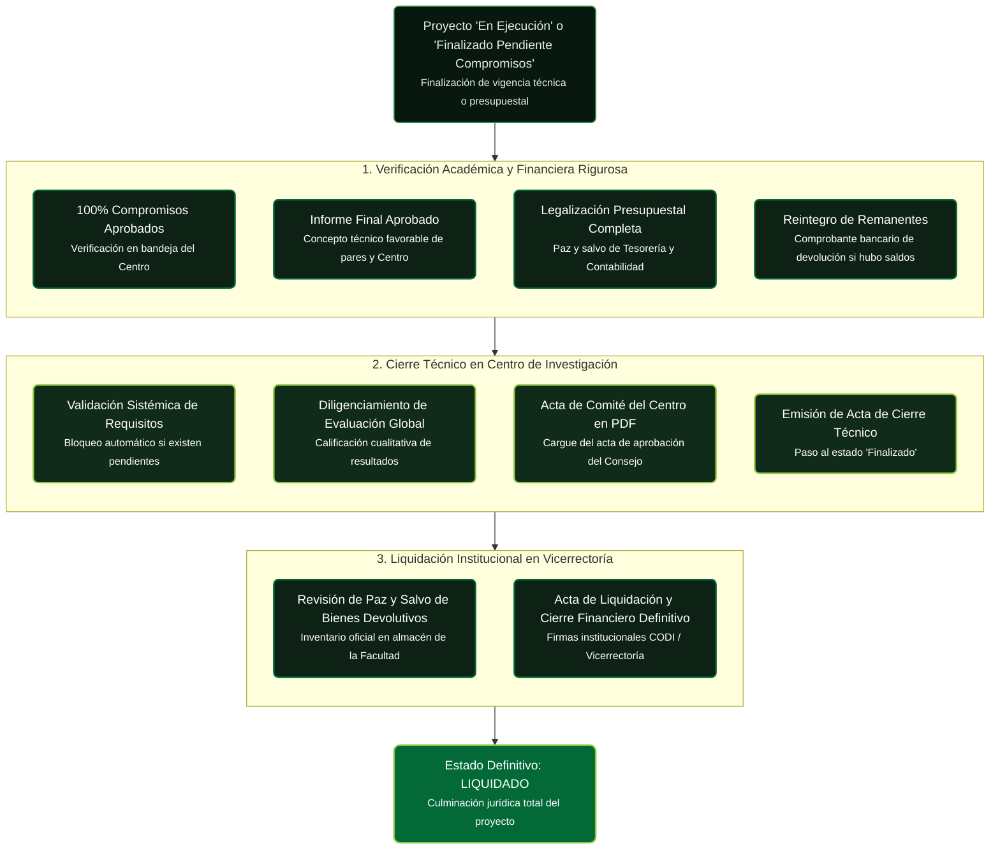


---

## 1. Requisitos Previos al Cierre

Para que el SIIU permita iniciar el trámite de cierre, se deben cumplir cuatro condiciones estrictas:

1. **Cumplimiento de Compromisos al 100%:** Todos los compromisos registrados en el proyecto deben encontrarse en estado **Aprobado** por el Centro de Investigación (ninguno puede estar en estado *Pendiente*, *Enviado* o *Atrasado*).
2. **Aprobación del Informe Final:** Debe constar el concepto favorable del Centro respecto al informe técnico definitivo.
3. **Paz y Salvo Presupuestal:**
   - Para proyectos financiados con recursos UdeA: Ejecución y legalización completa de anticipos, cuentas de cobro y facturas ante el Departamento de Presupuesto.
   - Si existieron saldos no ejecutados, debe constar el comprobante de reintegro a los fondos centrales de la Universidad.
4. **Paz y Salvo de Bienes Devolutivos:** Los equipos o instrumentos adquiridos deben encontrarse inventariados en el almacén de la unidad académica correspondiente.

---

## 2. Procedimiento de Cierre en Centro (Rol Centro de Investigación)

- **Ruta SIIU:** `Trámites administrativos >> Seguimiento proyectos >> Seleccionar proyecto >> Botón: Cierre de proyecto`
- **Pasos:**
  1. El sistema valida automáticamente el estado de los compromisos. Si existen pendientes, emitirá un mensaje de bloqueo indicando cuáles compromisos faltan.
  2. Si todos los compromisos están aprobados, el sistema habilita el formulario de **Cierre de Proyecto**.
  3. Registrar la evaluación general del proyecto (calificación de pertinencia y cumplimiento de objetivos).
  4. Adjuntar en formato **PDF** el Acta de Reunión del Comité Técnico del Centro donde se aprueba el cierre del proyecto.
  5. Presionar **CONFIRMAR CIERRE**. El proyecto adquiere el estado **Finalizado** o **Evaluado finalización**.
- :material-book: Guía oficial: [VI-GU-04](../archivo_maestro/VI-GU-04.md)

---

## 3. Liquidación en Vicerrectoría (Rol Vicerrectoría de Investigación)

- **Ruta SIIU:** `Trámites administrativos >> Seguimiento proyectos >> Liquidación institucional`
- **Pasos:**
  1. La Vicerrectoría audita el expediente digital completo.
  2. Se verifica la correspondencia entre la ejecución presupuestal reportada en el sistema contable y lo registrado en el SIIU.
  3. Se genera digitalmente el **Acta de Liquidación Definitiva**, firmada por el Vicerrector de Investigación (o su delegado) y el Investigador Principal.
  4. Al confirmar la liquidación, el proyecto pasa al estado definitivo **LIQUIDADO**.

---

## Diferencia entre Estados de Terminación

| Estado en SIIU | Significado Operativo |
| :--- | :--- |
| **Finalizado pendiente de compromisos** | El tiempo contractual de ejecución venció, pero el investigador adeuda uno o más informes o productos. No se puede liquidar hasta subsanar. |
| **Finalizado** | El proyecto terminó su plazo y cumplió todos sus compromisos académicos, pero está en trámite la legalización presupuestal o el acta formal. |
| **Evaluado finalización** | El Centro ya completó la rúbrica de evaluación de resultados finales. |
| **Liquidado** | El proyecto cuenta con acta formal de liquidación y se legalizó el 100% de los recursos económicos. Cierre jurídico definitivo. |

---

## :material-link: Próximo Paso en el Flujo
Para expedir certificados de finalización o paz y salvos institucionales:
Consulta **[Reportes y Certificaciones](../02_PROCESOS_CLAVE/Reportes_y_Certificaciones.md)**.

------------------------------------------------------------
## [DOCUMENTO]: Reportes_y_Certificaciones.md
*Ruta canónica original: `docs/02_PROCESOS_CLAVE/Reportes_y_Certificaciones.md`*
------------------------------------------------------------

# Proceso Clave: Reportes y Certificaciones Oficiales

El **SIIU** genera documentos oficiales para acreditar la trayectoria académica y científica de profesores, investigadores y evaluadores, así como reportes de control directivo para centros y vicerrectorías.

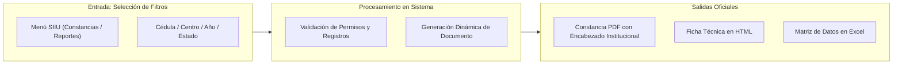


---

## 1. Constancias Oficiales en PDF

### Constancias de Participación en Proyectos (Personas)
Acredita la participación formal de un docente, investigador, estudiante o técnico en proyectos de investigación o extensión avalados por la Universidad.
- **Ruta SIIU:** `Constancias >> Participación en proyectos`
- **Pasos:**
  1. Presione el botón **Seleccionar**.
  2. Ingrese el número de cédula del participante y presione **Buscar**.
  3. Marque con check el nombre de la persona encontrada y presione **Agregar**.
  4. *(Opcional)* Defina un rango de fechas de participación. Si lo deja vacío, el sistema traerá el **histórico completo** de todos los proyectos en que ha participado.
  5. Presione **Buscar**. El sistema listará los proyectos.
  6. Presione el botón **Ver constancia**: Se abrirá una ventana con el documento oficial en **PDF**, listo para descargar o imprimir.
- :material-book: Instructivo oficial: [VI-IN-07](../archivo_maestro/VI-IN-07.md)

### Constancias como Evaluador de Proyectos
Certifica la labor como par evaluador en convocatorias del CODI o de centros de investigación.
- **Ruta SIIU:** `Constancias >> Evaluador` *(o `Constancias >> Jurado`)*
- **Pasos:**
  1. Seleccione el tratamiento de cortesía (Profesor, Dra., Mg., etc.).
  2. Presione **Seleccionar**, busque la cédula del evaluador y márquelo con check.
  3. Indique el rango de fechas de evaluación y presione **Buscar**.
  4. Presione **Ver constancia** para descargar el certificado oficial en formato **PDF**.
- :material-book: Instructivo oficial: [VI-IN-08](../archivo_maestro/VI-IN-08.md)

### Constancias de Proyectos por Grupo de Investigación
Certifica el portafolio de proyectos gestionados por un grupo de investigación avalado ante la Universidad.
- **Ruta SIIU:** `Constancias >> Proyectos por Grupo de Investigación`
- **Pasos:**
  1. Seleccionar la Unidad Académica y el Centro de Investigación.
  2. Seleccionar el Grupo de Investigación en la lista desplegable.
  3. Filtrar por estado de los proyectos (*Todos*, *En ejecución*, *Finalizados*).
  4. Generar el reporte oficial en **PDF**.
- :material-book: Instructivo oficial: [VI-IN-01](../archivo_maestro/VI-IN-01.md)

---

## 2. Reportes Analíticos y de Gestión

### Reporte por Persona (Histórico Individual)
- **Ruta SIIU:** `Reportes >> Consulta por persona`
- **Alcance por rol:**
  - *Investigador:* Solo puede consultar su propia cédula.
  - *Centro y Vicerrectoría:* Pueden consultar cualquier persona registrada en el portal.
- **Información entregada:** Código del proyecto, título, grupo de investigación, rol asumido (IP, coinvestigador, asesor), horas de dedicación semanal, función específica, fechas de vinculación y retiro, y vínculo institucional.
- **Ficha Técnica HTML:** Al final de cada fila, haciendo clic en el icono de visualización, se despliega en una ventana emergente la ficha técnica completa del proyecto formulado originalmente.
- **Exportación:** Permite exportar el listado completo a **PDF**.
- :material-book: Instructivo oficial: [VI-IN-11](../archivo_maestro/VI-IN-11.md)

### Reporte Historial de Proyectos
- **Ruta SIIU:** `Reportes >> Historial de Proyecto` *(o `Convocatorias >> Reportes >> Información básica de proyectos >> Historial`)*
- **Filtros avanzados:** Código, palabras clave, tipo de proyecto, estado, centro administrativo, año/mes de finalización, convocatoria y proceso de selección.
- **Exportación:** Permite visualizar en pantalla o descargar la matriz completa en archivo **Excel**.
- :material-book: Instructivos oficiales: [VI-IN-02](../archivo_maestro/VI-IN-02.md) y [VI-IN-10](../archivo_maestro/VI-IN-10.md)

### Reporte de Información Básica de Proyectos
El reporte más completo y exhaustivo del sistema SIIU:
- **Ruta SIIU:** `Convocatorias >> Reportes >> Información básica de proyectos`
- **Variables incluidas:** Año de apertura, convocatoria, línea temática/modalidad, centro administrativo, estado en el sub-proceso, nombre del proyecto, nombre del IP/CP, tipo de vinculación docente, unidad académica, grupo avalador, código SIIU, monto solicitado al financiador (recursos frescos y especie), monto total con cofinanciación y contrapartidas, calificaciones individuales de los evaluadores 1, 2 y 3, y puntaje promedio de evaluación.
- **Opciones avanzadas:**
  - Botón **Agregar Información**: Permite sumar columnas personalizadas a la cuadrícula de datos.
  - Botón **Exportar a Excel**: Descarga la base de datos completa.
  - Botón **Exportar a PDF**: Genera informe consolidado.
  - Botón **DESCARGAR PROYECTO**: Descarga en formato HTML la formulación completa del proyecto tal como fue matriculada.
- :material-book: Instructivo oficial: [VI-IN-09](../archivo_maestro/VI-IN-09.md)

---

## Regla de Navegadores y Ventanas Emergentes (Pop-ups)

!!! warning "Permisos de ventanas emergentes (pop-ups)"
    Tanto las constancias oficiales en PDF como las fichas técnicas en HTML se abren en **ventanas emergentes nuevas**.  
    Si al presionar "Ver constancia" o "Visualizar" no se abre ninguna ventana:
    1. Verifique la barra de direcciones en la parte superior derecha de su navegador (Chrome, Edge, Firefox).
    2. Haga clic en el icono de ventana bloqueada.
    3. Seleccione: **"Permitir siempre ventanas emergentes y redirecciones de https://ayudame2.udea.edu.co"**.
    4. Presione **Listo** y vuelva a generar la consulta.

================================================================================
# 3. GUÍAS RÁPIDAS Y REGLAS DE ORO
================================================================================


------------------------------------------------------------
## [DOCUMENTO]: Reglas_Oro_SIIU.md
*Ruta canónica original: `docs/03_GUIAS_RAPIDAS_CHEAT_SHEETS/Reglas_Oro_SIIU.md`*
------------------------------------------------------------

# Reglas de Oro del Sistema SIIU

Para evitar caídas de sesión, pérdidas de datos, rechazos administrativos o bloqueos técnicos en el **SIIU**, ten en cuenta estas directrices obligatorias en todas tus operaciones.

---

## 1. :material-paperclip: Nomenclatura y Formato de Archivos Adjuntos

El motor de archivos del SIIU es altamente sensible a la sintaxis de nombres de archivo:

| :material-close-circle: Lo que nunca debes hacer | Lo que siempre debes hacer |
| --- | --- |
| Nombres de más de 30 caracteres | Nombres cortos: 10 a 25 caracteres |
| Usar tildes (á, é, í, ó, ú) | Solo letras estándar (a-z, A-Z) |
| Usar la letra eñe (ñ, Ñ) | Reemplazar por "n" o "ni" |
| Usar símbolos: #, $, %, &, /, \ | Solo letras, números y guiones |
| Espacios múltiples o puntos extras | Usar guion bajo (_) o CamelCase |
| Archivos .docx, .zip, .rar, .jpg | Exclusivamente archivos .PDF |


> **Ejemplo Incorrecto:**  
> `Informe_Final_Investigación_Año_2024_Convocatoria#5_Versión(Aprobada).pdf` *(Falla de guardado)*  
> **Ejemplo Correcto:**  
> `InformeFinal_2024.pdf` *(Guardado exitoso)*

---

## 2. :material-web: Configuración de Navegadores y Pop-ups

El SIIU interactúa intensamente con ventanas modales y descargas automáticas de documentos.

- **Navegadores recomendados:**  
  - Mozilla Firefox *(altamente recomendado para reportes)*.
  - Google Chrome o Microsoft Edge en modo **Ventana de incógnito / privada** para evitar conflictos de caché con las sesiones del portal UdeA.
- **Habilitación de Ventanas Emergentes (Pop-ups):**  
  Tanto las fichas técnicas de los proyectos como las constancias de participación se abren en pop-ups. Debes habilitar en la barra de navegación:  
  `Permitir siempre ventanas emergentes de http://ayudame2.udea.edu.co`

---

## 3. :material-credit-card: Cuentas Bancarias para Jóvenes Investigadores

!!! danger "Restricción de tesorería institucional"
    1. **Billeteras electrónicas terminantemente prohibidas:** No se aceptan Nequi, Daviplata, Bancolombia Ahorro a la Mano ni Agroseguro.
    2. **Cuenta de Ahorros Tradicional:** Solo cuentas bancarias ordinarias a nombre del estudiante titular de la pasantía.
    3. **Sin cartas para el banco:** La Universidad **no emite cartas laborales** para abrir cuentas a pasantes de Jóvenes Investigadores, al tratarse de un auxilio o estímulo económico.

---

## 4. :material-cash: Manejo Presupuestal y Saldos

1. **Estado "En ejecución":** Ninguna modificación presupuestal ni cambio de rubro puede solicitarse mientras el proyecto esté en formulación, evaluación o aprobado. Debe estar formalmente **En ejecución**.
2. **Saldo mayor a \$0:** No intentes trasladar dinero desde un rubro en cero. El rubro padre debe tener fondos disponibles suficientes.
3. **Paz y salvo presupuestal:** Para cerrar un proyecto, la suma ejecutada más la suma reintegrada debe igualar exactamente el monto total transferido al centro de costos.

---

## 5. Gestión de Sesión y Guardado

- El SIIU cuenta con un temporizador de seguridad de sesión.
- Si estás redactando un texto largo en el **CKEditor**, redacta previamente en un procesador de texto local, luego copia y pega como **texto sin formato** (`Ctrl + Shift + V`), dale formato rápido y presiona **GUARDAR** de inmediato.
- Evita dejar pestañas del SIIU abiertas e inactivas durante más de 15 minutos.

------------------------------------------------------------
## [DOCUMENTO]: CheatSheet_Investigador.md
*Ruta canónica original: `docs/03_GUIAS_RAPIDAS_CHEAT_SHEETS/CheatSheet_Investigador.md`*
------------------------------------------------------------

# Ficha Rápida: Cheat Sheet del Investigador

Guía de consulta veloz para resolver las situaciones operativas más frecuentes en el SIIU en menos de 2 minutos.

---

## 1. Rutas Express en el SIIU

| Tarea | Ruta en el menú SIIU |
| --- | --- |
| Inscribir proyecto nuevo | Convocatorias >> Inscripción >> Proyectos en convocatoria |
| Proyecto con entidad externa | Convocatorias >> Inscripción >> Proyectos inscritos |
| Ver propuesta que me devolvieron | Convocatorias >> Proyectos en proceso >> Estado: Pendiente Actualización |
| Inscribir cupo Joven Investigador | Convocatorias >> Inscripción >> Cupos joven investigador |
| Registrar hoja de vida de mi JI | Trámites administrativos >> Seguimiento mis proyectos >> Botón: Hoja de vida JI |
| Pedir más tiempo (Prórroga) | Trámites administrativos >> Nueva solicitud o Novedad >> Solicitud |
| Mover plata de un rubro a otro | Trámites administrativos >> Nueva solicitud o Novedad >> Solicitud |
| Subir informe de avance o final | Trámites administrativos >> Seguimiento mis proyectos >> Botón: Compromisos |
| Descargar certificado de mi rol | Constancias >> Participación en proyectos |


---

## 2. Checklists Rápidos

### Al postular una propuesta
- [ ] Título claro y resumen formulado.
- [ ] Grupo de investigación avalador seleccionado.
- [ ] Textos copiados a CKEditor pegados como **texto plano** (sin basura de MS Word).
- [ ] Todos los rubros presupuestales respetan los topes de la convocatoria.
- [ ] Creados los compromisos mínimos exigidos (informes + productos).
- [ ] Diligenciada la información de **ODS, Misión de Sabios y Agendas G8** en la pestaña complementaria.
- [ ] Adjuntos en formato **PDF**, con nombres cortos (menos de 30 letras) y sin tildes ni símbolos.
- [ ] Presionado el botón **"Enviar a Centro"** (no dejarlo solo en borrador).

### Si el Centro devolvió tu proyecto para ajustes
- [ ] Entrar por `Convocatorias >> Proyectos en proceso >> Pendiente Actualización >> Editar`.
- [ ] Verificar la **fecha límite** indicada en el mensaje azul.
- [ ] Entrar a la pestaña **`Actualización`** y leer los comentarios del Centro.
- [ ] Modificar **únicamente** las secciones autorizadas.
- [ ] Regresar a `Actualización >> Comentarios >> Editar` y describir qué se cambió.
- [ ] Ir a la pestaña **`Enviar`** y presionar **"Enviar a Centro"**.

### Al vincular un Joven Investigador
- [ ] Verificar en MARES que los datos personales y académicos del estudiante estén al día.
- [ ] Confirmar que la cuenta bancaria sea **cuenta de ahorros tradicional** a nombre exclusivo del estudiante.
- [ ] :material-close-circle: **Cero Nequi, Daviplata o Ahorro a la Mano**.
- [ ] Confirmar la actualización de la hoja de vida para emitir el convenio de pasantía.

---

## :material-help-circle: Preguntas Frecuentes (FAQ)

### ¿Por qué el sistema no me deja guardar los cambios en el presupuesto?
> El proyecto debe encontrarse en estado **En ejecución**. Si estás intentando hacer un cambio de rubro, verifica que el rubro desde el cual quieres restar dinero tenga un saldo mayor a \$0. No se pueden hacer traslados desde rubros en cero.

### ¿Por qué no abre la constancia ni el detalle del proyecto?
> El navegador web tiene bloqueadas las **ventanas emergentes (pop-ups)**. Haz clic en el icono de ventana bloqueada en la barra de direcciones y selecciona *"Permitir siempre ventanas emergentes en este sitio"*.

### ¿Puedo cambiar el Investigador Principal yo mismo en el sistema?
> No. El cambio de responsable institucional es una solicitud administrativa especial que debe ser autorizada por el Centro de Investigación y aplicada formalmente por la **Vicerrectoría de Investigación**. Consulta [Modificaciones y Tramites](../02_PROCESOS_CLAVE/Modificaciones_y_Tramites.md#cambio-de-responsable).

------------------------------------------------------------
## [DOCUMENTO]: CheatSheet_Centro.md
*Ruta canónica original: `docs/03_GUIAS_RAPIDAS_CHEAT_SHEETS/CheatSheet_Centro.md`*
------------------------------------------------------------

# Ficha Rápida: Cheat Sheet del Centro de Investigación

Guía de consulta ágil para Jefes de Centro, Coordinadores y Analistas de Procesos en Unidades Académicas.

---

## 1. Rutas Express en el SIIU

| Tarea | Ruta en el menú SIIU |
| --- | --- |
| Evaluar técnicamente propuesta | Convocatorias >> Proyectos en evaluación >> Acciones >> Realizar eval. técnica |
| Devolver propuesta al IP | En Eval. Técnica: Marcar "No cumple" >> Guardar >> Autorizar actualización |
| Asignar evaluadores pares | Convocatorias >> Aval de proyectos >> Seleccionar proyecto >> Asignar evaluador |
| Aprobar trámites (prórrogas, etc.) | Trámites administrativos >> Flujo de procesos y novedades >> Consulta |
| Revisar compromisos cargados | Trámites administrativos >> Seguimiento proyectos >> Botón: Compromisos |
| Cierre técnico de proyecto | Trámites administrativos >> Seguimiento proyectos >> Botón: Cierre de proyecto |
| Constancia de proyectos por grupo | Constancias >> Proyectos por Grupo de Investigación |
| Historial de proyectos del centro | Reportes >> Historial de Proyecto |


---

## 2. Checklists de Control para Centros

### Al realizar la Evaluación Técnica Formal
- [ ] ¿El IP cumple los requisitos de vinculación docente estipulados en los términos de referencia?
- [ ] ¿El grupo avalador tiene categoría y reconocimiento vigentes?
- [ ] ¿El presupuesto solicitado respeta los montos máximos y los porcentajes permitidos por rubro?
- [ ] ¿Se anexaron los avales éticos requeridos para la temática?
- [ ] Si cumple todo: Marcar **Cumple** y emitir **Aval de Centro**.
- [ ] Si falta algún soporte o requisito subsanable: Marcar **No cumple** y presionar **`Autorizar actualización`**.

### Al autorizar actualización (Devolución al Investigador)
- [ ] Definir **Fecha y Hora límite** realistas para la subsanación.
- [ ] Seleccionar **exclusivamente las secciones pertinentes** (dejar bloqueadas las secciones que no requieran cambios).
- [ ] Redactar comentarios precisos y orientadores (máximo 400 caracteres).
- [ ] Confirmar que el proyecto quede en estado **Pendiente de actualización**.

### Al revisar solicitudes de modificación
- [ ] **Prórrogas:** Verificar que el plazo solicitado no exceda el tiempo máximo fijado por la normativa de la convocatoria.
- [ ] **Cambio de rubro:** Verificar que los traslados no desfinancien actividades críticas del proyecto y que el rubro donante tenga saldo real.
- [ ] **Participantes:** Validar la carta de renuncia o vinculación y la dedicación horaria semanal.

---

## 3. Decálogo Operativo para Gestores de Centro

1. **Nunca rechaces de plano un proyecto si el defecto es subsanable:** Utiliza la función de `Autorizar actualización` para garantizar el debido proceso al investigador.
2. **Revisa la fecha de vencimiento:** Monitorea que los investigadores respondan dentro del plazo; una vez vencido el tiempo, el sistema no les permitirá editar.
3. **Control de evaluadores pares:** Procura asignar pares sin conflicto de interés (que no pertenezcan al mismo grupo de investigación ni sean coautores frecuentes del IP).
4. **Verificación de compromisos antes de cerrar:** El botón de `Cierre de proyecto` se bloqueará si existe al menos un compromiso sin aprobar.
5. **No abuses del filtro "TODOS":** Al generar reportes consolidados, delimita siempre por año de convocatoria o estado para no sobrecargar el servidor.

------------------------------------------------------------
## [DOCUMENTO]: inicio-rapido.md
*Ruta canónica original: `docs/inicio-rapido.md`*
------------------------------------------------------------

# Empieza aquí en 5 minutos

> Esta página es el atajo. Léela una vez y sabrás por dónde seguir según tu caso.
> Tiempo estimado: 5 minutos.

---

## 1. ¿Quién eres? Elige tu puerta

| Si tú eres... | Tu manual es... | Tu primer trámite suele ser... |
|---|---|---|
| Investigador o tutor | [Rol Investigador](01_ROLES/Rol_Investigador.md) | Inscribir proyecto: [Matrícula](02_PROCESOS_CLAVE/Matricula_Proyectos.md) |
| Centro de investigación / extensión | [Rol Centro](01_ROLES/Rol_Centro_Investigacion.md) | Evaluar y avalar: [Evaluación y Aval](02_PROCESOS_CLAVE/Evaluacion_y_Aval.md) |
| Vicerrectoría o gestión | [Rol Vicerrectoría](01_ROLES/Rol_Vicerrectoria.md) | Configurar y liquidar: [Cierre y Liquidación](02_PROCESOS_CLAVE/Cierre_y_Liquidacion.md) |

!!! tip "¿Tienes 60 segundos? Respuestas directas"
    | Tu duda | Haz esto |
    |---|---|
    | No guarda el presupuesto | Verifica estado **En ejecución** y saldo > $0 ([detalle](faq.md)) |
    | No abre la constancia | Permite **pop-ups** en el navegador ([cómo](legal/cookies.md)) |
    | El Centro me devolvió el proyecto | Corrige solo lo indicado y reenvía ([pasos](02_PROCESOS_CLAVE/Evaluacion_y_Aval.md)) |
    | Necesito más tiempo | Pide **prórroga** antes del vencimiento ([trámites](02_PROCESOS_CLAVE/Modificaciones_y_Tramites.md)) |
    | Cuenta de Joven Investigador | Solo **ahorros tradicional**, nada de Nequi/Daviplata ([checklist](03_GUIAS_RAPIDAS_CHEAT_SHEETS/CheatSheet_Investigador.md)) |
    | ¿Qué norma me aplica? | Finanzas: **AS 466/2020** ([resumen simple](05_MARCO_NORMATIVO/AS_466_2020_Estatuto_Financiero_Vigente.md)) |

---

## 2. Tu ruta en 6 pasos (el mapa completo)

```mermaid
flowchart LR
    classDef paso fill:#0D2115,stroke:#35944B,stroke-width:1.5px,color:#FFFFFF,rx:6px,ry:6px;
    classDef fin fill:#026937,stroke:#8DC63F,stroke-width:2px,color:#FFFFFF,rx:8px,ry:8px;

    P1["1. Formula y radica<br><small>8 pestañas + Enviar a Centro</small>"]:::paso --> P2["2. Subsanación<br><small>Corrige si te devuelven</small>"]:::paso
    P2 --> P3["3. Inicio formal<br><small>Contratos, pólizas, centro de costos</small>"]:::paso
    P3 --> P4["4. Ejecución<br><small>Prórrogas y cambios de rubro</small>"]:::paso
    P4 --> P5["5. Compromisos<br><small>Informes y productos en PDF</small>"]:::paso
    P5 --> P6["6. Cierre y liquidación<br><small>Paz y salvo + acta</small>"]:::fin
```

!!! note "Amplía cualquier diagrama"
    Cada diagrama trae un botón **Ampliar** arriba a la derecha para verlo en grande (con botones A+ / A-).

---

## 3. Tus primeros 5 clics (checklist)

1. [ ] Abre tu [manual por rol](#1-quien-eres-elige-tu-puerta) y ubica tu ruta en el menú SIIU.
2. [ ] Guarda la [Ficha Rápida](03_GUIAS_RAPIDAS_CHEAT_SHEETS/CheatSheet_Investigador.md) que corresponda a tu perfil.
3. [ ] Aprende las [Reglas de Oro](03_GUIAS_RAPIDAS_CHEAT_SHEETS/Reglas_Oro_SIIU.md): PDF, nombres cortos, pop-ups, CKEditor.
4. [ ] Marca esta [FAQ](faq.md) en favoritos: es el buscador de dudas frecuentes.
5. [ ] Lee el [resumen legal](legal/index.md) (5 bullets) antes de firmar o radicar.

---

## 4. Si algo falla (3 culpables habituales)

1. **Pop-ups bloqueados** → las constancias no abren. [Cómo permitirlos](legal/cookies.md).
2. **Texto pegado de Word** → el formulario no guarda. Pega con **Ctrl+Shift+V**. [Detalle](02_PROCESOS_CLAVE/Matricula_Proyectos.md#3-editor-de-texto-ckeditor-en-siiu).
3. **Sesión vencida** → guarda a menudo y vuelve a ingresar por el portal UdeA.

## 5. Lo legal en 3 líneas

- Tus finanzas se rigen por el **AS 466/2020**: nada de gastar sin CDP/CRP previo.
- Tus creaciones, por el estatuto de PI (**RR 49544/2022**) y la **Ley 1838/2017** si hay spin-off.
- El texto fiel manda sobre los resúmenes: [Módulo Legal](legal/index.md).

---

!!! tip "¿Siguiente paso?"
    Ya sabes el mapa. Profundiza en tu [proceso clave](02_PROCESOS_CLAVE/Matricula_Proyectos.md) o pregunta en la [FAQ](faq.md).

------------------------------------------------------------
## [DOCUMENTO]: faq.md
*Ruta canónica original: `docs/faq.md`*
------------------------------------------------------------

# Preguntas Frecuentes (FAQ)

> ¿Primera vez en el SIIU? Empieza aquí. Respuestas en menos de 2 minutos, sin jerga.
> Si tu duda es legal, ve directo a [Módulo Legal](legal/index.md).

---

## 1. Acceso y uso básico

### ¿Cómo entro al SIIU por primera vez?
1. Entra a `www.udea.edu.co` → **Ingresar → Iniciar sesión** con tu usuario UdeA.
2. Ve a **Enlaces de interés → Mis aplicaciones → SIIU**.
3. Si no ves el SIIU, pide a tu Centro que verifique tu vinculación en MARES.
4. Detalle paso a paso: [Matrícula de Proyectos](02_PROCESOS_CLAVE/Matricula_Proyectos.md).

### ¿Qué hago si el sistema no me deja guardar el presupuesto?
1. Verifica el estado del proyecto: solo en **En ejecución** se puede mover presupuesto.
2. Verifica que el rubro origen tenga saldo mayor a **$0**.
3. Si está en borrador, primero presiona **Enviar a Centro**.
4. Guía: [Modificaciones y Trámites](02_PROCESOS_CLAVE/Modificaciones_y_Tramites.md).

### ¿Por qué no abre la constancia ni el detalle del proyecto?
1. Tu navegador bloqueó las **ventanas emergentes (pop-ups)**.
2. Haz clic en el icono de ventana bloqueada en la barra de direcciones.
3. Elige **Permitir siempre ventanas emergentes** en este sitio y recarga.
4. Para certificados: [Reportes y Certificaciones](02_PROCESOS_CLAVE/Reportes_y_Certificaciones.md).

### ¿Puedo cambiar al Investigador Principal yo mismo?
1. No. Es un trámite especial, no un botón de edición.
2. El Centro debe autorizarlo y la **Vicerrectoría** lo aplica.
3. Radícalo como Solicitud/Novedad según el origen de recursos.
4. Ver: [Modificaciones y Trámites](02_PROCESOS_CLAVE/Modificaciones_y_Tramites.md).

---

## 2. Errores frecuentes en trámites

### ¿Qué significa "Pendiente Actualización" y qué hago?
1. Significa que el Centro te devolvió el proyecto con observaciones.
2. Ve a `Convocatorias → Proyectos en proceso → Pendiente Actualización → Editar`.
3. Lee la pestaña **Actualización**, corrige solo lo autorizado y presiona **Enviar a Centro**.
4. Flujo completo: [Evaluación y Aval](02_PROCESOS_CLAVE/Evaluacion_y_Aval.md).

### ¿Cómo pego texto de Word sin dañar el formulario?
1. Copia en Word, pero pega con **Ctrl+Shift+V** (texto plano) en el CKEditor del SIIU.
2. Da formato con la barra del SIIU, no con estilos de Word.
3. Para tablas, usa el botón de tabla del propio editor.
4. Reglas: [Matrícula — Editor CKEditor](02_PROCESOS_CLAVE/Matricula_Proyectos.md#3-editor-de-texto-ckeditor-en-siiu).

### ¿Cómo pido más tiempo para entregar un compromiso sin prorrogar todo el proyecto?
1. Ve a `Trámites administrativos → Nueva solicitud o Novedad → Solicitud de plazo en compromisos`.
2. Elige el compromiso puntual, propone nueva fecha y justifica el retraso con PDF.
3. El Centro lo aprueba y vuelve a estado pendiente con nuevo plazo.
4. Ver: [Gestión de Compromisos](02_PROCESOS_CLAVE/Gestion_Compromisos.md#3-solicitud-de-plazo-en-la-entrega-de-compromisos).

### ¿Qué cuentas bancarias acepta el SIIU para Joven Investigador?
1. Solo **cuenta de ahorros tradicional** a nombre exclusivo del estudiante.
2. No se aceptan **Nequi, Daviplata ni Ahorro a la Mano**.
3. Verifica además que MARES tenga los datos al día.
4. Checklist: [Ficha Rápida del Investigador](03_GUIAS_RAPIDAS_CHEAT_SHEETS/CheatSheet_Investigador.md).

---

## 3. Legal, normas y cierre

### ¿Qué norma rige hoy las finanzas de mi proyecto?
1. El **Acuerdo Superior 466 de 2020** (sustituyó al 350/2007 y 121/1997).
2. Exige CDP previo y CRP definitivo antes de comprar o contratar.
3. Prohíbe **hechos cumplidos** (gastar sin respaldo presupuestal).
4. Resumen simple: [Estatuto Financiero Vigente](05_MARCO_NORMATIVO/AS_466_2020_Estatuto_Financiero_Vigente.md) · Texto fiel: [LEG-AS-466-2020](archivo_maestro/legalidad/LEG-AS-466-2020.md).

### ¿Puedo crear una spin-off con resultados de mi investigación?
1. Sí. La **Ley 1838 de 2017** lo permite, con o sin particulares.
2. Si hubo recursos públicos, parte de los beneficios revierte a la UdeA mediante fondo CTi.
3. La UdeA debe tener una coordinación que armonice esas actividades.
4. Texto fiel: [LEG-LEY-1838-2017](archivo_maestro/legalidad/LEG-LEY-1838-2017.md).

### ¿Qué necesito para cerrar y liquidar mi proyecto?
1. Tener el **100% de compromisos aprobados** y el informe final aprobado.
2. Legalizar todo el presupuesto (paz y salvo) y reintegrar remanentes si los hay.
3. El Centro emite el acta de cierre y la Vicerrectoría liquida financieramente.
4. Paso a paso: [Cierre y Liquidación](02_PROCESOS_CLAVE/Cierre_y_Liquidacion.md).

### ¿Dónde consulto el texto fiel de una norma si el resumen no me basta?
1. Cada ficha didáctica enlaza su **Documento Fuente Fidedigno** (`LEG-*.md`).
2. El índice general está en [MOC Marco Normativo](00_INICIO_Y_MOCS/MOC_Marco_Normativo.md).
3. El catálogo de 31 documentos está en [Catálogo Normativo](04_GLOSARIO_Y_CONCEPTOS/Catalogo_Normativo_31_Docs.md).

---

!!! tip "¿No encontraste tu duda?"
    Usa el buscador arriba (lupa) con una palabra clave: `prórroga`, `pop-up`, `Nequi`, `spin-off`, `hechos cumplidos`. Si vienes de un error del sistema, copia el mensaje exacto del error en el buscador.

================================================================================
# 4. MAPAS DE CONTENIDO (MOC) Y CONCEPTOS
================================================================================


------------------------------------------------------------
## [DOCUMENTO]: MOC_Ciclo_de_Vida_Proyectos.md
*Ruta canónica original: `docs/00_INICIO_Y_MOCS/MOC_Ciclo_de_Vida_Proyectos.md`*
------------------------------------------------------------

# Mapa de Contenido (MOC): Ciclo de Vida del Proyecto

El ciclo de vida de un proyecto en el **SIIU** es un proceso secuencial y gobernado por estados de control institucional, desde la postulación inicial hasta el cierre presupuestal y académico formal.

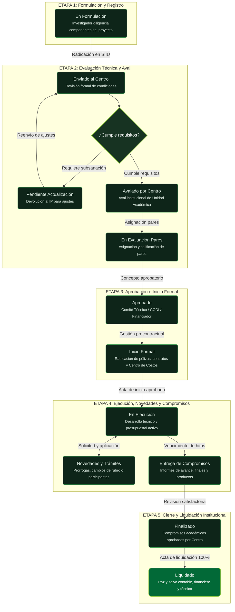

---

## Etapa 1: Formulación y Matrícula

En esta fase, el Investigador Principal (IP) estructura la propuesta técnica, metodológica, financiera y el equipo de trabajo.

- **Convocatoria de Investigación Interna:** Proyectos postulados a convocatorias del CODI u otras dependencias.  
  Guía de referencia: [VI-GU-24](../archivo_maestro/VI-GU-24.md) | Síntesis: [Matricula Proyectos](../02_PROCESOS_CLAVE/Matricula_Proyectos.md#convocatoria-interna)
- **Primer Proyecto de un Investigador:** Proceso especial que incluye el registro del perfil académico inicial en el sistema.  
  Guía de referencia: [VI-GU-17](../archivo_maestro/VI-GU-17.md) | Síntesis: [Matricula Proyectos](../02_PROCESOS_CLAVE/Matricula_Proyectos.md#primer-proyecto)
- **Proyectos Inscritos con Financiación Externa:** Proyectos con aval de entes externos (Minciencias, Regalías, Cooperación Internacional, Empresas).  
  Guía de referencia: [VI-GU-18](../archivo_maestro/VI-GU-18.md) | Síntesis: [Matricula Proyectos](../02_PROCESOS_CLAVE/Matricula_Proyectos.md#proyectos-inscritos)
- **Uso del Editor de Texto Enriquecido:** Directrices para tablas, fórmulas y formato libre de errores.  
  Guía de referencia: [VI-GU-25](../archivo_maestro/VI-GU-25.md) | Síntesis: [Matricula Proyectos](../02_PROCESOS_CLAVE/Matricula_Proyectos.md#editor-ckeditor)
- **Información Complementaria Obligatoria:** ODS, Misión de Sabios, Agendas Regionales G8 y Caracterización Socioeconómica.  
  Guía de referencia: [VI-GU-16](../archivo_maestro/VI-GU-16.md) | Síntesis: [Matricula Proyectos](../02_PROCESOS_CLAVE/Matricula_Proyectos.md#informacion-complementaria)

---

## 阶段 2: Evaluación, Aval y Ajustes

El proyecto enviado por el investigador entra al flujo de evaluación del Centro de Investigación y de la Vicerrectoría.

- **Evaluación Técnica Formal del Centro:** Verificación de condiciones habilitantes y requisitos de convocatoria.  
  Guía de referencia: [VI-GU-08](../archivo_maestro/VI-GU-08.md) | Síntesis: [Evaluacion y Aval](../02_PROCESOS_CLAVE/Evaluacion_y_Aval.md#evaluacion-tecnica-de-centro)
- **Devolución de Proyecto para Ajustes (Solicitada por el Centro):** El Centro habilita secciones específicas y fija fecha límite.  
  Instructivo de referencia: [VI-IN-12](../archivo_maestro/VI-IN-12.md) | Síntesis: [Evaluacion y Aval](../02_PROCESOS_CLAVE/Evaluacion_y_Aval.md#devolucion-para-ajustes)
- **Actualización por el Investigador del Proyecto Devuelto:** El IP corrige las secciones habilitadas y reenvía al Centro.  
  Instructivo de referencia: [VI-IN-05](../archivo_maestro/VI-IN-05.md) | Síntesis: [Evaluacion y Aval](../02_PROCESOS_CLAVE/Evaluacion_y_Aval.md#subsanacion-y-ajustes-de-proyectos-devueltos)
- **Asignación de Evaluadores Pares:** Parametrización y asignación de pares ciegos o jurados.  
  Guía de referencia: [VI-GU-06](../archivo_maestro/VI-GU-06.md) | Síntesis: [Evaluacion y Aval](../02_PROCESOS_CLAVE/Evaluacion_y_Aval.md#asignacion-evaluadores)

---

## 阶段 3: Inicio Formal del Proyecto

Una vez el proyecto está en estado **Aprobado**, no puede ejecutar recursos ni certificar horas docentes hasta su formalización.

- **Requisitos de Formalización:** Vinculación de pólizas contractuales, contratos de cofinanciación, convenios especiales y creación del Centro de Costos.
- **Acta de Inicio Formal:** Firma digital, registro de fechas oficiales de inicio y término, y paso a estado **En ejecución**.  
  Guía de referencia: [VI-GU-15](../archivo_maestro/VI-GU-15.md) | Síntesis: [Inicio Formal](../02_PROCESOS_CLAVE/Inicio_Formal.md)

---

## 阶段 4: Ejecución y Gestión de Novedades

Durante el desarrollo de la investigación, surgen necesidades de ajuste operacional o presupuestal.

- **Diferencia Vital:**
  - *Solicitud Administrativa:* Aplica a proyectos internos con recursos UdeA / CODI.
  - *Novedad Administrativa:* Aplica a proyectos inscritos con financiación externa.
- **Prórrogas de Tiempo:**
  - Prórroga de Inicio (proyecto en estado *Aprobado*).
  - Prórroga de Ejecución (proyecto en estado *En ejecución*).  
  Guía de referencia: [VI-GU-23](../archivo_maestro/VI-GU-23.md) | Síntesis: [Modificaciones y Tramites](../02_PROCESOS_CLAVE/Modificaciones_y_Tramites.md#prorroga-de-proyecto)
- **Modificaciones Presupuestales / Cambio de Rubro:** Creación de subrubros y traslados de saldos mayores a \$0.  
  Guía de referencia: [VI-GU-20](../archivo_maestro/VI-GU-20.md) | Síntesis: [Modificaciones y Tramites](../02_PROCESOS_CLAVE/Modificaciones_y_Tramites.md#cambio-de-rubro)
- **Modificación del Equipo Humano:** Cambio de participantes e investigadores.  
  Guía de referencia: [VI-GU-19](../archivo_maestro/VI-GU-19.md) | Síntesis: [Modificaciones y Tramites](../02_PROCESOS_CLAVE/Modificaciones_y_Tramites.md#cambio-de-participante)
- **Cambio de Responsable Institucional:**  
  Guía de referencia: [VI-GU-01](../archivo_maestro/VI-GU-01.md) | Síntesis: [Modificaciones y Tramites](../02_PROCESOS_CLAVE/Modificaciones_y_Tramites.md#cambio-de-responsable)
- **Gestión y Plazo de Compromisos Académicos:**  
  Guías de referencia: [VI-GU-09](../archivo_maestro/VI-GU-09.md) y [VI-GU-22](../archivo_maestro/VI-GU-22.md) | Síntesis: [Gestion Compromisos](../02_PROCESOS_CLAVE/Gestion_Compromisos.md)

---

## 阶段 5: Cierre, Liquidación y Certificación

Fase final donde se rinden cuentas y se emite el paz y salvo definitivo.

- **Cierre Académico y Administrativo:** Aprobación del 100% de productos comprometidos (artículos, ponencias, tesis, patentes).
- **Cierre Financiero y Liquidación Presupuestal:** Legalización del 100% del presupuesto asignado y reintegro de remanentes si aplica.  
  Guía de referencia: [VI-GU-04](../archivo_maestro/VI-GU-04.md) | Síntesis: [Cierre y Liquidacion](../02_PROCESOS_CLAVE/Cierre_y_Liquidacion.md)
- **Generación de Constancias y Certificados Oficiales:**  
  Instructivos: [VI-IN-01](../archivo_maestro/VI-IN-01.md), [VI-IN-07](../archivo_maestro/VI-IN-07.md), [VI-IN-08](../archivo_maestro/VI-IN-08.md) | Síntesis: [Reportes y Certificaciones](../02_PROCESOS_CLAVE/Reportes_y_Certificaciones.md)

------------------------------------------------------------
## [DOCUMENTO]: MOC_Por_Roles.md
*Ruta canónica original: `docs/00_INICIO_Y_MOCS/MOC_Por_Roles.md`*
------------------------------------------------------------

# Mapa de Contenido (MOC): Navegación por Roles

En el **Sistema SIIU**, las acciones y permisos están segmentados según la responsabilidad administrativa y académica del usuario. Utiliza este mapa para localizar los procedimientos y guías pertinentes a tu perfil:

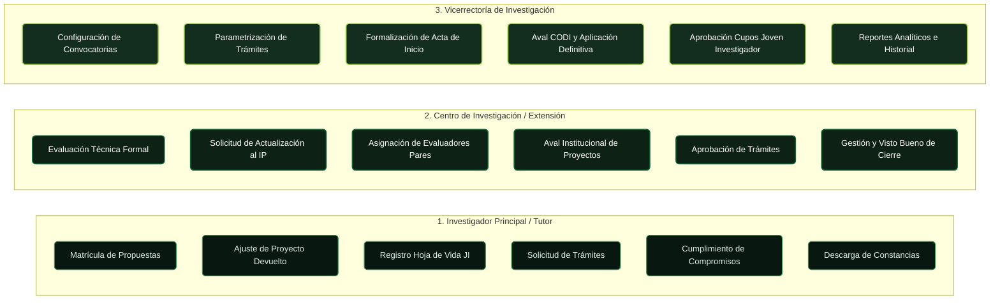


---

## 1. Investigador Principal / Tutor
*Responsable de formular proyectos, ejecutar presupuesto, coordinar talento y rendir cuentas académicas.*

| Operación | Guía / Instructivo Base | Procedimiento Sintetizado |
| :--- | :---: | :--- |
| **Inscripción en Convocatoria Interna** | [VI-GU-24](../archivo_maestro/VI-GU-24.md) | [Matricula Proyectos](../02_PROCESOS_CLAVE/Matricula_Proyectos.md#convocatoria-interna) |
| **Matrícula de Primer Proyecto** | [VI-GU-17](../archivo_maestro/VI-GU-17.md) | [Matricula Proyectos](../02_PROCESOS_CLAVE/Matricula_Proyectos.md#primer-proyecto) |
| **Matrícula de Proyecto Inscrito (Financiación Externa)** | [VI-GU-18](../archivo_maestro/VI-GU-18.md) | [Matricula Proyectos](../02_PROCESOS_CLAVE/Matricula_Proyectos.md#proyectos-inscritos) |
| **Uso del Editor de Texto (CKEditor)** | [VI-GU-25](../archivo_maestro/VI-GU-25.md) | [Matricula Proyectos](../02_PROCESOS_CLAVE/Matricula_Proyectos.md#editor-ckeditor) |
| **Actualizar Proyecto Devuelto por el Centro** | [VI-IN-05](../archivo_maestro/VI-IN-05.md) | [Evaluacion y Aval](../02_PROCESOS_CLAVE/Evaluacion_y_Aval.md#subsanacion-y-ajustes-de-proyectos-devueltos) |
| **Diligenciar Información Complementaria (ODS / Sabios / G8)** | [VI-GU-16](../archivo_maestro/VI-GU-16.md) | [Matricula Proyectos](../02_PROCESOS_CLAVE/Matricula_Proyectos.md#informacion-complementaria) |
| **Matrícula de Cupo Joven Investigador** | [VI-GU-10](../archivo_maestro/VI-GU-10.md) | [Programa Joven Investigador](../02_PROCESOS_CLAVE/Programa_Joven_Investigador.md#matricula-de-cupos) |
| **Registro de Estudiante / Hoja de Vida JI** | [VI-IN-06](../archivo_maestro/VI-IN-06.md) | [Programa Joven Investigador](../02_PROCESOS_CLAVE/Programa_Joven_Investigador.md#hoja-de-vida-estudiante) |
| **Prórroga de Cupo Joven Investigador** | [VI-GU-11](../archivo_maestro/VI-GU-11.md) | [Programa Joven Investigador](../02_PROCESOS_CLAVE/Programa_Joven_Investigador.md#prorroga-de-cupos) |
| **Solicitud de Prórroga del Proyecto (Inicio o Ejecución)** | [VI-GU-23](../archivo_maestro/VI-GU-23.md) | [Modificaciones y Tramites](../02_PROCESOS_CLAVE/Modificaciones_y_Tramites.md#prorroga-de-proyecto) |
| **Solicitud de Modificación Presupuestal / Cambio de Rubro** | [VI-GU-20](../archivo_maestro/VI-GU-20.md) | [Modificaciones y Tramites](../02_PROCESOS_CLAVE/Modificaciones_y_Tramites.md#cambio-de-rubro) |
| **Solicitud de Cambio o Inclusión de Participantes** | [VI-GU-19](../archivo_maestro/VI-GU-19.md) | [Modificaciones y Tramites](../02_PROCESOS_CLAVE/Modificaciones_y_Tramites.md#cambio-de-participante) |
| **Solicitud de Plazo para Entrega de Compromisos** | [VI-GU-22](../archivo_maestro/VI-GU-22.md) | [Gestion Compromisos](../02_PROCESOS_CLAVE/Gestion_Compromisos.md#solicitud-de-plazo) |
| **Entrega y Subida de Compromisos Académicos** | [VI-GU-09](../archivo_maestro/VI-GU-09.md) | [Gestion Compromisos](../02_PROCESOS_CLAVE/Gestion_Compromisos.md#entrega-de-compromisos) |
| **Generar Constancia Personal de Participación** | [VI-IN-07](../archivo_maestro/VI-IN-07.md) | [Reportes y Certificaciones](../02_PROCESOS_CLAVE/Reportes_y_Certificaciones.md#constancias-de-participacion) |
| **Generar Constancia como Evaluador** | [VI-IN-08](../archivo_maestro/VI-IN-08.md) | [Reportes y Certificaciones](../02_PROCESOS_CLAVE/Reportes_y_Certificaciones.md#constancias-evaluador) |
| **Consulta Histórica Personal de Proyectos** | [VI-IN-11](../archivo_maestro/VI-IN-11.md) | [Reportes y Certificaciones](../02_PROCESOS_CLAVE/Reportes_y_Certificaciones.md#reporte-por-persona) |

Consulta la **[Guía Detallada del Investigador](../01_ROLES/Rol_Investigador.md)** y la **[Ficha Rápida](../03_GUIAS_RAPIDAS_CHEAT_SHEETS/CheatSheet_Investigador.md)**.

---

## 2. Centro de Investigación / Extensión
*Unidad académico-administrativa de Facultad, Escuela o Instituto que valida la viabilidad técnica, avala y supervisa los proyectos.*

| Operación | Guía / Instructivo Base | Procedimiento Sintetizado |
| :--- | :---: | :--- |
| **Evaluación Técnica Formal y Aval del Proyecto** | [VI-GU-08](../archivo_maestro/VI-GU-08.md) | [Evaluacion y Aval](../02_PROCESOS_CLAVE/Evaluacion_y_Aval.md#evaluacion-tecnica-de-centro) |
| **Solicitar Actualización / Devolución de Proyecto al IP** | [VI-IN-12](../archivo_maestro/VI-IN-12.md) | [Evaluacion y Aval](../02_PROCESOS_CLAVE/Evaluacion_y_Aval.md#devolucion-para-ajustes) |
| **Asignación de Evaluadores Pares Internos / Externos** | [VI-GU-06](../archivo_maestro/VI-GU-06.md) | [Evaluacion y Aval](../02_PROCESOS_CLAVE/Evaluacion_y_Aval.md#asignacion-evaluadores) |
| **Aprobación de Solicitudes y Trámites Administrativos** | [VI-GU-12](../archivo_maestro/VI-GU-12.md) | [Modificaciones y Tramites](../02_PROCESOS_CLAVE/Modificaciones_y_Tramites.md#aprobacion-en-centro) |
| **Revisión y Aprobación de Compromisos Entregados** | [VI-GU-09](../archivo_maestro/VI-GU-09.md) | [Gestion Compromisos](../02_PROCESOS_CLAVE/Gestion_Compromisos.md#revision-en-centro) |
| **Cierre Formal del Proyecto (Técnico y Administrativo)** | [VI-GU-04](../archivo_maestro/VI-GU-04.md) | [Cierre y Liquidacion](../02_PROCESOS_CLAVE/Cierre_y_Liquidacion.md#cierre-en-centro) |
| **Generar Constancias de Proyectos por Grupo de Investigación**| [VI-IN-01](../archivo_maestro/VI-IN-01.md) | [Reportes y Certificaciones](../02_PROCESOS_CLAVE/Reportes_y_Certificaciones.md#constancias-por-grupo) |
| **Consulta de Reporte Historial de Proyectos** | [VI-IN-02](../archivo_maestro/VI-IN-02.md) / [VI-IN-10](../archivo_maestro/VI-IN-10.md) | [Reportes y Certificaciones](../02_PROCESOS_CLAVE/Reportes_y_Certificaciones.md#reporte-historial) |
| **Reporte de Información Básica de Proyectos** | [VI-IN-09](../archivo_maestro/VI-IN-09.md) | [Reportes y Certificaciones](../02_PROCESOS_CLAVE/Reportes_y_Certificaciones.md#informacion-basica) |

Consulta la **[Guía Detallada del Centro](../01_ROLES/Rol_Centro_Investigacion.md)** y la **[Ficha Rápida](../03_GUIAS_RAPIDAS_CHEAT_SHEETS/CheatSheet_Centro.md)**.

---

## 3. Vicerrectoría de Investigación / Administrador Central
*Instancia central de gobierno institucional que parametriza el sistema, define convocatorias, avala ante CODI y ejecuta liquidaciones.*

| Operación | Guía / Instructivo Base | Procedimiento Sintetizado |
| :--- | :---: | :--- |
| **Configuración de Convocatorias del SIIU** | [VI-GU-07](../archivo_maestro/VI-GU-07.md) | [Evaluacion y Aval](../02_PROCESOS_CLAVE/Evaluacion_y_Aval.md#configuracion-convocatorias) |
| **Configuración de Trámites y Flujos Administrativos** | [VI-GU-14](../archivo_maestro/VI-GU-14.md) | [Modificaciones y Tramites](../02_PROCESOS_CLAVE/Modificaciones_y_Tramites.md#configuracion-flujos) |
| **Cambio de Responsable de Proyecto** | [VI-GU-01](../archivo_maestro/VI-GU-01.md) | [Modificaciones y Tramites](../02_PROCESOS_CLAVE/Modificaciones_y_Tramites.md#cambio-de-responsable) |
| **Inicio Formal de Proyectos en el SIIU** | [VI-GU-15](../archivo_maestro/VI-GU-15.md) | [Inicio Formal](../02_PROCESOS_CLAVE/Inicio_Formal.md#inicio-en-vicerrectoria) |
| **Avalar y Aplicar Solicitudes Administrativas (Instancias / CODI)** | [VI-GU-13](../archivo_maestro/VI-GU-13.md) | [Modificaciones y Tramites](../02_PROCESOS_CLAVE/Modificaciones_y_Tramites.md#aplicacion-en-vicerrectoria) |
| **Cierre y Liquidación Institucional del Proyecto** | [VI-GU-04](../archivo_maestro/VI-GU-04.md) | [Cierre y Liquidacion](../02_PROCESOS_CLAVE/Cierre_y_Liquidacion.md#liquidacion-en-vicerrectoria) |
| **Generación de Reportes Consolidados del Sistema** | [VI-IN-09](../archivo_maestro/VI-IN-09.md) / [VI-IN-10](../archivo_maestro/VI-IN-10.md) | [Reportes y Certificaciones](../02_PROCESOS_CLAVE/Reportes_y_Certificaciones.md#reportes-analiticos) |

Consulta la **[Guía Detallada de la Vicerrectoría](../01_ROLES/Rol_Vicerrectoria.md)**.

------------------------------------------------------------
## [DOCUMENTO]: MOC_Tramites_y_Solicitudes.md
*Ruta canónica original: `docs/00_INICIO_Y_MOCS/MOC_Tramites_y_Solicitudes.md`*
------------------------------------------------------------

# Mapa de Contenido (MOC): Trámites y Modificaciones Administrativas

Durante la vida de un proyecto en el SIIU surgen eventualidades que exigen modificaciones contractuales, operativas o presupuestales. El sistema gestiona estas solicitudes mediante flujos parametrizables de aprobación entre el **Investigador Principal**, el **Centro de Investigación** y la **Vicerrectoría**.

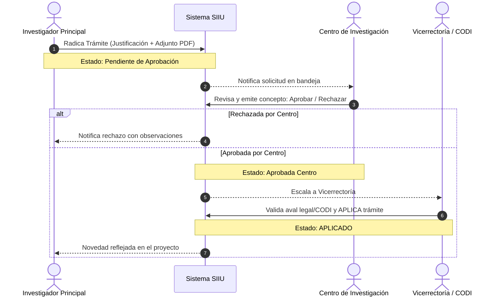


---

## Matriz Comparativa: Solicitud vs Novedad

Una de las distinciones operativas más críticas en el SIIU es la fuente de financiación:

| Criterio | Solicitud Administrativa | Novedad Administrativa |
| :--- | :--- | :--- |
| **Tipo de Proyecto** | Proyectos de Convocatoria Interna (recursos UdeA, CODI, BUP, etc.). | Proyectos Inscritos con Financiación Externa (Minciencias, Regalías, Cooperación Internacional). |
| **Flujo de Decisión** | El Centro aprueba y la Vicerrectoría (o CODI) avala y aplica de fondo. | El Investigador o Centro anexa la carta/acta del financiador externo que autoriza el cambio; la UdeA valida y aplica el registro. |
| **Menú en SIIU** | `Trámites administrativos >> Nueva solicitud o Novedad >> Solicitud` | `Trámites administrativos >> Nueva solicitud o Novedad >> Novedad` |

---

## Catálogo de Trámites Disponibles

### 1. Prórrogas de Tiempo del Proyecto
- **Prórroga de Inicio:** Se solicita cuando el proyecto está en estado **Aprobado** pero no se han podido suscribir contratos o pólizas dentro del término reglamentario.
- **Prórroga de Ejecución:** Se solicita cuando el proyecto está en estado **En ejecución** para extender el plazo de finalización y entrega de productos.
- :material-book: Guía oficial: [VI-GU-23](../archivo_maestro/VI-GU-23.md) | Síntesis: [Modificaciones y Tramites](../02_PROCESOS_CLAVE/Modificaciones_y_Tramites.md#prorroga-de-proyecto)

### 2. :material-cash: Cambio de Rubro / Modificación Presupuestal
- Permite traslados entre rubros aprobados o la creación de subrubros dentro de rubros habilitados.
- **Condición Estricta:** El proyecto debe estar **En ejecución**. No es posible trasladar saldo desde un rubro padre cuyo saldo disponible sea \$0.
- :material-book: Guía oficial: [VI-GU-20](../archivo_maestro/VI-GU-20.md) | Síntesis: [Modificaciones y Tramites](../02_PROCESOS_CLAVE/Modificaciones_y_Tramites.md#cambio-de-rubro)

### 3. Cambio o Inclusión de Participantes
- Modificación del equipo humano (investigadores principales, coinvestigadores, asesores, personal técnico).
- Requiere justificación, indicación de dedicación horaria semanal y soportes académicos.
- :material-book: Guía oficial: [VI-GU-19](../archivo_maestro/VI-GU-19.md) | Síntesis: [Modificaciones y Tramites](../02_PROCESOS_CLAVE/Modificaciones_y_Tramites.md#cambio-de-participante)

### 4. Cambio del Responsable del Proyecto
- Relevo institucional del Investigador Principal ante la Universidad por razones de fuerza mayor, comisión académica, renuncia o retiro.
- :material-book: Guía oficial: [VI-GU-01](../archivo_maestro/VI-GU-01.md) | Síntesis: [Modificaciones y Tramites](../02_PROCESOS_CLAVE/Modificaciones_y_Tramites.md#cambio-de-responsable)

### 5. Solicitud de Plazo en Entrega de Compromisos
- Aplica para prórrogas específicas asociadas a un compromiso académico particular (informe de avance, informe final, artículo sometido) sin necesariamente extender el tiempo contractual general.
- :material-book: Guía oficial: [VI-GU-22](../archivo_maestro/VI-GU-22.md) | Síntesis: [Gestion Compromisos](../02_PROCESOS_CLAVE/Gestion_Compromisos.md#solicitud-de-plazo)

---

## Flujos de Gestión Administrativa en el Sistema

| Rol | Acción | Guía de Referencia | Procedimiento |
| :--- | :--- | :---: | :--- |
| **Centro** | Aprobar solicitudes radicadas por los investigadores | [VI-GU-12](../archivo_maestro/VI-GU-12.md) | [Modificaciones y Tramites](../02_PROCESOS_CLAVE/Modificaciones_y_Tramites.md#aprobacion-en-centro) |
| **Vicerrectoría** | Avalar ante instancias institucionales y APLICAR en el sistema | [VI-GU-13](../archivo_maestro/VI-GU-13.md) | [Modificaciones y Tramites](../02_PROCESOS_CLAVE/Modificaciones_y_Tramites.md#aplicacion-en-vicerrectoria) |
| **Vicerrectoría** | Configurar y parametrizar los tipos de trámites y sus rutas de aprobación | [VI-GU-14](../archivo_maestro/VI-GU-14.md) | [Modificaciones y Tramites](../02_PROCESOS_CLAVE/Modificaciones_y_Tramites.md#configuracion-flujos) |

Consulta la sección integral: **[Modificaciones y Tramites](../02_PROCESOS_CLAVE/Modificaciones_y_Tramites.md)**.

------------------------------------------------------------
## [DOCUMENTO]: MOC_Reportes_y_Constancias.md
*Ruta canónica original: `docs/00_INICIO_Y_MOCS/MOC_Reportes_y_Constancias.md`*
------------------------------------------------------------

# Mapa de Contenido (MOC): Reportes, Consultas y Constancias

El **Sistema SIIU** ofrece dos grandes tipos de salidas documentales:
1. **Constancias Oficiales en PDF:** Documentos con validez institucional para acreditar participación de personas, de grupos o labores de evaluación de pares.
2. **Reportes Analíticos y de Gestión (Excel / HTML / PDF):** Consultas gerenciales para el seguimiento de la ejecución académica y financiera por convocatoria, centro o facultad.

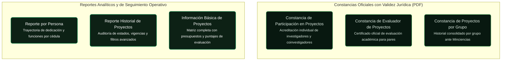


---

## 1. Constancias Oficiales (Descarga en PDF)

Estas constancias se generan directamente desde el menú principal del sistema y cuentan con el encabezado y pie oficial de la Vicerrectoría de Investigación.

| Tipo de Constancia | ¿Quién la genera? | Parámetros Requeridos | Instructivo Oficial | Procedimiento |
| :--- | :--- | :--- | :---: | :--- |
| **Constancia de Participación en Proyectos** | Investigador / Centro | Cédula del participante, rango de fechas (opcional para histórico completo), tipo de proyecto. | [VI-IN-07](../archivo_maestro/VI-IN-07.md) | [Reportes y Certificaciones](../02_PROCESOS_CLAVE/Reportes_y_Certificaciones.md#constancias-de-participacion) |
| **Constancia de Evaluador de Proyectos** | Investigador / Centro | Cédula del evaluador, tratamiento de cortesía (Profesor, Dr., etc.), rango de fechas de evaluación. | [VI-IN-08](../archivo_maestro/VI-IN-08.md) | [Reportes y Certificaciones](../02_PROCESOS_CLAVE/Reportes_y_Certificaciones.md#constancias-evaluador) |
| **Constancias de Proyectos por Grupo** | Centro / Vicerrectoría | Selección de Unidad Académica, Centro de Investigación, Grupo de Investigación y estado del proyecto. | [VI-IN-01](../archivo_maestro/VI-IN-01.md) | [Reportes y Certificaciones](../02_PROCESOS_CLAVE/Reportes_y_Certificaciones.md#constancias-por-grupo) |

---

## 2. Reportes Analíticos y de Seguimiento

Herramientas para auditar la cartera de proyectos, verificar estados, vigencias y puntajes de evaluación.

| Nombre del Reporte | ¿Quién tiene acceso? | Qué información entrega | Exportación | Instructivo Oficial | Procedimiento |
| :--- | :--- | :--- | :---: | :---: | :--- |
| **Reporte por Persona** | Investigador *(solo sus proyectos)*, Centro y Vicerrectoría *(todos)* | Código SIIU, nombre de proyecto, grupo, institución, rol, dedicación semanal, función, fechas de vinculación/retiro y ficha técnica HTML del proyecto. | PDF / HTML | [VI-IN-11](../archivo_maestro/VI-IN-11.md) | [Reportes y Certificaciones](../02_PROCESOS_CLAVE/Reportes_y_Certificaciones.md#reporte-por-persona) |
| **Reporte Historial de Proyectos** | Investigador, Centro y Vicerrectoría | Filtros por código, palabras clave, estado, año/mes de finalización, convocatoria o proceso de selección. | Pantalla / Excel | [VI-IN-02](../archivo_maestro/VI-IN-02.md) / [VI-IN-10](../archivo_maestro/VI-IN-10.md) | [Reportes y Certificaciones](../02_PROCESOS_CLAVE/Reportes_y_Certificaciones.md#reporte-historial) |
| **Información Básica de Proyectos** | Centro y Vicerrectoría | Matriz completa de datos: año, modalidad/línea temática, centro, estado, IP, vinculación docente, unidad académica, grupo, montos solicitados/totales y puntajes de evaluadores 1, 2, 3 y promedio. | Excel / PDF / HTML | [VI-IN-09](../archivo_maestro/VI-IN-09.md) | [Reportes y Certificaciones](../02_PROCESOS_CLAVE/Reportes_y_Certificaciones.md#informacion-basica) |

---

!!! tip "Recomendación de rendimiento en reportes"
    Al consultar en el SIIU, **evite seleccionar la opción "TODOS"** en todos los filtros de búsqueda simultáneamente. Esto genera consultas muy pesadas a la base de datos y puede ocasionar lentitud o bloqueo de sesión. Delimite siempre por año, centro o estado.

------------------------------------------------------------
## [DOCUMENTO]: MOC_Marco_Normativo.md
*Ruta canónica original: `docs/00_INICIO_Y_MOCS/MOC_Marco_Normativo.md`*
------------------------------------------------------------

# MOC: Marco Normativo e Institucional de la Investigación

| Metadato | Detalle Institucional |
| :--- | :--- |
| **Código MOC** | `MOC-05-LEGALIDAD` |
| **Entidad Regulada** | Vicerrectoría de Investigación — Universidad de Antioquia |
| **Alcance** | Régimen Jurídico, Estatutario y Reglamentario del Ecosistema de Investigación |
| **Documentos Consolidados** | **21 Disposiciones Normativas Fundamentales** (Leyes, Estatutos CSU, Resoluciones Rectorales) |
| **Herramienta Integrada** | **Sistema de Información para la Investigación Universitaria (SIIU)** |

---

## 1. Arquitectura de Jerarquía Jurídica Institucional

Toda actuación técnica, presupuestal, administrativa o contractual adelantada en el **SIIU** por investigadores, evaluadores, centros o vicerrectorías se fundamenta en la siguiente jerarquía piramidal:

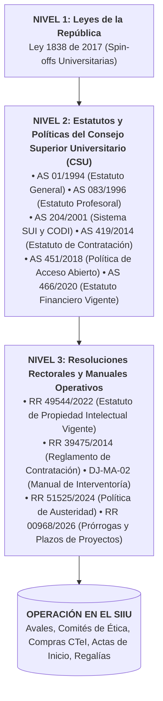

---

## 2. Catálogo Maestro de las 21 Normas Reguladoras

A continuación se relacionan los 21 actos normativos compilados, con acceso directo a sus **Fichas Didácticas Wiki** y a sus **Transcripciones Fidedignas Íntegras** en el Archivo Maestro:

| # | Norma Oficial | Materia / Descripción Operativa | Estado Jurídico | Ficha Wiki Didáctica | Archivo Fidedigno |
| :-: | :--- | :--- | :---: | :--- | :--- |
| **1** | **Ley 1838 de 2017** | Fomento a empresas de base tecnológica (Spin-offs) en IES públicas | **Vigente** | [Ficha Wiki](../05_MARCO_NORMATIVO/Ley_1838_2017_Spinoffs.md) | [LEG-LEY-1838-2017](../archivo_maestro/legalidad/LEG-LEY-1838-2017.md) |
| **2** | **Acuerdo Superior 01 de 1994** | Estatuto General de la UdeA (Misión, gobierno, autonomía, estructura) | **Vigente** | [Ficha Wiki](../05_MARCO_NORMATIVO/AS_01_1994_Estatuto_General.md) | [LEG-AS-01-1994](../archivo_maestro/legalidad/LEG-AS-01-1994.md) |
| **3** | **Acuerdo Superior 083 de 1996** | Estatuto Profesoral (Dedicación a I+D, derechos, estímulos, deberes) | **Vigente** | [Ficha Wiki](../05_MARCO_NORMATIVO/AS_083_1996_Estatuto_Profesoral.md) | [LEG-AS-083-1996](../archivo_maestro/legalidad/LEG-AS-083-1996.md) |
| **4** | **Acuerdo Superior 086 de 1996** | Participación remunerada de docentes de cátedra en proyectos I+D | **Vigente** | [Ficha Wiki](../05_MARCO_NORMATIVO/AS_086_1996_Profesores_Catedra_Proyectos.md) | [LEG-AS-086-1996](../archivo_maestro/legalidad/LEG-AS-086-1996.md) |
| **5** | **Acuerdo Superior 121 de 1997** | Estatuto Presupuestal antecedente (Estructura histórica del gasto) | *Histórico* | [Ficha Wiki](../05_MARCO_NORMATIVO/AS_121_1997_Estatuto_Presupuestal.md) | [LEG-AS-121-1997](../archivo_maestro/legalidad/LEG-AS-121-1997.md) |
| **6** | **Acuerdo Superior 124 de 1997** | Estatuto Básico de Extensión (Consultorías científicas y servicios) | **Vigente** | [Ficha Wiki](../05_MARCO_NORMATIVO/AS_124_1997_Estatuto_Extension.md) | [LEG-AS-124-1997](../archivo_maestro/legalidad/LEG-AS-124-1997.md) |
| **7** | **Acuerdo Superior 204 de 2001** | Sistema Universitario de Investigación (SUI) y funciones del CODI | **Vigente** | [Ficha Wiki](../05_MARCO_NORMATIVO/AS_204_2001_Sistema_Universitario_Investigacion.md) | [LEG-AS-204-2001](../archivo_maestro/legalidad/LEG-AS-204-2001.md) |
| **8** | **Acuerdo Superior 253 de 2003** | Estatuto del Profesor de Cátedra y Ocasional (Vinculación a proyectos) | **Vigente** | [Ficha Wiki](../05_MARCO_NORMATIVO/AS_253_2003_Docentes_Catedra_Ocasionales.md) | [LEG-AS-253-2003](../archivo_maestro/legalidad/LEG-AS-253-2003.md) |
| **9** | **Acuerdo Superior 284 de 2004** | Programa de Gestión Tecnológica y Transferencia de Resultados | **Vigente** | [Ficha Wiki](../05_MARCO_NORMATIVO/AS_284_2004_Gestion_Tecnologica.md) | [LEG-AS-284-2004](../archivo_maestro/legalidad/LEG-AS-284-2004.md) |
| **10** | **Acuerdo Superior 350 de 2007** | Estatuto Financiero anterior (Derogado por AS 466 de 2020) | *Histórico* | [Ficha Wiki](../05_MARCO_NORMATIVO/AS_350_2007_Estatuto_Financiero.md) | [LEG-AS-350-2007](../archivo_maestro/legalidad/LEG-AS-350-2007.md) |
| **11** | **Acuerdo Superior 418 de 2014** | Política Integral de Prácticas Académicas (Pasantías en I+D) | **Vigente** | [Ficha Wiki](../05_MARCO_NORMATIVO/AS_418_2014_Politica_Practicas.md) | [LEG-AS-418-2014](../archivo_maestro/legalidad/LEG-AS-418-2014.md) |
| **12** | **Acuerdo Superior 419 de 2014** | Estatuto General de Contratación (Régimen de derecho privado en CTeI) | **Vigente** | [Ficha Wiki](../05_MARCO_NORMATIVO/AS_419_2014_Estatuto_Contratacion.md) | [LEG-AS-419-2014](../archivo_maestro/legalidad/LEG-AS-419-2014.md) |
| **13** | **Acuerdo Superior 451 de 2018** | Política de Acceso Abierto a la Producción Académica e Investigativa | **Vigente** | [Ficha Wiki](../05_MARCO_NORMATIVO/AS_451_2018_Politica_Acceso_Abierto.md) | [LEG-AS-451-2018](../archivo_maestro/legalidad/LEG-AS-451-2018.md) |
| **14** | **Acuerdo Superior 466 de 2020** | **Estatuto Financiero Vigente** (Centros de costo, rubros y tesorería) | **Vigente** | [Ficha Wiki](../05_MARCO_NORMATIVO/AS_466_2020_Estatuto_Financiero_Vigente.md) | [LEG-AS-466-2020](../archivo_maestro/legalidad/LEG-AS-466-2020.md) |
| **15** | **Manual DJ-MA-02** | Manual de Interventoría de Bienes, Servicios y Obras | **Vigente** | [Ficha Wiki](../05_MARCO_NORMATIVO/DJ_MA_02_Manual_Interventoria.md) | [LEG-DJ-MA-02](../archivo_maestro/legalidad/LEG-DJ-MA-02.md) |
| **16** | **Resolución Rectoral 21231 de 2005** | Estatuto de PI anterior (Derogado por RR 49544 de 2022) | *Derogado* | [Ficha Wiki](../05_MARCO_NORMATIVO/RR_21231_2005_Estatuto_Propiedad_Intelectual.md) | [LEG-RR-21231-2005](../archivo_maestro/legalidad/LEG-RR-21231-2005.md) |
| **17** | **Resolución Rectoral 39475 de 2014** | Reglamento del Estatuto Contractual (Contratación directa CTeI Art. 44) | **Vigente** | [Ficha Wiki](../05_MARCO_NORMATIVO/RR_39475_2014_Reglamento_Contratacion.md) | [LEG-RR-39475-2014](../archivo_maestro/legalidad/LEG-RR-39475-2014.md) |
| **18** | **Resolución Rectoral 39477 de 2014** | Referente Ético Institucional (Bioética, honestidad científica, valores) | **Vigente** | [Ficha Wiki](../05_MARCO_NORMATIVO/RR_39477_2014_Referente_Etico.md) | [LEG-RR-39477-2014](../archivo_maestro/legalidad/LEG-RR-39477-2014.md) |
| **19** | **Resolución Rectoral 49544 de 2022** | **Estatuto de Propiedad Intelectual Vigente** (Acta SIIU, 33% regalías) | **Vigente** | [Ficha Wiki](../05_MARCO_NORMATIVO/RR_49544_2022_Nuevo_Estatuto_PI.md) | [LEG-RR-49544-2022](../archivo_maestro/legalidad/LEG-RR-49544-2022.md) |
| **20** | **Resolución Rectoral 51525 de 2024** | Política de Austeridad y Gasto (Viajes, compras, software e insumos) | **Vigente** | [Ficha Wiki](../05_MARCO_NORMATIVO/RR_51525_2024_Ajustes_SIIU.md) | [LEG-RR-51525-2024](../archivo_maestro/legalidad/LEG-RR-51525-2024.md) |
| **21** | **Resolución Rectoral 00968 de 2026** | **Reglamento de Prórrogas y Plazos** en Proyectos de Investigación | **Vigente** | [Ficha Wiki](../05_MARCO_NORMATIVO/RR_00968_2026_Modernizacion.md) | [LEG-RR-00968-2026](../archivo_maestro/legalidad/LEG-RR-00968-2026.md) |

---

## 3. Matriz Temática de Concordancia Normativa $\leftrightarrow$ Trámites en el SIIU

A continuación se detalla qué norma habilita, regula o restringe cada paso del ciclo operativo de un proyecto de investigación en el SIIU:

```mermaid
flowchart LR
    subgraph Tramites_SIIU[Módulos y Trámites en SIIU]
        T1[Matrícula de Proyecto y Aval]
        T2[Acta de Inicio y Registro PI]
        T3[Compras, Equipos y Reactivos]
        T4[Supervisión de Cuentas y Pagos]
        T5[Prórrogas de Cronograma]
        T6[Plazo para Cumplir Compromisos]
        T7[Reporte de Invención y Regalías]
        T8[Publicaciones y Autoarchivo]
    end

    subgraph Marco_Legal[Norma Habilitante]
        N_SUI[AS 204/2001 - Sistema SUI / CODI]
        N_PI[RR 49544/2022 - Estatuto PI]
        N_CONT[AS 419/2014 + RR 39475/2014 CTeI]
        N_INT[DJ-MA-02 - Manual Interventoría]
        N_PRORR[RR 00968/2026 - Reglamento Prórrogas]
        N_AUST[RR 51525/2024 - Política Austeridad]
        N_OA[AS 451/2018 - Acceso Abierto]
    end

    T1 --> N_SUI
    T2 --> N_PI
    T3 --> N_CONT
    T3 --> N_AUST
    T4 --> N_INT
    T5 --> N_PRORR
    T6 --> N_PRORR
    T7 --> N_PI
    T8 --> N_OA
```

### Tabla de Concordancias Específicas:

| Trámite / Acción en el SIIU | Norma Aplicable | Artículo(s) Clave | Regla Operativa Institucional |
| :--- | :--- | :--- | :--- |
| **Inscripción y Aval de Propuesta** | [AS 204 de 2001](../05_MARCO_NORMATIVO/AS_204_2001_Sistema_Universitario_Investigacion.md) | Arts. 10 y 12 | Requiere aval técnico del Centro y aprobación del Consejo de Facultad para horas en plan de trabajo. |
| **Acta de Registro de PI** | [RR 49544 de 2022](../05_MARCO_NORMATIVO/RR_49544_2022_Nuevo_Estatuto_PI.md) | Art. 64 | El registro del proyecto en el SIIU cumple formalmente los 15 requisitos del Acta de PI y TRL. |
| **Compra de Reactivos e Insumos** | [RR 39475 de 2014](../05_MARCO_NORMATIVO/RR_39475_2014_Reglamento_Contratacion.md) y [RR 51525 de 2024](../05_MARCO_NORMATIVO/RR_51525_2024_Ajustes_SIIU.md) | Art. 44 (RR 39475) y Art. 14 (RR 51525) | Contratación directa bajo régimen de CTeI sin pliegos ordinarios. Solicitud justificada según ensayos. |
| **Adquisición de Software Científico** | [RR 51525 de 2024](../05_MARCO_NORMATIVO/RR_51525_2024_Ajustes_SIIU.md) | Art. 15 Parágrafo | Proyectos de I+D con recursos externos no requieren visto bueno de Informática; solo notificación. |
| **Interventoría y Pago de Contratos** | [Manual DJ-MA-02](../05_MARCO_NORMATIVO/DJ_MA_02_Manual_Interventoria.md) | Numerales 4, 5 y 6 | Verificación previa obligatoria de aportes PILA (Salud, Pensión, ARL) antes de aprobar informe y factura. |
| **Solicitud de Prórroga de Ejecución** | [RR 00968 de 2026](../05_MARCO_NORMATIVO/RR_00968_2026_Modernizacion.md) | Arts. 4, 6 y 7 | Radicar en SIIU mínimo 2 meses antes del vencimiento. Máximo 50% del plazo original (excepcional 100%). |
| **Plazo para Artículos o Patentes** | [RR 00968 de 2026](../05_MARCO_NORMATIVO/RR_00968_2026_Modernizacion.md) | Art. 12 | Hasta 1 año (máximo 2 años). No reabre presupuesto. Para compromisos pendientes por evaluación de terceros. |
| **Protección de Patente y Spin-off** | [RR 49544 de 2022](../05_MARCO_NORMATIVO/RR_49544_2022_Nuevo_Estatuto_PI.md) y [Ley 1838 de 2017](../05_MARCO_NORMATIVO/Ley_1838_2017_Spinoffs.md) | Art. 98 y 113 (RR 49544) | Concepto vinculante del Comité de PI. Distribución del 33% de regalías brutas para investigadores. |
| **Depósito de Artículos y Tesis** | [AS 451 de 2018](../05_MARCO_NORMATIVO/AS_451_2018_Politica_Acceso_Abierto.md) | Arts. 5, 6 y 7 | Autoarchivo obligatorio en el Repositorio Institucional UdeA en acceso abierto, respetando embargos editoriales. |

---

## 4. Navegación Transversal de la Wiki

- :material-home: **Volver al Portal Principal:** [HOME](HOME.md)
- :material-account-group: **MOC por Perfiles y Roles:** [MOC_Por_Roles](MOC_Por_Roles.md)
- :material-refresh: **MOC Ciclo de Vida del Proyecto:** [MOC_Ciclo_de_Vida_Proyectos](MOC_Ciclo_de_Vida_Proyectos.md)
- :material-clipboard-list: **MOC de Trámites y Modificaciones:** [MOC_Tramites_y_Solicitudes](MOC_Tramites_y_Solicitudes.md)
- :material-chart-bar: **MOC de Certificaciones y Reportes:** [MOC_Reportes_y_Constancias](MOC_Reportes_y_Constancias.md)
- :material-book-open: **Glosario Oficial del SIIU:** [Glosario_Terminos_SIIU](../04_GLOSARIO_Y_CONCEPTOS/Glosario_Terminos_SIIU.md)

------------------------------------------------------------
## [DOCUMENTO]: Glosario_Terminos_SIIU.md
*Ruta canónica original: `docs/04_GLOSARIO_Y_CONCEPTOS/Glosario_Terminos_SIIU.md`*
------------------------------------------------------------

# Glosario de Términos y Conceptos del SIIU

Compendio de definiciones oficiales y canónicas utilizadas en las guías, instructivos y formularios del **Sistema de Información para la Investigación Universitaria (SIIU)** de la Universidad de Antioquia.

---

## 1. Estados Canónicos de los Proyectos

| Estado en SIIU | Definición Oficial | Implicación Operativa |
| :--- | :--- | :--- |
| **En formulación** | Propuesta en proceso de diligenciamiento por parte del IP. | Solo el IP tiene acceso de edición. El Centro aún no puede verla formalmente. |
| **Enviado a Centro** | La propuesta fue radicada formalmente por el IP ante el Centro de Investigación o Extensión. | Se bloquea la edición del IP y se activa la bandeja de revisión técnica del Centro. |
| **Pendiente Actualización** | El Centro revisó la propuesta, encontró condiciones no cumplidas y autorizó un plazo de ajuste al IP. | El IP puede volver a editar exclusivamente las secciones habilitadas por el Centro. |
| **Actualizado** | El IP completó las correcciones solicitadas por el Centro y reenvió la propuesta. | Lista para reevaluación técnica por parte del Centro. |
| **Avalado por Centro** | El Centro validó que la propuesta cumple todas las condiciones técnicas y formales. | Habilitada para asignación de evaluadores pares o envío a instancias centrales. |
| **Aprobado** | La propuesta superó la evaluación de pares y fue aprobada por la instancia respectiva (CODI, Comité de Extensión). | El proyecto está admitido pero **aún no puede ejecutar recursos** hasta formalizar inicio. |
| **Aplazado** | Se ha decidido suspender temporalmente el inicio formal del proyecto por mutuo acuerdo. | Permanece a la espera de condiciones para iniciar. |
| **No iniciado** | Venció el plazo máximo reglamentario para formalizar el inicio y no se legalizaron contratos ni pólizas. | El proyecto corre riesgo de cancelación por expiración de términos. |
| **En Ejecución** | Se firmó el Acta de Inicio Formal, se asignó Centro de Costos y rigen las fechas oficiales de vigencia. | **Habilitado para compras, pagos, contratación, cambios de rubro y prórrogas.** |
| **Pendiente de Prórroga** | Se ha radicado una solicitud de extensión de tiempo y se encuentra en trámite de aprobación. | Trámite en estudio en Centro o Vicerrectoría. |
| **Suspendido** | Se emitió una solicitud formal de suspensión temporal de actividades (por fuerza mayor o caso fortuito). | Se congela temporalmente el cómputo del plazo de ejecución. |
| **Atrasados** | El proyecto superó la fecha límite pactada para entregar compromisos y aún tiene entregables pendientes. | Genera alertas en los reportes de auditoría y bloquea nuevas postulaciones. |
| **Finalizado pendiente de compromisos** | Venció el plazo contractual máximo de ejecución, pero quedan pendientes informes o productos por aprobar. | No se puede liquidar hasta que se subsanen todos los entregables. |
| **Finalizado** | Culminó el tiempo de ejecución y se cumplió el 100% de los compromisos académicos. | En espera de la auditoría y legalización presupuestal definitiva. |
| **Evaluado finalización** | El Centro de Investigación ya diligenció la rúbrica de evaluación general de resultados y cierre técnico. | Paso previo a la liquidación financiera. |
| **Liquidado** | Se legalizó el 100% del presupuesto asignado y se expidió el Acta de Liquidación Definitiva. | **Cierre jurídico y financiero completo y definitivo.** |
| **Cancelado** | El proyecto fue revocado o desistido antes o durante su desarrollo por decisión fundamentada. | Fin del trámite sin certificación de resultados. |

---

## 2. Tipos de Trámites y Modificaciones

### Solicitud Administrativa
Trámite mediante el cual un Investigador Principal solicita al Centro y a la Vicerrectoría una modificación (prórroga, cambio de rubro, participante) en un proyecto financiado con **recursos internos de la Universidad de Antioquia** (CODI, BUP, fondos de dependencia). Requiere decisión de fondo de las instancias universitarias.

### Novedad Administrativa
Trámite aplicable a proyectos inscritos financiados con **recursos de entidades externas** (Minciencias, Regalías, Cooperación Internacional). La Universidad no decide autónomamente el cambio, sino que registra y aplica la autorización formal previamente emitida por el financiador externo.

### Prórroga de Inicio
Ampliación del plazo otorgado para suscribir contratos, pólizas y comités de ética, tramitada mientras el proyecto figura en estado **Aprobado**.

### Prórroga de Ejecución
Ampliación del horizonte de tiempo para desarrollar actividades científicas y rendir informes, tramitada mientras el proyecto figura en estado **En ejecución**.

---

## 3. Conceptos Financieros y Presupuestales

### Recursos Frescos (Efectivo)
Dinero líquido transferido a la cuenta del proyecto para costear honorarios, compras de insumos, viajes, reactivos y equipos.

### Recursos en Especie (Contrapartida)
Aportes no monetarios valorados económicamente, como las horas de dedicación de los profesores de planta, el uso de laboratorios, reactivos existentes o infraestructura física.

### Centro de Costos
Código contable asignado por el Departamento de Presupuesto para la imputación contable de los ingresos y egresos de cada proyecto.

### Cambio de Rubro
Traslado presupuestal entre cuentas contables del proyecto. Exige que el rubro origen tenga saldo disponible mayor a \$0 y que el proyecto esté en ejecución.

---

## 4. Instancias y Roles Universitarios

- **CODI (Comité para el Desarrollo de la Investigación):** Máxima autoridad colegiada de fomento y política científica de la Universidad de Antioquia.
- **Centro de Investigación / Extensión:** Unidad académica-administrativa adscrita a una Facultad, Escuela o Instituto que coordina la investigación en su área.
- **Investigador Principal (IP) / Coordinador:** Docente o investigador responsable de la ejecución técnica, ética y financiera del proyecto.
- **Joven Investigador (JI):** Estudiante o recién graduado beneficiario de un estímulo económico para realizar una pasantía de investigación guiada por un tutor.
- **MARES:** Sistema central de administración académica y estudiantil de la Universidad de Antioquia, interconectado con el SIIU.

------------------------------------------------------------
## [DOCUMENTO]: Catalogo_Normativo_31_Docs.md
*Ruta canónica original: `docs/04_GLOSARIO_Y_CONCEPTOS/Catalogo_Normativo_31_Docs.md`*
------------------------------------------------------------

# Catálogo Normativo Indexado: 31 Documentos Oficiales

Este catálogo relaciona de forma exhaustiva los **31 documentos normativos y operativos** de la Vicerrectoría de Investigación y la Vicerrectoría de Extensión de la Universidad de Antioquia, vinculando la fuente fidedigna en `archivo_maestro/` con los módulos didácticos de la Wiki.

---

## 1. Guías Operativas (21 Guías `VI-GU-*`)

| Código | Título Oficial | Figuras | Versión / Fecha | Archivo Fidedigno (1 a 1) | Módulo Didáctico en Wiki |
| :---: | :--- | :---: | :---: | :--- | :--- |
| **VI-GU-01** | Guía para cambiar el responsable del proyecto | 14 | V01 / 13-MAR-2024 | [VI-GU-01](../archivo_maestro/VI-GU-01.md) | [Modificaciones y Tramites](../02_PROCESOS_CLAVE/Modificaciones_y_Tramites.md#cambio-de-responsable) |
| **VI-GU-04** | Guía para el cierre de proyectos en SIIU | 18 | V01 / 01-ABR-2024 | [VI-GU-04](../archivo_maestro/VI-GU-04.md) | [Cierre y Liquidacion](../02_PROCESOS_CLAVE/Cierre_y_Liquidacion.md) |
| **VI-GU-06** | Guía para la asignación de evaluadores en SIIU | 24 | V01 / 01-ABR-2024 | [VI-GU-06](../archivo_maestro/VI-GU-06.md) | [Evaluacion y Aval](../02_PROCESOS_CLAVE/Evaluacion_y_Aval.md#asignacion-evaluadores) |
| **VI-GU-07** | Guía para la configuración de la convocatoria | 43 | V01 / 01-ABR-2024 | [VI-GU-07](../archivo_maestro/VI-GU-07.md) | [Evaluacion y Aval](../02_PROCESOS_CLAVE/Evaluacion_y_Aval.md#configuracion-convocatorias) |
| **VI-GU-08** | Guía para la evaluación técnica y aval del proyecto | 48 | V01 / 01-ABR-2024 | [VI-GU-08](../archivo_maestro/VI-GU-08.md) | [Evaluacion y Aval](../02_PROCESOS_CLAVE/Evaluacion_y_Aval.md#evaluacion-tecnica-de-centro) |
| **VI-GU-09** | Guía para la gestión de compromisos en SIIU | 13 | V01 / 01-ABR-2024 | [VI-GU-09](../archivo_maestro/VI-GU-09.md) | [Gestion Compromisos](../02_PROCESOS_CLAVE/Gestion_Compromisos.md#entrega-de-compromisos) |
| **VI-GU-10** | Guía para la matrícula de cupos en el programa joven investigador | 50 | V01 / 01-ABR-2024 | [VI-GU-10](../archivo_maestro/VI-GU-10.md) | [Programa Joven Investigador](../02_PROCESOS_CLAVE/Programa_Joven_Investigador.md#matricula-de-cupos) |
| **VI-GU-11** | Guía para la solicitud de prórroga de cupos del programa Joven Investigador | 17 | V01 / 01-ABR-2024 | [VI-GU-11](../archivo_maestro/VI-GU-11.md) | [Programa Joven Investigador](../02_PROCESOS_CLAVE/Programa_Joven_Investigador.md#prorroga-de-cupos) |
| **VI-GU-12** | Guía para aprobar solicitudes administrativas en el SIIU | 19 | V01 / 01-ABR-2024 | [VI-GU-12](../archivo_maestro/VI-GU-12.md) | [Modificaciones y Tramites](../02_PROCESOS_CLAVE/Modificaciones_y_Tramites.md#aprobacion-en-centro) |
| **VI-GU-13** | Guía para avalar y aplicar solicitudes administrativas en el SIIU | 38 | V01 / 01-ABR-2024 | [VI-GU-13](../archivo_maestro/VI-GU-13.md) | [Modificaciones y Tramites](../02_PROCESOS_CLAVE/Modificaciones_y_Tramites.md#aplicacion-en-vicerrectoria) |
| **VI-GU-14** | Guía para configurar trámites administrativos en el SIIU | 32 | V01 / 01-ABR-2024 | [VI-GU-14](../archivo_maestro/VI-GU-14.md) | [Modificaciones y Tramites](../02_PROCESOS_CLAVE/Modificaciones_y_Tramites.md#configuracion-flujos) |
| **VI-GU-15** | Guía para el inicio formal de proyectos en el SIIU | 50 | V01 / 01-ABR-2024 | [VI-GU-15](../archivo_maestro/VI-GU-15.md) | [Inicio Formal](../02_PROCESOS_CLAVE/Inicio_Formal.md) |
| **VI-GU-16** | Guía para la información complementaria de los proyectos en el SIIU | 11 | V01 / 01-ABR-2024 | [VI-GU-16](../archivo_maestro/VI-GU-16.md) | [Matricula Proyectos](../02_PROCESOS_CLAVE/Matricula_Proyectos.md#informacion-complementaria) |
| **VI-GU-17** | Guía para la matrícula de primer proyecto en el SIIU | 58 | V01 / 01-ABR-2024 | [VI-GU-17](../archivo_maestro/VI-GU-17.md) | [Matricula Proyectos](../02_PROCESOS_CLAVE/Matricula_Proyectos.md#primer-proyecto) |
| **VI-GU-18** | Guía para la matrícula de proyectos inscritos al SIIU | 50 | V01 / 01-ABR-2024 | [VI-GU-18](../archivo_maestro/VI-GU-18.md) | [Matricula Proyectos](../02_PROCESOS_CLAVE/Matricula_Proyectos.md#proyectos-inscritos) |
| **VI-GU-19** | Guía para la solicitud de cambio de participante en el SIIU | 21 | V01 / 01-ABR-2024 | [VI-GU-19](../archivo_maestro/VI-GU-19.md) | [Modificaciones y Tramites](../02_PROCESOS_CLAVE/Modificaciones_y_Tramites.md#cambio-de-participante) |
| **VI-GU-20** | Guía para la solicitud de cambio de rubro en el SIIU | 33 | V01 / 01-ABR-2024 | [VI-GU-20](../archivo_maestro/VI-GU-20.md) | [Modificaciones y Tramites](../02_PROCESOS_CLAVE/Modificaciones_y_Tramites.md#cambio-de-rubro) |
| **VI-GU-22** | Guía para la solicitud de plazo en la entrega de compromisos en el SIIU | 17 | V01 / 01-ABR-2024 | [VI-GU-22](../archivo_maestro/VI-GU-22.md) | [Gestion Compromisos](../02_PROCESOS_CLAVE/Gestion_Compromisos.md#solicitud-de-plazo) |
| **VI-GU-23** | Guía para la solicitud de prórroga de proyectos en el SIIU | 20 | V01 / 01-ABR-2024 | [VI-GU-23](../archivo_maestro/VI-GU-23.md) | [Modificaciones y Tramites](../02_PROCESOS_CLAVE/Modificaciones_y_Tramites.md#prorroga-de-proyecto) |
| **VI-GU-24** | Guía para la matrícula de proyectos en convocatoria en el SIIU | 56 | V01 / 01-ABR-2024 | [VI-GU-24](../archivo_maestro/VI-GU-24.md) | [Matricula Proyectos](../02_PROCESOS_CLAVE/Matricula_Proyectos.md#convocatoria-interna) |
| **VI-GU-25** | Guía CKEditor para la matrícula de proyectos en el SIIU | 13 | V01 / 01-ABR-2024 | [VI-GU-25](../archivo_maestro/VI-GU-25.md) | [Matricula Proyectos](../02_PROCESOS_CLAVE/Matricula_Proyectos.md#editor-ckeditor) |

---

## 2. Instructivos Técnicos y de Consultas (10 Instructivos `VI-IN-*`)

| Código | Título Oficial | Figuras | Versión / Fecha | Archivo Fidedigno (1 a 1) | Módulo Didáctico en Wiki |
| :---: | :--- | :---: | :---: | :--- | :--- |
| **VI-IN-01** | Instructivo para generar constancias de proyectos por grupos de investigación | 11 | V01 / 12-ABR-2024 | [VI-IN-01](../archivo_maestro/VI-IN-01.md) | [Reportes y Certificaciones](../02_PROCESOS_CLAVE/Reportes_y_Certificaciones.md#constancias-por-grupo) |
| **VI-IN-02** | Instructivo para generar reporte historial de proyectos | 8 | V01 / 12-ABR-2024 | [VI-IN-02](../archivo_maestro/VI-IN-02.md) | [Reportes y Certificaciones](../02_PROCESOS_CLAVE/Reportes_y_Certificaciones.md#reporte-historial) |
| **VI-IN-05** | Instructivo para la actualización del proyecto devuelto al investigador principal | 14 | V01 / 12-ABR-2024 | [VI-IN-05](../archivo_maestro/VI-IN-05.md) | [Evaluacion y Aval](../02_PROCESOS_CLAVE/Evaluacion_y_Aval.md#subsanacion-y-ajustes-de-proyectos-devueltos) |
| **VI-IN-06** | Instructivo para el registro de estudiante como joven investigador | 14 | V01 / 12-ABR-2024 | [VI-IN-06](../archivo_maestro/VI-IN-06.md) | [Programa Joven Investigador](../02_PROCESOS_CLAVE/Programa_Joven_Investigador.md#hoja-de-vida-estudiante) |
| **VI-IN-07** | Instructivo para generar constancias de participación en proyectos | 11 | V01 / 12-ABR-2024 | [VI-IN-07](../archivo_maestro/VI-IN-07.md) | [Reportes y Certificaciones](../02_PROCESOS_CLAVE/Reportes_y_Certificaciones.md#constancias-de-participacion) |
| **VI-IN-08** | Instructivo para generar constancias evaluador de proyectos | 11 | V01 / 12-ABR-2024 | [VI-IN-08](../archivo_maestro/VI-IN-08.md) | [Reportes y Certificaciones](../02_PROCESOS_CLAVE/Reportes_y_Certificaciones.md#constancias-evaluador) |
| **VI-IN-09** | Instructivo para generar el reporte de información básica de proyectos | 9 | V01 / 12-ABR-2024 | [VI-IN-09](../archivo_maestro/VI-IN-09.md) | [Reportes y Certificaciones](../02_PROCESOS_CLAVE/Reportes_y_Certificaciones.md#informacion-basica) |
| **VI-IN-10** | Instructivo para generar el reporte historial de proyectos | 8 | V01 / 12-ABR-2024 | [VI-IN-10](../archivo_maestro/VI-IN-10.md) | [Reportes y Certificaciones](../02_PROCESOS_CLAVE/Reportes_y_Certificaciones.md#reporte-historial) |
| **VI-IN-11** | Instructivo para generar el reporte por persona | 12 | V01 / 12-ABR-2024 | [VI-IN-11](../archivo_maestro/VI-IN-11.md) | [Reportes y Certificaciones](../02_PROCESOS_CLAVE/Reportes_y_Certificaciones.md#reporte-por-persona) |
| **VI-IN-12** | Instructivo para solicitar actualización de proyectos en el sistema SIIU | 14 | V01 / 12-ABR-2024 | [VI-IN-12](../archivo_maestro/VI-IN-12.md) | [Evaluacion y Aval](../02_PROCESOS_CLAVE/Evaluacion_y_Aval.md#devolucion-para-ajustes) |

---

## 3. Estadísticas Globales del Repositorio

- **Total Documentos Oficiales:** 31 documentos procesados (100%).
- **Total Figuras y Capturas Indexadas:** 658 figuras archivadas con identificadores normalizados `!**VI-XX-YY-figura-ZZ.png**`.
- **Compatibilidad de la Wiki:** Totalmente operable en **Obsidian** (con soporte de wikilinks y graph view), renderizable en **GitHub** y exportable a sitios estáticos (**Quartz 4.0** o **MkDocs Material**).

================================================================================
# 5. SÍNTESIS DEL MARCO NORMATIVO INSTITUCIONAL (21 NORMAS)
================================================================================


------------------------------------------------------------
## [DOCUMENTO]: AS_01_1994_Estatuto_General.md
*Ruta canónica original: `docs/05_MARCO_NORMATIVO/AS_01_1994_Estatuto_General.md`*
------------------------------------------------------------

# Acuerdo Superior 01 de 1994 — Estatuto General de la Universidad de Antioquia

| Metadato | Detalle Institucional |
| :--- | :--- |
| **Jerarquía** | **Constitución Institucional / Norma Cúspide de la Universidad** |
| **Fecha de Expedición** | 5 de marzo de 1994 (Vigente desde 14 de marzo de 1994) |
| **Versión Actualizada** | Compilación oficial de Secretaría General con concordancias a 30 de junio de 2026 |
| **Órgano Emisor** | Consejo Superior Universitario (CSU) |
| **Documento Fidedigno** | [LEG-AS-01-1994](../archivo_maestro/legalidad/LEG-AS-01-1994.md) |
| **Estatus Legal** | **Vigente** (Deroga el Acuerdo Superior 13 de 1980) |

---

## 1. Naturaleza Jurídica y Principios Rectores

El **Estatuto General (Acuerdo Superior 01 de 1994)** define a la Universidad de Antioquia como un **Ente Universitario Autónomo con régimen especial**, personería jurídica, gobierno propio, rentas y patrimonio independientes (Artículo 1º).

### Principios Fundamentales para el Ecosistema de Investigación:
1. **Investigación y Docencia como Ejes Misionales (Art. 14):** La investigación es la fuente primaria del conocimiento, sustento del currículo y motor de soluciones científicas y tecnológicas para Antioquia y Colombia.
2. **Autonomía Universitaria (Art. 7):** Facultad de autoorganización académica, reglamentación propia, fijación de planes de estudio y régimen contractual de derecho privado con sujeción presupuestal.
3. **Interdisciplinariedad (Art. 13):** Promoción de la cooperación transversal entre saberes e institutos para el abordaje de problemas complejos.
4. **Descentralización y Desconcentración (Art. 23):** Operación delegada en Facultades, Institutos, Escuelas y Centros de Investigación.

---

## 2. Mapa de Gobernanza y Órganos de Dirección

```mermaid
flowchart TD
    CSU["Consejo Superior Universitario (CSU)<br/>• Máximo Órgano de Gobierno y Dirección (Art. 29)<br/>• Aprueba Estatutos, Presupuesto y Crea Unidades"]
    
    Rector["Rectoría<br/>• Primera Autoridad Ejecutiva y Representante Legal (Art. 40)<br/>• Ordenación General del Gasto y Contratación"]
    
    Acad["Consejo Académico<br/>• Máxima Autoridad Académica (Art. 34)<br/>• Aprueba Planes Curriculares, I+D y Posgrados"]
    
    CODI["Comité para el Desarrollo de la Investigación (CODI)<br/>(Comité Asesor del Consejo Académico - Art. 38)"]
    
    Decanos["Decanos de Facultad<br/>• Representantes del Rector (Art. 51)<br/>• Ordenadores del Gasto Delegados (Art. 53)"]
    
    CF["Consejos de Facultad<br/>• Autoridad Académica Seccional (Art. 57)<br/>• Aprueba Planes de I+D y avala Proyectos"]
    
    Centros["Centros de Investigación y Extensión (Art. 74)<br/>• Administran proyectos y recursos en SIIU"]

    CSU --> Rector
    CSU --> Acad
    Rector --> Decanos
    Acad --> CODI
    Acad --> CF
    Decanos --> CF
    CF --> Centros
```

---

## 3. Estructura Académica Operativa para la Investigación

El Estatuto General categoriza las unidades académicas donde se gesta y ejecuta la investigación universitaria:

| Tipo de Unidad | Definición Estatutaria (Arts. 70-77) | Rol en el SIIU y en la Investigación |
| :--- | :--- | :--- |
| **Facultad** | Unidad académica básica fundamental dirigida por el Decano y el Consejo de Facultad. | Unidad de adscripción de los grupos de investigación y aval institucional de propuestas. |
| **Instituto** | Unidad de primer orden enfocada en el desarrollo de disciplinas mediante investigación de punta y programas de maestría/doctorado. | Gestiona proyectos de investigación pura y aplicada con alto componente doctoral. |
| **Escuela** | Unidad de primer orden orientada al desarrollo de profesiones e investigación aplicada. | Ejecuta proyectos orientados al ejercicio profesional y transferencia. |
| **Centro de Investigación** | Unidad técnica de la Facultad encargada de administrar la investigación cuando el volumen de proyectos lo justifique. | **Centro Gestor Primario en el SIIU**: revisa requisitos éticos, formula presupuestos y gestiona convocatorias. |
| **Corporación Académica** | Entidad interdisciplinaria creada por el CSU por fuera de facultades (e.g., Biogénesis, Ambiental). | Conduce macroproyectos interfacultades y alianzas científicas internacionales. |

---

## 4. Régimen del Personal Docente e Investigador (Título V)

El Estatuto clasifica con precisión las formas de vinculación profesoral que interactúan con el Sistema de Información para la Investigación Universitaria (SIIU):

```mermaid
flowchart LR
    Profesores[Personal Docente UdeA] --> Carrera[Profesores de Carrera\n- Empleados Públicos de Régimen Especial\n- Exclusiva 44h / Completo 40h / Medio 20h\n- Concurso de Méritos - Art. 82-84]
    
    Profesores --> Contratistas[Profesores No Empleados\n- Docentes de Cátedra\n- Docentes Ocasionales\n- Docentes Visitantes\n- Contrato Prestación de Servicios - Art. 82]
    
    Profesores --> AdHonorem[Profesores Ad Honórem\n- Sin Vínculo Laboral\n- Reglamentado por RS 2448/2021]
    
    Carrera -. "Investigación en Plan de Trabajo" .-> SIIU[(Gestión de Proyectos\nen el SIIU)]
    Contratistas -. "Participación según Contrato" .-> SIIU
```

### Reglas Clave para Investigadores:
- **Plan de Trabajo Académico:** Las horas dedicadas a proyectos de investigación aprobados por el CODI o financiados externamente deben formalizarse en el Plan de Trabajo semestral aprobado por el Consejo de Facultad.
- **Incentivos y Estímulos (Art. 86):** Los incentivos económicos o regalías recibidos por proyectos de investigación o consultorías científicas **no constituyen factor salarial**.
- **Premio a la Investigación:** Máximo galardón científico otorgado periódicamente para exaltar las contribuciones sobresalientes de docentes y estudiantes (Anexo 3).

---

## 5. Articulación con el Marco Normativo Institucional

El Estatuto General es la matriz de habilitación de todas las normas reglamentarias del ecosistema:
- **Estatuto Profesoral:** [Acuerdo Superior 083 de 1996](AS_083_1996_Estatuto_Profesoral.md)
- **Sistema Universitario de Investigación (SUI):** [Acuerdo Superior 204 de 2001](AS_204_2001_Sistema_Universitario_Investigacion.md)
- **Estatuto de Contratación:** [Acuerdo Superior 419 de 2014](AS_419_2014_Estatuto_Contratacion.md) y [RR 39475 de 2014](RR_39475_2014_Reglamento_Contratacion.md)
- **Estatuto Financiero Vigente:** [Acuerdo Superior 466 de 2020](AS_466_2020_Estatuto_Financiero_Vigente.md)
- **Propiedad Intelectual:** [Resolución Rectoral 21231 de 2005](RR_21231_2005_Estatuto_Propiedad_Intelectual.md) y [RR 49544 de 2022](RR_49544_2022_Nuevo_Estatuto_PI.md)

---

## 6. Navegación y Enlaces

- **Transcripción Fidedigna:** [LEG-AS-01-1994](../archivo_maestro/legalidad/LEG-AS-01-1994.md)
- **Mapa de Contenido:** [MOC_Marco_Normativo](../00_INICIO_Y_MOCS/MOC_Marco_Normativo.md)
- **Estructura de Roles:** [Rol del Investigador Principal](../01_ROLES/Rol_Investigador.md) | [Rol del Centro de Investigación](../01_ROLES/Rol_Centro_Investigacion.md) | [Rol de la Vicerrectoría](../01_ROLES/Rol_Vicerrectoria.md)

------------------------------------------------------------
## [DOCUMENTO]: AS_083_1996_Estatuto_Profesoral.md
*Ruta canónica original: `docs/05_MARCO_NORMATIVO/AS_083_1996_Estatuto_Profesoral.md`*
------------------------------------------------------------

# Acuerdo Superior 083 de 1996 — Estatuto Profesoral

> **Tipo de Norma:** Estatuto Profesoral de la Universidad de Antioquia  
> **Número:** Acuerdo Superior 083 (22 de julio de 1996, actualizado a junio de 2026)  
> **Órgano Emisor:** Consejo Superior Universitario — Universidad de Antioquia  
> **Documento Fuente Fidedigno:** [LEG-AS-083-1996](../archivo_maestro/legalidad/LEG-AS-083-1996.md)

---

## 1. Importancia Crucial para los Investigadores en el SIIU

El Estatuto Profesoral es el marco laboral y académico que define los deberes, derechos, ascensos, descargues horarios, distinciones y comisiones de los docentes universitarios vinculados a la investigación:

```mermaid
flowchart TD
    A["Profesor Investigador UdeA<br/>(AS 083 de 1996)"] --> B["Dedicación y Descargue<br/>(Art. 21: Mínimo 4h docencia si se dedica preferentemente a I+D)"]
    A --> C["Incentivos y Reconocimientos<br/>(Art. 73: Premio a la Investigación CODI / 15 SMMLV)"]
    A --> D["Comisiones Académicas<br/>(Art. 108: Estudio / Art. 113: Posdoctoral)"]
    D --> E["Regla de Reemplazo en SIIU<br/>(Obligatorio tramitar cambio de responsable avalado por Centro y notificado a CODI)"]
    A --> F["Propiedad Intelectual<br/>(Art. 30 Num. 4: Derecho a beneficios de patentes y creaciones)"]
```

---

## 2. Articulación Directa con Guías y Procesos del SIIU

| Asunto Estatutario | Disposición en AS 083/1996 | Vínculo Directo en el SIIU y la Wiki |
|---|---|---|
| **Sustitución de Responsable de Proyecto** | **Art. 108 (inciso final):** El docente que tome comisión debe acreditar el cumplimiento o sustituir la jefatura del proyecto ante el Comité Técnico del Centro y CODI. | [Guía VI-GU-01 (Cambio de Responsable)](../archivo_maestro/VI-GU-01.md) y [Modificaciones Administrativas](../02_PROCESOS_CLAVE/Modificaciones_y_Tramites.md) |
| **Dedicación Preferente a la Investigación** | **Art. 21:** Descargue de docencia lectiva (mínimo 4 horas lectivas semanales). | [Rol del Investigador](../01_ROLES/Rol_Investigador.md) |
| **Premio a la Investigación Universitaria** | **Art. 73:** Evaluación CODI con jurados externos en 3 áreas del saber sobre proyectos registrados en el SIIU. | [Rol de la Vicerrectoría](../01_ROLES/Rol_Vicerrectoria.md) |
| **Propiedad Intelectual Docente** | **Art. 30 num. 4:** Derecho a disponer y beneficiarse de patentes y producción académica. | [Acuerdo Superior 086 de 1996](AS_086_1996_Profesores_Catedra_Proyectos.md) |
| **Filiación Institucional Obligatoria** | **Art. 31 num. 13:** Obligación de acreditarse formalmente como profesor UdeA en toda publicación científica. | [Gestión de Compromisos](../02_PROCESOS_CLAVE/Gestion_Compromisos.md) |

------------------------------------------------------------
## [DOCUMENTO]: AS_086_1996_Profesores_Catedra_Proyectos.md
*Ruta canónica original: `docs/05_MARCO_NORMATIVO/AS_086_1996_Profesores_Catedra_Proyectos.md`*
------------------------------------------------------------

# Acuerdo Superior 086 de 1996 — Remuneración y Horas de Profesores de Cátedra en Proyectos

> **Tipo de Norma:** Acuerdo del Consejo Superior Universitario  
> **Número:** 086 (05 de agosto de 1996)  
> **Órgano Emisor:** Consejo Superior Universitario — Universidad de Antioquia  
> **Documento Fuente Fidedigno:** [LEG-AS-086-1996](../archivo_maestro/legalidad/LEG-AS-086-1996.md)

---

## 1. Propósito y Relevancia en Proyectos de Investigación y Extensión

Este acuerdo faculta a las directivas universitarias para aplicar condiciones especiales de remuneración y dedicación horaria a profesores de cátedra vinculados a proyectos de investigación o extensión:

1. **Incremento de Valor Hora (hasta 200%):** Permite a Directores y Vicerrectores autorizar un valor de hora cátedra superior al estándar cuando el profesor posee alta trayectoria y el proyecto produce excedentes o infraestructura económica/académica para la Universidad.
2. **Excepción de Límite de Horas:** Faculta al Rector para expedir resoluciones motivadas que autoricen superar el tope habitual de horas cátedra cuando la complejidad o demanda del proyecto lo requiera.

---

## 2. Articulación Operativa con el SIIU

- **Presupuesto y Personal ([Matrícula de Proyectos](../02_PROCESOS_CLAVE/Matricula_Proyectos.md)):**
  - Al formular el presupuesto en el rubro de *Personal* y asignar dedicación a docentes de cátedra con tarifas especiales, se debe contar con el soporte de la autorización respectiva.
- **Modificaciones de Personal ([Modificaciones y Trámites](../02_PROCESOS_CLAVE/Modificaciones_y_Tramites.md)):**
  - Al tramitar inclusiones o cambios de dedicación horaria mediante solicitud administrativa en SIIU, la norma sustenta la justificación académica y financiera.

------------------------------------------------------------
## [DOCUMENTO]: AS_121_1997_Estatuto_Presupuestal.md
*Ruta canónica original: `docs/05_MARCO_NORMATIVO/AS_121_1997_Estatuto_Presupuestal.md`*
------------------------------------------------------------

# Acuerdo Superior 121 de 1997 — Estatuto Presupuestal de la Universidad

> **Tipo de Norma:** Estatuto Presupuestal Universitario  
> **Número:** Acuerdo Superior 121 (07 de julio de 1997, vigencia 1998, compilado a 2019)  
> **Órgano Emisor:** Consejo Superior Universitario — Universidad de Antioquia  
> **Documento Fuente Fidedigno:** [LEG-AS-121-1997](../archivo_maestro/legalidad/LEG-AS-121-1997.md)

---

## 1. Importancia para la Gestión de Proyectos en el SIIU

El Estatuto Presupuestal establece los principios rectores bajo los cuales opera la ejecución de los recursos financieros en proyectos de investigación interna (CODI/BUP) y externa (Minciencias, Regalías, Cooperación Internacional).

```mermaid
flowchart TD
    A["Presupuesto General UdeA<br/>(AS 121 de 1997)"] --> B["Unidades Ejecutoras / Centros<br/>(Art. 12 Descentralización)"]
    B --> C["Proyectos en SIIU<br/>(Art. 26 Proyectos Inversión)"]
    C --> D["Certificado de Disponibilidad (CDP)<br/>(Art. 43 Previa afectación)"]
    D --> E["Registro Presupuestal (RP)<br/>(Art. 43 Compromiso formal)"]
    E --> F["Ordenación del Gasto<br/>(Art. 47 Facultades delegadas)"]
```

---

## 2. Articulación Directa con Procesos del SIIU

| Artículo / Principio | Impacto en el SIIU | Enlace en Wiki |
|---|---|---|
| **Art. 10 y 14 (Anualidad y Especialización)** | Las apropiaciones de proyectos con recursos institucionales deben programarse y ejecutarse conforme a vigencias y rubros específicos. | [Cheat Sheet Investigador](../03_GUIAS_RAPIDAS_CHEAT_SHEETS/CheatSheet_Investigador.md) |
| **Art. 22 (Cooperación Internacional)** | Fondos de asistencia internacional no reembolsable se incorporan como recursos de capital en proyectos inscritos. | [Matrícula de Proyectos](../02_PROCESOS_CLAVE/Matricula_Proyectos.md) |
| **Art. 42 (Proyectos Cofinanciados)** | Obliga a que toda contrapartida universitaria o externa esté debidamente garantizada antes del inicio. | [Inicio Formal](../02_PROCESOS_CLAVE/Inicio_Formal.md) |
| **Art. 43 (CDP y RP)** | Requisito indispensable para contratar personal, adquirir equipos o ejecutar traslados presupuestales en SIIU. | [Modificaciones y Trámites](../02_PROCESOS_CLAVE/Modificaciones_y_Tramites.md) |
| **Art. 47 (Ordenación del Gasto)** | Define la potestad delegada a Decanos y Directores para firmar contratos y autorizar desembolsos de proyectos. | [Rol Centro Investigación](../01_ROLES/Rol_Centro_Investigacion.md) |

------------------------------------------------------------
## [DOCUMENTO]: AS_124_1997_Estatuto_Extension.md
*Ruta canónica original: `docs/05_MARCO_NORMATIVO/AS_124_1997_Estatuto_Extension.md`*
------------------------------------------------------------

# Acuerdo Superior 124 de 1997 — Estatuto Básico de Extensión

> **Tipo de Norma:** Estatuto Básico de Extensión  
> **Número:** Acuerdo Superior 124 (29 de septiembre de 1997, actualizado con reformas a junio de 2026)  
> **Órgano Emisor:** Consejo Superior Universitario — Universidad de Antioquia  
> **Documento Fuente Fidedigno:** [LEG-AS-124-1997](../archivo_maestro/legalidad/LEG-AS-124-1997.md)

---

## 1. Conexión Estratégica entre Investigación y Extensión

El Estatuto de Extensión regula la interacción directa de la Universidad con la sociedad civil, las empresas y el Estado. Su vínculo con la investigación es determinante en la **gestión tecnológica, consultoría especializada, prestación de servicios de laboratorio y transferencias de recursos**:

```mermaid
flowchart TD
    A["Proyectos de Extensión / Asesoría / Servicios"] --> B["Ingresos Percibidos por Contratos"]
    B --> C["Aporte del 3% a Vicerrectoría de Investigación<br/>(Art. 47 AS 124 modificado)"]
    B --> D["Overhead / Plus Institucional<br/>(30% para Investigación)"]
    C & D --> E["Financiación de Convocatorias CODI y Fondos de I+D"]
    A --> F["Gestión Tecnológica (Art. 21)<br/>Patentes, Licenciamiento y Spin-offs"]
```

---

## 2. Aspectos Clave para la Operación del SIIU

| Componente | Disposición Legal | Impacto Operativo en Proyectos |
|---|---|---|
| **Gestión Tecnológica (Art. 21)** | Define invención, innovación, adecuación, transferencia y comercialización de tecnología. | Marco que orienta los compromisos de nuevo conocimiento y productos tecnológicos en el SIIU. |
| **Distribución de Ingresos y Overheads (Art. 47)** | 3% directo del ingreso bruto o 30% del overhead pactado se transfiere a la Vicerrectoría de Investigación. | Alimenta las bolsas presupuestales de las convocatorias internas en el SIIU. |
| **Consultoría e Interventoría (Art. 19)** | Clasifica asesorías, consultorías, asistencia técnica, interventorías y veedurías. | Define la tipología jurídica de proyectos inscritos con entidades externas. |
| **Centros de Extensión (Art. 36-37)** | Establece las atribuciones de los Centros de Extensión en articulación con los Centros de Investigación. | Evaluación de pertinencia social e impacto territorial. |

------------------------------------------------------------
## [DOCUMENTO]: AS_204_2001_Sistema_Universitario_Investigacion.md
*Ruta canónica original: `docs/05_MARCO_NORMATIVO/AS_204_2001_Sistema_Universitario_Investigacion.md`*
------------------------------------------------------------

# Acuerdo Superior 204 de 2001 — Sistema Universitario de Investigación (SUI)

> **Tipo de Norma:** Estatuto del Sistema Universitario de Investigación (SUI)  
> **Número:** Acuerdo Superior 204 (06 de noviembre de 2001, con modificaciones de AS 317/2006, AS 386/2011, AS 477/2022)  
> **Órgano Emisor:** Consejo Superior Universitario — Universidad de Antioquia  
> **Documento Fuente Fidedigno:** [LEG-AS-204-2001](../archivo_maestro/legalidad/LEG-AS-204-2001.md)

---

## 1. La Columna Vertebral del Ecosistema de Investigación y del SIIU

El Acuerdo Superior 204 de 2001 es la norma estatutaria suprema que define **cómo se concibe, organiza, financia y evalúa la investigación en la Universidad de Antioquia**. Cada módulo operativo del SIIU y cada instructivo técnico derivan su validez funcional de este acuerdo:

```mermaid
flowchart TD
    A["Acuerdo Superior 204 de 2001<br/>(Sistema Universitario de Investigación)"] --> B["Grupos de Investigación<br/>(Célula vital - Art. 6)"]
    A --> C["Centros y Comités Técnicos<br/>(Evaluación y Aval - Arts. 7-10)"]
    A --> D["Comités de Área<br/>(Selección interdisciplinaria - Arts. 14-18)"]
    A --> E["CODI<br/>(Asignación de recursos y convocatorias - Arts. 19-20)"]
    
    B --> F["SIIU: Formulación de Proyectos"]
    C --> G["SIIU: Aval Técnico de Centro (VI-GU-08)"]
    D & E --> H["SIIU: Parametrización y Asignación de Pares (VI-GU-06/07)"]
    E --> I["SIIU: Programa Jóvenes Investigadores (Art. 30 / VI-GU-10)"]
    E --> J["SIIU: Control de Compromisos y Paz y Salvos (Art. 40 / VI-GU-09)"]
```

---

## 2. Articulación Directa con Procesos y Guías del SIIU

| Estipulación del AS 204/2001 | Aplicación Práctica en el Sistema SIIU | Guía / Instructivo de Respaldo |
|---|---|---|
| **Art. 6: Grupos de Investigación** | Solo grupos avalados por Vicerrectoría pueden postular proyectos en convocatorias internas y avalar jóvenes investigadores. | [Instructivo VI-IN-01 (Constancias por Grupos)](../archivo_maestro/VI-IN-01.md) |
| **Art. 10: Comité Técnico de Centro** | Realiza la evaluación técnica formal, solicita ajustes al IP, aprueba prórrogas y avala trámites. | [Guía VI-GU-08 (Evaluación Técnica y Aval)](../archivo_maestro/VI-GU-08.md) y [Instructivo VI-IN-05](../archivo_maestro/VI-IN-05.md) |
| **Art. 20 y 23: Convocatorias CODI** | Parametrización de términos de referencia, montos, requisitos de financiación en SIIU. | [Guía VI-GU-07 (Configuración de Convocatorias)](../archivo_maestro/VI-GU-07.md) |
| **Art. 30: Jóvenes Investigadores** | Cuotas de estudiantes de pregrado asignadas a grupos con agenda activa y estímulo económico mensual. | [Guía VI-GU-10 (Matrícula Cupos JI)](../archivo_maestro/VI-GU-10.md) e [Instructivo VI-IN-06](../archivo_maestro/VI-IN-06.md) |
| **Art. 33: Pares Evaluadores** | Asignación confidencial de evaluadores externos independientes e imparciales para garantizar rigor. | [Guía VI-GU-06 (Asignación Evaluadores)](../archivo_maestro/VI-GU-06.md) e [Instructivo VI-IN-08](../archivo_maestro/VI-IN-08.md) |
| **Art. 40: Regla de Paz y Salvo para Concursar** | No se puede radicar nuevo proyecto si el grupo o IP tiene compromisos vencidos o pendientes en proyectos previos. | [Guía VI-GU-09 (Gestión Compromisos)](../archivo_maestro/VI-GU-09.md) y [Reglas de Oro del SIIU](../03_GUIAS_RAPIDAS_CHEAT_SHEETS/Reglas_Oro_SIIU.md) |

------------------------------------------------------------
## [DOCUMENTO]: AS_253_2003_Docentes_Catedra_Ocasionales.md
*Ruta canónica original: `docs/05_MARCO_NORMATIVO/AS_253_2003_Docentes_Catedra_Ocasionales.md`*
------------------------------------------------------------

# Acuerdo Superior 253 de 2003 — Estatuto del Profesor de Cátedra y Ocasional

> **Tipo de Norma:** Estatuto del Profesor de Cátedra y Ocasional  
> **Número:** Acuerdo Superior 253 (18 de febrero de 2003, compilado y actualizado a junio de 2026)  
> **Órgano Emisor:** Consejo Superior Universitario — Universidad de Antioquia  
> **Documento Fuente Fidedigno:** [LEG-AS-253-2003](../archivo_maestro/legalidad/LEG-AS-253-2003.md)

---

## 1. Importancia Práctica en la Contratación de Equipos de Proyecto en el SIIU

En el SIIU, una proporción muy significativa del personal de investigación corresponde a **profesores ocasionales y docentes de cátedra** contratados específicamente con recursos de proyectos (CODI, Minciencias, Regalías o convenios interinstitucionales).

```mermaid
flowchart LR
    A["Presupuesto Proyecto SIIU<br/>(Rubro de Personal)"] --> B["Profesor de Cátedra<br/>(Hasta 40h/sem en I+D - Art. 19)"]
    A --> C["Profesor Ocasional<br/>(Tiempo completo / medio tiempo - Art. 31)"]
    B --> D["Escalafón Cátedra (C1-C10)<br/>Puntaje por Artículos, Patentes y Libros (Art. 14)"]
    C --> E["Asignación según Dec. 1279/2002"]
    B & C --> F["Derechos de PI y Comisiones de Servicio (Art. 34)"]
```

---

## 2. Puntos Clave para la Formulación Presupuestal y Trámites Administrativos

| Parámetro Normativo | Regla del AS 253/2003 | Impacto en el SIIU |
|---|---|---|
| **Dedicación en Investigación (Art. 19.2.1)** | Docentes de cátedra externos o jubilados pueden contratarse **hasta por 40 horas semanales** dedicadas exclusivamente a proyectos de investigación. | Permite formular dedicaciones altas en proyectos financiados con recursos externos o de Vicerrectoría. |
| **Puntaje por Productos de I+D (Art. 14)** | Artículos A1 (10 u), patentes/software (6 u), libros int. (12 u) elevan la categoría del docente (C1 a C10) e incrementan su tarifa horaria. | Estimula el reporte de compromisos y productos tecnológicos en el SIIU. |
| **Incremento Especial de Tarifa (Art. 16)** | Se puede autorizar un incremento hasta del **200%** en la hora cátedra por méritos y conveniencia del proyecto (autorizado por Vicerrectoría de Investigación). | Exige adjuntar la resolución de incremento en los trámites de contratación del proyecto. |
| **Comisiones de Servicio (Art. 34.f)** | Profesores de cátedra hasta 8 días; profesores ocasionales hasta 30 días (y hasta 60 días para pasantías de posgrado/convenio). | Habilita salidas de campo y estancias en proyectos sin suspender el contrato. |
| **Contratación de Jubilados (Art. 3)** | Jubilados pueden ser vinculados como investigadores principales o co-investigadores mediante cátedra. | [Guía VI-GU-19 (Cambio de Participante)](../archivo_maestro/VI-GU-19.md) |

------------------------------------------------------------
## [DOCUMENTO]: AS_284_2004_Gestion_Tecnologica.md
*Ruta canónica original: `docs/05_MARCO_NORMATIVO/AS_284_2004_Gestion_Tecnologica.md`*
------------------------------------------------------------

# Acuerdo Superior 284 de 2004 — Programa de Gestión Tecnológica y Transferencia

> **Tipo de Norma:** Acuerdo del Consejo Superior Universitario  
> **Número:** 284 (14 de diciembre de 2004)  
> **Órgano Emisor:** Consejo Superior Universitario — Universidad de Antioquia  
> **Documento Fuente Fidedigno:** [LEG-AS-284-2004](../archivo_maestro/legalidad/LEG-AS-284-2004.md)

---

## 1. Conexión Estratégica con el SIIU

El Acuerdo Superior 284 de 2004 estructura el marco operativo para que las invenciones y resultados de proyectos inscritos en el SIIU trasciendan los laboratorios hacia el sector productivo mediante **patentes, licenciamiento, desarrollo de software, spin-offs y contratos de I+D+i**:

```mermaid
flowchart TD
    A["Resultados de Proyecto en SIIU<br/>(Productos Tecnológicos)"] --> B["Gestor Tecnológico de Facultad<br/>(Art. 15 AS 284/2004)"]
    B --> C["Programa Gestión Tecnológica (PGT)<br/>Vicerrectoría de Extensión / Investigación"]
    C --> D["Unidad Transferencia de Tecnología (UTT)<br/>Patentes, Licenciamiento y Secretos"]
    C --> E["Unidad Emprendimiento Empresarial (UEE)<br/>Preincubación y Spin-offs"]
    D & E --> F["Comercialización y Retorno de Regalías<br/>(Estímulos a Docentes Investigadores - Art. 19)"]
```

---

## 2. Aspectos Normativos y Operativos Clave

| Disposición | Contenido Normativo | Aplicación en el SIIU |
|---|---|---|
| **Estructura Dual (Art. 4)** | Creación de la Unidad de Transferencia (UTT) y Unidad de Emprendimiento (UEE). | Canales institucionales para registrar y valorar productos tecnológicos generados en proyectos del SIIU. |
| **Gestores Tecnológicos (Art. 15)** | Figura de enlace en cada facultad entre los grupos de investigación y el PGT. | Articulación con los Centros de Investigación al evaluar componentes de innovación. |
| **Proyectos con Empresas (Art. 18)** | Regula formulación técnico-económica, negociación contractual y entrega de informes finales a empresas aliadas. | Aplica para la tipología de proyectos inscritos con financiación de contraparte privada. |
| **Estímulos a Docentes (Art. 19)** | Faculta la reglamentación de incentivos económicos a investigadores derivados de la explotación comercial de su tecnología. | Articulado con la Ley 1838 de 2017 y el Estatuto de Propiedad Intelectual. |

------------------------------------------------------------
## [DOCUMENTO]: RR_21231_2005_Estatuto_Propiedad_Intelectual.md
*Ruta canónica original: `docs/05_MARCO_NORMATIVO/RR_21231_2005_Estatuto_Propiedad_Intelectual.md`*
------------------------------------------------------------

# Resolución Rectoral 21231 de 2005 — Estatuto de Propiedad Intelectual

> **Tipo de Norma:** Resolución Rectoral  
> **Número:** 21231 (05 de agosto de 2005)  
> **Emisor:** Rectoría — Universidad de Antioquia (por delegación del Consejo Superior Universitario AS 073/1996)  
> **Documento Fuente Fidedigno:** [LEG-RR-21231-2005](../archivo_maestro/legalidad/LEG-RR-21231-2005.md)

---

## 1. El Blindaje de los Resultados Científicos en el SIIU

La Resolución Rectoral 21231 de 2005 sentó las bases operativas de la propiedad intelectual en la Universidad de Antioquia, regulando desde la **titularidad institucional de patentes** hasta el instrumento más importante en el arranque de cualquier investigación: el **Acta de Acuerdo de Proyecto**:

```mermaid
flowchart TD
    A["Formulación de Proyecto en SIIU"] --> B["Acta de Acuerdo Obligatoria<br/>(Art. 37 RR 21231/2005)"]
    B --> C["Definición de Integrantes, Roles y Tiempos"]
    B --> D["Distribución de Futuros Beneficios Económicos"]
    B --> E["Cláusula de Confidencialidad y Secreto"]
    B --> F["Inicio Formal en SIIU (VI-GU-15)"]
    F --> G["Ejecución con Cuaderno de Laboratorio (Art. 38)"]
    G --> H["Protección de Patente / Software (Art. 30)"]
    H --> I["Regalías a Investigadores (Art. 32)"]
```

---

## 2. Puntos Críticos para Investigadores y Centros

| Aspecto Regulado | Disposición Legal | Impacto Operativo en el SIIU |
|---|---|---|
| **Acta de Acuerdo Previa (Art. 37)** | Es obligatoria para todo proyecto antes de su ejecución. Debe incluir roles, quiénes NO son titulares de PI, reparto de beneficios y confidencialidad. | En la [Guía VI-GU-15 (Inicio Formal)](../archivo_maestro/VI-GU-15.md), el cargue del acta de acuerdo firmada es requisito indispensable. |
| **Titularidad Institucional (Arts. 23-24)** | Las patentes y derechos patrimoniales sobre creaciones de docentes en cumplimiento de sus funciones pertenecen a la Universidad. | Los contratos de proyectos cofinanciados en SIIU deben estipular con claridad las reglas de titularidad compartida. |
| **Participación en Regalías (Art. 32)** | Los inventores y autores tienen derecho a participar en los beneficios económicos netos que reciba la Universidad por licenciamiento. | Habilita incentivos económicos directos al equipo de investigación. |
| **Cuaderno de Laboratorio (Art. 38)** | Toda investigación experimental debe llevar un cuaderno foliado y cronológico que no puede ser retirado del laboratorio. | Garantiza la trazabilidad y la fecha cierta para la solicitud de patentes nacionales e internacionales. |
| **Prohibición de Divulgación Previa (Art. 34.2)** | No se pueden publicar artículos, ponencias ni tesis mientras se tramite la solicitud de patente o registro (máx. 1 año). | Evita la pérdida de novedad de las invenciones generadas en proyectos de SIIU. |

------------------------------------------------------------
## [DOCUMENTO]: AS_350_2007_Estatuto_Financiero.md
*Ruta canónica original: `docs/05_MARCO_NORMATIVO/AS_350_2007_Estatuto_Financiero.md`*
------------------------------------------------------------

# Acuerdo Superior 350 de 2007 — Estatuto Financiero de la Universidad

> **Tipo de Norma:** Estatuto Financiero Universitario  
> **Número:** Acuerdo Superior 350 (27 de noviembre de 2007, vigencia 2008, actualizado a 2019)  
> **Órgano Emisor:** Consejo Superior Universitario — Universidad de Antioquia  
> **Documento Fuente Fidedigno:** [LEG-AS-350-2007](../archivo_maestro/legalidad/LEG-AS-350-2007.md)

---

## 1. El Rigor Financiero en la Gestión de Proyectos del SIIU

El Estatuto Financiero gobierna la administración de fondos, la ordenación del gasto, los pagos a proveedores/contratistas y la contabilidad de los proyectos de investigación:

```mermaid
flowchart TD
    A["Presupuesto del Proyecto en SIIU"] --> B["CDP y CRP Obligatorios<br/>(Art. 30: Sin CDP/CRP el compromiso es nulo)"]
    B --> C["Ejecución por Rubros Aprobados<br/>(Art. 28: Exclusividad del gasto)"]
    C --> D["Modificación Presupuestal en SIIU<br/>(Cambio de Rubro / Traslado - Art. 32)"]
    D --> E["Pago mediante Tesorería General<br/>(Art. 37-38 / Circular Rectoral 22 de 1999)"]
    E --> F["Prohibición Radical<br/>(Art. 47: No legalización de hechos cumplidos)"]
```

---

## 2. Puntos Clave que Todo Investigador y Centro Debe Saber

| Regla Financiera | Artículo del AS 350/2007 | Consecuencia Práctica en el SIIU |
|---|---|---|
| **Prohibición de Hechos Cumplidos** | **Art. 47** | Ningún investigador puede solicitar bienes, servicios o contratar personal antes de contar con la aprobación y registro del trámite en SIIU. Los gastos no autorizados no se reembolsan y comprometen la responsabilidad personal. |
| **Certificados Presupuestales (CDP y CRP)** | **Art. 30** | Toda orden de servicio, compra o pago de estímulos a Jóvenes Investigadores requiere reserva previa y refrendación de la Sección de Presupuesto. |
| **Cambios de Rubro / Traslados** | **Art. 32** | Los traslados presupuestales en SIIU solo proceden si la partida origen tiene saldo real libre de afectación. |
| **Centralidad de Tesorería** | **Art. 37** | No existen cuentas bancarias descentralizadas de proyectos; todo el recaudo y desembolso es gestionado por la Tesorería General. |
| **Cajas Menores y Avances** | **Art. 48** | Los gastos operativos menores de campo se gestionan por fondos fijos reembolsables de acuerdo con la normatividad de cajas menores. |

------------------------------------------------------------
## [DOCUMENTO]: AS_418_2014_Politica_Practicas.md
*Ruta canónica original: `docs/05_MARCO_NORMATIVO/AS_418_2014_Politica_Practicas.md`*
------------------------------------------------------------

# Acuerdo Superior 418 de 2014 — Política Integral de Prácticas Académicas

> **Tipo de Norma:** Acuerdo del Consejo Superior Universitario  
> **Número:** 418 (29 de abril de 2014)  
> **Órgano Emisor:** Consejo Superior Universitario — Universidad de Antioquia  
> **Documento Fuente Fidedigno:** [LEG-AS-418-2014](../archivo_maestro/legalidad/LEG-AS-418-2014.md)

---

## 1. Integración de la Práctica Académica con la Investigación Formativa

El Acuerdo Superior 418 de 2014 supera la visión tradicional de que las prácticas estudiantiles son exclusivas de la docencia o extensión asistencial. Establece que la práctica es un espacio estructurante y transversal donde convergen la **Docencia, la Extensión y la Investigación**:

```mermaid
flowchart TD
    A["Estudiantes de Pregrado UdeA"] --> B["Prácticas Académicas en Investigación<br/>(Art. 39 AS 418/2014)"]
    B --> C["Adscripción a Grupos y Semilleros en SIIU"]
    B --> D["Generación y Transferencia de Conocimiento"]
    C & D --> E["Articulación con Joven Investigador (AS 204 Art. 30)"]
    B --> F["Formalización y Pólizas Obligatorias<br/>(Convenios y Seguros - Arts. 51 y 57)"]
```

---

## 2. Puntos Clave para Grupos y Proyectos en el SIIU

| Componente | Artículo AS 418/2014 | Impacto en el SIIU |
|---|---|---|
| **Prácticas en I+D+i** | **Art. 39** | La Vicerrectoría de Investigación promueve y avala prácticas con componentes de generación y transferencia de conocimiento en proyectos del SIIU. |
| **Formalización Jurídica** | **Art. 51** | Toda vinculación de estudiantes en escenarios de práctica externos requiere convenio marco/específico, acta de inicio o contrato formal. |
| **Pólizas y Cobertura de Riesgos** | **Art. 57** | Obligatoriedad institucional de pólizas de accidentes estudiantiles y responsabilidad civil extracontractual para salidas de campo y laboratorios. |
| **Dedicación Docente a Tutorías** | **Art. 42-43** | El acompañamiento docente a estudiantes en proyectos formativos se reconoce expresamente en el plan de trabajo profesoral. |

------------------------------------------------------------
## [DOCUMENTO]: AS_419_2014_Estatuto_Contratacion.md
*Ruta canónica original: `docs/05_MARCO_NORMATIVO/AS_419_2014_Estatuto_Contratacion.md`*
------------------------------------------------------------

# Acuerdo Superior 419 de 2014 — Estatuto General de Contratación

> **Tipo de Norma:** Estatuto General de Contratación Universitaria  
> **Número:** Acuerdo Superior 419 (29 de abril de 2014, compilado y actualizado a junio de 2026)  
> **Órgano Emisor:** Consejo Superior Universitario — Universidad de Antioquia  
> **Documento Fuente Fidedigno:** [LEG-AS-419-2014](../archivo_maestro/legalidad/LEG-AS-419-2014.md)

---

## 1. El Régimen Contractual Privado y la Ciencia y Tecnología

El Estatuto General de Contratación consagra la aplicación del régimen de **derecho privado** para la contratación de la Universidad de Antioquia, otorgando una flexibilidad operativa crucial para el desarrollo de proyectos de investigación y convenios interinstitucionales:

```mermaid
flowchart TD
    A["Contratación en Proyectos de Investigación"] --> B{"¿Es actividad científica o insumo de I+D?"}
    B -- Sí --> C["Excepción Art. 17 Numeral 13<br/>Contratación Directa Especial para CTeI"]
    B -- No --> D["Procedimiento por Cuantías Ordinarias<br/>(Art. 15: Menor, Mediana o Mayor Cuantía)"]
    C & D --> E["Requisitos Previos Ineludibles<br/>(Estudios previos, CDP y Registro Presupuestal)"]
    E --> F["Perfeccionamiento y Pólizas (Arts. 22 y 23)"]
    F --> G["Seguimiento por Interventoría y Liquidación (Arts. 25 y 26)"]
```

---

## 2. Puntos Críticos para Investigadores y Centros de Investigación

| Asunto Contractual | Disposición en AS 419/2014 | Impacto Práctico en el SIIU |
|---|---|---|
| **Régimen Especial de CTeI (Art. 17 num. 13)** | Se exceptúan de las convocatorias y cotizaciones ordinarias los contratos para el desarrollo de actividades científicas y tecnológicas, proyectos de investigación, innovación y adquisición de insumos especializados de laboratorio. | Facilita la adquisición ágil de reactivos, insumos de alta pureza y servicios especializados en el marco del presupuesto del proyecto. |
| **Convenios Internacionales (Art. 7 num. 2)** | El Rector tiene la competencia exclusiva para suscribir contratos y convenios internacionales que aporten recursos para proyectos. | En la [Matrícula de Proyectos Inscritos](../02_PROCESOS_CLAVE/Matricula_Proyectos.md), los convenios con agencias extranjeras deben contar con la firma rectoral. |
| **Límite de Adición Presupuestal (Art. 21)** | Los contratos solo pueden adicionarse en valor hasta en un **50% del monto inicial**. | Todo contrato o prestación de servicios de investigación debe formularse con previsión adecuada para evitar superar el tope legal. |
| **Pólizas y Garantías (Art. 23)** | Se exige constitución de garantías de cumplimiento, salarios y calidad de bienes de acuerdo con el riesgo. | En el [Inicio Formal de Proyectos](../02_PROCESOS_CLAVE/Inicio_Formal.md), el cargue de pólizas aprobadas es condición previa al acta de inicio. |
| **Liquidación Oportuna (Art. 26)** | Todo contrato o convenio debe liquidarse de común acuerdo a más tardar dentro de los **seis (6) meses** siguientes a su finalización. | Condición ineludible para el [Cierre y Liquidación de Proyectos](../02_PROCESOS_CLAVE/Cierre_y_Liquidacion.md) en SIIU. |

------------------------------------------------------------
## [DOCUMENTO]: RR_39475_2014_Reglamento_Contratacion.md
*Ruta canónica original: `docs/05_MARCO_NORMATIVO/RR_39475_2014_Reglamento_Contratacion.md`*
------------------------------------------------------------

# Resolución Rectoral 39475 de 2014 — Reglamento del Estatuto General de Contratación

| Metadato | Detalle Institucional |
| :--- | :--- |
| **Norma Reglamentada** | [Acuerdo Superior 419 de 2014](AS_419_2014_Estatuto_Contratacion.md) |
| **Fecha de Expedición** | 14 de noviembre de 2014 |
| **Órgano Emisor** | Rectoría — Universidad de Antioquia |
| **Régimen Legal** | Derecho Privado (Art. 93 Ley 30/1992, Ley 647/2001) con Excepciones de CTeI |
| **Documento Fidedigno** | [LEG-RR-39475-2014](../archivo_maestro/legalidad/LEG-RR-39475-2014.md) |
| **Estado Jurídico** | **Vigente** (Deroga RR 16263/2002, 17887/2003, 13843/2000, 17115/2003, 21176/2005) |

---

## 1. Propósito y Alcance Operativo

La **Resolución Rectoral 39475 de 2014** es la norma procedimental maestra que instrumentaliza las adquisiciones, órdenes de servicio, convenios y compras públicas en la Universidad de Antioquia. 

Para los investigadores, directores de centro y coordinadores de proyectos en el **Sistema de Información para la Investigación Universitaria (SIIU)**, esta resolución establece:
1. Los **requisitos obligatorios de los Estudios Previos de Necesidad y Conveniencia** (20 ítems obligatorios antes de comprometer cualquier rubro).
2. El **procedimiento preferencial de contratación directa para Ciencia, Tecnología e Innovación (CTeI)** (Artículo 44).
3. Las reglas para **compras directas a proveedores extranjeros** (software, insumos de laboratorio, reactivos) sin las restricciones ordinarias de pliegos.
4. El régimen de pólizas, garantías contractuales y responsabilidades de interventoría (articuladas con el manual [DJ-MA-02](DJ_MA_02_Manual_Interventoria.md)).

---

## 2. Matriz Operativa de Cuantías y Tiempos de Selección

```mermaid
flowchart TD
    Inicio[Necesidad de Compra o Servicio en Proyecto SIIU] --> Cuantia{Determinar Cuantía del Gasto}
    
    Cuantia -- "< 150 SMMLV\n(Menor Cuantía)" --> Menor[Estudio Previo + CDP + Mínimo 3 Cotizaciones Homogéneas\nCuadro Comparativo y Selección Directa]
    Cuantia -- "150 a 2.000 SMMLV\n(Mediana Cuantía)" --> Mediana[Términos de Referencia aprobados por Comité Técnico\nPublicación Portal: Mínimo 5 Días Hábiles]
    Cuantia -- "≥ 2.000 SMMLV\n(Mayor Cuantía)" --> Mayor[Aprobación Comité Técnico + CSU\nPublicación Portal: Mínimo 10 Días Hábiles]
    
    Inicio -. "Si es Insumo, Reactivo o Servicio CTeI\n(Art. 44)" .-> CTeI[Trámite de Negociación Directa CTeI\nExento de Convocatoria Pública]
```

| Modalidad | Rango de Cuantía (SMMLV) | Instancia de Aprobación | Tiempo Publicación Portal | Requisitos Documentales |
| :--- | :--- | :--- | :--- | :--- |
| **Caja Menor** | < 1 SMMLV | Ordenador del Gasto Dependencia | No requiere | Solicitud justificada, factura legal |
| **Menor Cuantía** | Hasta 150 SMMLV | Decano / Director de Instituto (Delegado) | No requiere | Estudio previo (20 ítems), CDP, 3 cotizaciones, cuadro comparativo |
| **Mediana Cuantía** | 150 a 2.000 SMMLV | Comité Técnico de Contratación | Mínimo 5 días hábiles | Términos de referencia, RUP, evaluación objetiva, garantías |
| **Mayor Cuantía** | $\ge$ 2.000 SMMLV | Rector / Comité Técnico / Consejo Superior | Mínimo 10 días hábiles | Pliegos aprobados por CSU, adendas con 3 días de antelación, RUP |
| **Negociación Directa CTeI (Art. 44)** | Cualquier cuantía según rubro asignado | Ordenador del Gasto según delegación | No requiere convocatoria | Justificación de pertinencia científica, estudio previo, CDP, cotización |

---

## 3. Régimen Especial de Contratación en CTeI (Artículo 44)

Conforme a las facultades excepcionales del **Decreto Ley 393 de 1991, Decreto Ley 591 de 1991 y Ley 1286 de 2009**, la Universidad exonera de convocatoria pública las contrataciones amparadas en las **19 actividades del conocimiento**:

```mermaid
flowchart LR
    subgraph Adquisiciones CTeI Exoneradas
        A[Reactivos y Químicos Especializados]
        B[Equipos Científicos de Laboratorio]
        C[Suscripciones Bases de Datos Científicas]
        D[Servicios Técnicos Foráneos Especializados]
        E[Honorarios Investigadores y Conferencistas Extranjeros]
        F[Patentes, Licenciamiento y Transferencia]
        G[Publicaciones Científicas Indexadas]
    end
    
    Adquisiciones CTeI Exoneradas --> ProcesoDirecto[Contratación Directa CTeI\n- Sin Pliegos Ordinarios\n- Con Oferta Directa\n- Con Aceptación Electrónica]
```

### Compras a Proveedores Extranjeros (Artículos 47 y 48)
1. **Perfeccionamiento Ágil:** Se perfecciona formalmente con la **aceptación de la cotización vía correo electrónico** institucional o la expedición de la Orden de Compra/Factura Proforma.
2. **Exención de Garantías Locales:** Se autoriza el pago anticipado bancario internacional o mediante carta de crédito sin exigir pólizas de aseguradoras colombianas cuando el proveedor no tenga sucursal en el país.
3. **Nacionalización y Aduanas:** Tramitada centralmente por la Dirección de Gestión Logística con cargo al proyecto en el SIIU.

---

## 4. Matriz de Garantías y Pólizas Contractuales (Artículos 49-50)

Cuando el contrato o la orden de servicio supera los 50 SMMLV o involucra anticipos/riesgos operacionales, se exigen las siguientes garantías:

| Amparo / Cobertura | Porcentaje Mínimo Exigible | Vigencia Requerida |
| :--- | :--- | :--- |
| **Seriedad de la Oferta** | 10% del presupuesto estimado | Plazo de selección + 30 días calendario |
| **Cumplimiento del Contrato** | 15% del valor total del contrato | Plazo de ejecución + 4 meses adicionales |
| **Buen Manejo del Anticipo** | 100% del monto desembolsado | Hasta la amortización total del anticipo |
| **Pago de Salarios y Prestaciones** | 7% del valor total del contrato | Plazo contractual + 3 años adicionales |
| **Calidad de Equipos Científicos** | 50% del valor de los bienes suministrados | Mínimo 1 año a partir del Acta de Recibo a Satisfacción |
| **Calidad del Servicio Prestado** | 15% del valor de la orden | Plazo de ejecución + 4 meses adicionales |
| **Responsabilidad Civil Extracontractual** | 15% del valor total | Plazo contractual completo (UdeA asegurada) |

---

## 5. Puntos de Contacto con el SIIU y el Investigador Principal

1. **Elaboración del Estudio Previo en SIIU:**
   - Todo rubro a comprometer debe vincular el Estudio Previo diligenciado con los 20 requisitos del Artículo 7, incluyendo la matriz de riesgos operacionales y ambientales.
2. **Interventoría y Supervisión:**
   - El Investigador Principal o el Coordinador suele ser designado como **Interventor o Supervisor**. Debe cumplir rigurosamente el procedimiento del Manual [DJ-MA-02](DJ_MA_02_Manual_Interventoria.md).
3. **Verificación de Aportes Parafiscales:**
   - Es causal de rechazo de pago tramitar cuentas en SIIU sin adjuntar la planilla PILA mensual certificada del contratista (Salud, Pensión y ARL).
4. **Límite de Modificaciones Contractuales:**
   - Las prórrogas en tiempo no tienen límite porcentual pero requieren justificación técnica en el Comité del Centro; las **adiciones en dinero no pueden superar el 50% del valor inicial** del contrato (Artículo 59).

---

## 6. Enlaces y Navegación Cruzada

- **Norma Superior:** [Acuerdo Superior 419 de 2014 — Estatuto de Contratación](AS_419_2014_Estatuto_Contratacion.md)
- **Manual Operativo Vinculado:** [DJ-MA-02 — Manual de Interventoría](DJ_MA_02_Manual_Interventoria.md)
- **Norma Financiera:** [Acuerdo Superior 466 de 2020 — Estatuto Financiero Vigente](AS_466_2020_Estatuto_Financiero_Vigente.md)
- **Procedimientos SIIU:** [Modificaciones y Trámites Administrativos](../02_PROCESOS_CLAVE/Modificaciones_y_Tramites.md)
- **Mapa Normativo Central:** [MOC_Marco_Normativo](../00_INICIO_Y_MOCS/MOC_Marco_Normativo.md)

------------------------------------------------------------
## [DOCUMENTO]: RR_39477_2014_Referente_Etico.md
*Ruta canónica original: `docs/05_MARCO_NORMATIVO/RR_39477_2014_Referente_Etico.md`*
------------------------------------------------------------

# Resolución Rectoral 39477 de 2014 — Referente Ético Institucional

| Metadato | Detalle Institucional |
| :--- | :--- |
| **Norma Superior** | [Acuerdo Superior 01 de 1994 (Estatuto General)](AS_01_1994_Estatuto_General.md) — Arts. 4, 6 y 14 |
| **Fecha de Expedición** | 13 de noviembre de 2014 |
| **Órgano Emisor** | Rectoría — Universidad de Antioquia |
| **Marco Nacional** | Ley 87 de 1993, Decreto 943 de 2014 (MECI / Protocolos Éticos) |
| **Documento Fidedigno** | [LEG-RR-39477-2014](../archivo_maestro/legalidad/LEG-RR-39477-2014.md) |
| **Estado Jurídico** | **Vigente** |

---

## 1. Propósito y Trascendencia en la Investigación

La **Resolución Rectoral 39477 de 2014** adopta el **Referente Ético de la Universidad de Antioquia**, estableciendo el marco axiológico obligatorio para las conductas de docentes, investigadores, estudiantes y personal administrativo.

En el marco del **Sistema de Información para la Investigación Universitaria (SIIU)**, el Referente Ético fundamenta:
1. La **integridad científica y honestidad académica** en el diseño, experimentación, reporte y publicación de resultados.
2. Los protocolos de **los Comités de Bioética** (investigación con seres humanos, muestras biológicas y experimentación animal).
3. La transparencia en la **declaración de conflictos de interés** y relacionamiento con financiadores públicos o privados.
4. El respeto estricto a la autoría moral e intelectual de estudiantes, jóvenes investigadores y coinvestigadores.

---

## 2. Los Diez Valores Rectores y su Aplicación en Investigación

```mermaid
mindmap
  root((Referente Ético UdeA))
    Transparencia
      Datos experimentales verificables
      Trazabilidad presupuestal SIIU
    Responsabilidad
      Custodia de reactivos y muestras
      Rendición de cuentas ante la sociedad
    Respeto y Solidaridad
      Protección a comunidades y sujetos
      Consentimiento informado real
    Justicia y Equidad
      Reconocimiento justo de coautorías
      Distribución ética de beneficios
    Libertad y Confianza
      Libertad de cátedra e investigación
      Independencia frente al patrocinador
```

| Valor Ético | Manifestación en la Vida Cotidiana de la Investigación (SIIU) |
| :--- | :--- |
| **Transparencia** | Coherencia entre datos obtenidos y publicados; prohibición absoluta de manipulación, falsificación o plagio de resultados. |
| **Responsabilidad** | Cumplimiento estricto del cronograma y presupuesto aprobado en el SIIU; cuidado ambiental y bioseguridad en laboratorios. |
| **Justicia** | Reconocimiento de coautorías a coinvestigadores y estudiantes según su aporte sustantivo real; nunca autorías por jerarquía o cortesía. |
| **Equidad** | Inclusión y trato digno en los equipos de investigación; igualdad de oportunidades para jóvenes investigadores y personal en formación. |
| **Libertad** | Búsqueda autónoma de la verdad científica sin censura ni presiones externas de financistas o gremios. |
| **Respeto** | Respeto a los sujetos participantes, comunidades étnicas, bienestar animal y cuidado de los ecosistemas donde se hace trabajo de campo. |
| **Solidaridad** | Retribución social del conocimiento a las comunidades objeto de estudio antes de su difusión comercial. |
| **Confianza** | Manejo transparente de los recursos del proyecto y veracidad en los informes de avance remitidos al CODI. |
| **Tolerancia** | Discusión argumentada de discrepancias científicas sin descalificaciones personales ni persecución académica. |
| **Lealtad** | Fidelidad institucional, confidencialidad en información estratégica y salvaguarda del patrimonio científico universitario. |

---

## 3. Flujo Ético en el Ciclo de Vida de un Proyecto SIIU

```mermaid
flowchart TD
    Propuesta[Formulación de Proyecto en SIIU] --> EvaluacionEtica{¿Involucra Humanos,\nAnimales o Riesgo Biológico?}
    
    EvaluacionEtica -- Sí --> ComiteEtica[Remisión a Comité de Bioética\n- Comité de Ética Humana\n- Comité Institucional Cuidado Animal CICUAL]
    EvaluacionEtica -- No --> AvalCentro[Revisión y Aval Técnico\nCentro de Investigación]
    
    ComiteEtica --> Concepto{Concepto del Comité}
    Concepto -- Favorable / Aprobado --> CargaSIIU[Carga del Aval Ético en Formato PDF al SIIU]
    Concepto -- Con Observaciones --> Ajustes[Investigador Ajusta Metodología o Consentimientos]
    Ajustes --> ComiteEtica
    
    CargaSIIU --> AprobacionFinanciera[Aprobación CODI / Financiador Externo]
    AvalCentro --> AprobacionFinanciera
    
    AprobacionFinanciera --> Ejecucion[Ejecución con Trazabilidad y Datos Verificables]
```

---

## 4. Conflictos de Interés y Declaraciones Obligatorias

En consonancia con el **Acuerdo Superior 395 de 2011** y la **RR 39477 de 2014**:
- Todo investigador principal o coinvestigador debe declarar en el SIIU si tiene vínculos económicos, de asesoría personal, familiares o de participación societaria con empresas proveedoras o entidades financiadoras privadas que puedan sesgar la neutralidad del proyecto.
- Los miembros de comités evaluadores del CODI o de los Centros de Investigación deben declararse impedidos cuando evalúen propuestas de colegas de su mismo grupo de investigación o con quienes tengan lazos conyugales o de consanguinidad.

---

## 5. Enlaces y Navegación Cruzada

- **Documento Fidedigno:** [LEG-RR-39477-2014](../archivo_maestro/legalidad/LEG-RR-39477-2014.md)
- **Estatuto Superior:** [Acuerdo Superior 01 de 1994 — Estatuto General](AS_01_1994_Estatuto_General.md)
- **Sistema de Investigación:** [Acuerdo Superior 204 de 2001 — SUI](AS_204_2001_Sistema_Universitario_Investigacion.md)
- **Propiedad Intelectual:** [Resolución Rectoral 21231 de 2005](RR_21231_2005_Estatuto_Propiedad_Intelectual.md)
- **Manual de Interventoría:** [DJ-MA-02](DJ_MA_02_Manual_Interventoria.md)
- **MOC Central:** [MOC_Marco_Normativo](../00_INICIO_Y_MOCS/MOC_Marco_Normativo.md)

------------------------------------------------------------
## [DOCUMENTO]: DJ_MA_02_Manual_Interventoria.md
*Ruta canónica original: `docs/05_MARCO_NORMATIVO/DJ_MA_02_Manual_Interventoria.md`*
------------------------------------------------------------

# Manual de Interventoría de Bienes, Servicios y Obras (DJ-MA-02)

> **Código:** DJ-MA-02 (Versión 01 / 19 de mayo de 2020)  
> **Emisor:** Dirección Jurídica — Universidad de Antioquia  
> **Marco Legal:** Acuerdo Superior 419 de 2014, Resolución Rectoral 39475 de 2014, Ley 1474 de 2011  
> **Documento Fuente Fidedigno:** [LEG-DJ-MA-02](../archivo_maestro/legalidad/LEG-DJ-MA-02.md)

---

## 1. El Rol del Investigador Principal como Interventor Técnico en el SIIU

En la inmensa mayoría de proyectos financiados por convocatorias internas (CODI) o fuentes externas, el **Investigador Principal (IP)** actúa contractualmente como **interventor o supervisor** de las órdenes de compra de reactivos, adquisición de equipos científicos y contratos de prestación de servicios para el personal auxiliar y técnico:

```mermaid
flowchart TD
    A["Investigador Principal (IP) en SIIU"] --> B["Designación de Interventoría<br/>(Obligatoria en todo contrato - Art. 4.2 DJ-MA-02)"]
    B --> C["Control Precontractual<br/>(CDP, CRP, Garantías Aprobadas DJ-FO-007)"]
    C --> D["Ejecución y Acta de Inicio (DJ-FO-001)"]
    D --> E["Vigilancia Integral<br/>(Seguridad Social Mensual, Calidad y Plazos)"]
    E --> F["Recibo a Satisfacción (DJ-FO-010) y Liquidación (DJ-FO-005)"]
```

---

## 2. Obligaciones Ineludibles y Responsabilidades del Investigador

| Deber del Interventor | Mandato en DJ-MA-02 | Riesgo / Sanción por Incumplimiento |
|---|---|---|
| **Verificación de Seguridad Social (4.4.3.g-h)** | Exigir mensualmente la planilla de pago a EPS, Pensión y ARL antes de firmar cualquier cuenta de cobro o autorización de pago. | Responsabilidad disciplinaria y fiscal solidaria si se paga sin aportes al sistema de seguridad social. |
| **Prohibición de Iniciar sin Legalización (7.1.a)** | Prohibido iniciar labores antes de contar con la firma del contrato, pólizas aprobadas y Certificado de Registro Presupuestal (CRP). | Incurre en causal de hecho cumplido (Art. 34 AS 466/2020), con responsabilidad patrimonial personal. |
| **Oportunidad en Prórrogas (5.3)** | Toda prórroga de plazo contractual debe solicitarse y formalizarse **antes del vencimiento del contrato original**. | Los contratos vencidos no admiten prórroga; cualquier intento de adición posterior adolece de nulidad absoluta. |
| **Tope de Adición del 50% (5.1)** | El valor inicial del contrato solo puede incrementarse hasta en un **50%**. | Obliga a planear adiciones presupuestales dentro de los márgenes de ley. |
| **Régimen de 5 Responsabilidades (Cap. 6)** | El interventor responde en 5 esferas: **Disciplinaria, Penal, Civil, Patrimonial y Fiscal (ante Contraloría General de Antioquia)**. | Llamamiento en garantía y acción de repetición si la Universidad resulta condenada. |

---

## 3. Formatos Normalizados Clave para el Investigador

- **DJ-FO-001:** Acta de Inicio de Ejecución.
- **DJ-FO-003:** Acta de Seguimiento Mensual para contratos continuos.
- **DJ-FO-007:** Acta de Aprobación de Pólizas Contractuales.
- **DJ-FO-010:** Recibo a Satisfacción de Bienes y Servicios (requisito previo para desembolso por Tesorería).
- **DJ-FO-005:** Acta de Liquidación Final del Contrato.

------------------------------------------------------------
## [DOCUMENTO]: Ley_1838_2017_Spinoffs.md
*Ruta canónica original: `docs/05_MARCO_NORMATIVO/Ley_1838_2017_Spinoffs.md`*
------------------------------------------------------------

# Ley 1838 de 2017 — Creación y Fomento de Spin-offs Universitarias

> **Tipo de Norma:** Ley de la República de Colombia  
> **Número:** 1838 de 2017 (06 de Julio de 2017)  
> **Publicación:** Diario Oficial No. 50286  
> **Alcance:** Nacional para Instituciones de Educación Superior (IES)  
> **Documento Fuente Fidedigno:** [LEG-LEY-1838-2017](../archivo_maestro/legalidad/LEG-LEY-1838-2017.md)

---

## 1. Propósito y Relevancia Institucional

La Ley 1838 de 2017 (conocida como la *Ley Spin-off*) eliminó las barreras legales históricas que impedían a los docentes e investigadores de universidades públicas participar como socios, creadores y beneficiarios económicos en empresas de base tecnológica (EBT) nacidas a partir de resultados de proyectos de I+D+i.

En el marco de la Universidad de Antioquia, esta ley es el pilar legal superior que habilita las políticas institucionales de innovación, licenciamiento y transferencia tecnológica reguladas en los Acuerdos Superiores 418 y 419 de 2014.

```mermaid
flowchart LR
    A["Resultados de I+D en SIIU<br/>(Proyectos UdeA)"] --> B["Protección de PI<br/>(Patentes, Software)"]
    B --> C["Constitución de Spin-off<br/>(Ley 1838 de 2017)"]
    C --> D["Docentes / Investigadores<br/>Participan como socios"]
    C --> E["Retorno a la Universidad<br/>(Fondo de CTeI / Regalías)"]
```

---

## 2. Puntos Clave de la Ley

| Artículo | Concepto Regulado | Aplicación Práctica en la UdeA |
|---|---|---|
| **Art. 1** | Definición de Spin-off | Empresa basada en conocimientos y PI generados en laboratorios e instalaciones de la universidad. |
| **Art. 2** | Habilitación de Servidores Públicos | Docentes e investigadores pueden asociarse a cualquier título o fundar EBTs sin incurrir en incompatibilidad legal. |
| **Art. 3** | Beneficios Económicos | Los ingresos que reciba el docente provienen de la empresa; **no constituyen factor salarial** ni violan la prohibición de doble asignación del tesoro público. |
| **Art. 4** | Retorno y Fondos de CTeI | Las utilidades o regalías retornan a la Universidad para reinvertir en los fondos de investigación (FODI / CODI). |
| **Art. 5** | Coordinación Administrativa | Las IES deben contar con una dependencia gestora (Unidad de Innovación / Transferencia Tecnológica). |

---

## 3. Articulación con el SIIU y el Ciclo de Proyectos

1. **Gestión de Compromisos Académicos y Tecnológicos ([Gestión de Compromisos](../02_PROCESOS_CLAVE/Gestion_Compromisos.md)):**
   - Cuando un proyecto en SIIU reporta productos tecnológicos (prototipos, patentes, software registrado), estos pueden postularse ante la Vicerrectoría de Extensión / Innovación para ruta de transferencia.
2. **Propiedad Intelectual ([Acuerdo Superior 086 de 1996](AS_086_1996_Profesores_Catedra_Proyectos.md)):**
   - La titularidad institucional de las patentes y derechos patrimoniales se articula con la opción de licenciamiento hacia la Spin-off creada por el equipo investigador.
3. **Rol del Investigador ([Rol Investigador](../01_ROLES/Rol_Investigador.md)):**
   - Permite al docente universitario transitar de la investigación pura al emprendimiento de base científica con total blindaje jurídico.

------------------------------------------------------------
## [DOCUMENTO]: AS_451_2018_Politica_Acceso_Abierto.md
*Ruta canónica original: `docs/05_MARCO_NORMATIVO/AS_451_2018_Politica_Acceso_Abierto.md`*
------------------------------------------------------------

# Acuerdo Superior 451 de 2018 — Política Institucional de Acceso Abierto

> **Tipo de Norma:** Política Institucional del Consejo Superior Universitario  
> **Número:** Acuerdo Superior 451 (24 de abril de 2018)  
> **Adhesión:** Declaración de Berlín sobre Acceso Abierto  
> **Órgano Emisor:** Consejo Superior Universitario — Universidad de Antioquia  
> **Documento Fuente Fidedigno:** [LEG-AS-451-2018](../archivo_maestro/legalidad/LEG-AS-451-2018.md)

---

## 1. El Compromiso con la Ciencia Abierta y la Democratización del Saber

El Acuerdo Superior 451 de 2018 consagra la adhesión de la Universidad de Antioquia al movimiento mundial de **Acceso Abierto (Open Access)**, ordenando que toda la producción científica resultante de proyectos de investigación financiados con recursos públicos e institucionales sea depositada y visibilizada libremente:

```mermaid
flowchart LR
    A["Proyectos de Investigación en SIIU"] --> B["Productos Académicos Aprobados<br/>(Artículos, Tesis, Libros, Datos)"]
    B --> C["Estrategia de Depósito Delegado<br/>(Sistema de Bibliotecas - Art. 4)"]
    C --> D["Repositorio Institucional UdeA<br/>(Biblioteca Digital)"]
    D --> E["Redes Internacionales<br/>(LA Referencia / OpenAIRE / SNAAC)"]
    B --> F["Revistas UdeA en Open Access<br/>(Art. 3)"]
```

---

## 2. Aplicación Directa en la Gestión de Compromisos del SIIU

| Aspecto de la Política | Mandato del AS 451/2018 | Procedimiento Operativo en el SIIU |
|---|---|---|
| **Depósito Delegado (Art. 4)** | El Sistema de Bibliotecas archiva directamente en el Repositorio Institucional la producción de autores con filiación UdeA. | En la [Gestión de Compromisos](../02_PROCESOS_CLAVE/Gestion_Compromisos.md), el registro de artículos y libros en SIIU facilita la articulación automática con el Repositorio. |
| **Interoperabilidad de Sistemas (Art. 6.b)** | Mandato para que el sistema de información de proyectos (SIIU) intercambie metadatos con el Repositorio Institucional. | Permite validar compromisos académicos sin duplicar cargas documentales para los investigadores. |
| **Filiación Institucional Obligatoria** | Los productos deben registrar explícitamente a la *Universidad de Antioquia* como entidad de adscripción de los autores. | Requisito indispensable para la aprobación técnica de informes finales y paz y salvos en SIIU. |
| **Tesis y Trabajos de Grado (Art. 4 Par. 2)** | Los trabajos de investigación de maestría y doctorado vinculados a proyectos deben depositarse en acceso abierto. | Verificado en el [Cierre y Liquidación de Proyectos](../02_PROCESOS_CLAVE/Cierre_y_Liquidacion.md). |

------------------------------------------------------------
## [DOCUMENTO]: AS_466_2020_Estatuto_Financiero_Vigente.md
*Ruta canónica original: `docs/05_MARCO_NORMATIVO/AS_466_2020_Estatuto_Financiero_Vigente.md`*
------------------------------------------------------------

# Acuerdo Superior 466 de 2020 — Estatuto Financiero Vigente de la Universidad

!!! tip "En simple: ¿qué me exige esta norma?"
    Es la regla de plata vigente. Antes de comprar o contratar necesitas **CDP (reserva previa) y CRP (compromiso definitivo)**. **Prohibido gastar primero y legalizar después** (hechos cumplidos). El presupuesto vence el **31 de diciembre**: lo no comprometido con CRP se pierde. Si tu convenio exige cuenta exclusiva, la abre Gestión Financiera.

    | Palabra técnica | En simple | Ejemplo |
    |---|---|---|
    | CDP / CRP | Apartar plata / comprometerla de verdad | Sin CRP no firmes ni compres |
    | Hechos cumplidos | Gastar sin respaldo previo | Nulo e investigable |
    | Reservas / cuentas por pagar | Pasar un compromiso con CRP al año siguiente | Pide prórroga a tiempo |

> **Tipo de Norma:** Estatuto Financiero Universitario Vigente  
> **Número:** Acuerdo Superior 466 (28 de julio de 2020, actualizado a junio de 2026)  
> **Órgano Emisor:** Consejo Superior Universitario — Universidad de Antioquia  
> **Estado:** Vigente (Sustituyó y derogó expresamente al AS 350 de 2007 y al AS 121 de 1997)  
> **Documento Fuente Fidedigno:** [LEG-AS-466-2020](../archivo_maestro/legalidad/LEG-AS-466-2020.md)

---

## 1. El Marco Financiero Vigente y su Impacto en el SIIU

El Acuerdo Superior 466 de 2020 es la norma que rige hoy todas las operaciones presupuestales, contables y financieras de los proyectos en la Universidad de Antioquia. Introduce la convergencia con las **Normas Internacionales de Contabilidad del Sector Público (NICSP)** y define el ciclo financiero aplicable a los investigadores:

```mermaid
flowchart TD
    A["Proyecto de Investigación en SIIU"] --> B["Centro Gestor y Unidad Ejecutora<br/>(Art. 10 AS 466/2020)"]
    B --> C["Afectación Presupuestal Directa<br/>(Art. 30: Sobre el proyecto asociado en el sistema)"]
    C --> D["Certificados Obligatorios<br/>(CDP Previo y CRP Definitivo - Art. 10 y 32)"]
    D --> E["Cuentas Bancarias Exclusivas<br/>(Art. 70: Para convenios que lo exijan)"]
    E --> F["Prohibición Radical<br/>(Art. 34: Hechos cumplidos nulos e investigables)"]
```

---

## 2. Puntos Críticos para la Gestión de Proyectos en el SIIU

| Componente del AS 466/2020 | Regla Vigente | Trámite en SIIU |
|---|---|---|
| **Hechos Cumplidos (Art. 34)** | Prohibición absoluta de legalizar o pagar obligaciones que no reúnan los requisitos o se configuren como hechos cumplidos sin orden judicial previa. | Nunca adquirir insumos ni ordenar labores antes de que el contrato u orden de compra cuente con CRP en el sistema. |
| **Cuentas Bancarias de Convenios (Art. 70)** | Cuando un contrato o financiador externo exija el manejo exclusivo de fondos, la División de Gestión Financiera abre una cuenta con destinación específica atada al Centro Gestor. | Se reporta en el [Inicio Formal de Proyectos](../02_PROCESOS_CLAVE/Inicio_Formal.md) para recepción de desembolsos. |
| **Devolución de IVA en Proyectos (Art. 21)** | Los ordenadores del gasto de proyectos con recursos Minciencias pueden tramitar bimestralmente la devolución del IVA ante la Vicerrectoría Administrativa. | Representa recursos adicionales recuperados para la ejecución de las investigaciones. |
| **Reservas Presupuestales y Cuentas por Pagar (Art. 38-40)** | Las apropiaciones expiran a 31 de diciembre; solo los compromisos perfeccionados con CRP pasan como reservas presupuestales o cuentas por pagar a la siguiente vigencia. | Justifica la necesidad de tramitar prórrogas y adiciones con suficiente anticipación en SIIU. |
| **Activos Intangibles (Art. 57)** | El software, algoritmos y patentes desarrollados en proyectos se reconocen formalmente en los estados financieros de la Universidad. | Articulado con la política de propiedad intelectual y los compromisos tecnológicos. |

------------------------------------------------------------
## [DOCUMENTO]: RR_49544_2022_Nuevo_Estatuto_PI.md
*Ruta canónica original: `docs/05_MARCO_NORMATIVO/RR_49544_2022_Nuevo_Estatuto_PI.md`*
------------------------------------------------------------

# Resolución Rectoral 49544 de 2022 — Estatuto de Propiedad Intelectual Vigente

| Metadato | Detalle Institucional |
| :--- | :--- |
| **Norma Delegante** | [Acuerdo Superior 01 de 1994 (Estatuto General)](AS_01_1994_Estatuto_General.md) — Art. 33 literal o y AS 073 de 1996 |
| **Fecha de Expedición** | 25 de noviembre de 2022 (Compilado a junio de 2026) |
| **Órgano Emisor** | Rectoría — Universidad de Antioquia |
| **Derogatorias Expresas** | **Deroga íntegramente la [Resolución Rectoral 21231 de 2005](RR_21231_2005_Estatuto_Propiedad_Intelectual.md) y la RR 33944 de 2012** |
| **Documento Fidedigno** | [LEG-RR-49544-2022](../archivo_maestro/legalidad/LEG-RR-49544-2022.md) |
| **Estado Jurídico** | **VIGENTE — Estatuto Rector de Propiedad Intelectual UdeA** |

---

## 1. Importancia y Cambio Estructural

La **Resolución Rectoral 49544 de 2022** representa la modernización más profunda de la normativa sobre derechos de autor, propiedad industrial y transferencia de tecnología de la Universidad de Antioquia. 

Sustituye el régimen histórico de 2005 para adaptarse a la **Ley 1838 de 2017 (Spin-offs)**, la **Ley 1915 de 2018 (Derechos de Autor)**, la **Política Institucional de Acceso Abierto ([AS 451 de 2018](AS_451_2018_Politica_Acceso_Abierto.md))**, y la gestión de proyectos a través del **Sistema de Información para la Investigación Universitaria (SIIU)**.

---

## 2. El Acta de Registro y Propiedad Intelectual en el SIIU (Artículo 64)

> **Mandato Estatutario (Art. 64 Parágrafo 2):**  
> *"El Acta de registro en el Sistema Integrado de Información Universitaria -SIIU-, hará las veces de esta Acta."*

Antes de iniciar la ejecución de cualquier proyecto financiado por el CODI, por fuentes externas o que involucre recursos significativos de la Universidad, el Investigador Principal y todos los participantes deben formalizar el Acta de Registro con los siguientes **15 requisitos obligatorios**:

```mermaid
flowchart TD
    subgraph 15 Requisitos Obligatorios del Acta de Registro en SIIU
        R1[1. Nombre del proyecto e información general]
        R2[2. Tipo de proyecto: básica, aplicada, desarrollo experimental]
        R3[3. Nivel de Madurez Tecnológica - TRL inicial y esperado]
        R4[4. Objeto de la investigación]
        R5[5. Plazo de ejecución]
        R6[6. Productos y entregables protegibles esperados]
        R7[7. Entidades participantes y fuentes de financiación]
        R8[8. Nombre y rol de cada participante]
        R9[9. Tipo de vinculación institucional: docente, estudiante, contratista]
        R10[10. Acuerdo interno de distribución de beneficios en el grupo]
        R11[11. Declaración si cumple o no requisito de grado]
        R12[12. Compromiso expreso de confidencialidad y secreto]
        R13[13. Compromiso con el Decálogo de Ética Institucional]
        R14[14. Constancia de conocimiento del Estatuto de PI]
        R15[15. Firmas de todos los intervinientes y aval del Centro]
    end
```

---

## 3. Matriz Vigente de Distribución de Regalías e Ingresos (Artículo 113)

Cuando una invención, patente, software o desarrollo biotecnológico de la Universidad es transferido, comercializado o licenciado a una empresa o Spin-off, los ingresos netos recibidos se distribuyen obligatoriamente según la siguiente tabla:

```mermaid
pie title Distribución de Regalías por Explotación de PI (Art. 113 Numeral 1)
    "Creadores / Inventores" : 33
    "Fondo de Innovación Institucional" : 21
    "Facultad / Unidad Académica" : 20
    "División de Innovación" : 12
    "Grupo(s) de Investigación" : 8
    "Vicerrectores (Investigación, Docencia, Extensión)" : 6
```

| Beneficiario Institucional | Porcentaje Asignado | Destino del Recurso |
| :--- | :---: | :--- |
| **Creadores (Docentes, Estudiantes, Contratistas)** | **33%** | Pago directo en dinero. **No constituye salario** (Art. 109 Par. 2). Vitalicio hasta su fallecimiento. |
| **Fondo de Innovación** | **21%** | Fondo central para cofinanciar nuevos prototipos, patentes y pruebas de concepto. |
| **Unidad Académica de los Creadores** | **20%** | Fortalecimiento de laboratorios e infraestructura de la respectiva Facultad o Instituto. |
| **División de Innovación (Extensión)** | **12%** | Sostenibilidad operativa de la oficina de transferencia y tasas de mantenimiento internacional. |
| **Grupo(s) de Investigación de Origen** | **8%** | Recursos directos para financiar insumos, salidas de campo o reactivos del grupo. |
| **Vicerrectores Misionales** | **6%** | Apoyo a los ejes sustantivos conforme al Art. 47 del AS 124/1997. |

---

## 4. Ruta de Protección y Transferencia Tecnológica

```mermaid
sequenceDiagram
    autonumber
    actor Inv as Investigador / Grupo
    participant Centro as Centro de Investigación
    participant SIIU as Sistema SIIU
    participant DivInn as División de Innovación
    participant ComitePI as Comité de Propiedad Intelectual
    participant SIC as Superintendencia / OMPI

    Inv->>SIIU: Registro de Proyecto + Acta de Inicio (15 puntos, TRL)
    Centro->>SIIU: Aval técnico y ético del proyecto
    Note over Inv,SIIU: Ejecución con Cuaderno de Laboratorio Foliado (Art. 68)
    Inv->>DivInn: Reporte de Invención / Revelación de Creación (Art. 95)
    DivInn->>DivInn: Estudio de Estado del Arte, TRL y Patentabilidad (Art. 97)
    DivInn->>ComitePI: Presenta Dictamen Técnico Preliminar
    ComitePI->>ComitePI: Deliberación y Decisión Vinculante de Proteger (Art. 98)
    ComitePI->>DivInn: Orden de radicación oficial
    DivInn->>SIC: Solicitud de Patente de Invención / Modelo de Utilidad
    DivInn->>Inv: Cesión formal de derechos patrimoniales y portafolio de transferencia
```

---

## 5. Cuadro Comparativo: Régimen Anterior (RR 21231/2005) vs. Régimen Vigente (RR 49544/2022)

| Aspecto Clave | Régimen Anterior (RR 21231 de 2005) | Régimen Vigente (RR 49544 de 2022) |
| :--- | :--- | :--- |
| **Soporte Digital** | Actas físicas aisladas en papel | **Integración directa en el SIIU** como acta con plena validez jurídica |
| **Madurez Tecnológica** | No contemplaba escalas estandarizadas | Obligatoriedad de medición de **escalas TRL** (Technology Readiness Level) |
| **Spin-offs** | Regulación incipiente sin marco legal | Articulación plena con la **Ley 1838 de 2017** y autorización de marcas UdeA |
| **Entorno Virtual y Software** | Tratamiento genérico analógico | Capítulo integral para software, repositorios institucionales y licencias abiertas (GPL, Creative Commons) |
| **Distribución de Ingresos** | Dispersa en normas complementarias (RR 33944/2012) | **Unificada en el Art. 113** con 33% fijo para creadores y 21% para el Fondo de Innovación |
| **Recursos Genéticos** | Mención básica a permisos ambientales | Procedimiento estricto con **Permiso Marco ANLA y Contratos Marco MinAmbiente** (DA 391/1996) |

---

## 6. Enlaces y Navegación Cruzada

- **Documento Fidedigno:** [LEG-RR-49544-2022](../archivo_maestro/legalidad/LEG-RR-49544-2022.md)
- **Régimen Histórico Derogado:** [Resolución Rectoral 21231 de 2005](RR_21231_2005_Estatuto_Propiedad_Intelectual.md)
- **Ley Habilitante de Spin-offs:** [Ley 1838 de 2017](Ley_1838_2017_Spinoffs.md)
- **Política de Acceso Abierto:** [Acuerdo Superior 451 de 2018](AS_451_2018_Politica_Acceso_Abierto.md)
- **Gestión de Transferencia:** [Programa de Gestión Tecnológica (AS 284 de 2004)](AS_284_2004_Gestion_Tecnologica.md)
- **Mapa Central:** [MOC_Marco_Normativo](../00_INICIO_Y_MOCS/MOC_Marco_Normativo.md)

------------------------------------------------------------
## [DOCUMENTO]: RR_51525_2024_Ajustes_SIIU.md
*Ruta canónica original: `docs/05_MARCO_NORMATIVO/RR_51525_2024_Ajustes_SIIU.md`*
------------------------------------------------------------

# Resolución Rectoral 51525 de 2024 — Política de Austeridad y Eficiencia en el Gasto Público

| Metadato | Detalle Institucional |
| :--- | :--- |
| **Norma Superior** | [Acuerdo Superior 01 de 1994 (Estatuto General)](AS_01_1994_Estatuto_General.md) y [AS 466 de 2020 (Estatuto Financiero)](AS_466_2020_Estatuto_Financiero_Vigente.md) |
| **Fecha de Expedición** | 25 de julio de 2024 |
| **Órgano Emisor** | Rectoría — Universidad de Antioquia |
| **Deroga Expresamente** | Resolución Rectoral 25750 del 27 de marzo de 2008 |
| **Documento Fidedigno** | [LEG-RR-51525-2024](../archivo_maestro/legalidad/LEG-RR-51525-2024.md) |
| **Estado Jurídico** | **VIGENTE** |

---

## 1. Alcance y Aplicación en Proyectos SIIU

La **Resolución Rectoral 51525 de 2024** actualiza las políticas de contención del gasto, autocontrol y racionalización presupuestal en toda la estructura de la Universidad de Antioquia.

Para los investigadores principales, coordinadores y gestores de centros en el **Sistema de Información para la Investigación Universitaria (SIIU)**, el Artículo 3º establece el principio rector:
> *"Los proyectos de extensión e investigación se sujetarán al cumplimiento del principio de planeación presupuestal; su ejecución y seguimiento debe estar enmarcado en las políticas de eficiencia y austeridad en el gasto, buscando maximizar los excedentes y garantizando el cumplimiento de los objetivos trazados en cada uno de ellos."*

---

## 2. Reglas Específicas para Rubros de Investigación en SIIU

```mermaid
flowchart TD
    Gasto[Ejecución de Rubros en Proyecto SIIU] --> TipoGasto{Tipo de Gasto Solicitado}
    
    TipoGasto -- "Viajes / Congresos\n(Arts. 8 y 9)" --> Viajes[Priorizar Asistencia Virtual TIC\nTarifa Aérea Más Económica\nSi es Invitación: Financiada por Organizador]
    
    TipoGasto -- "Insumos de Laboratorio\n(Art. 14)" --> Insumos[Estricta Justificación Costo-Beneficio\nCantidades Acordes a Ensayos\nControl de Mermas]
    
    TipoGasto -- "Software y Licencias\n(Art. 15)" --> Software{¿Proyecto con Recursos Externos?}
    Software -- Sí --> SoftExento[Exento de Aval Previo de Informática\nSolo Requiere Notificación]
    Software -- No --> SoftReq[Requiere Concepto Previo de Informática]
    
    TipoGasto -- "Telefonía / Datos\n(Art. 13)" --> Telefono[Permitido Únicamente si Está Presupuestado\ny Financiado con Recursos Externos]
```

---

## 3. Matriz Operativa de Rubros de Gasto

| Rubro en el SIIU | Restricción / Política de Austeridad | Excepción Habilitante para Investigación |
| :--- | :--- | :--- |
| **Tiquetes Aéreos y Viáticos** | Planificación obligatoria con tarifa económica básica. Priorizar participación remota. | Aprobación justificada del ordenador del gasto para trabajo de campo o misiones científicas insustituibles. |
| **Insumos y Reactivos de Laboratorio** | Prohibición de compras excesivas que generen caducidad o almacenamiento ineficiente. | Adquisiciones respaldadas en el cronograma metodológico del proyecto en SIIU. |
| **Licencias de Software Científico** | Las licencias institucionales requieren concepto favorable de la División de Gestión Informática. | **Proyectos de I+D como contratista o cofinanciados:** No requieren aval previo de informática; solo notificación de control (Art. 15 Parágrafo). |
| **Telefonía Móvil y Planes de Datos** | Desmonte general de planes celulares en la Universidad. | **Líneas para trabajo de campo:** Permitidas si están financiadas con recursos externos y presupuestadas en el proyecto. |
| **Eventos y Logística Científica** | Prohibición absoluta de agasajos, souvenirs, fiestas o propaganda física (agendas, esferos). | Realización en espacios propios universitarios con catering estrictamente funcional. |
| **Consultorías y Estudios Técnicos** | Verificación obligatoria de antecedentes para evitar duplicidades de diagnósticos previos. | Subcontratación justificada en requerimientos de alta especialidad técnica o ensayos certificados. |

---

## 4. Checklist de Validación para el Investigador Principal

Antes de someter una solicitud de desembolso o compra en el SIIU:
- [ ] ¿El insumo o servicio solicitado se encuentra explícitamente programado en el presupuesto aprobado?
- [ ] En caso de tiquetes aéreos, ¿se cotizó la tarifa más económica disponible y con antelación suficiente?
- [ ] En caso de software especializado, ¿se remitió copia informativa a la División de Gestión Informática?
- [ ] ¿Se verificó que no se estén cargando gastos de souvenirs, obsequios o refrigerios suntuarios?
- [ ] ¿Los contratos de prestación de servicios cumplen las directrices del Comité de Transitorios?

---

## 5. Enlaces y Navegación Cruzada

- **Documento Fidedigno:** [LEG-RR-51525-2024](../archivo_maestro/legalidad/LEG-RR-51525-2024.md)
- **Estatuto Financiero Vigente:** [Acuerdo Superior 466 de 2020](AS_466_2020_Estatuto_Financiero_Vigente.md)
- **Reglamento Contractual:** [Resolución Rectoral 39475 de 2014](RR_39475_2014_Reglamento_Contratacion.md)
- **Manual de Interventoría:** [DJ-MA-02](DJ_MA_02_Manual_Interventoria.md)
- **Mapa Normativo Central:** [MOC_Marco_Normativo](../00_INICIO_Y_MOCS/MOC_Marco_Normativo.md)

------------------------------------------------------------
## [DOCUMENTO]: RR_00968_2026_Modernizacion.md
*Ruta canónica original: `docs/05_MARCO_NORMATIVO/RR_00968_2026_Modernizacion.md`*
------------------------------------------------------------

# Resolución Rectoral 00968 de 2026 — Trámite de Prórrogas y Plazos en Proyectos SIIU

| Metadato | Detalle Institucional |
| :--- | :--- |
| **Norma Superior Habilitante** | [Acuerdo Superior 204 de 2001 (SUI)](AS_204_2001_Sistema_Universitario_Investigacion.md) — Art. 44 y [AS 01 de 1994](AS_01_1994_Estatuto_General.md) |
| **Fecha de Expedición** | 30 de septiembre de 2026 |
| **Órgano Emisor** | Rectoría — Universidad de Antioquia (aprobado tras sesión CODI 00012/2026) |
| **Instancia Aprobatoria** | Comité para el Desarrollo de la Investigación (CODI) y Centros de Investigación |
| **Plataforma Tecnológica** | **Sistema Integrado de Información Universitaria — SIIU** |
| **Documento Fidedigno** | [LEG-RR-00968-2026](../archivo_maestro/legalidad/LEG-RR-00968-2026.md) |
| **Estado Jurídico** | **VIGENTE** |

---

## 1. Contexto y Objetivos del Nuevo Reglamento

La **Resolución Rectoral 00968 de 2026** establece por primera vez un marco normativo uniforme, riguroso y transparente para gestionar:
1. La **ampliación del tiempo de ejecución técnica y financiera** de proyectos de investigación financiados por el CODI o la Universidad.
2. La concesión de un **plazo adicional exclusivo para la acreditación de productos que dependen de terceros** (como artículos científicos en evaluación por revistas indexadas, exámenes de patentes en la SIC o dictámenes editoriales).
3. La eliminación de asimetrías y discrecionalidades entre dependencias académicas, garantizando la **corresponsabilidad institucional** en el manejo de recursos públicos.

---

## 2. Diferenciación Crítica: Prórroga de Ejecución vs. Plazo de Compromisos

```mermaid
flowchart TD
    FinProyecto[Vencimiento del Cronograma del Proyecto] --> TipoSolicitud{¿Qué Necesita el Proyecto?}
    
    TipoSolicitud -- "Continuar Actividades Técnicas,\nExperimentos o Gastos" --> Prorroga[Prórroga de Plazo para Ejecución\n- Art. 2 literal b y Art. 7\n- Máximo 50% del tiempo inicial (Excepcional 100%)\n- Requiere aval del Centro + Consejo Facultad + CODI\n- Mantiene ejecución presupuestal y horas de dedicación]
    
    TipoSolicitud -- "Solo Acreditar Publicación,\nPatente o Dictamen de Terceros" --> PlazoAdicional[Plazo para Cumplimiento de Compromisos\n- Art. 2 literal c y Art. 12\n- Hasta por 1 Año (Máximo absoluto 2 Años)\n- NO reabre ejecución presupuestal\n- NO otorga nuevas horas en plan de trabajo\n- Estado SIIU: 'Con plazo adicional autorizado']
```

| Criterio Comparativo | Prórroga de Plazo de Ejecución (Art. 2b) | Plazo Adicional de Compromisos (Art. 2c, 12) |
| :--- | :--- | :--- |
| **Finalidad** | Culminar experimentos, pruebas de campo, compras o análisis técnicos. | Acreditar productos terminados cuya publicación/registro depende de un tercero. |
| **Ejecución Presupuestal** | Se mantiene abierta para ejecutar saldos comprometidos. | **Cerrada definitivamente**. No permite ningún gasto nuevo ni reasignación de rubros. |
| **Plan de Trabajo Docente** | Requiere aval de horas adicionales aprobado por Consejo de Facultad. | **No asigna horas en el plan de trabajo**. |
| **Límite Temporal** | Suma máxima: **hasta 50%** del plazo inicial (excepcional hasta 100%). | **Hasta 1 año** renovable por el CODI hasta un máximo de **2 años**. |
| **Estado en el SIIU** | "En Ejecución (Con Prórroga)" | "Con plazo adicional autorizado para cumplimiento de compromisos" (No atrasado). |

---

## 3. Flujograma del Trámite en el SIIU (Artículos 4, 5, 6 y 9)

```mermaid
sequenceDiagram
    autonumber
    actor IP as Investigador Principal
    participant CF as Consejo de Facultad
    participant Centro as Comité Técnico del Centro
    participant SIIU as Sistema SIIU
    participant VicI as Vicerrectoría de Investigación
    participant CODI as Comité CODI

    Note over IP,SIIU: Mínimo dos (2) meses antes del vencimiento del proyecto (Art. 6)
    IP->>CF: Solicita ajuste / continuidad de horas en Plan de Trabajo
    CF-->>IP: Emite aval de dedicación de tiempo docente
    IP->>SIIU: Radica solicitud de prórroga + Justificación técnica + Avance + Cronograma ajustado
    Centro->>SIIU: Evalúa pertinencia, costos y ejecución técnica/financiera
    Centro->>SIIU: Emite Concepto Favorable / Aval
    SIIU->>VicI: Validación de cumplimiento documental
    VicI->>CODI: Presenta caso en agenda de sesión
    CODI->>CODI: Delibera y adopta Decisión (Aprobada / Negada)
    CODI->>SIIU: Registra aprobación formal y actualiza cronograma oficial
    SIIU-->>IP: Notificación automática con nuevo plazo límite
```

---

## 4. Causales y Exigencias de Oportunidad (Artículos 3 y 6)

1. **Circunstancias Sobrevinientes:** La prórroga es de carácter extraordinario y solo procede ante contingencias científicas, logísticas imprevistas o fuerza mayor debidamente documentadas.
2. **Prohibición Expresa:** En ningún caso se otorgará para subsanar negligencias, omisiones de gestión o falta de planeación del equipo investigador.
3. **Plazo de Presentación:** Debe radicarse ante el Comité Técnico del Centro con **mínimo dos (2) meses de antelación** a la fecha de finalización. 
4. **Vencimiento sin Aprobación (Art. 13):** Si el plazo fenece sin que el IP haya radicado la solicitud y sin acreditar los compromisos, el SIIU calificará automáticamente el proyecto como **"INCUMPLIDO"**, notificando a la Oficina de Control Interno y activando el régimen de responsabilidades fiscales y disciplinarias.

---

## 5. Checklist Operativo para el Investigador Principal

Antes de someter una prórroga o plazo en el SIIU:
- [ ] ¿Faltan más de 60 días calendario para la fecha de terminación del proyecto?
- [ ] ¿Cuenta con el aval formal del Consejo de Facultad para la asignación de horas en el Plan de Trabajo?
- [ ] ¿El informe de avance detalla con precisión los objetivos cumplidos, el saldo presupuestal y las tareas pendientes?
- [ ] En caso de solicitar plazo de compromisos (Art. 12), ¿se adjuntó la carta de recepción de la revista científica o el radicado de la patente ante la SIC?
- [ ] ¿El tiempo acumulado de prórrogas respeta el tope del 50% del plazo original?

---

## 6. Enlaces y Navegación Cruzada

- **Documento Fidedigno:** [LEG-RR-00968-2026](../archivo_maestro/legalidad/LEG-RR-00968-2026.md)
- **Sistema Universitario de Investigación:** [Acuerdo Superior 204 de 2001](AS_204_2001_Sistema_Universitario_Investigacion.md)
- **Estatuto General:** [Acuerdo Superior 01 de 1994](AS_01_1994_Estatuto_General.md)
- **Estatuto Profesoral:** [Acuerdo Superior 083 de 1996](AS_083_1996_Estatuto_Profesoral.md)
- **Estatuto de Propiedad Intelectual Vigente:** [Resolución Rectoral 49544 de 2022](RR_49544_2022_Nuevo_Estatuto_PI.md)
- **MOC Central de Legalidad:** [MOC_Marco_Normativo](../00_INICIO_Y_MOCS/MOC_Marco_Normativo.md)

================================================================================
# 6. ARCHIVO MAESTRO FIDEDIGNO: 31 GUÍAS E INSTRUCTIVOS OFICIALES
================================================================================


------------------------------------------------------------
## [DOCUMENTO]: VI-GU-01.md
*Ruta canónica original: `archivo_maestro/VI-GU-01.md`*
------------------------------------------------------------

# GUÍA PARA CAMBIAR EL RESPONSABLE DEL PROYECTO

> [!NOTE] Información de Control Documental
> **Código**: VI-GU-01  
> **Versión**: 01 / 13-MAR-2024  
> *Aviso legal institucional*: La impresión o copia digital de este documento se considera "COPIA NO CONTROLADA". Solo se garantiza la actualización de la documentación en el sitio oficial `http://www.udea.edu.co`.

---

## Contenido

1. [Definición](#1-definición)
2. [Contenido](#2-contenido)
   - 2.1. [Requisitos para cambiar el responsable del proyecto](#21-requisitos-para-cambiar-el-responsable-del-proyecto)
   - 2.2. [Usuarios que intervienen en el proceso](#22-usuarios-que-intervienen-en-el-proceso)
   - 2.3. [Ingresar al SIIU](#23-ingresar-al-siiu)
   - 2.4. [Cambiar responsable de proyecto](#24-cambiar-responsable-de-proyecto)
   - 2.5. [Ver histórico de cambios de responsable aplicados](#25-ver-histórico-de-cambios-de-responsable-aplicados)
3. [Nota de cambio](#3-nota-de-cambio)

---

## 1. Definición

Este documento se ha elaborado con el fin de ayudar y capacitar a los administradores del **Sistema de Información para la Investigación Universitaria: Investigación y Extensión – SIIU**, para cambiar el responsable del proyecto. 

Dado lo anterior se aclara que esta guía no hace parte de la normativa universitaria y solamente se debe utilizar como una herramienta que orienta los pasos a seguir.

---

## 2. Contenido

### 2.1. Requisitos para cambiar el responsable del proyecto
- El usuario debe tener acceso a SIIU, a la opción para cambiar el responsable del proyecto.

### 2.2. Usuarios que intervienen en el proceso
- Usuario Vicerrectoría o administrador del sistema SIIU.

### 2.3. Ingresar al SIIU

El investigador principal o responsable del proyecto debe autenticarse en el portal de la Universidad de Antioquia (`http://www.udea.edu.co`), buscar la opción aplicaciones y entre ellas elegir el SIIU, así:

1. Ingresa al portal de la Universidad: `http://www.udea.edu.co`, en el encabezado seleccione **Ingresar >> Iniciar sesión**.

   
   *Figura 1 - Ingreso al portal de la Universidad de Antioquia*

2. Aparece pantalla para ingresar su usuario y contraseña, seleccione **No soy un Robot** (el sistema le puede pedir realizar validaciones) finalmente presione clic en el botón **CONECTAR**.

   
   *Figura 2 - Conectar al portal*

3. Presione clic en la opción **Enlaces de Interés** y seleccione **Mis aplicaciones**.  
   *Ruta*: `Enlaces de interés → Mis aplicaciones`.

   
   *Figura 3 - Enlaces de interés*

4. Se abrirá una ventana con las aplicaciones de la Universidad, seleccione **SIIU**.

   
   *Figura 4 - Seleccione SIIU*

5. Se abre una nueva ventana con la aplicación SIIU.  
   > [!TIP] Configuración del Navegador
   > Si la ventana no abre inmediatamente, es necesaria la configuración de ventanas emergentes en el navegador y seleccionar la opción que autorice el SIIU.

---

### 2.4. Cambiar responsable de proyecto

1. Estando en el sistema SIIU ingrese a la opción:  
   `Trámites administrativos → Seguimiento proyectos`.

   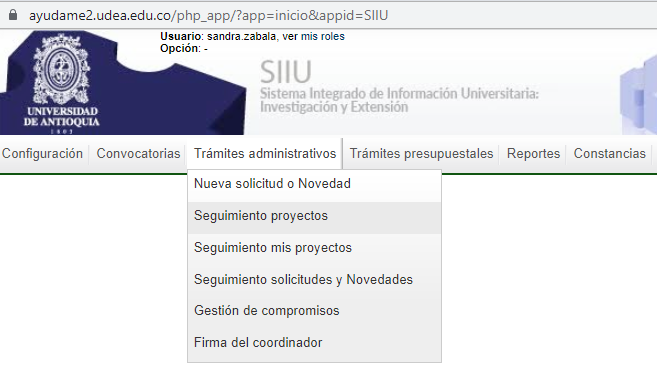
   *Figura 5 - Seguimiento a proyectos*

2. El sistema le muestra una nueva ventana donde aparecen los filtros de búsqueda. Seleccione el centro del proyecto y luego presione el botón **Consultar**.

   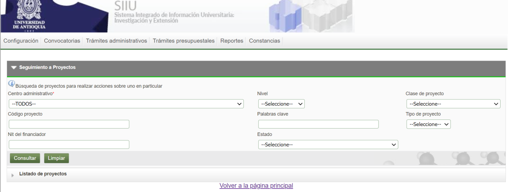
   *Figura 6 - Filtros de búsqueda*

3. Una vez identifique el proyecto que desea modificar, selecciónelo. Observe que el sistema presenta en la parte superior varios botones para hacer gestión. Seleccione el botón **Cambiar responsable**.

   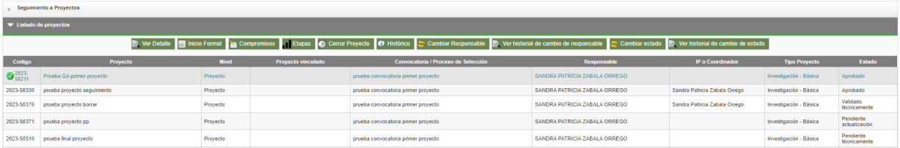
   *Figura 7 – Botón cambiar responsable*

4. Una vez selecciona el botón, el sistema presenta una nueva pantalla para el cambio del responsable. Presione el botón **Buscar** para agregar el número del documento del nuevo responsable.

   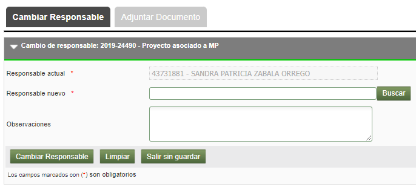
   *Figura 8 - Nuevo responsable*

5. Agregue el número del documento del nuevo responsable y presione el botón **Consultar**. El sistema trae la información del nuevo responsable; seleccione el registro presionando el icono check (✔️).

   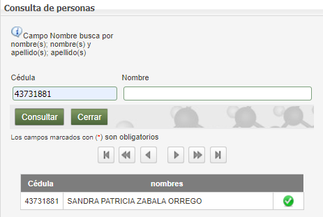
   *Figura 9 - Consulta nuevo participante*

6. Una vez se selecciona el nuevo responsable, el sistema agrega la información en el campo **Responsable nuevo**. Ingrese la información adicional que considere en el campo **Observaciones**.

   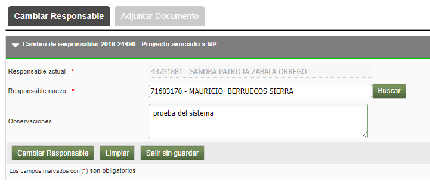
   *Figura 10 - Nuevo responsable para el proyecto*

7. Pase a la pestaña **Adjuntar Documento** y presione el icono **+** para agregar un nuevo documento.

   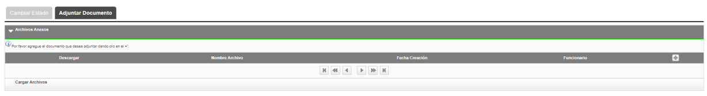
   *Figura 11 - Adjuntar documento*

8. Agregue la información propia de su documento adjunto (Documento, Tipo, Emisor, Fecha de emisión, Número, Descripción, Archivo). Regrese a la pestaña anterior y presione el botón **Cambiar responsable**.

   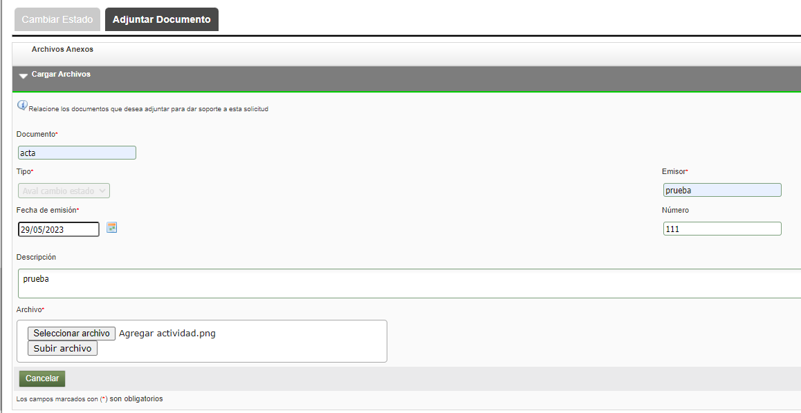
   *Figura 12 - Agregar información al documento adjunto*

9. El sistema cambia el responsable del proyecto exitosamente. El sistema permite ver el histórico del cambio de responsable aplicados para el proyecto; presione el icono **Ver historial cambio de responsable**.

   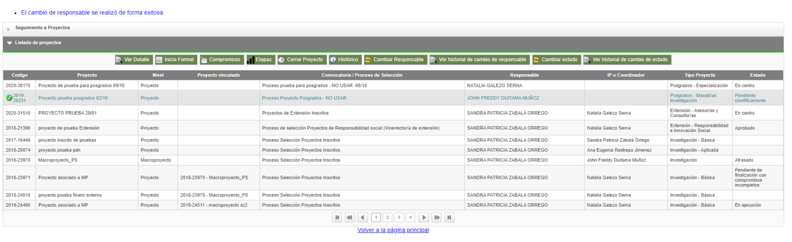
   *Figura 13 - Cambio responsable del proyecto exitoso*

---

### 2.5. Ver histórico de cambios de responsable aplicados

El sistema despliega una pantalla con la información histórica del proyecto:

| Campo | Detalle |
| :--- | :--- |
| **Consecutivo** | Código propio del sistema para la consulta |
| **Fecha** | Fecha del cambio |
| **Hora** | Hora del cambio |
| **Estado** | Estado del proyecto |
| **Responsable anterior** | Responsable anterior |
| **Responsable nuevo** | Nuevo responsable |
| **Usuario que registro** | Usuario que realizó el cambio |
| **Observaciones** | Detalle del cambio |

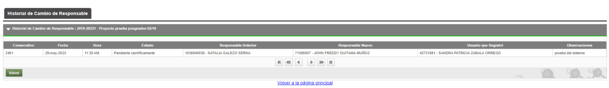
*Figura 14 - Histórico cambio de responsable*

- Presione el botón **Volver** para regresar.

---

## 3. Nota de cambio

- No aplica para la primera versión.

---

## Registro de Control y Firmas

| Rol | Nombre | Cargo / Dependencia | Fecha |
| :--- | :--- | :--- | :--- |
| **Elaboró** | Sandra Patricia Zabala Orrego | Contratista | 16-FEB-2024 |
| **Elaboró** | Lina María Ospina Pérez | Product Owner SIIU, Vicerrectoría de Investigación | 16-FEB-2024 |
| **Revisó** | Kerlin Yohana Bedoya Agudelo | Analista de Procesos, División de Arquitectura de Procesos | 12-MAR-2024 |
| **Revisó** | Julio César García Castrillón | Analista de Procesos, División de Arquitectura de Procesos | 12-MAR-2024 |
| **Aprobó** | Gloria Valencia Bustamante | Asistente, Vicerrectoría de Investigación | 13-MAR-2024 |

------------------------------------------------------------
## [DOCUMENTO]: VI-GU-04.md
*Ruta canónica original: `archivo_maestro/VI-GU-04.md`*
------------------------------------------------------------

# GUÍA PARA EL CIERRE DE PROYECTOS EN SIIU

> [!NOTE] Información de Control Documental
> **Código**: VI-GU-04  
> **Versión**: 01 / 13-MAR-2024  
> *Aviso legal institucional*: La impresión o copia digital de este documento se considera "COPIA NO CONTROLADA". Solo se garantiza la actualización de la documentación en el sitio oficial `http://www.udea.edu.co`.

---

## Contenido

1. [Definición](#1-definición)
2. [Contenido](#2-contenido)
   - 2.1. [Requisitos para el cierre](#21-requisitos-para-el-cierre)
   - 2.2. [Usuarios que intervienen en el proceso](#22-usuarios-que-intervienen-en-el-proceso)
   - 2.3. [Ingreso al SIIU](#23-ingreso-al-siiu)
   - 2.4. [Proceso Gestión de compromisos](#24-proceso-gestión-de-compromisos)
   - 2.5. [Cerrar un proyecto](#25-cerrar-un-proyecto)
3. [Nota de cambio](#3-nota-de-cambio)

---

## 1. Definición

Este documento se ha elaborado con el fin de ayudar y capacitar a las personas que desde los centros de investigación **Administran y gestionan los proyectos**, los cuales deben estar registrados en el **Sistema de Información para la Investigación Universitaria – SIIU**. 

Dado lo anterior se aclara que esta guía no hace parte de la normativa universitaria y solamente se debe utilizar como una herramienta que orienta los pasos a seguir para cerrar los proyectos en el SIIU.

---

## 2. Contenido

### 2.1. Requisitos para el cierre

- Para cerrar un proyecto, es necesario que se encuentre en estado **“Finalizado”**, es decir con todos los compromisos cumplidos.
- El único usuario autorizado para el cierre de proyectos es el **jefe de centro**.
- Debe tener disponible el (las) acta(s) de aprobación de cumplimiento de compromisos.

### 2.2. Usuarios que intervienen en el proceso

- **Usuario administrador centro**: jefe centro de investigación.

### 2.3. Ingreso al SIIU

El usuario que se encuentra registrado como jefe de centro debe autenticarse en el portal de la Universidad de Antioquia (`http://www.udea.edu.co`), buscar la opción aplicaciones y entre ellas elegir el SIIU, así:

1. Ingresa al portal de la Universidad: `http://www.udea.edu.co`, en el encabezado seleccione **Ingresar >> Iniciar sesión**.

   
   *Figura 1. Ingreso al portal de la Universidad de Antioquia.*

2. Aparece pantalla para ingresar su usuario y contraseña, seleccione **No soy un Robot** (el sistema le puede pedir realizar validaciones) finalmente presione clic en el botón **CONECTAR**.

   
   *Figura 2. Conectar al portal.*

3. Presione clic en la opción **Enlaces de Interés**, seleccione **Mis aplicaciones**.  
   *Ruta*: `Enlaces de interés → Mis aplicaciones`.

   
   *Figura 3. Enlaces de interés.*

4. Se abrirá una ventana con las aplicaciones de la Universidad, seleccione **SIIU**.

   
   *Figura 4. Seleccione SIIU.*

5. Se abre una nueva ventana con la aplicación SIIU.  
   > [!TIP] Configuración del Navegador
   > Si la ventana no abre inmediatamente, es necesaria la configuración de ventanas emergentes en el navegador y seleccionar la opción que autorice el SIIU.

---

### 2.4. Proceso Gestión de compromisos

Los compromisos del proyecto se dividen en dos conceptos:
- **Compromisos Obligatorios**: Son los compromisos configurados en la convocatoria, de acuerdo con los términos de referencia y que son de obligatorio cumplimiento.
- **Compromisos Opcionales**: Son aquellos compromisos internos para el proyecto que se desean asumir.

1. Ingrese por la opción:  
   `Trámites administrativos > Gestión de compromisos`.

   
   *Figura 5. Menú Gestión de compromisos.*

2. El SIIU abre una ventana con filtros de búsqueda, en la que debe elegir el centro de investigación correspondiente, este campo es obligatorio. Podrá agregar a la búsqueda del proyecto, los diferentes filtros o campos que dispone el sistema. Presione el botón **Consultar**.

   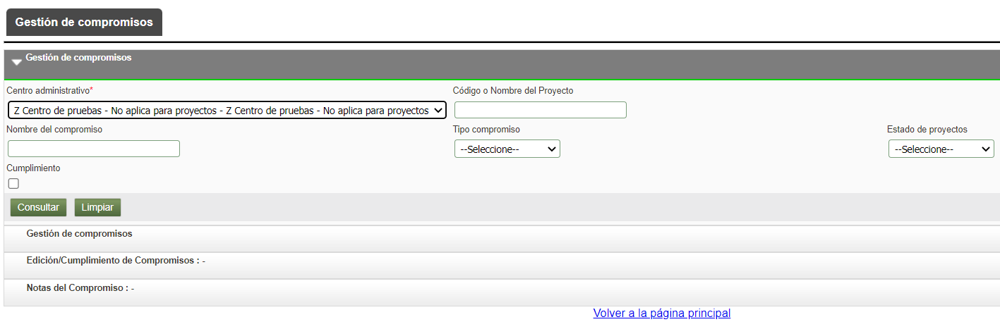
   *Figura 6. Filtros de consulta compromisos.*

   > [!IMPORTANT]
   > Si no utiliza otro filtro de consulta para especificar su proyecto, el sistema muestra por defecto, los compromisos pendientes de **TODOS** los proyectos de su centro.

3. Una vez realice la consulta, el sistema presenta listado de los compromisos pendientes por cumplir, además de los campos: tipo, proyecto, estado del proyecto, fecha estimada, la fecha real (campo vacío).  
   Seleccione con el cursor el compromiso que desea cumplir, en la parte superior del listado el sistema mostrará las diferentes opciones que tiene para el compromiso. Seleccione el botón **Cumplimiento**.

   
   *Figura 7. Listado de compromisos, seleccione compromiso.*

   > [!NOTE]
   > Solo podrá elegir un compromiso a la vez para gestionar su cumplimiento, por lo que deberá repetir el proceso tantas veces como compromisos tenga el proyecto.

4. El sistema abrirá una ventana donde el usuario podrá ver el detalle del compromiso seleccionado y deberá registrar los siguientes valores del acta en que fue aprobado el compromiso en los campos:
   - **Número acta**
   - **Fecha acta**
   - **Fecha real de cumplimiento** (es la fecha en la cual el investigador cumple con el compromiso).

   
   *Figura 8. Fecha real de cumplimiento.*

5. Puede agregar un comentario del compromiso que acaba de colocar la fecha real de finalización; para esto presione el botón **Notas del compromiso** y finalice con el botón **Agregar nota**. Una vez termine de ingresar toda la información del compromiso, presione el botón **Guardar**.

   
   *Figura 9. Nota al compromiso.*

6. El sistema muestra el mensaje *Actualizado exitosamente* y el compromiso desaparecerá de la lista del centro.
   *(Recuerde que solo muestra los compromisos pendientes).*  
   Deberá repetir el procedimiento con todos los compromisos faltantes asociados al proyecto que desea finalizar.

> [!IMPORTANT]
> Cuando se cumplan todos los compromisos obligatorios del proyecto, automáticamente este pasa a estado **FINALIZADO**.

---

### 2.5. Cerrar un proyecto

Cuando el proyecto se encuentra en estado **Finalizado**, se puede proceder con el Cierre del proyecto.

1. El usuario que se encuentra registrado como Jefe de Centro debe ingresar al SIIU e ingresar al menú:  
   `Trámites administrativos > Seguimiento proyectos`.

   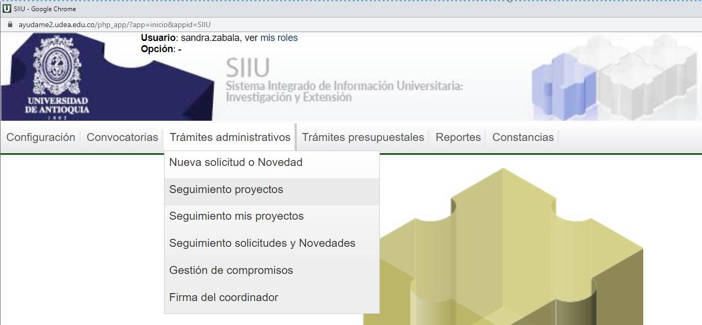
   *Figura 10. Seguimiento a proyectos.*

2. El SIIU abre una ventana en la que podrá realizar la búsqueda del proyecto que desea cerrar. Elija el centro de investigación correspondiente; para agilizar la búsqueda del proyecto, seleccione estado: **Finalizado** y presione botón **Consultar**.

   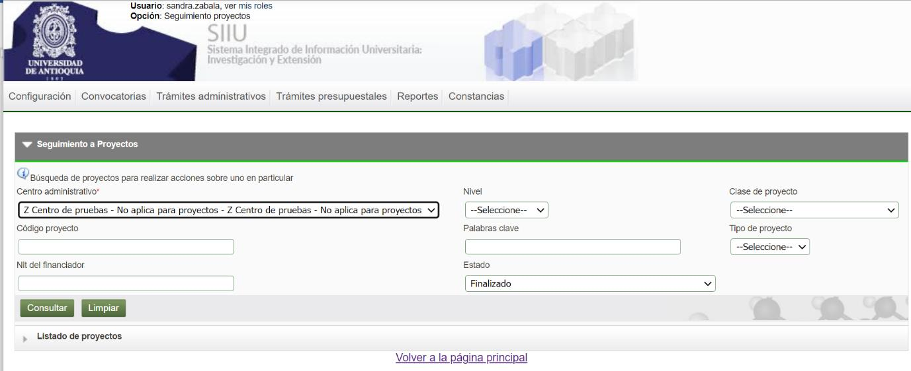
   *Figura 11. Estado finalizado.*

3. El sistema arroja el listado de los proyectos administrados por el centro que se encuentran en estado Finalizado.

   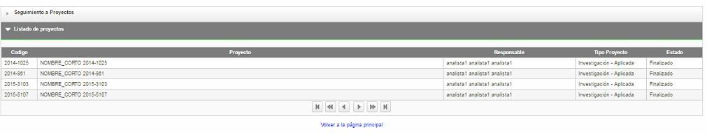
   *Figura 12. Proyectos estado finalizado.*

4. Seleccione mediante un clic, el proyecto que desee cerrar. El SIIU mostrará las diferentes opciones que tiene el proyecto en la parte superior de la lista y allí debe elegir el botón **Cerrar proyecto**.

   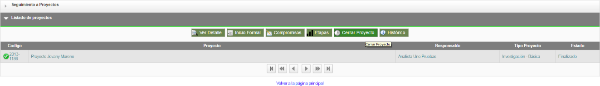
   *Figura 13. Botón del Cerrar proyecto.*

5. El sistema abre un formulario para registrar la evaluación de finalización del proyecto, presione el botón **Generar acta**.

   
   *Figura 14. Generar acta de finalización.*

6. El sistema habilitará una ventana donde se debe ingresar la información en los siguientes campos:

| Campo | Detalle |
| :--- | :--- |
| **Acta de comité técnico** | Ingrese el código del acta |
| **Fecha del comité técnico** | Ingrese fecha |
| **Financiador o cofinanciador** | Valores de dineros que han sido ejecutados en fresco o especie |

   Finalice presionando el botón **Generar acta de finalización**.

   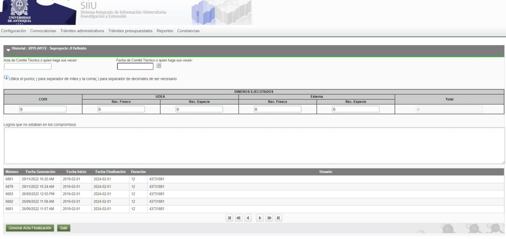
   *Figura 15. Generar acta de finalización.*

7. El sistema genera un documento PDF que deberá descargar e imprimir para agregar las firmas respectivas.

   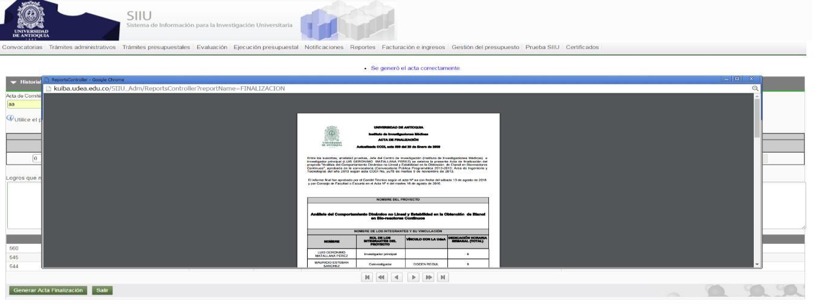
   *Figura 16. Acta de finalización PDF.*

   > [!IMPORTANT]
   > Una vez el acta de finalización se encuentre completamente firmada, debe escanearla en formato PDF y adjuntarla al SIIU para proceder con el cierre del proyecto.

8. Para adjuntar el documento generado, debe volver a ingresar al SIIU, seleccionar el proyecto y buscar la opción **Cerrar proyecto**. El sistema abrirá la ventana de cierre y allí debe presionar la pestaña **Adjuntar documento**, ingresar la información requerida en pantalla, adjuntar el documento y presionar el botón **Guardar**.

   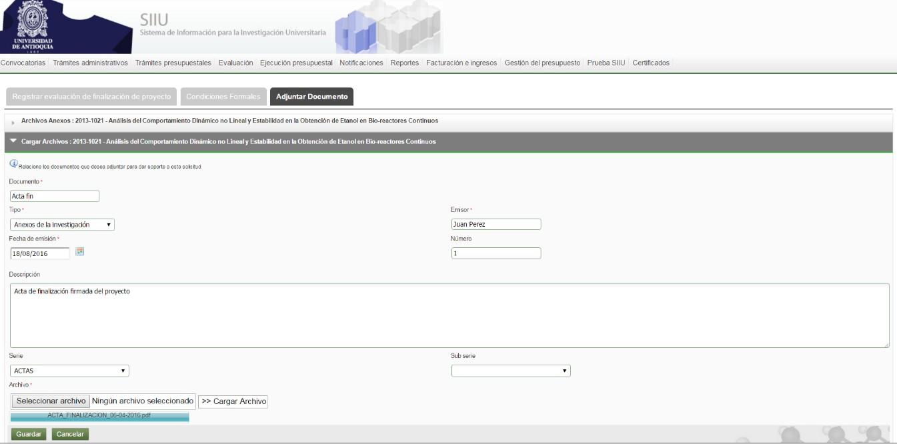
   *Figura 17. Documento adjunto.*

9. Valide que el documento se cargó exitosamente; observe que aparece en la lista de documentos adjuntos.

   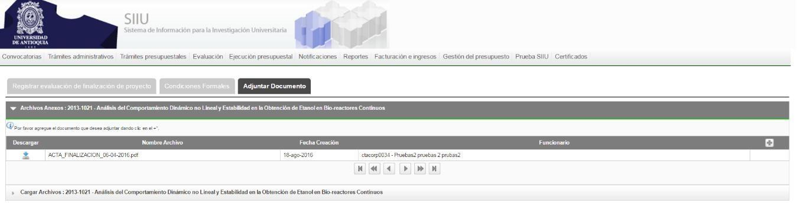
   *Figura 18. Valida documento adjunto.*

---

## 3. Nota de cambio

- No aplica para la primera versión.

---

## Registro de Control y Firmas

| Rol | Nombre | Cargo / Dependencia | Fecha |
| :--- | :--- | :--- | :--- |
| **Elaboró** | Sandra Patricia Zabala Orrego | Contratista | 16-FEB-2024 |
| **Elaboró** | Lina María Ospina Pérez | Product Owner SIIU, Vicerrectoría de Investigación | 16-FEB-2024 |
| **Revisó** | Kerlin Yohana Bedoya Agudelo | Analista de Procesos, División de Arquitectura de Procesos | 12-MAR-2024 |
| **Revisó** | Julio César García Castrillón | Analista de Procesos, División de Arquitectura de Procesos | 12-MAR-2024 |
| **Aprobó** | Gloria Valencia Bustamante | Asistente, Vicerrectoría de Investigación | 13-MAR-2024 |

------------------------------------------------------------
## [DOCUMENTO]: VI-GU-06.md
*Ruta canónica original: `archivo_maestro/VI-GU-06.md`*
------------------------------------------------------------

# GUÍA PARA LA ASIGNACIÓN DE EVALUADORES EN SIIU

> [!NOTE] Información de Control Documental
> **Código**: VI-GU-06  
> **Versión**: 01 / 13-MAR-2024  
> *Aviso legal institucional*: La impresión o copia digital de este documento se considera "COPIA NO CONTROLADA". Solo se garantiza la actualización de la documentación en el sitio oficial `http://www.udea.edu.co`.

---

## Contenido

1. [Definición](#1-definición)
2. [Contenido](#2-contenido)
   - 2.1. [Requisitos para Asignar evaluadores al SIIU](#21-requisitos-para-asignar-evaluadores-al-siiu)
   - 2.2. [Usuarios que intervienen en el proceso](#22-usuarios-que-intervienen-en-el-proceso)
   - 2.3. [Ingresar al SIIU](#23-ingresar-al-siiu)
   - 2.4. [Asignar Evaluación científica](#24-asignar-evaluación-científica)
   - 2.5. [Asignar Evaluadores](#25-asignar-evaluadores)
     - 2.5.1. [Opción Editar](#251-opción-editar)
     - 2.5.2. [Opción Eliminar](#252-opción-eliminar)
     - 2.5.3. [Opción Actualizar información de evaluador](#253-opción-actualizar-información-de-evaluador)
     - 2.5.4. [Opción Enviar correo con manual](#254-opción-enviar-correo-con-manual)
   - 2.6. [Agregar Evaluador](#26-agregar-evaluador)
     - 2.6.1. [Evaluador no registrado en SIIU](#261-evaluador-no-registrado-en-siiu)
     - 2.6.2. [Agregar evaluador existente](#262-agregar-evaluador-existente)
   - 2.7. [Asignar rol de evaluador](#27-asignar-rol-de-evaluador)
3. [Nota de cambio](#3-nota-de-cambio)

---

## 1. Definición

El presente documento tiene como propósito ayudar y capacitar a las personas que desde los centros de investigación / extensión **Administran y gestionan los proyectos**, los cuales deben estar registrados en el **Sistema de Información Integrado de información Universitaria: Investigación y Extensión – SIIU**. 

Dado lo anterior se aclara que esta guía no hace parte de la normativa universitaria y solamente se debe utilizar como una herramienta que orienta los pasos a seguir en el SIIU para asignar los evaluadores internos y externos por parte del centro de investigación.

---

## 2. Contenido

### 2.1. Requisitos para Asignar evaluadores al SIIU

- Para evaluar un proyecto por el Sistema Integrado de Información Universitaria: Investigación y Extensión - SIIU, se debe tener en cuenta la reglamentación aprobada por el Comité para el Desarrollo de la Investigación CODI o el Comité de Extensión, para el proceso de evaluación de los proyectos en el marco de una convocatoria, documento términos de referencia.
- El usuario con rol de centro de investigación, debe estar registrado en el portal institucional y tener acceso a SIIU.
- El usuario con rol de centro de investigación debe tener acceso a la opción de evaluación técnica y aval para el proyecto.
- El proyecto debe estar en estado **Aprobada evaluación técnica**.

### 2.2. Usuarios que intervienen en el proceso

El centro de investigación es quien se encarga de la evaluación técnica del proyecto y de dar Aval en el Sistema de Información Integrado de información Universitaria: Investigación y Extensión – SIIU, una vez el Investigador envía al centro de investigación o extensión el proyecto por medio de la plataforma, el centro revisa, avala y envía a la Vicerrectoría correspondiente Investigación – Extensión para continuar con el proceso de aprobación del proyecto.

### 2.3. Ingresar al SIIU

El usuario con rol de centro debe autenticarse en el portal de la Universidad de Antioquia (`http://www.udea.edu.co`), buscar la opción aplicaciones y entre ellas elegir el SIIU, así:

1. Ingrese al portal de la Universidad: `http://www.udea.edu.co`, en el encabezado seleccione **Ingresar >> Iniciar sesión**.

   
   *Figura 1 - Conectar al portal*

2. Aparece pantalla para ingresar su usuario y contraseña, seleccione **No soy un Robot** (el sistema le puede pedir realizar validaciones) finalmente presione clic en el botón **CONECTAR**.

   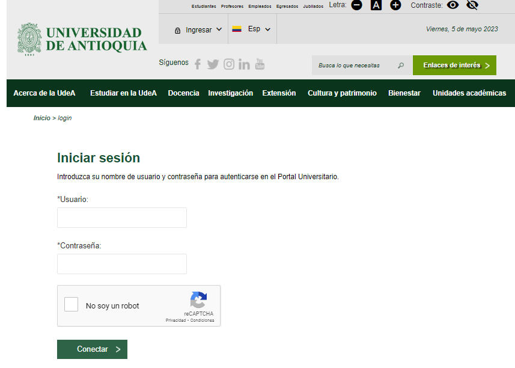
   *Figura 2 - Inicio de sesión*

3. Presione clic en la opción **Enlaces de Interés**, seleccione **Mis aplicaciones**.  
   *Ruta*: `Enlaces de interés → Mis aplicaciones`.

   
   *Figura 3 - Enlaces de interés*

4. Se abrirá una ventana con las aplicaciones de la Universidad, seleccione **SIIU**.

   
   *Figura 4 - Seleccione SIIU*

5. Se abre una nueva ventana con la aplicación SIIU.  
   > [!TIP] Configuración del Navegador
   > Si la ventana no abre inmediatamente, es necesaria la configuración de ventanas emergentes en el navegador y seleccionar la opción que autorice el SIIU.

---

### 2.4. Asignar Evaluación científica

Para el caso de los proyectos registrados en una convocatoria de *Primer proyecto*, o en otra convocatoria donde se haya definido una etapa de evaluación científica, el centro de investigación **ANTES** de realizar el proceso de Avales, es decir cuando el proyecto se encuentra en estado **Aprobada evaluación técnica**, debe asignar los evaluadores para que se realice el proceso de evaluación científica.

1. Para iniciar este proceso estando en SIIU, ingrese a la opción:  
   `Convocatorias > Proyectos en evaluación`.

   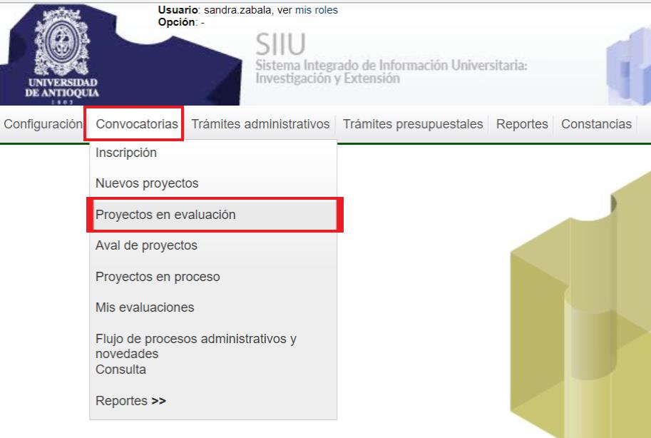
   *Figura 5 - Opción de menú*

2. Realice el filtro de búsqueda teniendo en cuenta que el proyecto se encuentre en estado **Aprobada Evaluación técnica**.

   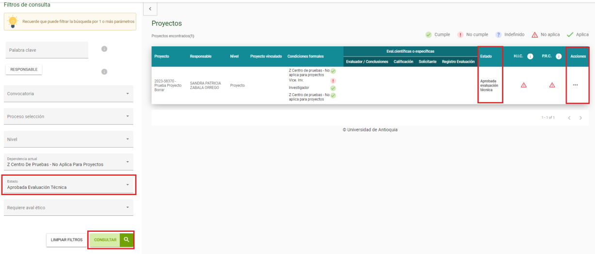
   *Figura 6 - Filtro de búsqueda*

---

### 2.5. Asignar Evaluadores

Cuando el proyecto se encuentra en estado **Aprobada Evaluación técnica**, el centro puede asignar los evaluadores (Interno o externo) para el proyecto.

1. Una vez haya realizado la consulta, presione el botón **Acciones** y en los tres puntos seleccione **Asignar Evaluadores**.

   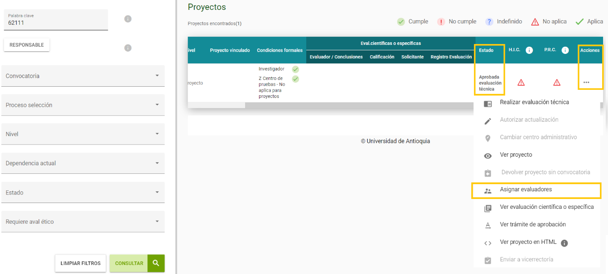
   *Figura 7 - Asignar Evaluadores*

2. El sistema muestra el o los evaluadores que fue(n) recomendado(s) en la matrícula del proyecto. Revise que en el campo asignación, el evaluador aparece con la etiqueta **Recomendado**. Presione los tres puntos del botón acciones.

   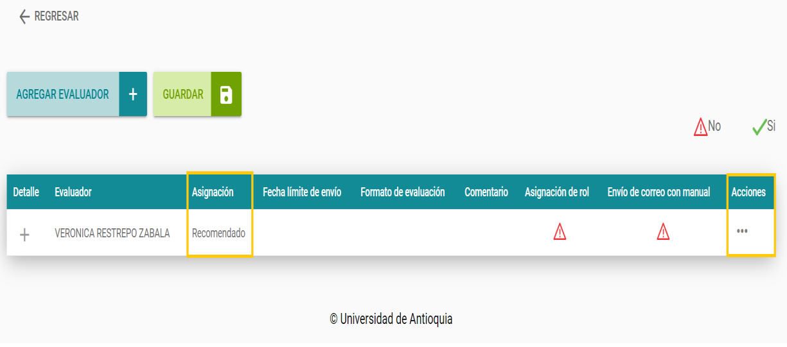
   *Figura 8 (en doc ref. Figura 2) - Evaluador recomendado*

3. El sistema presenta las siguientes acciones:

| Acción | Detalle |
| :--- | :--- |
| **Editar** | Permite cambiar la asignación del evaluador de recomendado a seleccionado o descartado. |
| **Eliminar** | Permite eliminar el registro del evaluador. |
| **Actualizar información del evaluador** | Permite actualizar los datos personales y la institución del evaluador. |
| **Asignar rol de evaluador** | Permite habilitar al evaluador la ficha de evaluación. |
| **Enviar correo con manual** | Envía al evaluador un correo con el enlace del proyecto. |

   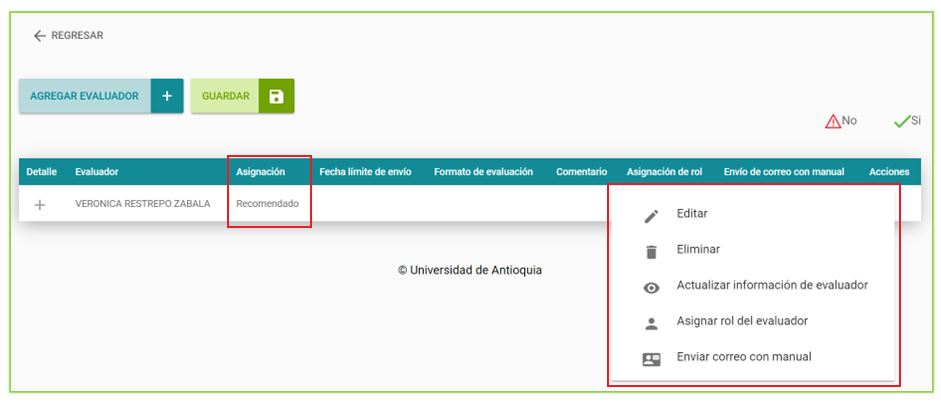
   *Figura 9 - Menú botón acciones evaluador*

#### 2.5.1. Opción Editar

1. Seleccione la opción **Editar**, el sistema presenta un nuevo formulario. En el campo asignación trae los valores *seleccionado* o *descartado*; elija la opción requerida para cambiar de estado al evaluador recomendado, agregue información en el campo comentario y presione **Editar**.

   
   *Figura 10 - Editar Evaluador*

2. Para aceptar el Evaluador debe elegir la opción **Seleccionado**. El sistema abre un nuevo formulario para definir la **Fecha límite de envío** de la evaluación y el **Formato de evaluación** que será utilizado por el evaluador. Finalice con el botón **EDITAR**.

   
   *Figura 11 (en doc ref. Figura 3) - Editar evaluador*

3. Una vez se ha seleccionado el evaluador, el sistema muestra el resumen. Presione el botón **GUARDAR**.

   
   *Figura 12 (en doc ref. Figura 4) - Resumen de evaluador*

#### 2.5.2. Opción Eliminar

Puede suceder que se requiera eliminar el evaluador. Presione la opción **Eliminar** del menú del evaluador. El sistema presenta mensaje de confirmación:  
*¿Está seguro que desea eliminar este evaluador?*  
Si desea eliminarlo presione **Eliminar**, o **Cancelar** para descartar.

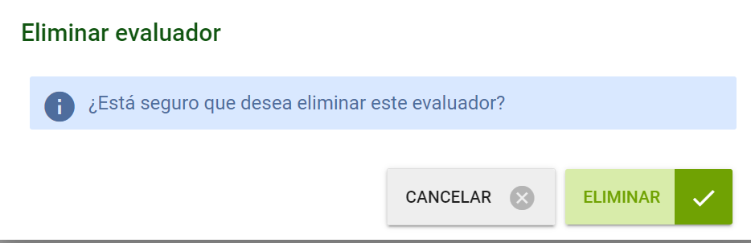
*Figura 13 - Eliminar evaluador*

#### 2.5.3. Opción Actualizar información de evaluador

En esta opción, el sistema muestra la información personal del evaluador para modificar en caso de ser requerido (Identificación, Tipo de documento, Fecha de nacimiento, Nombres, Primer apellido, Segundo apellido).


*Figura 14 - Actualizar información del evaluador*

Una vez termine de actualizar los datos personales y/o institución, presione el botón **Actualizar evaluador**, o cancelar para descartar los cambios.

#### 2.5.4. Opción Enviar correo con Manual

En esta opción el sistema genera un mensaje indicando que se ha enviado al evaluador el enlace para visualizar el proyecto.


*Figura 15 (en doc ref. Figura 5) - Envío notificación al evaluador*

---

### 2.6. Agregar Evaluador

Cuando no se tienen evaluadores recomendados es necesario **Agregar Nuevo evaluador**, cuando la convocatoria lo exija. Presione el botón **AGREGAR EVALUADOR**.


*Figura 16 (en doc ref. Figura 6) - Filtro de búsqueda Agregar evaluador*

El sistema presenta nuevo formulario para agregar un nuevo evaluador al sistema. Ingrese el número de documento en el campo identificación y presione **Buscar**.

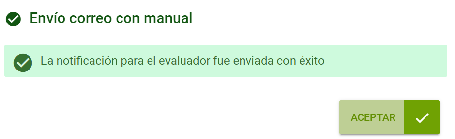
*Figura 17 (en doc ref. Figura 7) - Agregar evaluador*

#### 2.6.1. Evaluador no registrado en SIIU

Si el evaluador no se encuentra registrado en SIIU, el sistema permite el ingreso del nuevo evaluador por el botón **Registrar evaluador +**.


*Figura 18 - Agregar nuevo evaluador*

Ingrese toda la información requerida (Identificación, Tipo de documento, Fecha de nacimiento, Nombres, Primer apellido, Segundo apellido, Sexo, Correo, Teléfono, Celular, Estado, Dirección, Continente, País, Departamento, Municipio, Institución, Área de especialidad, Dirección CvLac, Observación). Presione **Registrar evaluador**.


*Figura 19 - Datos nuevo evaluador*

#### 2.6.2. Agregar evaluador existente

1. Ingrese el número de documento en el campo **Identificación** y presione **Buscar**. El sistema trae la información del evaluador que existe en SIIU. Presione el botón **Seleccionar**.

   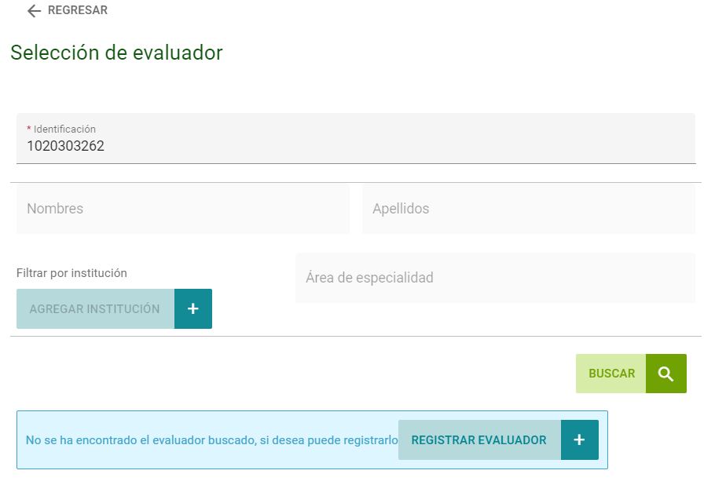
   *Figura 20 - Consultar evaluador*

   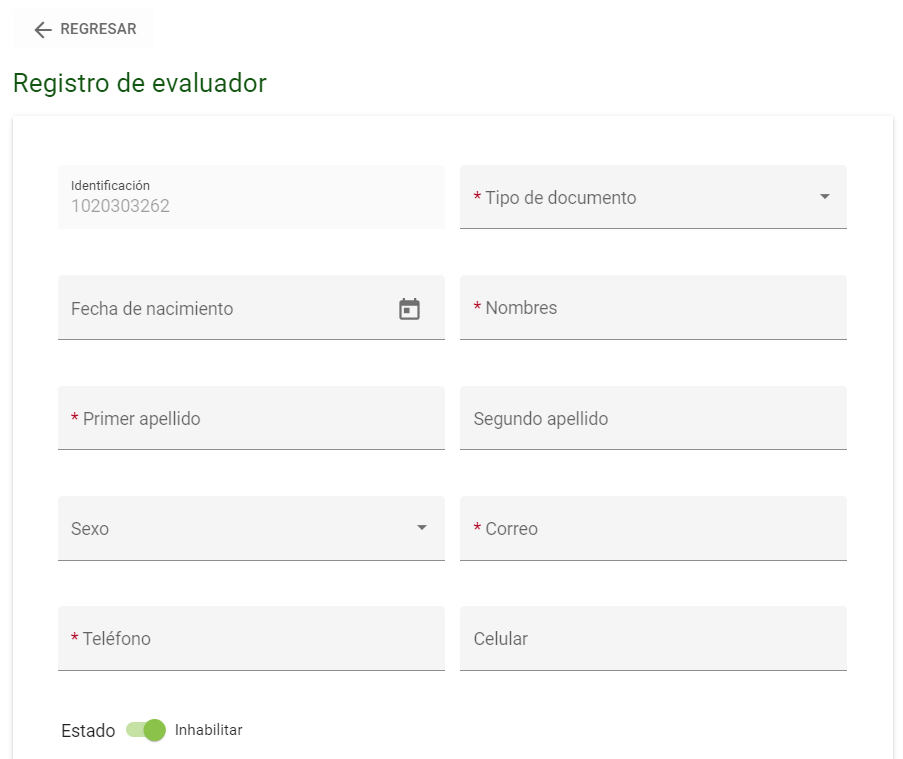
   *Figura 21 - Seleccionar evaluador*

2. Se abre una nueva ventana para asignar el evaluador; el sistema despliega las opciones: *Recomendado, Seleccionado, Descartado*. Elija la opción **Seleccionado**. Ingrese la información requerida (Fecha límite de envío, Formato de evaluación, Correo de notificación, Comentario) y finalice con el botón **AGREGAR**.

   
   *Figura 22 (en doc ref. Figura 8) - Pasar el evaluador a estado seleccionado*

   
   *Figura 23 (en doc ref. Figura 9) - Agregar evaluador existente*

---

### 2.7. Asignar rol de evaluador

1. Estando en la pantalla de resumen de los evaluadores seleccionados presione los tres puntos de la columna acciones.

   
   *Figura 24 - Asignar rol evaluador*

2. Seleccione el registro del evaluador y presione la opción **Asignar rol de evaluador**. Presione **GUARDAR** para finalizar.

> [!NOTE] Procedimiento Transitorio
> Esta parte del proceso se hace de forma manual mientras se ajusta el proceso de evaluación por el sistema; una vez se normalice continúa el proceso desde el sistema.  
> Una vez asignados los evaluadores, el proyecto queda en estado **Pendiente científicamente** y desde el centro se deben enviar en PDF las dos o tres evaluaciones a la Vicerrectoría de Investigación indicando:
> - Código del proyecto.
> - Identificación de los evaluadores como está registrada en SIIU.
> - Señalando quién es el evaluador 1 y quién es el evaluador 2 (las evaluaciones deben corresponder con esta misma estructura: *evaluación 1* y *evaluación 2*).
>
> *Nota institucional*: Todos los datos mostrados en las imágenes fueron tomados de proyectos y procesos usados para efectos de pruebas.

---

## 3. Nota de cambio

- No aplica para la primera versión.

---

## Registro de Control y Firmas

| Rol | Nombre | Cargo / Dependencia | Fecha |
| :--- | :--- | :--- | :--- |
| **Elaboró** | Sandra Patricia Zabala Orrego | Contratista | 16-FEB-2024 |
| **Elaboró** | Lina María Ospina Pérez | Product Owner SIIU, Vicerrectoría de Investigación | 16-FEB-2024 |
| **Revisó** | Kerlin Yohana Bedoya Agudelo | Analista de Procesos, División de Arquitectura de Procesos | 12-MAR-2024 |
| **Revisó** | Julio César García Castrillón | Analista de Procesos, División de Arquitectura de Procesos | 12-MAR-2024 |
| **Aprobó** | Gloria Valencia Bustamante | Asistente, Vicerrectoría de Investigación | 13-MAR-2024 |

------------------------------------------------------------
## [DOCUMENTO]: VI-GU-07.md
*Ruta canónica original: `archivo_maestro/VI-GU-07.md`*
------------------------------------------------------------

# GUÍA PARA LA CONFIGURACIÓN DE LA CONVOCATORIA

> [!NOTE] Información de Control Documental
> **Código**: VI-GU-07  
> **Versión**: 01 / 13-MAR-2024  
> *Aviso legal institucional*: La impresión o copia digital de este documento se considera "COPIA NO CONTROLADA". Solo se garantiza la actualización de la documentación en el sitio oficial `http://www.udea.edu.co`.

---

## Contenido

1. [Definición](#1-definición)
2. [Políticas](#2-políticas)
3. [Contenido](#3-contenido)
   - 3.1. [Ingresar al sistema SIIU por el portal institucional](#31-ingresar-al-sistema-siiu-por-el-portal-institucional)
   - 3.2. [Inscripción de convocatoria](#32-inscripción-de-convocatoria)
   - 3.3. [Información general](#33-información-general)
     - 3.3.1. [Sección nombre y descripción de la convocatoria](#331-sección-nombre-y-descripción-de-la-convocatoria)
     - 3.3.2. [Sección Financiadores](#332-sección-financiadores)
     - 3.3.3. [Sección proceso de selección, fechas, hora de cierre de la convocatoria](#333-sección-proceso-de-selección-fechas-hora-de-cierre-de-la-convocatoria)
     - 3.3.4. [Sección permisos](#334-sección-permisos)
     - 3.3.5. [Sección Inicio con NN y GUARDAR](#335-sección-inicio-con-nn-y-guardar)
   - 3.4. [Cronograma de la convocatoria](#34-cronograma-de-la-convocatoria)
   - 3.5. [Presupuestal](#35-presupuestal)
     - 3.5.1. [Opción modalidades de financiación](#351-opción-modalidades-de-financiación)
     - 3.5.2. [Opción rubros financiables](#352-opción-rubros-financiables)
     - 3.5.3. [Opción cambio de rubros preautorizados](#353-opción-cambio-de-rubros-preautorizados)
     - 3.5.4. [Porcentaje máximo de rubros](#354-porcentaje-máximo-de-rubros)
   - 3.6. [Compromisos y condiciones formales](#36-compromisos-y-condiciones-formales)
     - 3.6.1. [Compromisos](#361-compromisos)
     - 3.6.2. [Condiciones formales](#362-condiciones-formales)
   - 3.7. [Estructura de proyecto](#37-estructura-de-proyecto)
   - 3.8. [Documento soporte](#38-documento-soporte)
   - 3.9. [Publicar convocatoria](#39-publicar-convocatoria)
4. [Nota de cambio](#4-nota-de-cambio)

---

## 1. Definición

Este documento se ha elaborado con el fin de ayudar y capacitar a usuarios que administran proyectos de las **vicerrectorías de investigación / extensión**, los cuales deben estar registrados en el **Sistema de Información Integrado de información Universitaria: Investigación y Extensión – SIIU**. 

Dado lo anterior se aclara que esta guía no hace parte de la normativa universitaria y solamente se debe utilizar como una herramienta que orienta el paso que se debe seguir en el SIIU para la matrícula de convocatorias en el sistema SIIU.

---

## 2. Políticas

- Para la matrícula de una convocatoria en el Sistema Integrado de Información Universitaria: Investigación y Extensión se debe tener el proceso de selección que fue creado previamente para asociarlo a la convocatoria.
- De otro lado se deben tener el documento de los términos de referencia definidos para la convocatoria.

---

## 3. Contenido

### 3.1 Ingresar al sistema SIIU por el portal institucional

El usuario debe autenticarse en el portal de la Universidad de Antioquia (`http://www.udea.edu.co`), buscar la opción aplicaciones y entre ellas elegir el SIIU, así:

1. Ingresa al portal de la Universidad: `http://www.udea.edu.co`, en el encabezado seleccione **Ingresar >> Iniciar sesión**.

   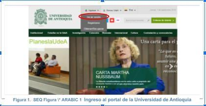
   *Figura 1. Ingreso al portal de la UdeA.*

2. Aparecerá la pantalla para iniciar sesión como usuario del portal; ingrese usuario y contraseña luego presione clic en el botón **CONECTAR**.

   
   *Figura 2. Inicio de sesión en portal de la UdeA.*

3. Se abrirá una ventana con su nombre en la parte izquierda de la página, seleccione:  
   `Enlaces de interés → Mis aplicaciones`.

   
   *Figura 3. Aplicaciones del sistema.*

4. El sistema carga una ventana con las aplicaciones de la Universidad a las cuales el usuario tiene acceso, seleccione la aplicación **SIIU**.

   
   *Figura 4. Seleccione SIIU.*

5. Se debe abrir una nueva ventana con la aplicación SIIU en la que podrá iniciar el registro del proyecto.  
   > [!TIP] Ventanas Emergentes
   > Si la ventana no abre inmediatamente, es necesaria la configuración de ventanas emergentes en el navegador y seleccionar la opción que autorice el SIIU.

---

### 3.2 Inscripción de convocatoria

Para la matrícula de convocatorias en el sistema SIIU, es indispensable considerar los prerrequisitos del proceso:
- Tener proceso de selección creado para la convocatoria. *(Ver manual de creación de proceso de selección)*.
- Documento de términos de referencia de la convocatoria a inscribir.

> [!IMPORTANT]
> El usuario que realiza el proceso es el **Administrador del sistema SIIU de las vicerrectorías**.

**Ruta de acceso**: Ingrese a la opción del menú SIIU: `Convocatorias > Inscripción`.


*Figura 5. Menú convocatoria.*

El sistema presenta la pantalla con la información general de la convocatoria con el **tren de opciones** que serán configuradas:
1. Información general
2. Cronograma
3. Presupuestal
4. Compromisos y condiciones
5. Estructura de proyecto
6. Documentos soporte


*Figura 6. Tren de opciones convocatoria.*

---

### 3.3 Información general

#### 3.3.1 Sección nombre y descripción de la convocatoria

Ingrese la información a los siguientes campos de acuerdo a los términos de referencia:
- **Nombre corto**
- **Nombre largo**
- **Descripción**: ingrese la descripción de la convocatoria. *(Tenga presente que tiene hasta 4000 caracteres para ingresar la información)*.


*Figura 7. Información general / Sección nombre y descripción de la convocatoria.*

#### 3.3.2 Sección Financiadores

1. Defina los financiadores de la convocatoria; seleccione el botón **Seleccionar financiadores** y presione el icono **+** para agregar.
2. Realice la búsqueda de los financiadores nacional o internacional. En caso de que no existan en la base de datos, el sistema permite ingresar los financiadores.
3. Ingrese el nombre de la entidad en el campo palabra clave o escriba el NIT en el campo definido, presione el botón **BUSCAR**.


*Figura 8. Información General - Sección financiadores.*

4. Una vez se ha realizado la consulta, el sistema trae la información del financiador y permite seleccionarlo con la opción **AGREGAR FINANCIADOR**.


*Figura 9. Selección de financiador.*

5. Cuando el financiador elegido es la **Universidad de Antioquia**, el sistema solicita información adicional, como la **dependencia** y **programa**. Esta opción se realiza para posteriormente definir el centro de costos.


*Figura 10. Selección dependencia.*

6. Presione el botón **Guardar financiadores** para el almacenamiento en la base de datos del financiador elegido.

#### 3.3.3 Sección proceso de selección, fechas, hora de cierre de la convocatoria

En esta sección se debe ingresar información en los siguientes campos:
- **Buscar proceso de selección**: se elige el proceso de selección definido para la convocatoria.
- **Fecha de apertura**: se elige del calendario la fecha de apertura de la convocatoria.
- **Fecha de cierre**: se elige del calendario la fecha de cierre de la convocatoria.
- **Fecha de resultados**: se elige del calendario la fecha de resultados de la convocatoria.
- **Hora de cierre**: se define la hora de cierre de la convocatoria en formato militar 24 horas.


*Figura 11. Definición de fechas para la convocatoria.*

#### 3.3.4 Sección permisos

Defina los siguientes permisos:
- **Tipo**: despliegue los usuarios que tendrán acceso para la matrícula de proyecto de convocatoria.
- **Subtipo**: defina los roles que participan.
- **Instancia**: seleccione la(s) instancia(s) que hacen parte de la gestión o evaluación de los proyectos que se vinculen a la convocatoria.
- **Utilización**: seleccione la opción **TODOS**; estos son roles propios del sistema para el ingreso desde el portal.


*Figura 12. Permisos y roles de acceso.*

#### 3.3.5 Sección Inicio con NN y GUARDAR

- **Permite inicio con NN**: indica si los proyectos permiten iniciar con NN, de acuerdo con los términos de referencia.
- **Tiempo proyecto en lista**: indica el tiempo que los proyectos quedan en lista de espera (por defecto aparece 0).
- **Observaciones**: campo que permite agregar observaciones para la convocatoria que se está configurando (puede ingresar hasta 400 caracteres).
- Presione el botón **GUARDAR** para almacenar el registro de configuración de la convocatoria.


*Figura 13. Inicio con NN y Guardar.*


*Figura 14. Ejemplo Información general.*


*Figura 15. Ejemplo Información general (Plazos, prórrogas, suspensiones y cancelaciones).*

---

### 3.4 Cronograma de la convocatoria

Seleccione esta opción para agregar las etapas de la convocatoria y presione **Agregar evento**.


*Figura 16. Agregar evento.*

> [!IMPORTANT]
> Este proceso es muy importante porque define las etapas de los proyectos ya sea para **AVALAR** en el centro o **APROBAR** en la vicerrectoría. Se recomienda colocar en el campo *Nombre del evento*: `Avalar proyecto` o `Aprobar proyecto` según sea el caso.

El sistema presenta formulario con las opciones:
- **Nombre del evento**: defina si el proceso a configurar es Avalar o Aprobar.
- **Hito en proceso de selección**: despliegue la lista de valores para el hito y seleccione de acuerdo al nombre del evento definido.


*Figura 17. Configuración Hito.*

- **Fecha de inicio**: ingrese la fecha de inicio del evento.
- **Fecha fin**: ingrese la fecha fin del evento.
- Presione botón **AGREGAR EVENTO**.


*Figura 18. Agregar evento.*

Una vez se agregue el evento, el sistema presenta resumen del evento guardado. Recuerde presionar **GUARDAR** para almacenar el registro.


*Figura 19. Guardar evento.*

> [!NOTE] Modificación de eventos
> Puede modificar el evento **ANTES** de publicar la convocatoria: presione los tres puntos para **Editar** o **Eliminar** el evento.


*Figura 20. Editar evento.*


*Figura 21. Resumen de hitos para la convocatoria.*

---

### 3.5 Presupuestal

En el proceso de configuración presupuestal para la convocatoria, aparecen las opciones:
- Modalidades de financiación
- Rubros financiables
- Cambio de rubros preautorizados
- Porcentaje máximo de rubros


*Figura 22. Configuración presupuestal de la convocatoria.*

#### 3.5.1. Opción modalidades de financiación

Esta opción de la configuración presupuestal permite definir un monto fijo para la convocatoria. Contiene los campos:
- **Nombre modalidad**: ingrese el nombre para la modalidad. *(Pueden ingresarse más de una modalidad de acuerdo con los términos de referencia de la convocatoria)*.
- **Monto máximo**: ingrese el valor máximo de la modalidad.
- **Duración máxima**: ingrese la duración en meses.
- Presione **Agregar Modalidad**.


*Figura 23. Modalidad de financiación.*

#### 3.5.2. Opción rubros financiables

Permite definir los rubros que estarán habilitados para la convocatoria según los términos de referencia. Presione el botón **Agregar Rubro +**.

El sistema abre un nuevo formulario con los siguientes campos:
- **Rubro Financiable**: despliegue lista de rubros y seleccione.
- **Nombre del Rubro**: indique el nombre.
- **Permitido para**: seleccione la instancia (S).
- **Justificación solicitada**: ingrese valor en el campo.
- **Descripción**: ingrese valor en el campo.
- **Rubro padre**: despliegue lista de rubros si aplica.
- **Active la opción si el rubro aplica para los cofinanciadores**: se activa esta opción cuando el proyecto cuenta con cofinanciadores con aportes, en fresco o en especie.
- **Calcular administración**: cuando se selecciona el rubro administración, se activa este botón.
- Presione botón **Agregar Rubro**.


*Figura 24. Agregar rubro.*


*Figura 25. Lista rubros financiables.*

> [!NOTE]
> Debe realizar el mismo proceso por cada rubro que desea vincular a la convocatoria.


*Figura 26. Agregando rubro financiable.*

#### 3.5.3. Opción cambio de rubros preautorizados

Si requiere agregar rubros preautorizados, presione el botón **Agregar Rubro +**.


*Figura 27. Rubros preautorizados.*

#### 3.5.4. Porcentaje máximo de rubros

Dependiendo de los términos de la convocatoria, agregue el máximo porcentaje para los rubros. Presione el botón **Agregar Porcentaje**.


*Figura 28. Máximo porcentaje para los rubros.*


*Figura 29. Porcentaje máximo de rubros.*


*Figura 30. Resumen porcentaje máximo de rubros.*

---

### 3.6 Compromisos y condiciones formales

Permite la configuración en la convocatoria de los compromisos y las condiciones formales definidos en los términos de referencia.

#### 3.6.1. Compromisos

Por defecto se posiciona en esta pestaña. Presione **Agregar Compromiso**.


*Figura 31. Compromisos y condiciones formales.*

Una vez se presiona el botón **Agregar compromisos** se ingresa información en los campos:
- **Comentario**: se ingresa el compromiso.
- **Condición para ser obligatorio**: campo opcional.
- **Modalidades que aplica**: el sistema trae por defecto el nombre y el valor de la modalidad o modalidades ingresadas previamente.
- **Tipo**: defina si el compromiso es *opcional* o si es *obligatorio*.
- Presione botón **Agregar Compromiso**.


*Figura 32. Agregar compromiso.*

Una vez se guarde el compromiso aparece un resumen del compromiso guardado.


*Figura 33. Resumen de compromisos.*

#### 3.6.2. Condiciones formales

Las condiciones formales son definidas en los términos de referencia de la convocatoria. Se configuran en la convocatoria para que aparezcan en la matrícula de los proyectos y de esta manera se pueda validar su cumplimiento o no.

1. Presione **Agregar condición**.

   
   *Figura 34. Agregar condición formal.*

2. El sistema presenta el formulario con los siguientes campos:

| Campo | Ejemplo / Detalle |
| :--- | :--- |
| **Explicación** | Ingrese la(s) condiciones formales una a una de acuerdo a los términos de referencia. |
| **Modalidades** | Seleccione la(s) modalidad(s) configurada previamente (ej. *Modalidad única*). |
| **Quien Verifica** | Seleccione quien verifica las condiciones formales (ej. *Centro de investigación*, *Vicerrectoría*). |
| **Momento de Verificar** | Seleccione los momentos en que se verificarán las condiciones formales (ej. *Presentación y selección*). |

   
   *Figura 35. Ingresar condiciones formales.*

   Presione el botón para agregar la condición formal ingresada; recuerde que debe realizar el mismo proceso por cada una.

3. Cada vez que se agrega una condición formal y se guarda el sistema presenta un resumen. Esta opción permite editar la condición formal desde la opción de los tres puntos para modificarla **ANTES** de publicar la convocatoria. Recuerde presionar el botón **GUARDAR** para almacenar el registro.

   
   *Figura 36. Resumen condición formal.*

---

### 3.7 Estructura de proyecto

La opción de estructura del proyecto permite definir la información requerida para la matrícula de los proyectos como son, por ejemplo: *Marco teórico, objetivo general, bibliografía*, entre otros que se encuentran definidos en los términos de referencia.

1. Presione **Agregar estructura proyecto** para comenzar.

   
   *Figura 37. Agregar estructura proyecto.*

2. El sistema despliega un formulario para ingresar información con los siguientes campos:
   - **Título**
   - **Explicación**
   - **Máximo número palabras**
   - **Tipo**: Obligatorio / Opcional
   - Finalice con el botón **Agregar estructura proyecto**.

   
   *Figura 38. Ingresar estructura de proyecto.*

3. Cada vez que se agrega un registro de la estructura del proyecto y se guarda, el sistema presenta un resumen de lo guardado. Esta opción permite editar desde la opción de los tres puntos antes de publicar la convocatoria. Presione el botón **GUARDAR** para almacenar el registro.

   
   *Figura 39. Resumen estructura proyecto.*

---

### 3.8 Documento soporte

La opción de documento soporte permite almacenar documentación de la convocatoria, como por ejemplo los términos de referencia. En esta opción encontrará también el botón **PUBLICAR**, el cual permite pasar la convocatoria de estado *En elaboración* a *Publicado*.


*Figura 40. Publicar convocatoria.*

1. El sistema despliega una ventana donde debe ingresar información en los campos obligatorios:
   - **Nombre del documento**
   - **Número del documento**
   - **Emisor**
   - **Fecha de emisión**
   - **Descripción**
   - **Archivo adjunto**: presione el icono **+** y proceda a seleccionar desde su PC el archivo que desea anexar.
2. Cuando lo haya seleccionado presione el botón **Agregar documento soporte**. Luego presione el botón **GUARDAR**.


*Figura 41. Documento adjunto.*

---

### 3.9 Publicar convocatoria

Presione el botón **PUBLICAR**:

> [!WARNING] Acción Irreversible
> El sistema le presenta mensajes de confirmación ya que luego **no podrá realizar cambios**, por esta causa debe estar muy seguro de que va a publicar.


*Figura 42. Mensaje confirmación para publicar convocatoria.*

Una vez se confirma el mensaje con el botón **Aceptar**, el sistema genera un nuevo mensaje con un resumen de la convocatoria. Presione **Aceptar** para continuar.  
La convocatoria pasa a estado **Publicado** y permite vincular los proyectos que se desean matricular.


*Figura 43. Resumen de la convocatoria.*

---

## 4. Nota de cambio

- No aplica para la primera versión.

---

## Registro de Control y Firmas

| Rol | Nombre | Cargo / Dependencia | Fecha |
| :--- | :--- | :--- | :--- |
| **Elaboró** | Sandra Patricia Zabala Orrego | Contratista | 16-FEB-2024 |
| **Elaboró** | Lina María Ospina Pérez | Product Owner SIIU, Vicerrectoría de Investigación | 16-FEB-2024 |
| **Revisó** | Kerlin Yohana Bedoya Agudelo | Analista de Procesos, División de Arquitectura de Procesos | 12-MAR-2024 |
| **Revisó** | Julio César García Castrillón | Analista de Procesos, División de Arquitectura de Procesos | 12-MAR-2024 |
| **Aprobó** | Gloria Valencia Bustamante | Asistente, Vicerrectoría de Investigación | 13-MAR-2024 |

------------------------------------------------------------
## [DOCUMENTO]: VI-GU-08.md
*Ruta canónica original: `archivo_maestro/VI-GU-08.md`*
------------------------------------------------------------

# GUÍA PARA LA EVALUACIÓN TÉCNICA Y AVAL DEL PROYECTO

> [!NOTE] Información de Control Documental
> **Código**: VI-GU-08  
> **Versión**: 01 / 13-MAR-2024  
> *Aviso legal institucional*: La impresión o copia digital de este documento se considera "COPIA NO CONTROLADA". Solo se garantiza la actualización de la documentación en el sitio oficial `http://www.udea.edu.co`.

---

## Contenido

1. [Definición](#1-definición)
2. [Políticas](#2-políticas)
3. [Contenido](#3-contenido)
   - 3.1. [Usuarios que intervienen en el proceso](#31-usuarios-que-intervienen-en-el-proceso)
   - 3.2. [Ingreso al SIIU](#32-ingreso-al-siiu)
   - 3.3. [Proceso de evaluación técnica de proyectos](#33-proceso-de-evaluación-técnica-de-proyectos)
     - 3.3.1. [Autorización de actualización de proyecto](#331-autorización-de-actualización-de-proyecto)
       - 3.3.1.1. [Ampliar el plazo de la actualización del proyecto](#3311-ampliar-el-plazo-de-la-actualización-del-proyecto)
   - 3.4. [Revisar proyecto actualizado](#34-revisar-proyecto-actualizado)
   - 3.5. [Asignar Evaluación científica](#35-asignar-evaluación-científica)
     - 3.5.1.1. [Asignar Evaluadores](#3511-asignar-evaluadores)
     - 3.5.1.2. [Agregar evaluador existente](#3512-agregar-evaluador-existente)
   - 3.6. [Dar Aval al proyecto por parte del centro](#36-dar-aval-al-proyecto-por-parte-del-centro)
4. [Nota de cambio](#4-nota-de-cambio)

---

## 1. Definición

Este documento se ha elaborado con el fin de ayudar y capacitar a las personas que desde los **centros de investigación / extensión Administran y gestionan los proyectos**, los cuales deben estar registrados en el **Sistema de Información Integrado de información Universitaria: Investigación y Extensión – SIIU**. 

Dado lo anterior se aclara que esta guía no hace parte de la normativa universitaria y solamente se debe utilizar como una herramienta que orienta los pasos que se deben seguir en el SIIU para evaluar y avalar proyectos por parte del centro de investigación.

---

## 2. Políticas

- Para evaluar y avalar un proyecto por el Sistema Integrado de Información Universitaria: Investigación y Extensión - SIIU, se debe tener en cuenta la reglamentación aprobada por el Comité para el Desarrollo de la Investigación CODI o el Comité de Extensión, para el proceso de evaluación de los proyectos en el marco de una convocatoria, documento términos de referencia.
- El usuario con rol de centro de investigación, debe estar registrado en el portal institucional y tener acceso a SIIU.
- El usuario con rol de centro de investigación debe tener acceso a la opción de evaluación técnica y aval para el proyecto.

---

## 3. Contenido

### 3.1 Usuarios que intervienen en el proceso

El centro de investigación es quien se encarga de la evaluación técnica del proyecto y de dar Aval en el Sistema de Información Integrado de información Universitaria: Investigación y Extensión – SIIU, una vez el Investigador envía al centro de investigación o extensión el proyecto por medio de la plataforma, el centro revisa, avala y envía a la Vicerrectoría correspondiente Investigación – Extensión para continuar con el proceso de aprobación del proyecto.

---

### 3.2 Ingreso al SIIU

El usuario con rol de centro debe autenticarse en el portal de la Universidad de Antioquia (`http://www.udea.edu.co`), buscar la opción aplicaciones y entre ellas elegir el SIIU, así:

1. Ingresa al portal de la Universidad: `http://www.udea.edu.co`, en el encabezado seleccione **Ingresar >> Iniciar sesión**.

   
   *Figura 1 - Ingreso al portal de la Universidad de Antioquia*

2. Aparece pantalla para ingresar su usuario y contraseña, seleccione **No soy un Robot** (el sistema le puede pedir realizar validaciones) finalmente presione clic en el botón **CONECTAR**.

   
   *Figura 2 - Conectar al portal*

3. Presione clic en la opción **Enlaces de Interés**, seleccione **Mis aplicaciones**.  
   *Ruta*: `Enlaces de interés → Mis aplicaciones`.

   
   *Figura 3 - Enlaces de interés*

4. Se abrirá una ventana con las aplicaciones de la Universidad, seleccione **SIIU**.

   
   *Figura 4 - Seleccione SIIU*

5. Se abre una nueva ventana con la aplicación SIIU.  
   > [!TIP]
   > Si la ventana no abre inmediatamente, es necesaria la configuración de ventanas emergentes en el navegador y seleccionar la opción que autorice el SIIU.

---

### 3.3 Proceso de evaluación técnica de proyectos

1. Estando en la aplicación del SIIU, ingrese por el menú:  
   `Convocatorias > Proyectos en evaluación`.

   
   *Figura 5 - Proyectos en evaluación*

2. En la opción filtros de consulta, desplácese al lado izquierdo de la ventana. Seleccione:
   - **Estado**: Matriculado
   - **Dependencia actual**: Centro al que pertenece el proyecto
   - En *Palabra clave* puede colocar el código del proyecto, o realizar la búsqueda por el campo deseado.  
   Presione la opción **Consultar**.

   
   *Figura 6 - Consulta proyectos en evaluación*

3. Una vez tenga el registro de la búsqueda, en la columna **Acciones** dé clic a los tres puntos que se muestran.

   
   *Figura 7 - Acciones sobre el proyecto*

4. Una vez presionados los tres puntos, se despliega menú con diferentes opciones; para el proceso de evaluación seleccione la opción **Realizar evaluación técnica**.

   
   *Figura 8 – Seleccione Realizar evaluación técnica*

5. El sistema presenta una nueva ventana que contiene en la parte superior la información general del proyecto. *(En caso de que requiera ampliar el detalle del proyecto, seleccione "Ver proyecto")*. En la parte inferior aparecen las condiciones formales definidas en los términos de referencia de la convocatoria y las opciones para seleccionar su cumplimiento.  
   Las opciones disponibles (solo una por registro) son: **Cumple**, **No cumple**, **No aplica**.

   
   *Figura 9 - Condiciones formales*

6. Si en la evaluación de las condiciones formales cumple todos los ítems, presione **GUARDAR** y luego **CONFIRMAR**. De esta manera el proyecto queda listo para el proceso de **AVAL**.

   
   *Figura 10 - Evaluación técnica*

---

#### 3.3.1 Autorización de actualización de proyecto

Puede suceder que algunas condiciones formales del proyecto no se cumplan; en este caso deberá marcar **No cumple** y se debe solicitar al Investigador Principal (IP) o responsable la actualización del proyecto.

Cuando se presiona el botón **GUARDAR** y alguna de las condiciones formales está marcada como *No cumple*, se habilitan los botones **Autorizar actualización** y **Confirmar**.


*Figura 11 – Condición formal No cumple*

Presione el botón **Autorizar actualización** para configurar el proceso de ajuste:

| Campo | Configuración requerida |
| :--- | :--- |
| **Evaluación** | Seleccione *Evaluación Técnica*. |
| **Fecha Límite** | Seleccione el plazo límite que dará al IP para el ajuste correspondiente. |
| **Hora Límite** | El sistema por defecto tiene la hora `23:59:59`. |
| **Secciones del Proyecto** | Puede seleccionar múltiples opciones; recuerde que solo se habilitan las pestañas donde el IP deberá realizar el ajuste. |
| **Cambios solicitados** | Redacte con detalle cuáles son los ajustes que deberá realizar el IP. Por favor indique el código del proyecto para que el investigador lo identifique fácilmente (ejemplo: `2022-55370`). |


*Figura 12 - Autorizar actualización*

Presione el botón **Autorizar Actualización**. El sistema genera un mensaje de alerta:  
*“¿Confirma que desea autorizar al investigador para que actualice las secciones indicadas para el proyecto? El proyecto quedará en estado Pendiente de actualización y el investigador podrá acceder a él para realizar las modificaciones pertinentes.”*  
Presione el botón **Aceptar** para continuar.


*Figura 13 - Mensaje de alerta para actualizar*

Una vez presionado el botón Aceptar, el sistema genera el mensaje de confirmación:  
*“Las secciones Descripción, Cronograma del proyecto ... han sido habilitadas hasta [fecha/hora] para que el responsable del proyecto las modifique.”*


*Figura 14 - Mensaje de confirmación*

Cuando se acepte la confirmación:
- El proyecto pasa a estado **Pendiente de actualización**.
- Al IP le llega un correo informándole de las secciones habilitadas y el tiempo disponible.
- Cuando el IP realice la actualización, el proyecto pasa a estado **Actualizado** y el usuario centro podrá validar los ajustes.

##### 3.3.1.1 Ampliar el plazo de la actualización del proyecto

> [!IMPORTANT]
> Si el IP dejó vencer el tiempo para realizar la actualización del proyecto, el usuario centro puede ampliar el plazo. Tenga en cuenta que solo permite ampliar la fecha del plazo (no permite elegir otra sesión para actualizar).

1. Ingrese a `Convocatorias > Proyectos en evaluación`.
2. Busque por palabra clave (código del proyecto) y presione **Consultar**.
3. En la columna **Acciones** dé clic a los tres puntos y seleccione **Autorizar actualización**.

   ![[VI-GU-08-figura-12a.png]]
   *Figura 12 a – Autorizar actualización*

4. El sistema solo habilita el campo **Fecha límite** (la hora límite por defecto trae 11:59:59 pm). Presione el icono de calendario para modificar la fecha límite y presione **Autorizar actualización**.

   ![[VI-GU-08-figura-12b.png]]
   *Figura 12 b – Cambiar fecha límite*

---

### 3.4 Revisar proyecto actualizado

Una vez el Investigador haya realizado los ajustes al proyecto:

1. Ingrese a `Convocatorias > Proyectos en Evaluación`.
2. En filtros de búsqueda:
   - **Convocatoria**: Seleccione la convocatoria respectiva.
   - **Estado**: Seleccione **Actualizado**.
   - Presione **Consultar**.

   
   *Figura 15 - Filtro de búsqueda proyecto actualizado*

3. Seleccione el proyecto haciendo clic en los tres puntos de la columna **Acciones** y presione el botón **Ver proyecto**.

   
   *Figura 16 - Ver proyecto*

4. En una ventana nueva aparecerá toda la información del proyecto; en la pestaña **Actualización** se evidencian las observaciones registradas por el Investigador. Revise de nuevo las secciones del proyecto para corroborar los ajustes.

   
   *Figura 17 - Pestaña Actualización*

5. Decisiones de evaluación sobre el proyecto actualizado:
   - **Si persisten errores o venció el plazo**: Ingrese a la opción *Evaluación Técnica*, marque la condición formal en **No cumple** >> **Autorizar Actualización** para devolverlo nuevamente.
     
     
     *Figura 18 - Validar actualización*

   - **Si los ajustes son correctos**: Seleccione la opción **Cumple** para todas las condiciones formales y finalice presionando los botones **Guardar** y **Confirmar**.

     
     *Figura 19 - Proyecto cumple*

6. Al presionar **Confirmar**, se abre un cuadro de diálogo: *“¿Desea confirmar la evaluación técnica? Al confirmar la evaluación ya no podrá autorizar al investigador o coordinador la actualización del proyecto, ni realizar más cambios a esta evaluación.”* Presione **Aceptar**.

   
   *Figura 20 - Confirmar envío de proyecto.*

7. El sistema confirma: *“El proyecto ... ha quedado en el estado Aprobada evaluación técnica”*, indicando que queda apto para ser avalado.

   
   *Figura 21 - Notificación de proyecto enviado*

---

### 3.5 Asignar Evaluación científica

Para proyectos de la convocatoria de *Primer proyecto*, o donde se haya definido evaluación científica en el centro previo al Aval:

1. Con el proyecto en estado **Aprobada Evaluación técnica**, presione el botón **Acciones** (tres puntos) y seleccione **Asignar Evaluadores**.

   
   *Figura 22 - Botón acciones*

#### 3.5.1.1 Asignar Evaluadores

El sistema muestra el o los evaluadores recomendados en la matrícula del proyecto con la etiqueta **Recomendado**.


*Figura 23 - Evaluador recomendado*

Presione los tres puntos de la columna acciones para ver las opciones disponibles:

| Acción | Detalle |
| :--- | :--- |
| **Editar** | Cambia la asignación del evaluador de recomendado a seleccionado o descartado. |
| **Eliminar** | Elimina el registro del evaluador. |
| **Actualizar información del evaluador** | Permite actualizar los datos personales y la institución del evaluador. |
| **Asignar rol de evaluador** | Habilita al evaluador la ficha de evaluación. |
| **Enviar correo con manual** | Envía al evaluador un correo con el enlace del proyecto. |


*Figura 24 - Menú botón acciones evaluador*

- **Editar evaluador**: Seleccione *Editar*, cambie asignación a **Seleccionado**, ingrese la fecha límite de envío y el formato de evaluación, agregue comentarios y presione **EDITAR** y luego **GUARDAR**.

  
  *Figura 25 - Editar Evaluador*

  
  *Figura 26 - Editar evaluador (formulario fechas y formato)*

  
  *Figura 27 - Resumen de evaluador*

- **Eliminar evaluador**: Si se requiere retirar, seleccione *Eliminar* y confirme el mensaje.

  
  *Figura 28 - Eliminar evaluador*

- **Actualizar datos del evaluador**: Modifique identificación, nombres, apellidos, contacto y presione *Actualizar evaluador*.

  
  *Figura 29 - Actualizar información del evaluador*

- **Enviar correo con manual**: Genera mensaje de notificación automática al evaluador con el enlace del proyecto.

  
  *Figura 30 - Envío notificación al evaluador*

- **Agregar nuevo evaluador**: Si no hay recomendados, presione **AGREGAR EVALUADOR**. Si no está registrado en el SIIU, use el botón **Registrar evaluador +** completando todos sus datos personales e institucionales.

  
  *Figura 31 - Filtro de búsqueda Agregar evaluador*

  
  *Figura 32 - Formulario búsqueda nuevo evaluador*

  
  *Figura 33 - Botón Registrar nuevo evaluador*

  
  *Figura 34 - Datos nuevo evaluador*

#### 3.5.1.2 Agregar evaluador existente

1. Ingrese número de identificación en la consulta y presione **Buscar**.
2. Presione el botón **Seleccionar**.
3. Elija la opción **Seleccionado**, defina fecha límite y formato, y presione **AGREGAR**.


*Figura 35 - Consultar evaluador*


*Figura 36 - Seleccionar evaluador*


*Figura 37 - Estado seleccionado*


*Figura 38 - Formulario agregar evaluador existente*

#### 3.5.1.3 Asignar rol del evaluador

En la pantalla de resumen presione los tres puntos de acciones, seleccione **Asignar rol de evaluador** y presione **GUARDAR**.


*Figura 39 - Asignar rol evaluador*

> [!NOTE] Procedimiento Transitorio
> Esta parte del proceso se hace de forma transitoria mientras se ajusta el proceso de evaluación por el sistema:  
> Una vez asignados los evaluadores, el proyecto queda en estado **Pendiente científicamente** y desde el centro se deben enviar en PDF las dos o tres evaluaciones a la Vicerrectoría de Investigación indicando:
> - Código del proyecto.
> - Identificación de los evaluadores registrada en SIIU.
> - Señalando quién es el *evaluador 1* y quién es el *evaluador 2*.

---

### 3.6 Dar Aval al proyecto por parte del centro

Luego de revisar que el proyecto cumple con todos los requisitos y validar la información en el SIIU:

1. Ingrese al menú: `Convocatorias > Aval de proyectos`.

   
   *Figura 40 - Menú Aval de proyectos*

2. Seleccione la convocatoria y en estado elija **Aprobada Evaluación Técnica** >> **Consultar**.

   
   *Figura 41 - Ingresar a proyecto para Aval del Centro*

3. Para ver el detalle del proyecto ingrese a la columna *Proyecto/Responsable* y dé clic en **Ver proyecto**. Para ver el historial de cambios de estado dé clic en **Ver detalle**.

   
   *Figura 42 - Detalle del proyecto*

4. Para iniciar el proceso de aval:  
   - Seleccione la casilla de verificación en la columna **Documento de soporte**.  
   - Presione el botón superior **Asociar acta**.

   
   *Figura 43 - Asociar acta a proyecto para aval*

5. En la ventana para agregar documentos de soporte:  
   - Diligencie: *Nombre del documento (AVAL COMITÉ TÉCNICO)*, *Número del documento*, *Emisor*, *Fecha de emisión*, *Tipo de documento (Acta)*, *Descripción*.  
   - En **Archivo adjunto (+)** seleccione el PDF del acta escaneada.  
   - Presione **AGREGAR DOCUMENTO SOPORTE**.

   
   *Figura 44 - Ventana Documento de soporte*

   
   *Figura 45 - Adjuntar documento*

6. En la columna **Resultado**, escoja la opción **Avalado** y dé clic en el botón **Guardar**.

   
   *Figura 46 - Avalar proyecto*

7. Tras el mensaje de confirmación de guardado exitoso, presione **Confirmar**.

   
   *Figura 47 - Aprobar el proyecto*

8. El sistema muestra la advertencia: *“¿Realmente desea confirmar los Avales / Aprobaciones? Después de confirmar los cambios los proyectos completarán esta etapa... y no podrá realizar modificaciones adicionales...”*. Presione **ACEPTAR**.

   
   *Figura 48 - Confirmación de aval*

> [!TIP]
> Una vez avalado el proyecto por parte del Centro, este será enviado a la Vicerrectoría de Investigación para continuar con la aprobación. Se recomienda notificar a la Vicerrectoría una vez ha sido avalado.  
> *(Nota: Todos los datos mostrados en las imágenes fueron tomados de proyectos y procesos usados para efectos de pruebas).*

---

## 4. Nota de cambio

- No aplica para la primera versión.

---

## Registro de Control y Firmas

| Rol | Nombre | Cargo / Dependencia | Fecha |
| :--- | :--- | :--- | :--- |
| **Elaboró** | Sandra Patricia Zabala Orrego | Contratista | 16-FEB-2024 |
| **Elaboró** | Lina María Ospina Pérez | Product Owner SIIU, Vicerrectoría de Investigación | 16-FEB-2024 |
| **Revisó** | Kerlin Yohana Bedoya Agudelo | Analista de Procesos, División de Arquitectura de Procesos | 12-MAR-2024 |
| **Revisó** | Julio César García Castrillón | Analista de Procesos, División de Arquitectura de Procesos | 12-MAR-2024 |
| **Aprobó** | Gloria Valencia Bustamante | Asistente, Vicerrectoría de Investigación | 13-MAR-2024 |

------------------------------------------------------------
## [DOCUMENTO]: VI-GU-09.md
*Ruta canónica original: `archivo_maestro/VI-GU-09.md`*
------------------------------------------------------------

# GUÍA PARA LA GESTIÓN DE COMPROMISOS EN SIIU

> [!NOTE] Información de Control Documental
> **Código**: VI-GU-09  
> **Versión**: 01 / 13-MAR-2024  
> *Aviso legal institucional*: La impresión o copia digital de este documento se considera "COPIA NO CONTROLADA". Solo se garantiza la actualización de la documentación en el sitio oficial `http://www.udea.edu.co`.

---

## Contenido

1. [Definición](#1-definición)
2. [Contenido](#2-contenido)
   - 2.1. [Requisitos para la gestión de compromisos](#21-requisitos-para-la-gestión-de-compromisos)
   - 2.2. [Usuarios que intervienen en el proceso](#22-usuarios-que-intervienen-en-el-proceso)
   - 2.3. [Ingreso al SIIU](#23-ingreso-al-siiu)
   - 2.4. [Proceso Gestión de compromisos](#24-proceso-gestión-de-compromisos)
     - 2.4.1. [Nuevo compromiso](#241-nuevo-compromiso)
     - 2.4.2. [Ver detalle de compromiso](#242-ver-detalle-de-compromiso)
     - 2.4.3. [Editar compromiso](#243-editar-compromiso)
     - 2.4.4. [Cumplimiento de compromisos](#244-cumplimiento-de-compromisos)
3. [Nota de cambio](#3-nota-de-cambio)

---

## 1. Definición

Este documento se ha elaborado con el fin de ayudar y capacitar a las personas que desde los centros de investigación **Administran y gestionan los proyectos** de los grupos de investigación, los cuales deben estar registrados en el **Sistema de Información para la Investigación Universitaria – SIIU**. 

Dado lo anterior se aclara que esta guía no hace parte de la normativa universitaria y solamente se debe utilizar como una herramienta que orienta el paso a seguir para la gestión de compromisos en el SIIU.

---

## 2. Contenido

### 2.1. Requisitos para la gestión de compromisos

- El proyecto debe estar en estado **En ejecución**.
- Se deben tener compromisos obligatorios sin finalizar.

### 2.2. Usuarios que intervienen en el proceso

- **Usuario Administrador Centro**: Jefe Centro de Investigación.

### 2.3. Ingreso al SIIU

El usuario con rol Centro debe autenticarse en el portal de la Universidad de Antioquia (`http://www.udea.edu.co`), buscar la opción aplicaciones y entre ellas elegir el SIIU, así:

1. Ingresa al portal de la Universidad: `http://www.udea.edu.co`, en el encabezado seleccione **Ingresar >> Iniciar sesión**.

   
   *Figura 1- Ingreso al portal de la Universidad de Antioquia*

2. Aparece pantalla para ingresar su usuario y contraseña, seleccione **No soy un Robot** (el sistema le puede pedir realizar validaciones) finalmente presione clic en el botón **CONECTAR**.

   
   *Figura 2 - Conectar al portal*

3. Presione clic en la opción **Enlaces de Interés**, seleccione **Mis aplicaciones**.  
   *Ruta*: `Enlaces de interés → Mis aplicaciones`.

   
   *Figura 3 - Enlaces de interés*

4. Se abrirá una ventana con las aplicaciones de la Universidad, seleccione **SIIU**.

   
   *Figura 4 - Seleccione SIIU*

5. Se abre una nueva ventana con la aplicación SIIU.  
   > [!TIP] Configuración del Navegador
   > Si la ventana no abre inmediatamente, es necesaria la configuración de ventanas emergentes en el navegador y seleccionar la opción que autorice el SIIU.

---

### 2.4. Proceso Gestión de compromisos

Los compromisos del proyecto se dividen en dos conceptos:
- **Compromisos Obligatorios**: Son los compromisos configurados en la convocatoria, de acuerdo con los términos de referencia y que son de obligatorio cumplimiento.
- **Compromisos Opcionales**: Son aquellos compromisos internos para el proyecto que se desean asumir.

1. Ingrese por la opción:  
   `Trámites administrativos > Gestión de compromisos` *(referenciado también como Trámites Opcionales > Gestión de compromisos)*.

   
   *Figura 5 - Menú Gestión de compromisos*

2. El SIIU abrirá una ventana con filtros de búsqueda, en la que deberá elegir el centro de investigación correspondiente (este campo es obligatorio). Podrá agregar a la búsqueda del proyecto los diferentes filtros o campos que dispone el sistema. Presione **Consultar**.

   
   *Figura 6 - Filtros de consulta compromisos*

   > [!IMPORTANT]
   > Debe utilizar el filtro de búsqueda con el **código del proyecto** requerido; si lo elige por el centro únicamente, el sistema le trae como resultado los compromisos pendientes de **TODOS** los proyectos de su centro.

3. Una vez realice la consulta, el sistema presenta el listado de los compromisos pendientes por cumplir, además de los campos: *Tipo, proyecto, estado del proyecto, fecha estimada, la fecha real (campo vacío)*.

   
   *Figura 7 - Consulta de compromisos*

4. Seleccione con el cursor el compromiso que desea gestionar. En la parte superior del listado el sistema mostrará las diferentes opciones que tiene para el compromiso: **Nuevo**, **Ver Detalle**, **Editar**, **Cumplimiento**.

   
   *Figura 8 - Gestión para los compromisos*

---

#### 2.4.1. Nuevo compromiso

Esta opción permite crear un nuevo **compromiso opcional** que el centro considere se debe cumplir en el proyecto, además de los compromisos obligatorios definidos por la convocatoria.  
Para el caso de los proyectos inscritos esta opción permite definir los compromisos opcionales que se desean adquirir.

> [!WARNING] Compromisos Opcionales Adquiridos
> Los compromisos opcionales que agregue se convierten en **de obligatorio cumplimiento**.

1. Presione el botón **Nuevo**.
2. El sistema presenta un nuevo formulario donde debe ingresar información en los siguientes campos:

| Campos | Detalle |
| :--- | :--- |
| **Compromiso** | Ingrese el nuevo compromiso que desea registrar – *campo obligatorio*. |
| **Comentario** | Ingrese información adicional para el compromiso. |
| **Tipo Compromiso** | El sistema muestra por defecto de solo lectura: **Administrativo**. |

3. Una vez ingrese la información, presione el botón **GUARDAR**.


*Figura 9 - Nuevo compromiso*

---

#### 2.4.2. Ver detalle de compromiso

Al presionar el botón **Ver detalle**, el sistema presenta una ventana emergente con información propia del compromiso (Tipo de compromiso, Explicación, Comentario, Fecha estimada de cumplimiento, Fecha real de cumplimiento, Notas, Funcionario).  
Presione el botón **Cerrar** para salir.


*Figura 10 - Ver detalle de compromiso*

---

#### 2.4.3. Editar compromiso

El sistema permite editar únicamente los **compromisos opcionales**, ya que los compromisos Obligatorios están definidos por los términos de referencia de la convocatoria.  
Presione el botón **Editar** y modifique la información del compromiso requerido.

---

#### 2.4.4. Cumplimiento de compromisos

En la opción cumplimiento el jefe de centro podrá asignar la fecha real del cumplimiento del compromiso y agregar información en caso de ser necesario.

1. Seleccione el compromiso y presione el botón **Cumplimiento**.

   
   *Figura 11 - Listado de compromisos, seleccione compromiso*

   > [!NOTE]
   > Solo podrá elegir un compromiso a la vez para gestionar su cumplimiento, por lo que deberá repetir el proceso tantas veces como compromisos tenga el proyecto.

2. El sistema abrirá una ventana donde el usuario podrá ver el detalle del compromiso seleccionado y deberá registrar los siguientes valores del acta en que fue aprobado el compromiso en los campos:
   - **Número acta**
   - **Fecha acta**
   - **Fecha real de cumplimiento** *(es la fecha en la cual el investigador cumple con el compromiso)*.

   
   *Figura 12 – Fecha real de cumplimiento*

3. Puede agregar un comentario del compromiso al que acaba de colocar la fecha real de finalización; presione el botón **NOTAS DEL COMPROMISO** y finalice con **AGREGAR NOTA**. Una vez termine de ingresar toda la información del compromiso, presione el botón **GUARDAR**.

   
   *Figura 13 - Nota al compromiso*

4. El sistema muestra el mensaje *“Actualizado exitosamente”* y el compromiso desaparecerá de la lista del centro.  
   *(Recuerde que solo lista los compromisos pendientes)*.  
   Deberá repetir el procedimiento con todos los compromisos faltantes asociados al proyecto que desea finalizar.

> [!IMPORTANT]
> Cuando se cumplan todos los compromisos obligatorios del proyecto, automáticamente este pasa a estado **FINALIZADO**.

---

## 3. Nota de cambio

- No aplica para la primera versión.

---

## Registro de Control y Firmas

| Rol | Nombre | Cargo / Dependencia | Fecha |
| :--- | :--- | :--- | :--- |
| **Elaboró** | Sandra Patricia Zabala Orrego | Contratista | 16-FEB-2024 |
| **Elaboró** | Lina María Ospina Pérez | Product Owner SIIU, Vicerrectoría de Investigación | 16-FEB-2024 |
| **Revisó** | Kerlin Yohana Bedoya Agudelo | Analista de Procesos, División de Arquitectura de Procesos | 12-MAR-2024 |
| **Revisó** | Julio César García Castrillón | Analista de Procesos, División de Arquitectura de Procesos | 12-MAR-2024 |
| **Aprobó** | Gloria Valencia Bustamante | Asistente, Vicerrectoría de Investigación | 13-MAR-2024 |

------------------------------------------------------------
## [DOCUMENTO]: VI-GU-10.md
*Ruta canónica original: `archivo_maestro/VI-GU-10.md`*
------------------------------------------------------------

# GUÍA PARA LA MATRÍCULA DE CUPOS EN EL PROGRAMA JOVEN INVESTIGADOR

> [!NOTE] Información de Control Documental
> **Código**: VI-GU-10  
> **Versión**: 01 / 13-MAR-2024  
> *Aviso legal institucional*: La impresión o copia digital de este documento se considera "COPIA NO CONTROLADA". Solo se garantiza la actualización de la documentación en el sitio oficial `http://www.udea.edu.co`.

---

## Contenido

1. [Definición](#1-definición)
2. [Políticas](#2-políticas)
3. [Contenido](#3-contenido)
   - 3.1. [Usuarios que Intervienen](#31-usuarios-que-intervienen)
   - 3.2. [Proceso de ejecución del trámite](#32-proceso-de-ejecución-del-trámite)
     - 3.2.1. [Ingresar a la aplicación SIIU](#321-ingresar-a-la-aplicación-siiu)
     - 3.2.2. [Ingreso al registro del cupo y el Plan de trabajo Joven Investigador – JI -](#322-ingreso-al-registro-del-cupo-y-el-plan-de-trabajo-joven-investigador--ji-)
     - 3.2.3. [Pestaña Información General](#323-pestaña-información-general)
     - 3.2.4. [Pestaña Descripción / Cronograma](#324-pestaña-descripción--cronograma)
     - 3.2.5. [Pestaña Presupuesto](#325-pestaña-presupuesto)
     - 3.2.6. [Pestaña Plan de trabajo](#326-pestaña-plan-de-trabajo)
     - 3.2.7. [Pestaña Participantes](#327-pestaña-participantes)
     - 3.2.8. [Compromisos y Condiciones](#328-compromisos-y-condiciones)
4. [Nota de cambio](#4-nota-de-cambio)

---

## 1. Definición

Este documento se ha elaborado con el fin de ayudar y capacitar a las personas que están interesadas en participar en la convocatoria al programa **Joven Investigador de la Universidad de Antioquia**, para lo cual deben ingresar el plan de trabajo en el **Sistema Integrado de Información Universitaria: Investigación y Extensión - SIIU**. 

Dado lo anterior se aclara que esta guía no hace parte de la normativa universitaria y se debe utilizar como una herramienta que orienta el paso que se debe seguir en el aplicativo.

---

## 2. Políticas

Para inscribir un plan de trabajo en la convocatoria para Joven investigador UdeA, debe tener en cuenta los términos de referencia definidos por el CODI.

---

## 3. Contenido

### 3.1. Usuarios que Intervienen

- **El Tutor del Joven investigador**: es quien se encarga de la inscripción del plan de trabajo en el Sistema Integrado de Información Universitaria: Investigación y Extensión – SIIU.
- **Vicerrectoría de Investigación**: por medio de la plataforma, la Vicerrectoría revisa, avala y envía a los evaluadores la documentación correspondiente al plan de trabajo y procederá a su aprobación en el SIIU, para darle el inicio correspondiente.

---

### 3.2. Proceso de ejecución del trámite

#### 3.2.1. Ingresar a la aplicación SIIU

El Tutor debe autenticarse en el portal de la Universidad de Antioquia (`http://www.udea.edu.co`), buscar la opción aplicaciones y entre ellas elegir el SIIU, así:

1. Ingresa al portal de la Universidad: `http://www.udea.edu.co`, en el encabezado seleccione **Ingresar >> Iniciar sesión**.

   
   *Figura 1 - Ingreso a portal UdeA*

2. Saldrá la pantalla para iniciar sesión como usuario del portal, ingrese su usuario y contraseña y presione clic en el botón **CONECTAR**.

   
   *Figura 2 - Autenticación en el portal*

3. Se abrirá una ventana con su nombre en la parte izquierda de la página, seleccione:  
   `Enlaces de interés → Mis aplicaciones`.

   
   *Figura 3 - Menú de acceso al Siiu*

4. Se abrirá una ventana con las aplicaciones de la Universidad, seleccione **SIIU**.

   
   *Figura 4 - Mis aplicaciones SIIU*

5. Se debe abrir una nueva ventana con la aplicación SIIU en la que podrá iniciar el registro del cupo del joven investigador.  
   > [!TIP]
   > Si la ventana no abre inmediatamente, es necesaria la configuración de ventanas emergentes en el navegador y seleccionar la opción que autorice el SIIU.

---

#### 3.2.2. Ingreso al registro del cupo y el Plan de trabajo Joven Investigador – JI -

Estando en la aplicación del SIIU presione clic en el menú:  
`Convocatorias >> Nuevos Proyectos`.

En esta ventana se inicia el ingreso de la información del cupo en el marco del cual el estudiante realizará las actividades de investigación (Plan de trabajo del estudiante).

> [!NOTE]
> A lo largo de la aplicación usted encontrará la palabra **proyecto**; para el caso de los cupos de Joven Investigador usted realizará el proceso sobre las opciones de proyectos sin ningún inconveniente en la matrícula del cupo.


*Figura 5 – Crear cupo JI por convocatoria*

---

#### 3.2.3. Pestaña Información General

Ingrese los datos para el cupo a matricular según la siguiente especificación:

| Campo | Detalle a registrar |
| :--- | :--- |
| **Matrícula de** | Subproyecto |
| **Tipo de Subproyecto** | Joven Investigador U. De A. |
| **Tipo de proyecto** | Investigación |
| **Clasificación del proyecto** | Básica o Aplicada |
| **Seleccione check Convocatoria** | Convocatoria |
| **Convocatoria** | Convocatoria vigente para Joven Investigador |
| **Modalidad de financiación** | Modalidad Única $6.960.000 |
| **Grupo de investigación** | Seleccione grupo de investigación al que pertenece el cupo |


*Figura 6 - Matrícula del cupo*

Active el botón **Proyecto no registrado en Siiu**. El sistema habilita los campos:
- **Título de proyecto**: Colocar `Joven Investigador 2023`
- **Justificación**: Colocar `Joven Investigador 2023`
- **Centro administrativo**: `Vicerrectoría de Investigación`


*Figura 7 - Proyecto no registrado en SIIU*

> [!WARNING]
> La opción **Requiere comité de bioética**, **NO SE ACTIVA**, se deja por defecto apagada, ya que para la asignación del cupo no se requiere.


*Figura 8 – Opción Requiere comité bioético se deja por defecto*

Defina el lugar donde se desarrollará la pasantía:

| Campo | Detalle |
| :--- | :--- |
| **Nombre corto** | Colocar `Joven Investigador 2023` |
| **Nombre completo** | Colocar `Joven Investigador 2023` |
| **Palabras claves** | Colocar `Joven Investigador 2023` |
| **Seccional** | Medellín – Antioquia o la sede/seccional de la Universidad a la que pertenece el grupo o profesor de regiones |
| **Lugar de ejecución** | De la pasantía del estudiante (laboratorio, bloque, oficina) |
| **Duración** | Ingrese 12 meses |


*Figura 9 - Nombre del proyecto y lugar de ejecución*

1. Presione clic en el botón **GUARDAR**.
2. Verifique que en la parte superior el SIIU haya asignado el código al cupo y figure con estado **“En elaboración”**.

   
   *Figura 10 - Código y estado del cupo*

3. Presione el botón **Siguiente** para pasar a *Descripción Cronograma*.

   
   *Figura 11 - Descripción Cronograma*

> [!TIP] Guardado Parcial
> Luego de guardar esta primera pestaña, podrá retomar el registro del cupo en cualquier momento antes de enviarlo a la Vicerrectoría.  
> Ruta para retomar: `Convocatorias >> Proyectos en proceso` > Ingrese el código en *Palabra clave* >> **Consultar** >> Columna **Acciones** (tres puntos) >> **Editar**.


*Figura 12 - Proyectos en proceso*


*Figura 13 - Editar registro cupo*

---

#### 3.2.4. Pestaña Descripción / Cronograma

En esta pestaña encontrará dos subpestañas: **Descripción** y **Cronograma**.


*Figura 14 - Pestaña Descripción / Cronograma*

##### Subpestaña Descripción
1. Ingrese el link del **ORCID del Tutor** (tramitado previamente en `https://orcid.org/`) y el enlace al perfil de **Google Scholar del grupo de investigación**.
   - *Tutorial ORCID*: `http://biblioteca.uoc.edu/es/investigacion/como-puedes-obtener-el-codigo-orcid`
   - *Tutorial Google Scholar*: `https://www.youtube.com/watch?v=ZvZUUYKRobc`
2. Presione clic en los puntos a la izquierda del descriptor y presione **Editar** para abrir el editor de texto y colocar los enlaces.

   
   *Figura 15 - Editar Descripción*

   
   *Figura 16 - Edición Descripción*

> [!IMPORTANT]
> **No debe agregar otra descripción**.

##### Subpestaña Cronograma
Registre únicamente las actividades de investigación, innovación y apoyo al grupo que asignará al estudiante, incluyendo las actividades de obligatorio cumplimiento.


*Figura 17 – Cronograma Actividades*

1. Presione clic en **Agregar actividad** por cada una de las actividades a registrar.
2. Complete: *Actividad*, *Detalle*, mes de *Inicio* y *Fin* (periodo meses Desde - Hasta).
3. Presione el botón **AGREGAR ACTIVIDAD**.

   
   *Figura 18 - Agregar actividad*

4. Una vez ingresadas todas las actividades, revise el resumen presentado.

   
   *Figura 19 - Resumen con actividades creadas*

5. Presione **GUARDAR** y **SIGUIENTE**.

---

#### 3.2.5. Pestaña Presupuesto

Esta opción contiene dos subpestañas: **Cofinanciadores** y **Presupuesto**.


*Figura 20 - Pestaña presupuestal*

##### Subpestaña Cofinanciadores
> [!IMPORTANT]
> La pestaña cofinanciadores **se deja tal como está**, ya viene parametrizada en el SIIU. **NO agregar más cofinanciadores**. Solo presione clic en el botón **GUARDAR**.


*Figura 21 - Cofinanciadores*

##### Subpestaña Presupuesto
1. Dé clic en **AGREGAR RUBRO**.
2. Únicamente seleccione el ítem: `Programa Jóvenes Investigadores UdeA` *(no agregue otros rubros)*.
3. En el campo Justificación coloque: `Programa joven investigador`.

   
   *Figura 22 - Agregar rubro*

4. Presione **AGREGAR RUBRO** e ingrese el valor total del convenio en la columna CODI: **$6.960.000** *(recuerde agregar los dos ceros de los decimales: `6960000.00`)*.
5. En el campo Moneda elija **COP**, presione el botón **Guardar** y luego **Siguiente**.

   
   *Figura 23 - Ingresar valores al presupuesto*

   > [!WARNING]
   > No se agregan otros rubros ni tampoco más valores en CODI o en especie.

6. Presione **GUARDAR** (verifique el mensaje *Guardado exitoso*) y presione **SIGUIENTE**.

   
   *Figura 24 - Mensaje de almacenamiento*

---

#### 3.2.6. Pestaña Plan de trabajo

> [!NOTE] Criterio CODI
> Para la asignación de cupos por Grupo, el CODI conformará una comisión de tres investigadores (al menos uno por área del conocimiento), quienes revisarán la información registrada en el aplicativo SIIU y asignarán los cupos con base en la propuesta del plan de trabajo.

En esta pestaña se registran:
- **Actividades de formación en investigación**: Debe incluir obligatoriamente:
  - *Realizar un curso de formación virtual o presencial de los ofertados por la Agenda de Formación de Cultura Científica de la UdeA (mínimo 18 horas de asistencia).*
  - *Realizar una actividad de apropiación social del conocimiento o una actividad de difusión acorde con el Anexo 1 Actividades de obligatorio cumplimiento.*
- **Actividades colectivas o de apoyo al Grupo**.


*Figura 25 - Plan de trabajo*

1. Dé clic en los tres puntos (**Editar**) para relacionarlas en el cuadro de texto.

   
   *Figura 26 - Editar Actividades de apoyo*

   
   *Figura 27 - Agregar actividades de apoyo*

2. Presione el botón **Cerrar** y confirme el guardado seleccionando **SÍ**.

   
   *Figura 28 - Confirmación*

3. Presione el botón **Siguiente**.

---

#### 3.2.7. Pestaña Participantes


*Figura 29 - Pestaña Participantes*

> [!IMPORTANT]
> Para los cupos únicamente se registra el **participante tutor** y el **participante estudiante indeterminado**.

##### A. Registro del Tutor
Requisitos del tutor: Debe ser un profesor de planta, ocasional o de cátedra con vínculo activo con la UdeA, que haga parte del equipo de investigación del proyecto (preferiblemente el IP) y **no podrá estar en Comisión Administrativa**.

1. Clic en **AGREGAR PARTICIPANTE** >> **SELECCIONAR PARTICIPANTE**.
2. Digite el número de cédula y presione **BUSCAR**. El SIIU traerá los datos automáticamente; dé clic en **SELECCIONAR**.

   
   *Figura 30 - Seleccionar participante tutor*

3. Presione **SELECCIONAR INSTITUCIÓN** y elija `890980040 - Universidad De Antioquia Vice. Inv.`

   
   *Figura 31 - Seleccionar institución*

4. Presione **BUSCAR GRUPO** y elija el grupo de investigación correspondiente.

   
   *Figura 32 - Buscar Grupo del tutor*

5. En vínculo UdeA seleccione el correspondiente (ej. Profesor - Regular/Planta), defina la dependencia y en Rol seleccione **“Tutor”**.

   
   *Figura 33 - Vínculo UdeA del tutor*

6. En dedicación, coloque el mismo número de horas a la semana tanto *por fuera* como *por dentro* del plan de trabajo (ej. 2h) y en duración **12 meses**.

   
   *Figura 34 - Definición de horas y tiempo del tutor*

7. En los campos *Función* y *Observaciones* digite `Tutor`. Presione **AGREGAR PARTICIPANTE**.

   
   *Figura 35 - Función y observaciones del participante*

8. Presione **GUARDAR** y verifique el resumen en pantalla.

   
   *Figura 36 - Resumen de registro de participante Tutor*

##### B. Registro del Joven Investigador (Indeterminado)
1. Presione **AGREGAR PARTICIPANTE**. El participante aparece por defecto como **Indeterminado**.  
   *(Inicialmente se deja como indeterminado; no se presiona "seleccionar participante" hasta no saber si se obtuvo el cupo)*.
2. Vaya directamente a **SELECCIONAR INSTITUCIÓN** (`Universidad de Antioquia Vice. Inv.`).

   
   *Figura 37 - Agregar joven investigador indeterminado*

3. Presione **BUSCAR GRUPO**, digite el nombre del grupo, presione **BUSCAR**, luego **AGREGAR** y seleccione el grupo requerido.

   
   *Figura 38 - Agregar grupo al JI*

4. En Rol seleccione únicamente **“Joven Investigador”**.

   
   *Figura 39 - Rol Joven Investigador*

5. Seleccione la **Facultad** y el **programa** académico tentativo del estudiante. *(Si se aprueba el cupo, podrá modificarse más adelante)*.

   
   *Figura 40 - Facultad y programa del JI*

6. En dedicación semanal registre entre **10 y 16 horas** durante **12 meses**.

   
   *Figura 41 - Horas dedicación del JI*

7. En los campos *Función* y *Observaciones* digite `Joven investigador`. Presione **AGREGAR PARTICIPANTE**.

   
   *Figura 42 - Campo Función y observaciones del JI*

8. Presione **GUARDAR** y valide el resumen con ambos participantes registrados.

   
   *Figura 43 - Resumen de participantes del cupo*

---

#### 3.2.8. Compromisos y Condiciones

Contiene dos subpestañas: **Compromisos** y **Condiciones formales**.


*Figura 44 - Compromisos y condiciones*

##### Subpestaña Compromisos
Aparece el listado de compromisos obligatorios acordes a los términos de referencia. El ingreso de comentarios es opcional. Presione **GUARDAR**.


*Figura 45 - Compromisos definidos*

##### Subpestaña Condiciones formales
Se listan los requisitos que se deben cumplir al presentar la solicitud del cupo.

> [!CAUTION] Criterio de Eliminación Directa
> Debe seleccionar la palabra **“Cumple”** en cada una de las condiciones formales; **de lo contrario, el cupo queda automáticamente rechazado**.


*Figura 46 - Condiciones formales*

Presione el botón **GUARDAR** y luego **SIGUIENTE**.

---

#### 3.2.9. Pestaña Documento Soporte y Envío

1. **Documento Soporte**: En este trámite **NO SE REQUIERE SUBIR NINGÚN TIPO DE DOCUMENTO**. Presione directamente el botón **SIGUIENTE**.

   
   *Figura 47 - Documento Soporte*

2. **Pestaña Enviar**: Presione el botón **Enviar a Centro**.

   
   *Figura 48 - Pestaña Enviar*

3. Aparece cuadro de confirmación: *“¿Realmente desea enviar el proyecto?”*. Presione **ACEPTAR**.

   
   *Figura 49 - Confirmación envío del cupo*

4. El sistema notifica que el proyecto ha sido enviado y queda en estado **Matriculado**, garantizando su radicación formal ante la Vicerrectoría de Investigación. Presione **ACEPTAR**.

   
   *Figura 50 - Cupo recibido por la VRI*

---

## 4. Nota de cambio

- No aplica para la primera versión.

---

## Registro de Control y Firmas

| Rol | Nombre | Cargo / Dependencia | Fecha |
| :--- | :--- | :--- | :--- |
| **Elaboró** | Sandra Patricia Zabala Orrego | Contratista | 16-FEB-2024 |
| **Elaboró** | Lina María Ospina Pérez | Product Owner SIIU, Vicerrectoría de Investigación | 16-FEB-2024 |
| **Revisó** | Kerlin Yohana Bedoya Agudelo | Analista de Procesos, División de Arquitectura de Procesos | 12-MAR-2024 |
| **Revisó** | Julio César García Castrillón | Analista de Procesos, División de Arquitectura de Procesos | 12-MAR-2024 |
| **Aprobó** | Gloria Valencia Bustamante | Asistente, Vicerrectoría de Investigación | 13-MAR-2024 |

------------------------------------------------------------
## [DOCUMENTO]: VI-GU-11.md
*Ruta canónica original: `archivo_maestro/VI-GU-11.md`*
------------------------------------------------------------

# GUÍA PARA LA SOLICITUD DE PRÓRROGA DE CUPOS EN EL PROGRAMA JOVEN INVESTIGADOR

> [!NOTE] Información de Control Documental
> **Código**: VI-GU-11  
> **Versión**: 01 / 13-MAR-2024  
> *Aviso legal institucional*: La impresión o copia digital de este documento se considera "COPIA NO CONTROLADA". Solo se garantiza la actualización de la documentación en el sitio oficial `http://www.udea.edu.co`.

---

## Contenido

1. [Definición](#1-definición)
2. [Contenido](#2-contenido)
   - 2.1. [Requisitos](#21-requisitos)
   - 2.2. [Usuarios que intervienen](#22-usuarios-que-intervienen)
   - 2.3. [Ingrese a la aplicación SIIU por el portal](#23-ingrese-a-la-aplicación-siiu-por-el-portal)
   - 2.4. [Solicitar prórroga para cupo de Joven Investigador](#24-solicitar-prórroga-para-cupo-de-joven-investigador)
   - 2.5. [Enviar solicitud](#25-enviar-solicitud)
   - 2.6. [Editar Solicitud](#26-editar-solicitud)
3. [Nota de cambio](#3-nota-de-cambio)

---

## 1. Definición

El presente documento tiene como propósito ayudar y capacitar a los **tutores interesados en solicitar prórrogas para cupos de Joven Investigador**, para lo cual deben ingresar al **Sistema de Información para la Investigación Universitaria: Investigación y Extensión – SIIU**, para realizar el respectivo trámite administrativo. 

Dado lo anterior se aclara que esta guía no hace parte de la normativa universitaria y solamente se debe utilizar como una herramienta que orienta los pasos a seguir.

---

## 2. Contenido

### 2.1. Requisitos

- Tener a mano el código del SIIU del cupo que obtuvo el tutor al momento de la matrícula y que se encuentra publicado en los resultados de la convocatoria.
- Utilizar preferiblemente un navegador diferente a Chrome y por modo incógnito o ventana privada.

### 2.2. Usuarios que intervienen

- **Usuario Tutor**: Es quien se encarga de la matrícula del cupo, del registro de la hoja de vida del joven investigador y de la creación de solicitudes administrativas sobre el cupo en el SIIU. El tutor administra el cupo y lo envía por medio de la plataforma a la Vicerrectoría de Investigación para su aprobación correspondiente.
- **Usuario Vicerrectoría**: Es el encargado de **APROBAR** las solicitudes en el SIIU para que sus cambios se vean reflejados en el cupo.

---

### 2.3. Ingrese a la aplicación SIIU por el portal

El tutor debe ingresar al portal de la Universidad de Antioquia (`http://www.udea.edu.co`) donde se autenticará, buscará la opción aplicaciones y entre las disponibles deberá elegir SIIU, así:

1. Ingrese al portal de la Universidad: `http://www.udea.edu.co`, en el encabezado seleccione **Ingresar >> Iniciar sesión**.

   
   *Figura 1. Ingreso al portal de la Universidad de Antioquia*

2. Aparece la pantalla para iniciar sesión como usuario del portal; ingrese su usuario y contraseña y presione clic en el botón **CONECTAR**.

   
   *Figura 2. Iniciar sesión en el portal de la Universidad de Antioquia*

3. Se abrirá una ventana con su nombre en la parte izquierda de la página, seleccione:  
   `Enlaces de interés >> Mis aplicaciones`.

   
   *Figura 3. Información de usuario registrado en el portal*

4. Se abrirá una ventana con las aplicaciones de la Universidad permitidas para su ingreso; seleccione la aplicación **SIIU**.

   
   *Figura 4. Pantalla de aplicaciones disponibles para usuario*

5. Se debe abrir una nueva ventana con la aplicación SIIU.  
   > [!TIP]
   > Si la ventana no abre inmediatamente, es necesaria la configuración de ventanas emergentes en el navegador y seleccionar la opción que autorice el SIIU.

---

### 2.4. Solicitar prórroga para cupo de Joven Investigador

1. Una vez se encuentre en el aplicativo SIIU, ingrese por el menú:  
   `Trámites administrativos > Nueva solicitud o novedad`.

   
   *Figura 5- Trámites administrativos/Nueva solicitud o novedad*

2. El sistema despliega un formulario con filtros de consulta:
   - En el campo **Centro administrativo** seleccione la opción **“TODOS”**.
   - En el campo **Código proyecto**, ingrese el código del cupo de JI que le fue aprobado en la convocatoria.
   - Presione el botón **CONSULTAR**.

   
   *Figura 6- Filtro de búsqueda*

3. El sistema realiza la consulta de acuerdo con los parámetros indicados. Presione clic sobre la información del cupo.  
   Nótese que en la parte superior aparecen varios botones (prórroga, cambio en participante, entre otros).

   
   *Figura 7 - Barra de opciones administrativas*

4. Presione el botón **Prórroga**.

| Solicitud | Detalle |
| :--- | :--- |
| **Prórroga** | Permite realizar prórroga a cupos para la fecha de inicio. |

5. El sistema presenta el formulario de prórroga:
   - Seleccione el campo **“Para Iniciar”** *(esta opción indica que está solicitando un plazo para dar inicio al cupo)*.
   - En el campo **Tiempo solicitado** indique el tiempo de plazo requerido.
   - En el campo **Justificación** ingrese las razones para la solicitud de prórroga.
   - Presione el botón **Guardar**.

   
   *Figura 8 - Formulario Solicitud de prórroga*

   *(Al momento de GUARDAR la solicitud, el sistema mostrará un mensaje de almacenamiento exitoso).*

6. Pase a la siguiente pestaña **Actividades Prórroga**.  
   > [!NOTE]
   > En esta pestaña se agregan actividades que se desarrollarán durante la prórroga; no obstante, **esto no aplica para los cupos de JI**. Presione directamente **GUARDAR** para continuar.

   
   *Figura 9 - Actividades de prórroga*

7. Pase a la siguiente pestaña **Condiciones formales**.  
   *(En esta pestaña no se incluye ninguna información para este trámite)*. Presione **Guardar**.

   
   *Figura 10- Pestaña condiciones formales*

8. El sistema lo llevará a la última pestaña **Documento soporte** (o *Adjuntar Documento*). En esta pestaña puede adjuntar los soportes requeridos:
   - Presione el botón **+ Agregar** que encontrará al lado derecho de la pantalla.

   
   *Figura 11- Documento soporte botón Agregar*

   > [!IMPORTANT] Regla del Nombre de Archivo
   > El nombre del archivo a adjuntar debe ser **corto, no exceder 30 caracteres, sin tildes ni caracteres especiales y sin mayúscula sostenida**. No repita el nombre del documento.

   - En el formulario emergente ingrese: *Documento (Soportes)*, *Tipo*, *Emisor (Investigador Principal)*, *Fecha de emisión*, *Número*, *Descripción*.  
   - Clic en **Seleccionar archivo** para abrir el explorador y buscar el PDF; luego clic en **Abrir**.

   
   *Figura 12- Documento soporte _Seleccionar archivo*

   ![[VI-GU-11-figura-13a.png]]
   *Figura 13 (en doc ref. Figura 3)- Búsqueda de archivo para adjuntar*

   - Seleccione el botón **Cargar Archivo** y verifique que la barra de carga esté en azul y con el nombre correcto.  
   - Clic en **Guardar**.

   ![[VI-GU-11-figura-13b.png]]
   *Figura 13 / 14 - Cargar archivo*

   - Valide en la lista que el documento de soporte quedó correctamente adjunto.

   
   *Figura 14 - Soporte adjuntado*

---

### 2.5. Enviar solicitud

1. Presione el botón **ENVIAR** para que la Vicerrectoría de Investigación pueda revisar y gestionar la solicitud.

   ![[VI-GU-11-figura-14b.png]]
   *Figura 14 (en doc ref. Figura 14b)- Enviar solicitud*

2. El sistema genera un mensaje de confirmación de envío.  
   > [!WARNING]
   > Una vez enviada la solicitud ya **no podrá hacerle modificaciones**. La solicitud queda en estado **Pendiente de Aval**.

   
   *Figura 15 - Mensaje Enviado exitosamente*

---

### 2.6. Editar Solicitud

Antes de enviar la solicitud administrativa, se puede editar cuando se cierra el sistema por inactividad o cuando es necesario terminarla en otro momento:

1. Ingrese por: `Trámites administrativos > Seguimiento solicitudes y novedades`.

   
   *Figura 17 - Editar solicitud*

2. El sistema abre el formulario de seguimiento:

| Campo | Detalle |
| :--- | :--- |
| **Centro administrativo** | Seleccione el centro al que pertenece el cupo |
| **Tipo de trámite** | Seleccione la solicitud administrativa a editar |
| **Tipo Solicitud** | Seleccione si es Interna o Novedad |
| **Estado** | Seleccione estado **En edición** *(Antes de Enviar a centro)* |
| **Código o nombre del cupo** | Ingrese el código o nombre del cupo que desea editar (campo código o Nombre del proyecto) |
| **Rango de fecha inicial / final** | Seleccione el rango de fechas de creación |

   
   *Figura 16 - Filtro de búsqueda para editar*

3. Seleccione el cupo a editar y continúe con el registro de la solicitud hasta enviar.

---

## 3. Nota de cambio

- No aplica para la primera versión.

---

## Registro de Control y Firmas

| Rol | Nombre | Cargo / Dependencia | Fecha |
| :--- | :--- | :--- | :--- |
| **Elaboró** | Sandra Patricia Zabala Orrego | Contratista | 16-FEB-2024 |
| **Elaboró** | Lina María Ospina Pérez | Product Owner SIIU, Vicerrectoría de Investigación | 16-FEB-2024 |
| **Revisó** | Kerlin Yohana Bedoya Agudelo | Analista de Procesos, División de Arquitectura de Procesos | 12-MAR-2024 |
| **Revisó** | Julio César García Castrillón | Analista de Procesos, División de Arquitectura de Procesos | 12-MAR-2024 |
| **Aprobó** | Gloria Valencia Bustamante | Asistente, Vicerrectoría de Investigación | 13-MAR-2024 |

------------------------------------------------------------
## [DOCUMENTO]: VI-GU-12.md
*Ruta canónica original: `archivo_maestro/VI-GU-12.md`*
------------------------------------------------------------

# GUÍA PARA APROBAR SOLICITUDES ADMINISTRATIVAS EN EL SIIU

> [!NOTE] Información de Control Documental
> **Código**: VI-GU-12  
> **Versión**: 01 / 29-ABR-2024  
> *Aviso legal institucional*: La impresión o copia digital de este documento se considera "COPIA NO CONTROLADA". Solo se garantiza la actualización de la documentación en el sitio oficial `http://www.udea.edu.co`.

---

## Contenido

1. [Definición](#1-definición)
2. [Contenido](#2-contenido)
   - 2.1. [Requisitos para Aprobar Solicitudes Administrativas](#21-requisitos-para-aprobar-solicitudes-administrativas)
   - 2.2. [Usuarios que intervienen en el proceso](#22-usuarios-que-intervienen-en-el-proceso)
   - 2.3. [Ingreso al SIIU](#23-ingreso-al-siiu)
   - 2.4. [Aprobar Solicitudes administrativas](#24-aprobar-solicitudes-administrativas)
     - 2.4.1. [Ver recomendaciones](#241-ver-recomendaciones)
     - 2.4.2. [Pestaña Historial](#242-pestaña-historial)
     - 2.4.3. [Pestaña Condiciones Formales](#243-pestaña-condiciones-formales)
     - 2.4.4. [Pestaña Adjuntar documento](#244-pestaña-adjuntar-documento)
     - 2.4.5. [Enviar solicitud](#245-enviar-solicitud)
3. [Nota de cambio](#3-nota-de-cambio)

---

## 1. Definición

Este documento se ha elaborado con el fin de ayudar y capacitar a los **usuarios con rol Vicerrectoría del Sistema de Información para la Investigación Universitaria – SIIU** en la configuración de permisos y aprobación de trámites. 

Dado lo anterior se aclara que esta guía no hace parte de la normativa universitaria y solamente se debe utilizar como una herramienta que orienta los pasos a seguir en el aplicativo.

---

## 2. Contenido

### 2.1 Requisitos para Aprobar Solicitudes Administrativas

- El usuario con rol Vicerrectoría debe estar registrado en el portal institucional y tener acceso a SIIU.
- El usuario con rol Vicerrectoría debe tener acceso a la opción de trámites.
- Las solicitudes administrativas deben estar en estado **Avalada**.

### 2.2 Usuarios que intervienen en el proceso

- **Usuario Investigador**: Investigador Principal o responsable del Proyecto, es quien realiza la solicitud y la envía a través del SIIU.
- **Usuario administrador de centro de investigación**: Jefe del Centro de Investigación del proyecto, es quien revisa, **AVALA y APLICA** la solicitud, según las recomendaciones del Comité Técnico del Centro; adicionalmente genera la adenda correspondiente para la solicitud.
- **Usuario Vicerrectoría**: Es el encargado de **APROBAR** las solicitudes en el SIIU para que sus cambios se vean reflejados en los proyectos.

---

### 2.3 Ingreso al SIIU

El usuario con rol Vicerrectoría debe autenticarse en el portal de la Universidad de Antioquia (`http://www.udea.edu.co`), buscar la opción aplicaciones y entre ellas elegir el SIIU, así:

1. Ingresa al portal de la Universidad: `http://www.udea.edu.co`, en el encabezado seleccione **Ingresar >> Iniciar sesión**.

   
   *Figura 1 - Ingreso al portal de la Universidad de Antioquia*

2. Aparece pantalla para ingresar su usuario y contraseña, seleccione **No soy un Robot** (el sistema le puede pedir realizar validaciones) finalmente presione clic en el botón **CONECTAR**.

   
   *Figura 2 - Ingresar al portal*

3. Presione clic en la opción **Enlaces de Interés**, seleccione **Mis aplicaciones**.  
   *Ruta*: `Enlaces de interés → Mis aplicaciones`.

   
   *Figura 3 – Enlaces de interés / Mis aplicaciones*

4. El sistema abre una ventana con las aplicaciones de la Universidad; seleccione **SIIU**.

   
   *Figura 4 - Seleccione SIIU*

5. Se abre una nueva ventana con la aplicación SIIU.  
   > [!TIP]
   > Si la ventana no abre inmediatamente, es necesaria la configuración de ventanas emergentes en el navegador y seleccionar la opción que autorice el SIIU.

---

### 2.4 Aprobar Solicitudes administrativas

> [!NOTE] Distinción Conceptual Clave
> - **Solicitud**: Son los cambios que se pueden realizar a un proyecto en *Tiempo, presupuesto, participante o compromisos*, el cual ha sido aprobado por su (co)financiador **interno** (pertenece a la Universidad de Antioquia).
> - **Novedad**: Son los cambios que se pueden realizar a un proyecto en *Tiempo, presupuesto, participante o compromisos*, el cual ha sido aprobado por su (co)financiador **externo** a la Universidad de Antioquia.

1. Ingrese con rol Vicerrectoría en el SIIU y diríjase al menú:  
   `Trámites administrativos > Seguimiento a solicitudes y novedades`.

   
   *Figura 5 - Trámites Administrativos / Seguimiento Solicitudes y novedades*

2. El sistema abre una ventana donde podrá ingresar los parámetros de búsqueda:
   - Seleccione el centro de investigación que corresponde.
   - En el campo **Tipo trámite** seleccione la opción **“Todos”** o elija la solicitud a aprobar.
   - En el campo **Estado** seleccione la opción **“Avalada”**.
   - Presione el botón **Consultar**.

   
   *Figura 6 - Filtro de búsqueda*

3. El sistema trae como resultado las solicitudes en estado Avalada. Observe que aparece un icono check de color azul (✔️), el cual indica que es el proceso para Aprobar la solicitud.

   
   *Figura 7 - Resultado de consulta*

   Iconos de acceso en la columna **Acciones**:
   - 🚫 **Solicitud de cancelación**: Actualmente no está disponible.
   - 🔵 **Aprobar solicitud**: Permite habilitar el proceso de aprobación.
   - 🔍 **Ver solicitud**: Permite ver el detalle de la solicitud.
   - 📈 **Historial de estados**: Permite visualizar los estados de la solicitud.

4. Para aprobar la solicitud, garantice que está en la solicitud requerida; luego ubíquese en la columna acciones y presione clic en el icono azul de **Aprobar solicitud**.

   
   *Figura 8 - Seleccionar avalar solicitud*

5. El sistema abre un formulario con la siguiente estructura:
   - **Barra de pestañas**: Muestra grupo de pestañas con opciones.
   - **Texto de la solicitud**: Muestra el tipo de solicitud creada.
   - **Botón Ver solicitud original**.
   - **Botón Ver recomendaciones**: Permite elegir la opción de recomendación.
   - **Barra de botones de gestión**: Guardar, siguiente y salir.

   
   *Figura 9 - Pestaña aprobar solicitud*

---

#### 2.4.1 Ver recomendaciones

Una vez se oprima la opción **“Ver recomendaciones”**, el sistema habilita un formulario con los siguientes campos:

| Campo | Detalle |
| :--- | :--- |
| **Nivel proceso** | Observe que se encuentra en Centro / Vicerrectoría |
| **Fecha otorga** | Aparece vacío; una vez presione guardar captura la fecha del sistema |
| **Recomendación** | Lista desplegable con los valores **Aprobar** o **Rechazar** (seleccione según corresponda) |
| **Número acta Aval / aprobación** | Ingrese el número del acta para la aprobación de la solicitud |
| **Fecha acta** | Ingrese la fecha del acta |
| **Comentario** | Ingrese comentario del proceso que está realizando |


*Figura 10 - Ingresar información completa*


*Figura 11 - Recomendación Aprobar*

1. En el campo **Recomendación**, seleccione entre las opciones **“Aprobar”** o **“Rechazar”** de acuerdo con la recomendación del comité técnico.
2. Ingrese el número y fecha del acta e inserte comentarios si existen.
3. Presione el botón **Guardar**.
4. Verifique que el mensaje de **Guardado exitoso** se visualice en la parte superior. Para continuar con la siguiente pestaña, clic en el botón **“Siguiente”**.


*Figura 12 - Almacenamiento exitoso*

---

#### 2.4.2 Pestaña Historial

En esta pestaña podrá ver el listado de todas las solicitudes y novedades que ha tenido el proyecto a lo largo del tiempo.  
Presione el botón **“Siguiente”** para continuar con el proceso.


*Figura 13 - Pestaña Historial*


*Figura 14 - Historial de solicitudes*

---

#### 2.4.3 Pestaña Condiciones Formales

En esta pestaña valide las condiciones formales existentes aplicables a la prórroga o trámite. Si la pantalla no tiene condiciones formales adicionales requeridas, presione el botón **“Siguiente”**.


*Figura 15 - Condiciones formales*

---

#### 2.4.4 Pestaña Adjuntar documento

En esta pestaña puede adjuntar los documentos de soporte que requiera la Vicerrectoría para la solicitud administrativa.

1. Presione el botón **+ Agregar** ubicado al lado derecho de la pantalla.

   
   *Figura 16 - Adjuntar documento*

   > [!IMPORTANT]
   > El nombre del archivo a adjuntar debe ser corto, no exceder 30 caracteres, sin tildes ni caracteres especiales y sin mayúscula sostenida. No colocar documentos con nombres repetidos.

2. En la ventana emergente complete: *Nombre del documento*, *Emisor*, *Fecha de emisión*, *Número* y *Descripción*.
3. Presione el botón **“Seleccionar Archivo”**, elija el archivo desde su ordenador y presione la opción **“Cargar Archivo”**. Luego presione **Guardar**.


*Figura 17 - Adjuntar documento*

---

#### 2.4.5 Enviar solicitud

1. Presione el botón **ENVIAR** para que la solicitud sea enviada de nuevo al **Centro de Investigación**, quien se encarga de generar la adenda y aplicar la solicitud.

   
   *Figura 18 - Enviar solicitud*

2. La solicitud queda formalmente en estado **Aprobada**.
3. El sistema mostrará un mensaje de confirmación en la parte superior notificando:  
   *“Guardado éxitosamente. La solicitud fue actualizada exitosamente. Su estado asignado es: Aprobada.”*

   
   *Figura 19 - Aprobar solicitudes*

> [!NOTE]
> Todos los datos mostrados en las imágenes fueron tomados de proyectos y procesos usados para efectos de pruebas.

---

## 3. Nota de cambio

- No aplica para la primera versión.

---

## Registro de Control y Firmas

| Rol | Nombre | Cargo / Dependencia | Fecha |
| :--- | :--- | :--- | :--- |
| **Elaboró** | Sandra Patricia Zabala Orrego | Contratista, Vicerrectoría Investigación | 16-FEB-2024 |
| **Revisó** | Kerlin Yohana Bedoya Agudelo | Analista de Procesos, División de Arquitectura de Procesos | 29-ABR-2024 |
| **Aprobó** | Gloria Valencia Bustamante | Asistente, Vicerrectoría de Investigación | 29-ABR-2024 |

------------------------------------------------------------
## [DOCUMENTO]: VI-GU-13.md
*Ruta canónica original: `archivo_maestro/VI-GU-13.md`*
------------------------------------------------------------

# GUÍA PARA AVALAR Y APLICAR SOLICITUDES ADMINISTRATIVAS EN EL SIIU

> [!NOTE] Información de Control Documental
> **Código**: VI-GU-13  
> **Versión**: 01 / 29-ABR-2024  
> *Aviso legal institucional*: La impresión o copia digital de este documento se considera "COPIA NO CONTROLADA". Solo se garantiza la actualización de la documentación en el sitio oficial `http://www.udea.edu.co`.

---

## Contenido

1. [Definición](#1-definición)
2. [Contenido](#2-contenido)
   - 2.1. [Requisitos para Avalar Solicitudes Administrativas](#21-requisitos-para-avalar-solicitudes-administrativas)
   - 2.2. [Usuarios que intervienen en el proceso](#22-usuarios-que-intervienen-en-el-proceso)
   - 2.3. [Ingreso al SIIU](#23-ingreso-al-siiu)
   - 2.4. [Avalar Solicitudes administrativas](#24-avalar-solicitudes-administrativas)
     - 2.4.1. [Ver recomendaciones](#241-ver-recomendaciones)
     - 2.4.2. [Pestaña Historial](#242-pestaña-historial)
     - 2.4.3. [Pestaña Condiciones Formales](#243-pestaña-condiciones-formales)
     - 2.4.4. [Pestaña Adjuntar documento](#244-pestaña-adjuntar-documento)
     - 2.4.5. [Enviar solicitud](#245-enviar-solicitud)
   - 2.5. [Aplicar Solicitud Administrativa: Centros de Investigación](#25-aplicar-solicitud-administrativa-centros-de-investigación)
     - 2.5.1. [Aplicar solicitud cambio de rubro](#251-aplicar-solicitud-cambio-de-rubro)
     - 2.5.2. [Aplicar Solicitud de prórroga](#252-aplicar-solicitud-de-prórroga)
     - 2.5.3. [Ver Solicitud Aplicada: Investigador Principal o responsable](#253-ver-solicitud-aplicada-investigador-principal-o-responsable)
3. [Nota de cambio](#3-nota-de-cambio)

---

## 1. Definición

Este documento se ha elaborado con el fin de ayudar y capacitar a los **usuarios con rol Centro de Investigación del Sistema de Información para la Investigación Universitaria – SIIU** para **AVALAR y APLICAR** solicitudes administrativas. 

Dado lo anterior se aclara que esta guía no hace parte de la normativa universitaria y solamente se debe utilizar como una herramienta que orienta los pasos a seguir en el aplicativo.

---

## 2. Contenido

### 2.1. Requisitos para Avalar Solicitudes Administrativas

- El usuario con rol Centro de Investigación debe estar registrado en el portal institucional y tener acceso a SIIU.
- El usuario con rol Centro de Investigación debe tener acceso a la opción correspondiente.
- La solicitud administrativa debe estar en estado **Pendiente de aval** (para ser avalada) y en estado **Aprobada** (para ser aplicada).

### 2.2. Usuarios que intervienen en el proceso

- **Usuario con rol Centro de Investigación**: Jefe del Centro de Investigación.

---

### 2.3. Ingreso al SIIU

El usuario con rol Centro de Investigación debe autenticarse en el portal de la Universidad de Antioquia (`http://www.udea.edu.co`), buscar la opción aplicaciones y entre ellas elegir el SIIU, así:

1. Ingresa al portal de la Universidad: `http://www.udea.edu.co`, en el encabezado seleccione **Ingresar >> Iniciar sesión**.

   
   *Figura 1 - Ingreso al portal de la Universidad de Antioquia*

2. Aparece pantalla para ingresar su usuario y contraseña, seleccione **No soy un Robot** (el sistema le puede pedir realizar validaciones) finalmente presione clic en el botón **CONECTAR**.

   
   *Figura 2 - Ingresar al portal*

3. Presione clic en la opción **Enlaces de Interés**, seleccione **Mis aplicaciones**.  
   *Ruta*: `Enlaces de interés → Mis aplicaciones`.

   
   *Figura 3 – Enlaces de interés / Mis aplicaciones*

4. El sistema abre una ventana con las aplicaciones de la Universidad; seleccione **SIIU**.

   
   *Figura 4 - Seleccione SIIU*

5. Se abre una nueva ventana con la aplicación SIIU.  
   > [!TIP]
   > Si la ventana no abre inmediatamente, es necesaria la configuración de ventanas emergentes en el navegador y seleccionar la opción que autorice el SIIU.

---

### 2.4. Avalar Solicitudes administrativas

Una vez el Investigador principal ha realizado la solicitud administrativa, la envía al Centro de Investigación para la respectiva revisión y aval; posteriormente se realiza la aplicación de la solicitud administrativa una vez sea aprobada por la Vicerrectoría. 

> [!IMPORTANT]
> El Centro de Investigación se encarga de **generar las adendas y adjuntar el documento** cuando la solicitud administrativa lo solicite; este proceso se realiza **antes de Aplicar la solicitud**.

> [!NOTE] Conceptos
> - **Solicitud**: Cambios a un proyecto en *Tiempo, presupuesto, participante o compromisos*, aprobado por su (co)financiador interno (Universidad de Antioquia).
> - **Novedad**: Cambios a un proyecto en *Tiempo, presupuesto, participante o compromisos*, aprobado por su (co)financiador externo a la Universidad de Antioquia.

1. El usuario con rol Centro de Investigación debe ingresar al menú del SIIU:  
   `Trámites Administrativos > Seguimiento Solicitudes y novedades`.

   
   *Figura 5 - Trámites Administrativos / Seguimiento Solicitudes y novedades*

2. Ingrese los parámetros de búsqueda:
   - Seleccione el **Centro administrativo** correspondiente.
   - En el campo **Tipo trámite** seleccione la opción **TODOS** o elija la solicitud puntual.
   - En el campo **Estado** seleccione la opción **“Pendiente por aval”** (o *“Aprobada”* si desea aplicar la solicitud).
   - Presione el botón **“Consultar”**.

   
   *Figura 6 - Filtro de búsqueda*

3. El sistema trae como resultado el listado de las solicitudes coincidentes.

   
   *Figura 7 - Resultado de consulta*

   Iconos de acceso en la columna **Acciones**:
   - 🚫 **Solicitud de cancelación**: Actualmente no está disponible.
   - 🟡/🟢 **Avalar solicitud**: Permite habilitar el proceso de aval.
   - 🔍 **Ver solicitud**: Permite ver el detalle de la solicitud.
   - 📈 **Historial de estados**: Permite visualizar los estados de la solicitud.

4. Para avalar la solicitud, garantice que está en la fila requerida y presione clic en el icono **Avalar solicitud**.

   
   *Figura 8 - Seleccionar avalar solicitud*

5. Estructura del formulario de aval:
   - **Barra de pestañas**: Pestañas del trámite.
   - **Texto de la solicitud**: Muestra el tipo de solicitud creada.
   - **Botón Ver solicitud original**.
   - **Botón Ver recomendaciones**: Muestra la recomendación para avalar la solicitud por parte del centro.
   - **Barra de botones de gestión**: Guardar, siguiente y salir.

   
   *Figura 9 - Pestaña avalar solicitud*

#### 2.4.1. Ver recomendaciones

1. Oprima el botón **Ver recomendaciones** para abrir el formulario:

| Campo | Detalle |
| :--- | :--- |
| **Nivel proceso** | Muestra el nivel: Centro |
| **Fecha otorga** | Vacío inicialmente; captura la fecha del sistema al presionar guardar |
| **Recomendación** | Lista desplegable con los valores **Avalar** o **Rechazar** |
| **Número acta Aval / aprobación** | Ingrese el número del acta del Comité Técnico |
| **Fecha acta** | Ingrese la fecha del acta |
| **Comentario** | Ingrese comentario justificativo si existe |


*Figura 10 - Ingresar información completa*


*Figura 11 - Recomendación Avalar*

2. Presione el botón **Guardar**.
3. Verifique el mensaje de **Guardado exitosamente** en la parte superior. Para avanzar a la siguiente pestaña, presione **“Siguiente”**.


*Figura 12 - Almacenamiento exitoso*

#### 2.4.2. Pestaña Historial

Permite examinar el historial previo de solicitudes y novedades del proyecto. Presione el botón **“Siguiente”**.


*Figura 13 - Pestaña Historial*


*Figura 14 - Historial de solicitudes*

#### 2.4.3. Pestaña Condiciones Formales

En esta pestaña valide las condiciones formales aplicables. Presione el botón **“Siguiente”**.


*Figura 15 - Condiciones formales*

#### 2.4.4. Pestaña Adjuntar documento

Permite adjuntar soportes documentales complementarios.

1. Presione el botón **+ Agregar** al lado derecho.

   
   *Figura 16 - Adjuntar documento*

   > [!IMPORTANT]
   > El nombre del archivo debe ser corto, no exceder 30 caracteres, sin tildes ni caracteres especiales y sin mayúscula sostenida. No colocar documentos con nombres repetidos.

2. Ingrese los detalles (*Nombre del documento, emisor, fecha de emisión, número y descripción*).
3. Presione **“Seleccionar Archivo”**, elija el archivo de su equipo y dé clic en **“Cargar Archivo”**. Luego presione **Guardar**.


*Figura 17 - Adjuntar documento*

#### 2.4.5. Enviar solicitud

Presione el botón **ENVIAR** para remitir la solicitud a la Vicerrectoría de Investigación para su aprobación final. La solicitud pasa a estado **Avalada**.


*Figura 18 - Enviar solicitud*

*(El sistema confirmará: “Guardado éxitosamente. La solicitud fue actualizada exitosamente. Su estado asignado es: Avalada.”)*

---

### 2.5. Aplicar Solicitud Administrativa: Centros de Investigación

Una vez la Vicerrectoría aprueba la solicitud, el **Jefe de Centro** entra nuevamente al sistema para **APLICAR** la solicitud y hacer efectivos los cambios en el proyecto.

1. Ingrese a: `Trámites Administrativos > Seguimiento Solicitudes y novedades`.

   
   *Figura 19 - Seguimiento a solicitudes y novedades*

2. En filtros de búsqueda:
   - Seleccione el Centro de investigación.
   - En **Estado** seleccione **“Aprobada”**.
   - Presione **“Consultar”**.

   
   *Figura 20 - Criterios de búsqueda*

   
   *Figura 21 - Resultado de búsqueda*

3. Ubique la solicitud y en la columna Acciones dé clic en el icono **Aplicar solicitud**.

   
   *Figura 22 - Icono aplicar*

   
   *Figura 23 - Resultado de búsqueda con opción aplicar*

---

#### 2.5.1. Aplicar solicitud cambio de rubro

1. Seleccione la casilla de la columna **Aplicar** en la fila del rubro correspondiente.
2. Verifique los valores y presione el botón **“Aplicar”**.

   
   *Figura 24 - Ventana Aplicar cambio de rubro*

3. El sistema muestra mensaje de confirmación:  
   *“Luego de ejecutar esta acción no se podrá deshacer la operación. ¿Está seguro de aplicar el cambio de rubro?”*  
   Verifique el campo *Total aprobado fresco* y presione **Aceptar**.

   
   *Figura 25 - Aplicar solicitud cambio de rubro*

4. El sistema regresa a la lista con el mensaje: **“La solicitud ha sido aplicada”**.

   
   *Figura 26 - Mensaje confirmación solicitud aplicada*

---

#### 2.5.2. Aplicar Solicitud de prórroga

Al presionar el icono *Aplicar* en una prórroga aprobada, el sistema genera el mensaje:  
*“¿Antes de aplicar esta solicitud debe generar el documento de adenda, desea generarlo?”*

| Botón | Función |
| :--- | :--- |
| **Aplicar** | Aplica la solicitud administrativa cuando ya tenga la adenda adjunta. |
| **Generar** | Genera el documento de Adenda (*paso obligatorio* antes de aplicar). |
| **Cancelar** | Cancela el proceso. |


*Figura 27 - Mensaje de Información para aplicar la solicitud*

1. Presione **Generar**. El sistema muestra los datos de la solicitud de prórroga; presione **Generar Adenda**.

   
   *Figura 28 - Generar adenda Solicitud de Prórroga*

2. En la ventana emergente marque el check: **“He leído y aceptado los términos y condiciones de este documento”** y presione **Confirmar**.

   
   *Figura 29 - Términos y condiciones*

   
   *Figura 30 - Confirma los términos y condiciones*

3. El sistema descarga automáticamente la **Adenda en formato PDF**.  
   Estructura obligatoria de la adenda:
   - Escudo de la universidad
   - Vicerrectoría a la que pertenece el proyecto
   - Título: *ADENDA No. X AL ACTA DE REGISTRO Y DE PROPIEDAD INTELECTUAL*
   - Dependencia (Centro del proyecto) y nombre del proyecto
   - Considerandos
   - Sección de firmas electrónicas: Investigador principal, Coordinador del Grupo de Investigación y Jefe de Centro de Investigación (*Firmado Electrónicamente*).

   
   *Figura 31 - Adenda generada en PDF encabezado*

   
   *Figura 32 - Sección de firmas de la adenda*

4. Una vez generada y verificada la adenda, regrese y seleccione el botón **Aplicar** para formalizar la prórroga en el SIIU.

---

#### 2.5.3. Ver Solicitud Aplicada: Investigador Principal o responsable

Para consultar y verificar los trámites ya aplicados:

1. Ingrese a: `Trámites administrativos > Seguimiento solicitudes`.
2. Filtros de búsqueda:
   - Centro Administrativo
   - Código o nombre del proyecto
   - Tipo de solicitud
   - Estado: **Aplicada**
   - Presione **Consultar**.

   
   *Figura 33 - Filtro de búsqueda*

   
   *Figura 34 - Solicitud aplicada*

3. En la columna **Acciones** se encuentran los botones:
   - **Ver Solicitud**: Despliega la solicitud en modo de solo lectura. Permite descargar los archivos de respaldo y la adenda desde la pestaña *Adjuntar Documento*.
   - **Historial de estados**: Muestra la trazabilidad cronológica de cambios de estado y avales por cada nivel.

   
   *Figura 35 - Iconos botón acciones*

   
   *Figura 36 - Solicitud de solo lectura*

   
   *Figura 37 - Descargar documento*

   
   *Figura 38 - Historial de la solicitud*

> [!NOTE]
> Todos los datos mostrados en las imágenes fueron tomados de proyectos y procesos usados para efectos de pruebas.

---

## 3. Nota de cambio

- No aplica para la primera versión.

---

## Registro de Control y Firmas

| Rol | Nombre | Cargo / Dependencia | Fecha |
| :--- | :--- | :--- | :--- |
| **Elaboró** | Sandra Patricia Zabala Orrego | Contratista, Vicerrectoría Investigación | 16-FEB-2024 |
| **Revisó** | Kerlin Yohana Bedoya Agudelo | Analista de Procesos, División de Arquitectura de Procesos | 29-ABR-2024 |
| **Aprobó** | Gloria Valencia Bustamante | Asistente, Vicerrectoría de Investigación | 29-ABR-2024 |

------------------------------------------------------------
## [DOCUMENTO]: VI-GU-14.md
*Ruta canónica original: `archivo_maestro/VI-GU-14.md`*
------------------------------------------------------------

# GUÍA PARA CONFIGURAR TRÁMITES ADMINISTRATIVOS EN EL SIIU

> [!NOTE] Información de Control Documental
> **Código**: VI-GU-14  
> **Versión**: 01 / 29-ABR-2024  
> *Aviso legal institucional*: La impresión o copia digital de este documento se considera "COPIA NO CONTROLADA". Solo se garantiza la actualización de la documentación en el sitio oficial `http://www.udea.edu.co`.

---

## Contenido

1. [Definición](#1-definición)
2. [Contenido](#2-contenido)
   - 2.1. [Requisitos para la configuración de permisos de usuarios](#21-requisitos-para-la-configuración-de-permisos-de-usuarios)
   - 2.2. [Usuarios que intervienen en el proceso](#22-usuarios-que-intervienen-en-el-proceso)
   - 2.3. [Ingreso al SIIU](#23-ingreso-al-siiu)
   - 2.4. [Configuración trámites administrativos](#24-configuración-trámites-administrativos)
     - 2.4.1. [Filtros de búsqueda y selección de convocatoria/proceso](#filtros-de-búsqueda-y-selección-de-convocatoriaproceso)
     - 2.4.2. [Agregar y parametrizar tipos de trámite administrativo](#agregar-y-parametrizar-tipos-de-trámite-administrativo)
     - 2.4.3. [Configuración de Niveles Administrativos (Avalar y Aprobar)](#configuración-de-niveles-administrativos-avalar-y-aprobar)
     - 2.4.4. [Asociación de Centros de Gestión](#asociación-de-centros-de-gestión)
     - 2.4.5. [Activación y Resumen del Trámite](#activación-y-resumen-del-trámite)
     - 2.4.6. [Inactivación de la Configuración del Trámite](#inactivación-de-la-configuración-del-trámite)
3. [Nota de cambio](#3-nota-de-cambio)
4. [Registro de Control y Firmas](#registro-de-control-y-firmas)

---

## 1. Definición

Este documento se ha elaborado con el fin de ayudar y capacitar los administradores del Sistema de Información para la Investigación Universitaria – SIIU. En la configuración de permisos de usuarios. Dado lo anterior se aclara que esta guía no hace parte de la normativa universitaria y solamente se debe utilizar como una herramienta que orienta los pasos a seguir en el aplicativo.

---

## 2. Contenido

### 2.1 Requisitos para la configuración de permisos de usuarios

- El usuario con rol de administrador debe estar registrado en el portal institucional y tener acceso a SIIU.
- El usuario con rol de administrador debe tener acceso a la opción de permisos.

### 2.2 Usuarios que intervienen en el proceso

- **Usuario con rol Administrador Proyecto**.

---

### 2.3 Ingreso al SIIU

El investigador principal o responsable del proyecto (o usuario administrador) debe autenticarse en el portal de la Universidad de Antioquia, `http://www.udea.edu.co`, buscar la opción aplicaciones y entre ellas elegir el SIIU, así:

1. Ingresa al portal de la Universidad: `http://www.udea.edu.co`, en el encabezado seleccione **Ingresar >> Iniciar sesión** (Ver figura 1).

   
   *Figura 1 - Ingreso al portal de la Universidad de Antioquia*

2. Aparece pantalla para ingresar su usuario y contraseña, seleccione *No soy un Robot* (el sistema le puede pedir realizar validaciones) finalmente presione clic en el botón **CONECTAR**. (Ver figura 2).

   
   *Figura 2 - Conectar al portal*

3. Presione clic en la opción **Enlaces de Interés** y seleccione **Mis aplicaciones**, así: `Enlaces de interés → Mis aplicaciones`. (Ver figura 3).

   
   *Figura 3 - Enlaces de interés*

4. Se abrirá una ventana con las aplicaciones de la Universidad; seleccione **SIIU**. (Ver figura 4).

   
   *Figura 4 - Seleccione SIIU*

> [!IMPORTANT]
> Se abre una nueva ventana con la aplicación SIIU. Si la ventana no abre inmediatamente, es necesaria la configuración de ventanas emergentes en el navegador y seleccionar la opción que autorice el SIIU.

---

### 2.4 Configuración trámites administrativos

Estando en el SIIU ingrese por el menú **Convocatorias** luego por la opción **Flujo procesos administrativos y novedades**, tal como muestra la figura 5.

Ruta: `Convocatorias / Flujo procesos administrativos y novedades`


*Figura 5 - Convocatorias/ Flujo procesos administrativos y novedades*

---

#### Filtros de búsqueda y selección de convocatoria/proceso

El sistema abre formulario con los campos:
- **Tipo de proyecto**: con las opciones *Investigación*, *Extensión*, *Posgrados*.
- **Tipo de trámite**: habilita las diferentes solicitudes administrativas que se pueden realizar por SIIU.
- **Mostrar inactivos**: casilla de verificación (check) para observar los procesos que ya se encuentran inactivos.
- Botones **Consultar** y **Limpiar**. (Ver figura 6).


*Figura 6 - Filtro de búsqueda*

Al seleccionar el tipo de proyecto se habilitan los botones de selección:
- **Convocatoria**
- **Proceso de selección**

Para indicar al sistema el tipo de trámite que desea consultar o configurar. (Ver figura 7).


*Figura 7 - Convocatoria o proceso de selección*

- **Caso Convocatoria**: Elija la opción convocatoria; observe que se despliega la lista de convocatorias disponibles. Elija la convocatoria que requiere para la configuración del trámite administrativo. (Ver figura 8).

  
  *Figura 8 - Listado de convocatorias*

- **Caso Proceso de selección**: De igual manera sucede al seleccionar la opción proceso de selección; el sistema lista los procesos de selección habilitados para la configuración del trámite administrativo. (Ver figura 9).

  
  *Figura 9 - Listado proceso de selección*

---

#### Agregar y parametrizar tipos de trámite administrativo

Cuando se presiona **Consultar** y el sistema muestra el mensaje *"No se obtuvieron registros para la consulta especificada"*, significa que el trámite no ha sido configurado aún. En este caso, presione el icono **+** que aparece al costado derecho de la pantalla. (Ver figura 10).

> [!NOTE] Definición de Novedad en el sistema
> Una *"Novedad"* se refiere a: cambios (en tiempo, presupuesto, personas o compromisos de un proyecto) que ya fueron aprobados por (co)financiador(es) externos.


*Figura 10 - Icono para agregar trámite administrativo*

Una vez se ha presionado el icono **+**, el sistema habilita un nuevo formulario donde se seleccionan los trámites que se desean configurar, el número de veces sin pasar por la vicerrectoría, además de la descripción del trámite.

En las figuras 11 y 12 observe que el campo **Tipo de trámite** muestra todos los trámites administrativos configurados en SIIU:
- *Adición Presupuestal*
- *Cambio de Participantes*
- *Cambio Rubro*
- *Cancelar Proyecto*
- *Homologación de Compromisos*
- *Modificación de ítems del proyecto*
- *Plazo para entrega de compromisos*
- *Prórroga*

Pasos de diligenciamiento:
1. Seleccione con un check cada uno de los tipos de trámite que desea configurar.
2. Asigne el **Número de veces sin pasar por Vicerrectoría** (por ejemplo: `3`).
3. Indique una **Descripción** para el trámite (por ejemplo: `solicitud administrativa`).
4. Presione la opción **Guardar**. (Ver figuras 11 y 12).


*Figura 11 - Resultado de la búsqueda*


*Figura 12 - Diligenciar configuración*

Una vez se presiona el botón **Guardar**, el sistema genera el mensaje *"Creado exitosamente"* y habilita los botones **Activar** y **Siguiente**. Presione el botón **Siguiente** para dirigirse a la pestaña **Nivel administrativo**. (Ver figura 13).


*Figura 13 - Botones Activar y Siguiente*

---

#### Configuración de Niveles Administrativos (Avalar y Aprobar)

Una vez se ha presionado la opción siguiente, el sistema se dirige a la pestaña **Nivel Administrativo**. Presione el icono **+** para configurar las acciones de avalar y aprobar el trámite. (Ver figura 14).


*Figura 14 - Pestaña Nivel administrativo*

Al presionar el icono **+**, el sistema abre un nuevo formulario con los siguientes campos:

| Campo | Detalle |
| :--- | :--- |
| **Secuencia** | Por defecto aparece en uno (`1`). |
| **Nivel administrativo** | Lista desplegable que contiene todas las unidades académicas / dependencias (`Centro de Docencia`, `Centro de Extensión`, `Centro de Investigación`, `Comité`, `Comité Ética`, `Dependencias en PlanView equivalentes a los centros de investigación`, `Dirección`, `Escuela`, `Facultad`, `Instituto`, `QA prueba`, `Rectoría`, `Unidad Académica Posgrados`, etc.). |
| **Recomendación** | Lista desplegable que contiene las opciones `Aprobar` o `Avalar`. |
| **Omitir** | Casilla para omitir la configuración del trámite. |
| **Notas** | Agregue información del trámite que está configurando, ya sea para avalar o aprobar. |
| **Guardar** | Almacena el registro. |
| **Cancelar** | Cancela la opción. |


*Figura 15 - Agregar Nivel administrativo*

Diligencie los campos del formulario de acuerdo con la configuración requerida para los trámites administrativos:
- **Regla general**: El centro avala mientras que la vicerrectoría aprueba.
- **Caso especial**: Un solo nivel donde la vicerrectoría aprueba directamente (por ejemplo, cupos de Joven Investigador o proyectos inscritos).

Esta opción depende del tipo de proyecto o convocatoria que se esté configurando. (Ver figura 16).


*Figura 16 - Configuración del trámite*

##### Paso 1: Configurar Nivel Aval (Centro de Investigación)
En las figuras 17 y 18 se muestra la configuración del trámite administrativo para el proceso de avalar la solicitud administrativa, donde el centro es quien realiza el aval:
- **Secuencia**: `1`
- **Nivel Administrativo**: `Centro de Investigación`
- **Recomendación**: `Avalar`
- **Notas**: `Avalar proyecto`
- Presione **Guardar** para continuar.


*Figura 17 - Centro Avala*


*Figura 18 - Centro Avala*

Una vez guardado el registro de aval, el sistema abre una nueva opción para seleccionar la instancia administrativa que va a realizar el proceso de avales a las solicitudes. (Ver figura 19).


*Figura 19 - Seleccionar instancia administrativa*

Despliegue la lista de la opción **Seleccione**, y el sistema mostrará todos los centros de investigación o extensión, según el caso:
- Se puede seleccionar un centro específico, o
- Se pueden seleccionar todos los centros eligiendo la opción **Todos**, de manera que todos los centros queden habilitados para realizar el proceso de aval.
- Presione el botón **Agregar**. (Ver figura 20).


*Figura 20 - Todos los centros*

Al seleccionar todos los centros, el sistema presenta la información en los campos:
- **Código Instancia**
- **Nombre Instancia**
- Acción de eliminación (icono `x`) para retirar cualquier centro no requerido.
- Presione el botón **Guardar** para continuar. (Ver figura 21).


*Figura 21 - Seleccionar centros*

> [!TIP] Continuación o edición en caso de interrupción
> Si el sistema se cierra por inactividad o debe continuar luego el proceso, realice la consulta de acuerdo con los filtros de búsqueda descritos anteriormente. Al consultar el trámite aparece el icono **lápiz**, el cual le permitirá editar el trámite y continuar con la configuración. (Ver figuras 22 y 23).


*Figura 22 - Resumen de la configuración*


*Figura 23 - Editar trámite administrativo*

##### Paso 2: Configurar Nivel Aprobación (Vicerrectoría)
Para agregar una nueva recomendación para aprobar:
1. Presione el icono **+**.
2. Observe que ha aumentado el valor en el campo **Secuencia** (pasa a `2`).
3. En el campo **Nivel administrativo**, seleccione `Vicerrectoría`.
4. En el campo **Recomendación**, seleccione `Aprobar`.
5. En **Notas**, ingrese la indicación correspondiente (ejemplo: `Aprobar`).
6. Presione **Guardar**. (Ver figura 24).


*Figura 24 - Aprobar trámite*

Una vez guardada la recomendación de Aprobación, el sistema abre un nuevo campo para seleccionar la instancia administrativa que realizará el proceso de aprobación. Aparecen las siguientes opciones:
- *Vicerrectoría de Extensión*
- *Vicerrectoría Administrativa*
- *Vicerrectoría de Docencia*
- *Vicerrectoría de Investigación*

Seleccione de acuerdo con su necesidad y luego presione **Guardar**. (Ver figuras 25 y 26).


*Figura 25 - Instancia que aprueba*

Una vez seleccionada la instancia, identifique que aparece el código de la instancia y el nombre de la instancia definida para la aprobación. (Ver figura 26).


*Figura 26 - Nombre instancia que aprueba*

Al presionar el botón **Guardar**, el sistema muestra un resumen de la configuración en la pestaña *Nivel administrativo* con las recomendaciones definidas de acuerdo con la configuración establecida para cada instancia. (Ver figura 27).

> [!NOTE] Criterio Operativo Institucional
> Normalmente el **Centro Avala** y la **Vicerrectoría Aprueba** las solicitudes administrativas.
> Puede suceder, como en el caso del cupo de Joven Investigador o proyectos inscritos, que la Vicerrectoría realiza el proceso de aprobación sin pasar por el centro para avalar; para este caso específico solo se configura la recomendación **Aprobar**.


*Figura 27 - Resumen de recomendaciones x instancias*

---

#### Asociación de Centros de Gestión

Una vez guardados y agregados los niveles administrativos, presione la opción **Siguiente** para dirigirse a la pestaña **Centros**. Allí podrá seleccionar el centro o centros que podrán utilizar la configuración del trámite administrativo para la solicitud requerida; de esta manera, el investigador principal podrá tramitarla.

En el campo **Centro administrativo**:
- Seleccione la opción **Todos los de investigación**, o
- Seleccione **Todos los de Extensión**, o
- Seleccione uno o varios centros específicos de la lista desplegable.
- Finalmente presione **Agregar**. (Ver figura 28).


*Figura 28 - Pestaña Centros*

Al seleccionar la opción *Todos los centros*, nótese que en la columna **Nombre** aparece la lista completa de los centros de investigación o extensión correspondientes. A su vez, aparece una columna con el icono `x`, tal como muestra la figura 29, la cual indica que puede eliminarse un centro individualmente si no aplica.


*Figura 29 - Todos los centros*

---

#### Activación y Resumen del Trámite

Una vez configurados los centros:
1. Diríjase nuevamente a la pestaña **Información general**.
2. Verifique que tenga la información completa en la ventana.
3. Presione la opción **Guardar**.
4. Luego presione el botón **Activar**. De esta manera queda configurado y disponible el proceso de Trámites administrativos para que el investigador principal pueda realizar solicitudes administrativas de acuerdo a su necesidad. (Ver figura 30).


*Figura 30 - Activar configuración*

Una vez activado el trámite, el sistema muestra el resumen con las siguientes columnas:

| Columna | Detalle |
| :--- | :--- |
| **Código de trámite** | Código del trámite configurado. |
| **Tipo de trámite** | Nombre del trámite configurado. |
| **Tipo de solicitud** | Interna o Novedad (Aplica para inscritos). |
| **Estado** | Estado del trámite: `Activo` o `Inactivo`. |
| **Inicio de vigencia** | Fecha en que se activó el trámite. |
| **Fin Vigencia** | Campo vacío (o fecha límite si aplica). |


*Figura 31 - Resumen de trámite configurado*

---

#### Inactivación de la Configuración del Trámite

Si en la pantalla de resumen descrita anteriormente se presiona el icono **lápiz**, el sistema abre una nueva ventana con el botón **Inactivar**, tal como muestra la figura 32.

> [!WARNING] Advertencia sobre Inactivación
> Tenga en cuenta que si presiona la opción **Inactivar**, la configuración deja de estar disponible en el sistema y se deberá crear una nueva configuración del trámite para reemplazar el trámite inactivo. (Ver figura 32).


*Figura 32 - Inactivar*

Una vez terminado el proceso de configuración del trámite administrativo, el investigador principal o coordinador del proyecto podrá realizar la solicitud del trámite administrativo y podrá enviarla al centro para su aval o a la vicerrectoría para su aprobación, según el caso configurado.

> [!NOTE]
> Todas las imágenes corresponden a la configuración general de proyectos del trámite de solicitudes administrativas.

---

## 3. Nota de cambio

- No aplica para la primera versión.

---

## Registro de Control y Firmas

| Rol | Nombre | Cargo / Dependencia | Fecha |
| :--- | :--- | :--- | :--- |
| **Elaboró** | Sandra Patricia Zabala Orrego | Contratista, Vicerrectoría Investigación | 16-FEB-2024 |
| **Revisó** | Kerlin Yohana Bedoya Agudelo | Analista de Procesos, División de Arquitectura de Procesos | 29-ABR-2024 |
| **Aprobó** | Gloria Valencia Bustamante | Asistente, Vicerrectoría de Investigación | 29-ABR-2024 |

------------------------------------------------------------
## [DOCUMENTO]: VI-GU-15.md
*Ruta canónica original: `archivo_maestro/VI-GU-15.md`*
------------------------------------------------------------

# GUÍA PARA EL INICIO FORMAL DE PROYECTOS EN EL SIIU

> [!NOTE] Información de Control Documental
> **Código**: VI-GU-15  
> **Versión**: 01 / 29-ABR-2024  
> *Aviso legal institucional*: La impresión o copia digital de este documento se considera "COPIA NO CONTROLADA". Solo se garantiza la actualización de la documentación en el sitio oficial `http://www.udea.edu.co`.

---

## Contenido

1. [Definición](#1-definición)
2. [Contenido](#2-contenido)
   - 2.1. [Requisitos](#21-requisitos)
   - 2.2. [Usuarios que intervienen](#22-usuarios-que-intervienen)
   - 2.3. [Ingresar a la aplicación SIIU](#23-ingresar-a-la-aplicación-siiu)
   - 2.4. [Proceso para realizar el inicio formal al proyecto](#24-proceso-para-realizar-el-inicio-formal-al-proyecto)
   - 2.5. [Pestaña Inicio Formal](#25-pestaña-inicio-formal)
     - 2.5.1. [Descargar documento de aprobación](#251-descargar-documento-de-aprobación)
     - 2.5.2. [Actualizar participantes](#252-actualizar-participantes)
     - 2.5.3. [Cambiar Participante NN](#253-cambiar-participante-nn)
     - 2.5.4. [Compromisos del Proyecto](#254-compromisos-del-proyecto)
     - 2.5.5. [Etapas del proyecto](#255-etapas-del-proyecto)
     - 2.5.6. [Nueva etapa](#256-nueva-etapa)
   - 2.6. [Pestaña Condiciones Formales](#26-pestaña-condiciones-formales)
   - 2.7. [Pestaña Generar Acta](#27-pestaña-generar-acta)
   - 2.8. [Pestaña Adjuntar Documento](#28-pestaña-adjuntar-documento)
   - 2.9. [Cerrar Inicio Formal](#29-cerrar-inicio-formal)
   - 2.10. [Verificación estado del proyecto](#210-verificación-estado-del-proyecto)
3. [Nota de cambio](#3-nota-de-cambio)
4. [Registro de Control y Firmas](#registro-de-control-y-firmas)

---

## 1. Definición

Este documento se ha elaborado con el fin de ayudar y capacitar a las personas que desde los grupos y centros de investigación / extensión ADMINISTRAN y gestionan los proyectos, los cuales deben estar registrados en el Sistema de Información para la Investigación Universitaria: Investigación y Extensión – SIIU. Dado lo anterior se aclara que esta guía no hace parte de la normativa universitaria y solamente se debe utilizar como una herramienta que orienta el paso a paso que se debe seguir en el SIIU para dar inicio formal a los proyectos.

---

## 2. Contenido

### 2.1. Requisitos

Para poder dar inicio formal a un proyecto, se deben cumplir las siguientes condiciones:
- El proyecto en cuestión debe estar en estado **Aprobado**.
- Haber realizado previamente el proceso de gestión de configuración del presupuesto.
- El **Centro** es el usuario autorizado para hacer el inicio formal del proyecto, excepto para los cupos de Joven Investigador que es la Vicerrectoría de Investigación.
- Tener a la mano el porcentaje de participación y beneficios de cada uno de los participantes del proyecto.
- Debe tener la información completa de los participantes designados como NN que van a participar en el proyecto, según los términos de referencia de la convocatoria.

> [!IMPORTANT] Para tener en cuenta
> Los participantes registrados en el proyecto son las personas que deberán firmar el **Acta de Inicio**. Si alguno de ellos ya no hará parte del proyecto, se deberá hacer una **solicitud de cambio de investigador ANTES de que se realice el Inicio formal del proyecto**.

---

### 2.2. Usuarios que intervienen

- **Usuario Centro**: Jefe Centro de Investigación.

---

### 2.3. Ingresar a la aplicación SIIU

El usuario debe autenticarse en el portal de la Universidad de Antioquia, `http://www.udea.edu.co`, buscar la opción aplicaciones y entre ellas elegir el SIIU, así:

1. Ingresa al portal de la Universidad: `http://www.udea.edu.co`, en el encabezado seleccione **Ingresar >> Iniciar sesión** (Ver figura 1).

   
   *Figura 1 - Ingrese al portal*

2. Saldrá la pantalla para iniciar sesión como usuario del portal (Ver figura 2); ingrese su usuario y contraseña y presione clic en el botón **CONECTAR**.

   
   *Figura 2 - Iniciar sesión en el portal*

3. Se abrirá una ventana con su nombre en la parte izquierda de la página; seleccione **Enlaces de interés >> Mis aplicaciones** (Ver figura 3).

   
   *Figura 3 - Información de usuario registrado en el portal*

4. Se abrirá una ventana con las aplicaciones de la Universidad; seleccione **SIIU** (Ver figura 4).

   
   *Figura 4 - Pantalla de aplicaciones disponibles para usuario*

> [!NOTE]
> Se debe abrir una nueva ventana con la aplicación SIIU en la que podrá iniciar el registro del proyecto. Si la ventana no abre inmediatamente, es necesaria la configuración de ventanas emergentes en el navegador y seleccionar la opción que autorice el SIIU.

---

### 2.4. Proceso para realizar el inicio formal al proyecto

> [!IMPORTANT]
> Para realizar el inicio formal primero debe realizar el **proceso de configuración del presupuesto**; sin este proceso inicial el sistema no le permitirá realizar el inicio formal al proyecto. Si desconoce cómo hacerlo, consulte el *"Manual configuración del presupuesto"* en la misma ruta de este manual.

Estando en el SIIU:
1. Ingrese en el menú **TrámitesAdministrativos**.
2. Seleccione la opción **Seguimiento Proyectos**. (Ver figura 5).


*Figura 5 - Seguimiento a proyectos*

3. El sistema abrirá una ventana de búsqueda (Figura 6), en la que deberá seleccionar el **Centro de investigación** (campo obligatorio); puede realizar la consulta con cualquiera de los campos disponibles y presione el botón **Consultar**.


*Figura 6 - Filtros de búsqueda*

4. El sistema muestra los proyectos que cumplen con los parámetros de búsqueda solicitados. (Ver figura 7).


*Figura 7 - Resultado de consulta*

> [!WARNING]
> Recuerde: Solo podrá dar inicio formal a los proyectos que se encuentren en estado **APROBADO**.

5. Una vez tenga el resultado de la consulta, seleccione con el cursor el proyecto al cual se dará el inicio formal y presione clic. El sistema habilita las opciones disponibles para el proyecto:

| Opción Disponible | Descripción |
| :--- | :--- |
| **Ver Detalle** | Muestra la información general del proyecto y la Convocatoria. |
| **Inicio Formal** | Permite hacer el inicio formal del proyecto. |
| **Compromisos** | Muestra los compromisos adquiridos. |
| **Etapas** | Muestra las etapas definidas del proyecto. |
| **Cerrar Proyecto** | Cuando el proyecto esté finalizado, podrá cerrar el proyecto. |
| **Histórico** | Permite ver todas las solicitudes que se hayan realizado. |


*Figura 8 - Seleccionar proyecto*

6. En las opciones disponibles, presione clic en el botón **Inicio Formal** tal como muestra la figura 9.


*Figura 9 - Botón inicio formal*

El sistema abre un nuevo formulario con 4 pestañas; diligéncielas adecuadamente para realizar el inicio formal al proyecto, tal como muestra la figura 10:
- *Inicio Formal*
- *Condiciones Formales*
- *Generar Acta*
- *Adjuntar Documento*


*Figura 10 - Pestañas para el inicio formal*

---

### 2.5. Pestaña Inicio Formal

El sistema abre un formulario donde deberá ingresar información importante del proyecto descrito en la siguiente tabla:

| Campo | Detalle |
| :--- | :--- |
| **Código Interno** | Es el código que utiliza el centro para la administración de sus proyectos. |
| **Fecha de Aprobación** | Es la fecha en la que el CODI aprobó el proyecto, mediante el acta del comité. Esta fecha sale por defecto. |
| **Fecha de Inicio** | La fecha en la que iniciará el proyecto. Tenga en cuenta que para pasos posteriores esta fecha no es editable. |
| **Fecha de Finalización** | De acuerdo con la duración del proyecto, esta fecha se calcula automáticamente. |
| **Información financiador o cofinanciador** | |
| **Convenio o contrato** | Número del convenio o contrato cuando hay un cofinanciador. |
| **Fecha suscripción** | Fecha de suscripción del convenio o contrato. |
| **Número de acta de PI** | Número de acta de propiedad intelectual. Este campo no es obligatorio. |
| **Fecha suscripción** | Fecha de suscripción del acta de propiedad intelectual. |
| **Propiedad intelectual** | % de participación con la propiedad intelectual. |


*Figura 11 - Pantalla inicio formal*

Una vez diligencie la información solicitada, finalice presionando **GUARDAR**.

El sistema genera el mensaje indicando que el *"Inicio formal ha sido creado exitosamente"*, en la parte superior de la ventana (Ver figura 12).


*Figura 12 - Mensaje de confirmación*

---

#### 2.5.1. Descargar documento de aprobación

Para descargar el documento de aprobación que ha sido cargado previamente, debe dar clic en el icono que se encuentra en la primera columna **Descargar** (icono de descarga). (Ver figura 13).


*Figura 13 - Opción para descargar documento*

Observe que en la pestaña Inicio formal aparecen botones importantes para la configuración detallada (Ver figura 14):
- **Actualizar Participantes**
- **Cambiar Participante N.N.**
- **Compromisos del Proyecto**
- **Etapas del Proyecto**


*Figura 14 - Botones de configuración del inicio formal*

---

#### 2.5.2. Actualizar participantes

Esta opción le permite actualizar la información de los participantes que fueron matriculados en el proyecto. Presione el botón **Actualizar Participante** (Ver figura 15).


*Figura 15 - Actualizar participante*

El sistema lo llevará a una ventana donde encontrará el listado de participantes matriculados con su información inicial almacenada. Para cada participante hay una fila; al extremo derecho encontrará el icono de un **lápiz**, el cual le permite editar la información del participante seleccionado. (Ver figura 15b/16).


*Figura 16 - Listado de participantes*

Al presionar el icono del lápiz, el sistema abrirá una nueva ventana donde podrá elegir o modificar diferentes campos habilitados:

| Campos | Detalle |
| :--- | :--- |
| **Fecha inicio proyecto** | Este campo no es editable. |
| **Fecha finalización proyecto** | Este campo no es editable. |
| **Participante** | Este campo no es editable. |
| **Rol en el proyecto** | Este campo no es editable, salvo si es participante NN. |
| **Institución por la cual participa** | Este campo no es editable. |
| **Grupo por el que participa** | Este campo se puede editar y modificar. |
| **Fecha de Ingreso\*** | Este campo se puede editar y modificar (obligatorio). |
| **Vínculo contractual para el proyecto** | Seleccione vínculo contractual si lo tiene; Opción: *Otro* o *Ninguno*. |
| **Requiere participación y beneficios** | Seleccione *Sí* o *No*. |
| **% participación y beneficio** | Asigne el valor porcentual por participante; recuerde que el tope máximo es 100%. Si se tienen varios participantes, la sumatoria debe ser 100%. |
| **Dedicación por fuera del plan de trabajo (Personal externo)** | |
| **Horas por semana** | Asigne número de horas, teniendo en cuenta los topes definidos desde talento humano. |
| **Meses** | Asigne número de meses, teniendo en cuenta que no debe superar la duración total del proyecto. |
| **Dedicación dentro del plan de trabajo (Empleados, personal interno)** | |
| **Horas por semana** | Asigne número de horas, teniendo en cuenta los topes definidos desde talento humano. |
| **Meses** | Asigne número de meses, teniendo en cuenta que no debe superar la duración total del proyecto. |
| **Nota aclaratoria para el %P y B** | Ingrese nota aclaratoria del % de participación y beneficios por participante si lo requiere (aparecerá en documentos de respaldo; no es obligatorio). |
| **Función** | Ingrese las funciones a desarrollar en el proyecto por parte del participante. |
| **Observaciones** | Ingrese observaciones si son requeridas. |

> [!WARNING] Regla de Oro del Porcentaje
> Tenga en cuenta que algunos participantes tienen % de participación y beneficio y otros no. Debe garantizar que entre **TODOS** los participantes sume exactamente el **100%**.


*Figura 17 - Formulario para actualizar participante*

Una vez presione el botón **GUARDAR**, el sistema lo devolverá a la pestaña *Participantes Proyecto*, donde podrá evidenciar los cambios realizados. Deberá realizar el mismo proceso para editar otro participante.

Para salir de la pestaña Participantes Proyecto, presione el botón **Volver** que encontrará en la parte inferior izquierda de la pantalla (Ver figura 18). Así volverá a la pestaña *Inicio Formal* y podrá continuar registrando la información pendiente.


*Figura 18 - Participantes proyecto - volver*

---

#### 2.5.3. Cambiar Participante NN

Los participantes NN son los que fueron matriculados previamente como indeterminados; es decir, se separa el cupo del participante, pero en la matrícula inicial no se sabía quién ocuparía el rol.

Verifique si el proyecto tiene participantes N.N.; en ese caso presione el botón **Cambiar Participante N.N.** (Ver figura 19).


*Figura 19 - Cambiar participante NN*

Se abrirá una nueva ventana donde el sistema mostrará el listado de participantes incluyendo los NN (se detectan porque no tienen nombre en la columna participante, pero sí tienen rol y dedicación).
1. Seleccione la fila donde aparece el participante NN (aparece un símbolo de chequeo verde en la columna *Selección*).
2. En la parte superior del listado se activará el botón **Consultar Persona**. (Ver figura 20).


*Figura 20 - Consultar persona NN*

> [!IMPORTANT]
> Se debe tener a mano la información real de los participantes, la cual debe ingresar con mucha atención ya que, una vez almacenado el registro, algunos campos no se podrán modificar.

3. Al presionar **Consultar persona**, el sistema abrirá la ventana *Consulta de personas*.
   - Si conoce la cédula del participante, digítela en el campo **Cédula**.
   - O puede realizar la búsqueda ingresando el nombre y un apellido en el campo **Nombre**.
   - Presione el botón **Consultar**. (Ver figuras 21 y 22).


*Figura 21 - Consulta por cédula*


*Figura 22 - Consulta por nombre*

4. Seleccione el participante presionando el ícono verde de visto bueno que aparece al lado derecho del nombre; el sistema lo llevará nuevamente al listado de participantes.
5. El sistema coloca a la persona seleccionada en el campo participante. Presione el botón **Modificar Datos**. (Ver figura 23).


*Figura 23 - Modificar datos*

6. Ingrese la información del participante en cada campo según la tabla de parámetros:

| Campos | Detalle |
| :--- | :--- |
| **Fecha inicio proyecto** | No editable. |
| **Fecha finalización proyecto** | No editable. |
| **Participante** | No editable. |
| **Rol en el proyecto** | Se puede editar para el participante NN. |
| **Institución por la cual participa** | Se puede editar para el participante NN. |
| **Grupo por el que participa** | Se puede editar y modificar. |
| **Fecha de Ingreso\*** | Se puede editar y modificar (obligatorio). |
| **Vínculo contractual para el proyecto** | Seleccione si aplica (*Otro* o *Ninguno*). |
| **Requiere participación y beneficios** | Seleccione *Sí* o *No*. |
| **% participación y beneficio** | Asigne el valor porcentual (tope global 100%). |
| **Dedicación fuera del plan** | Horas por semana y meses. |
| **Dedicación dentro del plan** | Horas por semana y meses. |
| **Nota aclaratoria %P y B** | Texto explicativo si aplica. |
| **Función** | Funciones a desarrollar en el proyecto. |
| **Observaciones** | Observaciones requeridas. |

7. Finalice presionando **Guardar**. (Ver figura 24).


*Figura 24 - Cambiar participante NN*

8. La información se verá reflejada en la fila del participante editado. Realice el mismo proceso para cada participante NN y, al finalizar, presione el botón **Volver** para regresar a la pestaña de *Inicio Formal*. (Ver figura 25).


*Figura 25 - Listado de participantes del proyecto*

---

#### 2.5.4. Compromisos del Proyecto

Los compromisos del proyecto se dividen en dos conceptos:
- **Compromisos Obligatorios**: Son los configurados en la convocatoria de acuerdo con los términos de referencia y son de obligatorio cumplimiento.
- **Compromisos Opcionales**: Son aquellos adicionales que se desean asumir para el proyecto.

Presione clic en la opción **Compromisos del proyecto** (Ver figuras 26 y 27).


*Figura 26 - Compromisos del proyecto*

El sistema muestra el formulario con el listado de compromisos obligatorios y permite agregar opcionales previamente definidos por el investigador principal.
- Seleccione el compromiso dando clic sobre él (aparece el símbolo de visto bueno verde a la izquierda).
- Se habilitan los botones **Ver detalle** y **Editar**. (Ver figura 27).


*Figura 27 - Selección de compromiso*

##### Acciones sobre compromisos:
- **Editar**: Presione **EDITAR**; el sistema despliega el formulario para ingresar la **Fecha estimada de cumplimiento del compromiso**. Presione **Guardar** y luego presione **Notas del compromiso**. (Ver figura 28).

  
  *Figura 28 - Editar compromiso*

- **Notas del compromiso**: Permite agregar observaciones. Escriba el texto en el campo *Nota* y presione **Agregar nota**. Regrese presionando **Volver** y finalmente **Guardar**. (Ver figura 29).

  
  *Figura 29 - Agregar Nota*

- **Ver detalle**: Muestra una ventana de solo lectura con toda la información del compromiso. Presione **Cerrar** para volver. (Ver figura 30).

  
  *Figura 30 - Detalle de compromiso*

- **Nuevo compromiso (opcional)**: Presione **Nuevo**. Complete los campos y presione **Guardar**:

  | Campo | Detalle |
  | :--- | :--- |
  | **Compromiso** | Ingrese el compromiso a agregar. |
  | **Comentarios** | Registre las observaciones o comentarios del compromiso. |
  | **Fecha estimada de cumplimiento** | Ingrese la fecha posible del cumplimiento del compromiso. |
  | **Guardar** | Almacena el registro. |

  
  *Figura 31 - Formulario Nuevo compromiso*

  Al presionar **Guardar**, el sistema muestra el mensaje de confirmación y el listado consolidado de compromisos Científicos y Administrativos. Presione el botón **Volver** para continuar. (Ver figura 32).

  
  *Figura 32 - Compromisos del proyecto*

---

#### 2.5.5. Etapas del proyecto

Las etapas del proyecto son las actividades que se realizarán en tiempos definidos, estableciendo así un cronograma para el proyecto.

Presione clic en el botón **Etapas del proyecto** (Ver figura 33).


*Figura 33 - Botón etapas del proyecto*

Al momento de guardar por primera vez el inicio formal, el sistema genera el mensaje:
> *"Crear etapa única: ¿Desea crear automáticamente una etapa con posibilidad de ejecución presupuestal y por toda la duración del proyecto? Luego de ejecutar esta acción, si es necesario podrá modificar las etapas del proyecto."* (Ver figura 34).


*Figura 34 - Mensaje crear etapa única*

Presione el botón **Aceptar**. El sistema crea de forma automática la etapa única que cubre todo el tiempo del proyecto. (Ver figura 35).


*Figura 35 - Etapa única*

---

#### 2.5.6. Nueva etapa

Para agregar una nueva etapa presione el botón **+** ubicado en el extremo derecho de la tabla. El sistema abre una nueva ventana donde debe ingresar los siguientes datos:

| Campo | Detalle |
| :--- | :--- |
| **Nombre** | Diligencie el nombre de la etapa. |
| **Ejecución presupuestal** | *Sí / No*: Indica si en esta etapa se pueden realizar o no solicitudes de cambio de rubros o adición presupuestal. |
| **Duración** | Escriba la duración en meses de la etapa. |
| **Orden** | Escriba la prioridad de la etapa estableciendo el orden numérico. |
| **Inicio de vigencia** | Seleccione la fecha de inicio de la vigencia de la etapa (*desde*). |
| **Fin de vigencia** | Seleccione la fecha fin de la vigencia de la etapa (*hasta*). |
| **Descripción** | Ingrese información adicional para la etapa que está creando. |
| **Guardar** | Presione para finalizar y almacenar el registro. |


*Figura 36 - Nueva etapa*

Valide en la tabla que la etapa creada haya quedado registrada. Puede ingresar tantas etapas como sea necesario para determinar en qué momentos será posible ejecutar el presupuesto. Una vez finalice, presione la opción **Volver** para regresar a la pantalla de *Inicio Formal*. (Ver figura 37).


*Figura 37 - Nueva etapa creada*

---

### 2.6. Pestaña Condiciones Formales

Ingrese en la pestaña **Condiciones Formales** (Ver figura 38).
- Observe que el sistema trae las condiciones formales definidas previamente para la convocatoria.
- Diligencie la columna **Cumplimiento** validando si el proyecto cumple o no cada condición formal.
- En el campo **Observaciones** puede ingresar aclaraciones si lo requiere.
- Una vez verifique que **TODAS las condiciones formales están en SI**, finalice presionando **Guardar**.


*Figura 38 - Condiciones formales*

> [!NOTE] Pestaña vacía
> Si la pestaña *Condiciones formales* está vacía (no requiere condiciones previas para esa convocatoria), presione el botón **Guardar** y continúe directamente con la siguiente pestaña. (Ver figura 39).


*Figura 39 - Condiciones formales vacía*

---

### 2.7. Pestaña Generar Acta

Seleccione la pestaña **Generar Acta** para generar el acta de inicio del proyecto (documento obligatorio para el cierre del inicio formal).

1. Presione clic en el icono **+** para generar una nueva acta. (Ver figura 40).

   
   *Figura 40 - Nueva acta*

2. En la nueva ventana, marque con check las casillas correspondientes a **Objetivo general** y **Objetivos específicos** (y demás secciones de la descripción del proyecto que apliquen). Presione el botón **Generar Acta**. (Ver figura 41).

   
   *Figura 41 - Botón Generar acta*

3. El sistema abre una ventana con el Acta en formato PDF:
   - Presione el icono de descarga (flecha hacia abajo) ubicado en la parte superior derecha.
   - Debe descargarla e imprimirla.
   - El investigador debe revisarla minuciosamente para realizar las correcciones a que haya lugar previo al cierre.
   - Recolectar las firmas físicas de todos los participantes y responsables institucionales. (Ver figuras 42, 43 y 44).

   
   *Figura 42 - Descargar acta de inicio*

   
   *Figura 43 - Acta de inicio (Estructura general, objetivos, compromisos, presupuesto y propiedad intelectual)*

   
   *Figura 44 - Acta de inicio (Firmas de responsables, Acta de PI y Anexo 1: Código de Ética Institucional)*

---

### 2.8. Pestaña Adjuntar Documento

Seleccione la pestaña **Adjuntar Documento** para subir al sistema el acta de inicio debidamente firmada.

1. Presione el botón **+** ubicado al lado derecho de la pantalla junto a la columna *Usuario*.

> [!CAUTION] Reglas estrictas para el nombre de archivos adjuntos
> El nombre del archivo a adjuntar debe ser **corto, no exceder 30 caracteres, sin tildes ni caracteres especiales y sin mayúscula sostenida**.

2. Diligencie los campos del documento:
   - **Tipo**: Debe seleccionar obligatoriamente **Acta**.
   - Ingrese el Nombre del documento y emisor.
   - Presione el botón **Seleccionar archivo** y elija el PDF firmado en su computador.
   - Haga clic en **Cargar Archivo**. Verifique que la barra de carga esté azul y muestre el nombre del archivo.
   - Clic en **Guardar**. (Ver figura 45 / pantalla adjuntar).

3. Una vez guardado, el sistema muestra el registro del Acta indicando fecha de creación, fechas de inicio y finalización, y el responsable. (Ver figura 46).


*Figura 45 - Adjuntar documento Acta*


*Figura 46 - Documento guardado*

---

### 2.9. Cerrar Inicio Formal

Una vez verificado que toda la información esté completa, con el acta de inicio adjunta y firmada:
1. Diríjase a la primera pestaña **Inicio Formal**.
2. Presione el botón **Cerrar inicio formal**. (Ver figura 47).

> [!WARNING] Consecuencia del Cierre
> Una vez cierre el inicio formal, **NO podrá realizar ningún ajuste** posterior en esta sección y el estado del proyecto cambiará automáticamente a **En ejecución**.


*Figura 47 - Botón cerrar inicio formal*

3. El sistema muestra la ventana emergente de confirmación: *"¿Está seguro que desea dar cierre al inicio formal del proyecto?"*. Presione el botón **Aceptar**. (Ver figura 48).


*Figura 48 - Aceptar cierre inicio formal*

4. El sistema presenta el mensaje de confirmación: *"Inicio formal aplicado exitosamente"*. (Ver figura 49).


*Figura 49 - Inicio formal aplicado*

---

### 2.10. Verificación estado del proyecto

El Jefe de Centro podrá validar que el proyecto ya inició formalmente:
1. Ingrese al SIIU en la ruta: `Trámites Administrativos / Seguimiento proyectos`.
2. Utilice los filtros de búsqueda y presione Consultar.
3. Observe que en la columna **Estado**, el proyecto aparece ahora como **En ejecución**. (Ver figura 50).


*Figura 50 - Proyecto en Ejecución*

> [!NOTE]
> Todas las imágenes del documento corresponden a proyectos de pruebas del sistema SIIU.

---

## 3. Nota de cambio

- No aplica para la primera versión.

---

## Registro de Control y Firmas

| Rol | Nombre | Cargo / Dependencia | Fecha |
| :--- | :--- | :--- | :--- |
| **Elaboró** | Sandra Patricia Zabala Orrego | Contratista, Vicerrectoría de Investigación | 16-FEB-2024 |
| **Revisó** | Kerlin Yohana Bedoya Agudelo | Analista de Procesos, División de Arquitectura de Procesos | 29-ABR-2024 |
| **Revisó** | Julio César García Castrillón | Analista de Procesos, División de Arquitectura de Procesos | 29-ABR-2024 |
| **Aprobó** | Gloria Valencia Bustamante | Asistente, Vicerrectoría de Investigación | 29-ABR-2024 |

------------------------------------------------------------
## [DOCUMENTO]: VI-GU-16.md
*Ruta canónica original: `archivo_maestro/VI-GU-16.md`*
------------------------------------------------------------

# GUÍA PARA LA INFORMACIÓN COMPLEMENTARIA DE LOS PROYECTOS EN EL SIIU

> [!NOTE] Información de Control Documental
> **Código**: VI-GU-16  
> **Versión**: 01 / 29-ABR-2024  
> *Aviso legal institucional*: La impresión o copia digital de este documento se considera "COPIA NO CONTROLADA". Solo se garantiza la actualización de la documentación en el sitio oficial `http://www.udea.edu.co`.

---

## Contenido

1. [Definición](#1-definición)
2. [Contenido](#2-contenido)
   - 2.1. [Requisitos para la matrícula de la información complementaria en los proyectos](#21-requisitos-para-la-matrícula-de-la-información-complementaria-en-los-proyectos)
   - 2.2. [Usuarios que intervienen en el proceso](#22-usuarios-que-intervienen-en-el-proceso)
   - 2.3. [Ingreso al SIIU](#23-ingreso-al-siiu)
   - 2.4. [Matrícula de información complementaria para los proyectos](#24-matrícula-de-información-complementaria-para-los-proyectos)
     - 2.4.1. [Agregar los objetivos de desarrollo sostenible (ODS)](#agregar-los-objetivos-de-desarrollo-sostenible--ods)
     - 2.4.2. [Agregar focos de la Misión de Sabios](#agregar-focos-de-la-misión-de-sabios)
     - 2.4.3. [Agregar Agenda G8](#agregar-agenda-g8)
     - 2.4.4. [Agregar objetivo socioeconómico](#agregar-objetivo-socioeconómico)
     - 2.4.5. [Guardar y continuar con la matrícula](#guardar-y-continuar-con-la-matrícula)
3. [Nota de cambio](#3-nota-de-cambio)
4. [Registro de Control y Firmas](#registro-de-control-y-firmas)

---

## 1. Definición

Este documento se ha elaborado con el fin de ayudar y capacitar investigadores principales o responsables del proyecto para el Sistema de Información para la Investigación Universitaria – SIIU en la matrícula de proyectos. Dado lo anterior se aclara que esta guía no hace parte de la normativa universitaria y solamente se debe utilizar como una herramienta que orienta los pasos que se debe seguir.

---

## 2. Contenido

### 2.1. Requisitos para la matrícula de la información complementaria en los proyectos

- El usuario con rol de investigador principal o responsable del proyecto debe estar registrado en el portal institucional y tener acceso a SIIU.
- El proyecto debe presentar en la matrícula la pestaña **Información complementaria** para diligenciar los campos requeridos.

---

### 2.2. Usuarios que intervienen en el proceso

- **Usuario con rol Investigador Principal o Responsable del Proyecto**.

---

### 2.3. Ingreso al SIIU

El investigador principal o responsable del proyecto debe autenticarse en el portal de la Universidad de Antioquia, `http://www.udea.edu.co`, buscar la opción aplicaciones y entre ellas elegir el SIIU, así:

1. Ingresa al portal de la Universidad: `http://www.udea.edu.co`, en el encabezado seleccione **Ingresar >> Iniciar sesión** (Ver figura 1).

   
   *Figura 1 - Ingreso al portal de la Universidad de Antioquia*

2. Aparece pantalla para ingresar su usuario y contraseña, seleccione *No soy un Robot* (el sistema le puede pedir realizar validaciones) finalmente presione clic en el botón **CONECTAR**. (Ver figura 2).

   
   *Figura 2 - Conectar al portal*

3. Presione clic en la opción **Enlaces de Interés** y seleccione **Mis aplicaciones**, así: `Enlaces de interés → Mis aplicaciones`. (Ver figura 3).

   
   *Figura 3 - Enlaces de interés*

4. Se abrirá una ventana con las aplicaciones de la Universidad; seleccione **SIIU**. (Ver figura 4).

   
   *Figura 4 - Seleccione SIIU*

> [!NOTE]
> Se abre una nueva ventana con la aplicación SIIU. Si la ventana no abre inmediatamente, es necesaria la configuración de ventanas emergentes en el navegador y seleccionar la opción que autorice el SIIU.

---

### 2.4. Matrícula de información complementaria para los proyectos

En la matrícula de proyectos aparece en el tren de datos la opción **2 Información complementaria** (esta opción aparece si en la configuración del sistema para la convocatoria se habilitó dicha pestaña). Tal como muestra la figura 5.

El tren de datos de la inscripción comprende:
1. Información general
2. **Información complementaria**
3. Descripción / cronograma
4. Presupuestal
5. Participantes
6. Compromisos y condiciones
7. Documento soporte
8. Enviar


*Figura 5 - Pestaña Información complementaria*

Una vez ingrese a la pestaña de información complementaria, el sistema le presenta la ventana donde podrá agregar:
- Objetivos de desarrollo sostenible / milenio (ODS)
- Focos de Misión de Sabios
- Agenda G8
- Objetivo socioeconómico del proyecto

> [!IMPORTANT] Obligatoriedad de diligenciamiento
> Tenga en cuenta que estos campos son **obligatorios** y debe diligenciarlos para que pueda enviar su proyecto al centro. El sistema le muestra un resumen de la selección realizada, tal como muestra la figura 6.


*Figura 6 - Resumen Información complementaria*

---

#### Agregar los objetivos de desarrollo sostenible – ODS

Ubíquese en la opción **Agregar objetivos del milenio** y despliegue la pestaña vertical.

El sistema permite agregar uno o varios objetivos del milenio / ODS. En caso de no seleccionar ningún ítem, el sistema le indicará que falta por seleccionar el registro y no le permitirá enviar el proyecto al centro. Tenga presente que puede seleccionar la opción **No aplica** en caso de que sea necesario. (Ver figura 7).


*Figura 7 - Objetivos desarrollo del milenio*

| Ítem | ODS (Objetivos de Desarrollo Sostenible / Milenio) |
| :--- | :--- |
| **Objetivo 1** | Poner fin a la pobreza en todas sus formas en todo el mundo |
| **Objetivo 2** | Poner fin al hambre |
| **Objetivo 3** | Garantizar una vida sana y promover el bienestar para todos en todas las edades |
| **Objetivo 4** | Garantizar una educación inclusiva, equitativa y de calidad y promover oportunidades de aprendizaje durante toda la vida para todos |
| **Objetivo 5** | Lograr la igualdad entre los géneros y empoderar a todas las mujeres y las niñas |
| **Objetivo 6** | Garantizar la disponibilidad de agua y su gestión sostenible y el saneamiento para todos |
| **Objetivo 7** | Garantizar el acceso a una energía asequible, segura, sostenible y moderna |
| **Objetivo 8** | Promover el crecimiento económico inclusivo y sostenible, el empleo y el trabajo decente para todos |
| **Objetivo 9** | Construir infraestructuras resilientes, promover la industrialización sostenible y fomentar la innovación |
| **Objetivo 10** | Reducir la desigualdad en y entre los países |
| **Objetivo 11** | Lograr que las ciudades sean más inclusivas, seguras, resilientes y sostenibles |
| **Objetivo 12** | Garantizar modalidades de consumo y producción sostenibles |
| **Objetivo 13** | Adoptar medidas urgentes para combatir el cambio climático y sus efectos |
| **Objetivo 14** | Conservar y utilizar sosteniblemente los océanos, los mares y los recursos marinos |
| **Objetivo 15** | Gestionar sosteniblemente los bosques, luchar contra la desertificación, detener e invertir la degradación de las tierras, detener la pérdida de biodiversidad |
| **Objetivo 16** | Promover sociedades justas, pacíficas e inclusivas |
| **Objetivo 17** | Revitalizar la Alianza Mundial para el Desarrollo Sostenible |
| **18** | **No aplica** |

---

#### Agregar focos de la Misión de Sabios

Ubíquese en la opción **Agregar focos de misión de sabios** y despliegue la pestaña vertical.

El sistema permite agregar uno o varios focos de misión de sabios. Si no selecciona ningún ítem, el sistema le indicará que falta por seleccionar el registro y no le permitirá enviar el proyecto al centro. Se puede seleccionar la opción **No aplica** si el proyecto no se enmarca en ninguno de los focos. (Ver figura 8).


*Figura 8 - Agregar focos de misión de sabios*

| Ítem | Focos de la Misión de Sabios |
| :--- | :--- |
| **1** | Biotecnología, Bioeconomía y Medio Ambiente |
| **2** | Ciencias Básicas y del Espacio |
| **3** | Ciencias de la Vida y la Salud |
| **4** | Ciencias Sociales, Desarrollo Humano y Equidad |
| **5** | Energía Sostenible |
| **6** | Industrias Creativas y Culturales |
| **7** | Océano y Recursos Hidrobiológicos |
| **8** | Tecnologías Convergentes – Nano, Info y Cogno- Industrias |
| **9** | **No aplica** |

---

#### Agregar Agenda G8

Ubíquese en la opción **Agregar Agenda G8** y despliegue la pestaña vertical.

El sistema permite agregar uno o varios ítems de Agenda G8. Si no se selecciona ningún ítem, el sistema indicará que falta por seleccionar el registro bloqueando el envío al centro. Se puede marcar la opción **No aplica** si corresponde. (Ver figuras 9 y tabla).


*Figura 9 - Agregar agenda G8*

| Área | Subáreas / Líneas Agenda G8 |
| :--- | :--- |
| **1. Organizaciones y Territorios Competitivos** | 1.1. Territorios inteligentes para la vida<br>1.2. Tecnologías Informáticas habilitadoras de la industria 4.0<br>1.3. Transformación digital |
| **2. Naturaleza y recursos** | 2.1. Recursos y servicios ambientales<br>2.2. Prevención y control de contaminación<br>2.3. Tecnificación del agro<br>2.4. Generación, almacenamiento y gestión de energía |
| **3. Sociedad y cultura** | 3.1. Construcción, preservación y gestión del patrimonio<br>3.2. Industrias culturales y creativas<br>3.3. Apropiación cultural<br>3.4. Hábitat, paz y ciudadanía |
| **4. Salud y vida** | 4.1. Salud inteligente: Inteligencia en salud<br>4.2. Precisión diagnóstica y tratamiento eficaz<br>4.3. Educación, promoción y prevención en salud<br>4.4. Nutrición y agroalimentación con alto valor agregado |
| **5. No aplica** | 5.1. No aplica |

---

#### Agregar objetivo socioeconómico

Ubíquese en la opción **Agregar objetivo socioeconómico** y despliegue la pestaña vertical.

> [!WARNING] Selección única
> El sistema permite agregar **solo un objetivo socioeconómico** (a diferencia de los ODS, Misión de Sabios y Agenda G8 que permiten selección múltiple). En caso de no seleccionar ningún ítem el sistema le indicará que falta por seleccionar el registro. Puede seleccionar la opción **No aplica** en caso de que sea necesario. (Ver figura 10).


*Figura 10 - Agregar Objetivo socioeconómico*

| Ítem | Objetivo Socioeconómico |
| :--- | :--- |
| **1** | Exploración y explotación del medio terrestre |
| **2** | Medio ambiente |
| **3** | Exploración y explotación del espacio |
| **4** | Transporte, telecomunicaciones y otras infraestructuras |
| **5** | Energía |
| **6** | Producción y Tecnología industrial |
| **7** | Salud |
| **8** | Agricultura |
| **9** | Educación |
| **10** | Cultura, ocio, religión y medios de comunicación |
| **11** | Sistemas políticos y sociales, estructuras y procesos |
| **12** | Avance general del conocimiento: I+D financiada con los fondos generales de las universidades |
| **13** | Avance general del conocimiento: I+D financiada con otras fuentes (otra investigación civil) |
| **14** | Defensa |
| **15** | **No aplica** |

---

#### Guardar y continuar con la matrícula

Una vez haya seleccionado cada ítem:
1. Presione el botón **GUARDAR** para almacenar los registros seleccionados para el proyecto.
2. Presione el botón **SIGUIENTE** para continuar con el paso 3 de la matrícula del proyecto (*Descripción cronograma*). Tal como muestra la figura 11.


*Figura 11 - Botón Guardar para almacenar*

---

## 3. Nota de cambio

- No aplica para la primera versión.

---

## Registro de Control y Firmas

| Rol | Nombre | Cargo / Dependencia | Fecha |
| :--- | :--- | :--- | :--- |
| **Elaboró** | Sandra Patricia Zabala Orrego | Contratista, Vicerrectoría Investigación | 16-FEB-2024 |
| **Revisó** | Kerlin Yohana Bedoya Agudelo | Analista de Procesos, División de Arquitectura de Procesos | 29-ABR-2024 |
| **Aprobó** | Gloria Valencia Bustamante | Asistente, Vicerrectoría de Investigación | 29-ABR-2024 |

------------------------------------------------------------
## [DOCUMENTO]: VI-GU-17.md
*Ruta canónica original: `archivo_maestro/VI-GU-17.md`*
------------------------------------------------------------

# GUÍA PARA LA MATRÍCULA DE PRIMER PROYECTO EN EL SIIU

> [!NOTE] Información de Control Documental
> **Código**: VI-GU-17  
> **Versión**: 01 / 29-ABR-2024  
> *Aviso legal institucional*: La impresión o copia digital de este documento se considera "COPIA NO CONTROLADA". Solo se garantiza la actualización de la documentación en el sitio oficial `http://www.udea.edu.co`.

---

## Contenido

1. [Definición](#1-definición)
2. [Contenido](#2-contenido)
   - 2.1. [Requisitos para la matrícula de proyectos](#21-requisitos-para-la-matrícula-de-proyectos)
   - 2.2. [Usuarios que intervienen en el proceso](#22-usuarios-que-intervienen-en-el-proceso)
   - 2.3. [Ingreso al SIIU](#23-ingreso-al-siiu)
   - 2.4. [Matrícula de proyectos vinculados al fondo primer proyecto](#24-matrícula-de-proyectos-vinculados-al-fondo-primer-proyecto)
     - 2.4.1. [Pestaña Información General](#241-pestaña-información-general)
     - 2.4.2. [Pestaña Descripción – Cronograma](#242-pestaña-descripción--cronograma)
     - 2.4.3. [Pestaña Presupuestal](#243-pestaña-presupuestal)
     - 2.4.4. [Pestaña Participantes](#244-pestaña-participantes)
     - 2.4.5. [Pestaña Evaluadores Recomendados](#245-pestaña-evaluadores-recomendados)
     - 2.4.6. [Pestaña Compromisos y Condiciones](#246-pestaña-compromisos-y-condiciones)
     - 2.4.7. [Condiciones Formales](#247-condiciones-formales)
     - 2.4.8. [Pestaña Documento Soporte](#248-pestaña-documento-soporte)
     - 2.4.9. [Pestaña Enviar](#249-pestaña-enviar)
3. [Nota de cambio](#3-nota-de-cambio)
4. [Registro de Control y Firmas](#registro-de-control-y-firmas)

---

## 1. Definición

Este documento se ha elaborado con el fin de ayudar y capacitar los investigadores principales, los cuales registran los proyectos en el Sistema de Información para la Investigación Universitaria – SIIU. Dado lo anterior se aclara que esta guía no hace parte de la normativa universitaria y solamente se debe utilizar como una herramienta que orienta los pasos que se debe seguir para la matrícula de proyectos que participan en fondo de apoyo “Primer proyecto”.

---

## 2. Contenido

### 2.1. Requisitos para la matrícula de proyectos

- El investigador principal o responsable del proyecto debe estar registrado en el portal institucional.
- El usuario debe tener acceso a SIIU.
- Tener a mano el número de documento de los participantes del proyecto.
- Tener a mano el documento de los términos de referencia del fondo.

---

### 2.2. Usuarios que intervienen en el proceso

- **Usuario Investigador Principal**.

---

### 2.3. Ingreso al SIIU

El investigador principal debe autenticarse en el portal de la Universidad de Antioquia, `http://www.udea.edu.co`, buscar la opción aplicaciones y entre ellas elegir el SIIU, así:

1. Ingresa al portal de la Universidad: `http://www.udea.edu.co`, en el encabezado seleccione **Ingresar >> Iniciar sesión** (Ver figura 1).

   
   *Figura 1 - Ingreso al portal de la Universidad de Antioquia*

2. Aparece pantalla para ingresar su usuario y contraseña, seleccione *No soy un Robot* (el sistema le puede pedir realizar validaciones) finalmente presione clic en el botón **CONECTAR**. (Ver figura 2).

   
   *Figura 2 - Conectar al portal*

3. Presione clic en la opción **Enlaces de Interés** y seleccione **Mis aplicaciones**, así: `Enlaces de interés → Mis aplicaciones`. (Ver figura 3).

   
   *Figura 3 - Enlaces de interés*

4. Se abrirá una ventana con las aplicaciones de la Universidad; seleccione **SIIU**. (Ver figura 4).

   
   *Figura 4 - Seleccione SIIU*

> [!NOTE]
> Se abre una nueva ventana con la aplicación SIIU. Si la ventana no abre inmediatamente, es necesaria la configuración de ventanas emergentes en el navegador y seleccionar la opción que autorice el SIIU.

---

### 2.4. Matrícula de proyectos vinculados al fondo primer proyecto

Estando en el aplicativo SIIU, ingrese al menú **Convocatorias** y seleccione la opción **Nuevos proyectos**. (Ver figura 5).


*Figura 5 - Menú para matrícula de proyectos*

---

#### 2.4.1. Pestaña Información General

El sistema abre el formulario denominado **Información general** para ingresar los datos de matrícula con los siguientes campos: (Ver figura 6).

| Campos | Detalle |
| :--- | :--- |
| **Matrícula de** | Proyecto |
| **Clase de proyecto** | Proyecto |
| **Tipo de proyecto** | Investigación |
| **Clasificación** | Básica o aplicada |
| **Opción de matrícula de proyecto** | Convocatoria |
| **Convocatoria** | Fondo apoyo al primer proyecto .... |
| **Modalidad de financiación** | Elija entre:<br>• *Vincula como estudiante en formación a un estudiante de pregrado*: \$25.000.000<br>• *Vincula como estudiante en formación a un estudiante de posgrado (Maestría, doctorado)*: \$40.000.000 |
| **Centro administrativo** | Centro que administra el proyecto |
| **Nombre corto** | Nombre corto del proyecto |
| **Nombre completo** | Nombre largo o completo del proyecto |
| **Palabras clave** | Indique palabras clave |
| **Seccional** | Elija seccional |
| **Lugar de ejecución** | Indique lugar de ejecución |
| **Duración** | Asigne duración al proyecto (Ver términos de referencia) |
| **Responsable** | El sistema coloca la información automáticamente |


*Figura 6 - Información general*

Presione el botón **GUARDAR** para que el sistema le asigne código al proyecto que está creando.

> [!IMPORTANT]
> Es importante tener a mano el número del proyecto asignado por el sistema, ya que lo va a necesitar en otros momentos.

Presione el botón **SIGUIENTE** para continuar con el próximo formulario.

---

#### 2.4.2. Pestaña Descripción – Cronograma

Esta opción del tren de datos se divide en dos pestañas: **Descripción** y **Cronograma**. (Ver figura 7).


*Figura 7 - Descripción _ cronograma*

##### A. Subpestaña Descripción
En esta opción se ingresa la información académica y técnica requerida para los proyectos matriculados en el fondo. Presione los tres puntos que aparecen en las descripciones para editar cada sección: (Ver figura 8).
- *Planteamiento del Problema*
- *Objetivo General*
- *Metodología Propuesta*
- *Resultados Esperados*
- *Funciones del Estudiante*
- *Consideraciones Éticas*
- *Marco Teórico / Referentes Conceptuales / Estado del Arte*
- *Referencias Bibliográficas*
- *Línea, Programa o Agenda de investigación en la que se inscribe el proyecto*


*Figura 8 - Descripciones*

El sistema abre una ventana con un editor de texto enriquecido (HTML) para ingresar la información. Presione el icono de guardar (disco) y luego el botón **CERRAR**. (Ver figura 9).


*Figura 9 - Editar descripciones*

- **Agregar nueva descripción**: Si requiere agregar una descripción adicional, presione el botón **Agregar descripción**. El sistema abre una ventana para ingresar el título; presione **Guardar título** y luego edite el contenido. (Ver figura 10).


*Figura 10 - Agregar descripción*

> [!NOTE] Formato HTML de Evaluación
> Toda la información que se ingrese en la pestaña de descripción se convierte en el HTML que la Vicerrectoría de Investigación descarga para remitir al jurado final del fondo; por tanto, debe quedar actualizada en caso de ajustes requeridos por los pares académicos y antes de que el Centro avale el proyecto.

##### B. Subpestaña Cronograma
Esta opción permite configurar la planeación de las actividades del proyecto y visualizar el cronograma de Gantt. Presione la opción **Agregar actividad**. (Ver figura 11).


*Figura 11 - Agregar actividad _ cronograma*

El sistema despliega una ventana emergente con los siguientes campos:

| Campo | Detalle |
| :--- | :--- |
| **Actividad** | Ingrese la actividad del proyecto. |
| **Detalle** | Campo opcional. |
| **Inicio** | Ingrese el mes de inicio de la actividad (número de mes a partir del inicio del proyecto). |
| **Fin** | Ingrese el mes de final de la actividad. |

Presione **Agregar actividad** para almacenar el registro. Realice la misma acción por todas las actividades que desee configurar. (Ver figura 12).

> [!WARNING]
> Recuerde: la duración de las actividades no debe sobrepasar el tiempo total de duración del proyecto.


*Figura 12 - Agregar actividad*

> [!TIP] Retomar un proyecto en proceso
> Si sale del SIIU o la sesión se cierra por inactividad, podrá retomar el registro fácilmente:
> 1. Ingrese al menú `Convocatorias / Proyectos en proceso`. (Ver figura 13).
> 2. En el campo *Palabra clave*, indique el código del proyecto y presione **Consultar**. (Ver figura 14).
> 3. En la columna *Acciones*, presione los tres puntos y seleccione la opción **Editar**. (Ver figura 15).


*Figura 13 - Editar proyecto*


*Figura 14 - Consulta proyecto a editar*


*Figura 15 - Menú contextual Editar proyecto*

---

#### 2.4.3. Pestaña Presupuestal

En esta pestaña encontrará las entidades que financian el proyecto (en recursos frescos o en especie) y podrá configurar el presupuesto por rubro. Consta de dos subpestañas: **Cofinanciadores** y **Presupuesto**. (Ver figura 16).


*Figura 16 - Pestaña presupuestal*

##### A. Subpestaña Cofinanciadores
Presione **Agregar cofinanciador**; el sistema despliega las opciones de *Financiador* o *Grupo*. (Ver figura 17).


*Figura 17 - Agregar financiador*

1. Digite el NIT del aportante y presione **Buscar**.
2. Elija la dependencia que aportará los recursos (ejemplo: `CODI - Comité para el Desarrollo de la Investigación`).
3. Presione **Agregar** y finalice con el botón **Guardar**. (Ver figura 18).


*Figura 18 - Agregar financiador UdeA CODI*

> [!IMPORTANT]
> Si va a ingresar recursos de una entidad diferente a las registradas, presione **Agregar cofinanciador** y registre los datos (recuerde adjuntar el documento soporte de respaldo).
> Al momento de **GUARDAR**, el sistema valida que exista **al menos un financiador** para el proyecto. (Ver figura 19).


*Figura 19 - Valida financiador*

Para cambiar el tipo de aportante (de Cofinanciador a Financiador), seleccione el registro en la lista desplegable *Tipo* y presione **Guardar**. (Ver figura 20).


*Figura 20 - Cambiar tipo de financiador*

**Matrícula de financiador que NO existe en el SIIU**:
Si al buscar el NIT este no existe, presione el botón **Registrar financiador**. (Ver figura 21).


*Figura 21 - Financiador no existe*

El sistema abre un formulario de persona jurídica para ingresar:
- NIT y Dígito de verificación
- Razón social y Tipo
- Información de contacto: Correo electrónico, Teléfono, Celular
- Ubicación: Continente, País, Departamento, Municipio, Dirección
- Presione **REGISTRAR FINANCIADOR**. (Ver figura 22).


*Figura 22 - Nueva persona jurídica*

Seleccione el nuevo financiador registrado y finalice con el botón **GUARDAR**. (Ver figura 23).


*Figura 23 - Agregar nuevo financiador*

##### B. Subpestaña Presupuesto
Permite ingresar los montos por cada rubro presupuestal teniendo en cuenta los términos de referencia. (Ver figura 24).


*Figura 24 - Subpestaña presupuesto*

1. Presione el botón **Agregar rubro**; el sistema abre una ventana emergente con la lista desplegable de rubros predefinidos (Administración, Apoyo a estudiantes, Publicaciones, etc.). Seleccione el rubro y presione **Aceptar**. (Ver figura 25).

   
   *Figura 25 - Lista de rubros*

2. Ingrese una justificación si lo considera necesario y presione **AGREGAR RUBRO**. (Ver figura 26).

   
   *Figura 26 - Agregar rubros*

> [!NOTE] Criterios Presupuestales Especiales
> - **Rubro Personal**: Para el caso del rubro *Personal* que corresponda al valor de las horas salariales que la Universidad le autoriza a cada investigador para trabajar en el proyecto, estos recursos se registran como dinero en **especie** (consultar fórmula con el Centro).
> - **Rubro Administración**: El porcentaje debe consultarlo con el Centro de Investigación; este se calcula sobre el valor total del presupuesto del proyecto.

3. Digite los valores en la columna del financiador o cofinanciador correspondiente. Identifique o seleccione la moneda Colombiana (**COP**) y presione el botón **GUARDAR**. (Ver figura 27).

   
   *Figura 27 - Insertar rubro*

4. **Creación de Subrubros**: Los subrubros son hijos o extensiones de un rubro padre, utilizados para discriminar ordenadamente el gasto.
   - Posiciónese en el rubro padre y presione los tres puntos antes del rubro.
   - Elija **+ Agregar subrubro**. (Ver figura 28).
   - Ingrese los valores discriminados y presione **Guardar** (mensaje: *Guardado exitosamente*). (Ver figura 29).


*Figura 28 - Agregar subrubro*


*Figura 29 - Definir valores subrubro*

---

#### 2.4.4. Pestaña Participantes

Permite registrar el talento humano que hará parte del proyecto (personal interno y externo). (Ver figura 30).

> [!NOTE] Participantes Indeterminados (NN)
> Son aquellos que se matriculan en el proyecto para separar el cupo de la vacante cuando aún no se conoce la identidad de la persona (de acuerdo con los términos de referencia).


*Figura 30 - Opción participantes*

##### Registro de participantes:
1. Presione **AGREGAR PARTICIPANTE**.
2. Presione el botón **Seleccionar participante**, ingrese el documento en el campo *Identificación* y presione **Buscar**. (Ver figura 31).

   
   *Figura 31 - Seleccionar participante*

   > [!IMPORTANT]
   > Tenga a mano el número de documento de cada participante (salvo si es indeterminado). Verifique el grupo de investigación al que pertenece y evite ingresar datos erróneos.

3. En el resultado de la búsqueda, presione la opción **Seleccionar**. (Ver figura 32). El sistema cargará los datos de la persona. (Ver figura 33).

   
   *Figura 32 - Participante a seleccionar*

   
   *Figura 33 - Agregar participante seleccionado*

4. **Institución del participante**:
   - Presione clic en **SELECCIONAR INSTITUCIÓN**.
   - Digite el NIT y presione **Buscar**.
   - Seleccione la institución y presione **Agregar**. (Ver figuras 34 y 35).

   
   *Figura 34 - Agregar institución*

   
   *Figura 35 - Institución adjunta*

5. **Selección del grupo**:
   - Presione el botón **BUSCAR GRUPO**.
   - El sistema permite elegir el grupo del participante cuando este pertenece a alguno. Si no pertenece a ninguno, no muestra lista (previamente puede solicitar la filiación a la Vicerrectoría enviando el soporte del GrupLAC). (Ver figura 36).

   
   *Figura 36 - Seleccionar grupo*

6. **Parámetros del participante**:
   - Vínculo UdeA
   - Rol en el proyecto (Tutor, Joven Investigador Minciencias, Auxiliar, etc.)
   - Dedicación horaria: horas por semana y meses (por dentro o por fuera del plan de trabajo)
   - Funciones en el proyecto
   - Observaciones
   - Presione **AGREGAR PARTICIPANTE**. (Ver figura 37).


*Figura 37 - Vínculo, rol, dedicación horaria y funciones del participante*

---

#### 2.4.5. Pestaña Evaluadores Recomendados

En esta pestaña podrá ingresar los evaluadores sugeridos para el proceso de evaluación externa. Presione el botón **Agregar evaluador**. (Ver figura 38).


*Figura 38 - Pestaña Evaluadores recomendados*

1. Digite el documento de identidad en el campo *Identificación* y presione **Buscar**. (Ver figura 39).
2. Si el evaluador ya existe en la base de datos de SIIU, el sistema trae sus datos personales, área de especialidad e institución. Presione **Seleccionar** y luego **Guardar**. (Ver figuras 40 y 41).


*Figura 39 - Agregar evaluador recomendado*


*Figura 40 - Registrar evaluador*


*Figura 41 - Evaluador agregado*

3. **Registrar evaluador inexistente**: Si el evaluador no existe en SIIU, presione el botón **REGISTRAR EVALUADOR**. (Ver figura 42).
4. El sistema abre un formulario completo: Nombres, Apellidos, Tipo y número de documento, Sexo, Correo, Teléfono, Celular, Ubicación (País, Depto, Municipio, Dirección), Institución, Área de especialidad, Dirección CvLAC y Observaciones. Presione **REGISTRAR EVALUADOR**. (Ver figura 43).


*Figura 42 - Registrar evaluador que no existe*


*Figura 43 - Registro evaluador inexistente*

---

#### 2.4.6. Pestaña Compromisos y Condiciones

Continúa el proceso en la pestaña **Compromisos y condiciones**. (Ver figura 44).


*Figura 44 - Pestaña de compromisos*

- El sistema lista los compromisos obligatorios configurados para la convocatoria de acuerdo con los términos de referencia. (Ver figura 45).


*Figura 45 - Compromisos obligatorios*

- **Agregar compromisos adicionales**: Presione el botón **AGREGAR COMPROMISO**, diligencie el nombre del compromiso y comentarios, y presione **AGREGAR COMPROMISO**. (Ver figura 46).
- Una vez agregado, en la columna acciones se presentan las opciones de **Editar** y **Eliminar**. (Ver figura 47).
- Seleccione los compromisos opcionales que asumirá y presione **Guardar**. (Ver figura 48).


*Figura 46 - Agregar compromiso*


*Figura 47 - Acciones compromisos opcionales*


*Figura 48 - Seleccionar compromisos opcionales*

> [!WARNING] Compromisos Opcionales
> Recuerde: Los compromisos opcionales que seleccione se convertirán en compromisos obligatorios para el proyecto; es decir, serán de obligatorio cumplimiento una vez aprobado.

---

#### 2.4.7. Condiciones Formales

Las condiciones formales fueron definidas de acuerdo con los términos de referencia para todos los proyectos que se inscriban al fondo. (Ver figura 49).

Valide una a una las condiciones formales y seleccione su estado en la columna **Cumplimiento**:
- `Cumple`
- `No cumple`
- `No aplica`

Seleccione la opción `Cumple` (o `No aplica`) según corresponda y presione el botón **Guardar**. (Ver figuras 50 y 51).


*Figura 49 - Condiciones formales*


*Figura 50 - Gestión condiciones formales*


*Figura 51 - Guardar condiciones formales*

> [!CAUTION] Regla de Envío para Condiciones Formales
> **Todas las condiciones formales deben estar marcadas con las opciones *Cumple* o *No aplica*.** Si alguna de las condiciones está marcada con *No cumple*, el sistema **NO** permitirá realizar el envío del proyecto al Centro.

---

#### 2.4.8. Pestaña Documento Soporte

En esta pestaña se adjuntan los documentos de respaldo pertinentes para la matrícula del proyecto (propuesta detallada, avales éticos, cartas de intención de cofinanciadores o carta explicativa de ajustes tras evaluación de pares si aplica).

1. Presione el botón **Agregar documento soporte**. (Ver figura 52).

   
   *Figura 52 - Pestaña Documento soporte*

2. El sistema despliega el formulario: ingrese Nombre del documento, Número, Emisor, Fecha de emisión, Tipo de documento y Descripción. (Ver figura 53).

   
   *Figura 53 - Adjuntar documento*

3. Presione el icono **+** en *Archivo adjunto*, seleccione el archivo desde su PC, presione **Agregar documento soporte** y luego haga clic en el botón **GUARDAR**. (Ver figura 54).

   
   *Figura 54 - Guardar documento soporte*

---

#### 2.4.9. Pestaña Enviar

Esta última pestaña del tren de datos permite enviar el proyecto formalmente al Centro de Investigación para su revisión y aval.

1. Presione el botón **Enviar a centro**. (Ver figura 55).

   
   *Figura 55 - Enviar a centro*

2. El sistema genera un mensaje de alerta: *"Recuerde que al enviar el proyecto el centro ya no podrá realizar cambios a menos de que se lo permitan en el momento de la revisión. ¿Realmente desea enviar el proyecto?"*. Si todo es correcto, presione el botón **ACEPTAR**. (Ver figura 56).

   
   *Figura 56 - Mensaje de alerta*

3. El sistema emite el mensaje de confirmación oficial indicando el código asignado, la fecha oficial de envío y confirmando que el proyecto queda en estado **Matriculado**. (Ver figura 57).

   
   *Figura 57 - Mensaje de confirmación*

> [!WARNING] Validación previa al envío
> Cuando va a enviar el proyecto, el sistema valida que todas las secciones del tren de datos estén 100% completas. Si falta información en alguna pestaña (por ejemplo, en *Compromisos y condiciones*), el sistema no permitirá el envío y resaltará en rojo la pestaña incompleta. (Ver figura 58). Proceda a completar la información faltante y vuelva a intentar el envío.


*Figura 58 - Completar información del proyecto*

---

## 3. Nota de cambio

- No aplica para la primera versión.

---

## Registro de Control y Firmas

| Rol | Nombre | Cargo / Dependencia | Fecha |
| :--- | :--- | :--- | :--- |
| **Elaboró** | Sandra Patricia Zabala Orrego | Contratista, Vicerrectoría Investigación | 16-FEB-2024 |
| **Revisó** | Kerlin Yohana Bedoya Agudelo | Analista de Procesos, División de Arquitectura de Procesos | 29-ABR-2024 |
| **Aprobó** | Gloria Valencia Bustamante | Asistente, Vicerrectoría de Investigación | 29-ABR-2024 |

------------------------------------------------------------
## [DOCUMENTO]: VI-GU-18.md
*Ruta canónica original: `archivo_maestro/VI-GU-18.md`*
------------------------------------------------------------

# GUÍA PARA LA MATRÍCULA DE PROYECTOS INSCRITOS AL SIIU

> [!NOTE] Información de Control Documental
> **Código**: VI-GU-18  
> **Versión**: 01 / 29-ABR-2024  
> *Aviso legal institucional*: La impresión o copia digital de este documento se considera "COPIA NO CONTROLADA". Solo se garantiza la actualización de la documentación en el sitio oficial `http://www.udea.edu.co`.

---

## Contenido

1. [Definición](#1-definición)
2. [Contenido](#2-contenido)
   - 2.1. [Requisitos para la matrícula de proyectos inscritos](#21-requisitos-para-la-matrícula-de-proyectos-inscritos)
   - 2.2. [Usuarios que intervienen en el proceso](#22-usuarios-que-intervienen-en-el-proceso)
   - 2.3. [Ingreso al SIIU](#23-ingreso-al-siiu)
   - 2.4. [Matrícula de proyectos inscritos](#24-matrícula-de-proyectos-inscritos)
     - 2.4.1. [Pestaña Información General](#241-pestaña-información-general)
     - 2.4.2. [Pestaña Descripción – Cronograma](#242-pestaña-descripción--cronograma)
     - 2.4.3. [Pestaña Presupuestal](#243-pestaña-presupuestal)
     - 2.4.4. [Pestaña Participantes](#244-pestaña-participantes)
     - 2.4.5. [Pestaña Compromisos y Condiciones](#245-pestaña-compromisos-y-condiciones)
     - 2.4.6. [Pestaña Documento Soporte](#246-pestaña-documento-soporte)
     - 2.4.7. [Pestaña Enviar](#247-pestaña-enviar)
3. [Nota de cambio](#3-nota-de-cambio)
4. [Registro de Control y Firmas](#registro-de-control-y-firmas)

---

## 1. Definición

Este documento se ha elaborado con el fin de ayudar y capacitar los investigadores principales, los cuales registran en el Sistema de Información para la Investigación Universitaria – SIIU los proyectos inscritos para la oportuna gestión del proyecto. Dado lo anterior se aclara que esta guía no hace parte de la normativa universitaria y solamente se debe utilizar como una herramienta que orienta los pasos que se debe seguir para la matrícula de proyectos inscritos al SIIU.

---

## 2. Contenido

### 2.1. Requisitos para la matrícula de proyectos inscritos

- El investigador principal o responsable del proyecto debe estar registrado en el portal institucional.
- El usuario debe tener acceso a SIIU.

---

### 2.2. Usuarios que intervienen en el proceso

- **Usuario Investigador Principal o Responsable del Proyecto**.

---

### 2.3. Ingreso al SIIU

El investigador principal o responsable del proyecto debe autenticarse en el portal de la Universidad de Antioquia, `http://www.udea.edu.co`, buscar la opción aplicaciones y entre ellas elegir el SIIU, así:

1. Ingresa al portal de la Universidad: `http://www.udea.edu.co`, en el encabezado seleccione **Ingresar >> Iniciar sesión** (ver Figura 1).

   
   *Figura 1 - Ingreso al portal de la Universidad de Antioquia*

2. Aparece pantalla para ingresar su usuario y contraseña, seleccione *No soy un Robot* (el sistema le puede pedir realizar validaciones) finalmente presione clic en el botón **CONECTAR**. (Ver figura 2).

   
   *Figura 2 - Conectar al portal*

3. Presione clic en la opción **Enlaces de Interés** seleccione **Mis aplicaciones**, así: `Enlaces de interés → Mis aplicaciones` (Ver Figura 3).

   
   *Figura 3 - Enlaces de interés*

4. Se abrirá una ventana con las aplicaciones de la Universidad; seleccione **SIIU**. (Ver figura 4).

   
   *Figura 4 - Seleccione SIIU*

> [!NOTE]
> Se abre una nueva ventana con la aplicación SIIU. Si la ventana no abre inmediatamente, es necesaria la configuración de ventanas emergentes en el navegador y seleccionar la opción que autorice el SIIU.

---

### 2.4. Matrícula de proyectos inscritos

Estando en el aplicativo SIIU, ingrese al menú **Convocatorias** y seleccione la opción **Nuevos proyectos**. (Ver figura 5).


*Figura 5 - Menú para matrícula de proyectos*

El tren de datos de la inscripción para proyectos inscritos consta de 7 secciones:
1. *Información general*
2. *Descripción cronograma*
3. *Presupuestal*
4. *Participantes*
5. *Compromisos y condiciones*
6. *Documento soporte*
7. *Enviar*

---

#### 2.4.1. Pestaña Información General

El sistema abre el nuevo formulario llamado **Información general**. Ingrese la información para cada campo solicitado, teniendo en cuenta elegir la opción **Proceso de selección**, y luego indicar **Proceso selección proyectos inscritos**. (Ver figura 6).

| Campos | Detalle |
| :--- | :--- |
| **Matrícula de** | Proyecto |
| **Clase de proyecto** | Proyecto |
| **Tipo de proyecto** | Investigación |
| **Clasificación** | Básica o aplicada |
| **Opción de matrícula** | Proceso de selección |
| **Proceso de selección** | Proceso selección proyectos inscritos |
| **Centro administrativo** | Centro que administra el proyecto |
| **Nombre corto** | Nombre corto del proyecto |
| **Nombre completo** | Nombre largo o completo del proyecto |
| **Palabras clave** | Indique palabras clave |
| **Seccional** | Elija seccional |
| **Lugar de ejecución** | Indique lugar de ejecución |
| **Duración** | Asigne duración al proyecto (meses) |
| **Responsable** | El sistema coloca la información automáticamente |


*Figura 6 - Información general*

Presione el botón **Guardar** para que el sistema le asigne código al proyecto inscrito que está creando.

> [!IMPORTANT]
> Es importante que tenga a mano el número del proyecto asignado por el sistema, ya que lo va a necesitar en otros momentos.  
> **Una vez se guarde la información, esta no podrá ser modificada en la primera pestaña.**

Presione el botón **Siguiente** y llene la información del próximo formulario.

---

#### 2.4.2. Pestaña Descripción – Cronograma

Esta opción se divide en dos pestañas: **Descripción** y **Cronograma**. (Ver figura 7).


*Figura 7 - Descripción _ cronograma*

##### A. Subpestaña Descripción
En esta opción se ingresa la información requerida para los proyectos inscritos. Presione los tres puntos que aparecen en las descripciones para editar. (Ver figura 8).


*Figura 8 - Descripciones*

El sistema abre una ventana con un editor de texto enriquecido (HTML) para ingresar la información solicitada. Para guardar presione el icono de guardado (disco) y luego la opción **Cerrar**. (Ver figura 9).


*Figura 9 - Editar descripciones*

- **Agregar nueva descripción**: Si requiere agregar una nueva descripción, presione la opción **Agregar descripción**. El sistema abre una ventana; agregue el nuevo título y presione **Guardar título**. (Ver figura 10). Una vez almacenado, el sistema le permite editar la descripción.


*Figura 10 - Agregar descripción*

##### B. Subpestaña Cronograma
Esta opción le permite configurar la planeación de las actividades del proyecto; adicionalmente podrá visualizar las actividades en un cronograma de Gantt. Presione el botón **Agregar actividad**. (Ver figura 11).


*Figura 11 - Agregar actividad _ cronograma*

El sistema despliega una ventana emergente con los siguientes campos:

| Campo | Detalle |
| :--- | :--- |
| **Actividad** | Ingrese la actividad del proyecto (obligatorio). |
| **Detalle** | Campo opcional. |
| **Inicio** | Ingrese el mes de inicio de la actividad. |
| **Fin** | Ingrese el mes de final de la actividad. |

> [!WARNING]
> Importante: La suma o duración de las actividades **No debe pasar el tiempo de duración total del proyecto**.

Presione **Agregar actividad** para terminar el registro. Realice la misma acción por todas las actividades que desee configurar. (Ver figura 12).


*Figura 12 - Agregar actividad*

> [!TIP] Retomar el registro de un proyecto en proceso
> Si sale del SIIU o se cierra la sesión por inactividad, podrá volver a ingresar y retomar el registro fácilmente:
> 1. Presione clic en el menú `Convocatorias / Proyectos en proceso`. (Ver figura 13).
> 2. En el campo *Palabra clave*, indique el código del proyecto y presione **Consultar**. (Ver figura 14).
> 3. En la columna *Acciones*, presione los tres puntos y elija la opción **Editar** para continuar. (Ver figura 15).


*Figura 13 - Editar proyecto*


*Figura 14 - Consulta proyecto a editar*


*Figura 15 - Editar proyecto*

---

#### 2.4.3. Pestaña Presupuestal

En esta pestaña encontrará las entidades que financian el proyecto, bien sea en recursos frescos o en especie. Adicionalmente podrá agregar nuevos financiadores en la subpestaña **Cofinanciadores**, y configurar el presupuesto detallado en la subpestaña **Presupuesto**. (Ver figura 16).


*Figura 16 - Pestaña presupuestal*

##### A. Subpestaña Cofinanciadores
Si una dependencia de la Universidad va a aportar recursos frescos al proyecto, presione **Agregar cofinanciador**; el sistema despliega las opciones de *Financiador* o *Grupo* para elegir según la necesidad. (Ver figura 17).


*Figura 17 - Agregar cofinanciador*

1. Ingrese el NIT de la entidad y presione el botón **Buscar**. (Ver figura 18).

   
   *Figura 18 - Agregar financiador*

2. Si desea agregar al CODI como financiador, digite el NIT de la Universidad (`890980040`) y presione **Buscar**. Seleccione la dependencia (`Comité Para El Desarrollo De La Investigación`), haga clic en **Agregar** y luego en **Guardar**. (Ver figura 19).

   
   *Figura 19 - Agregar financiador UdeA CODI*

> [!IMPORTANT]
> Si va a ingresar recursos de una entidad diferente a la(s) registrada(s), presione **Agregar cofinanciador** y registre los datos (recuerde adjuntar el documento soporte de respaldo).
> Tenga en cuenta que, al momento de **GUARDAR**, el sistema valida que exista **al menos un financiador** por el proyecto. (Ver figura 20).


*Figura 20 - Valida financiador*

Para cambiar el campo tipo (por defecto aparecen como Cofinanciador), seleccione el aportante, elija la opción **Financiador** y presione el botón **Guardar** para almacenar el cambio. (Ver figuras 21 y 22).


*Figura 21 - Seleccionar aportante*


*Figura 22 - Cambiar tipo de financiador*

**Matricular financiador que NO existe**:
El sistema SIIU permite matricular un nuevo financiador cuando al buscar su NIT este no existe. Presione la opción **Registrar financiador**. (Ver figura 23).


*Figura 23 - Financiador no existe*

El sistema abre un formulario para ingresar:
- NIT y Dígito de verificación
- Razón social y Tipo
- Correo electrónico, Teléfono y Celular
- Ubicación: Continente, País, Departamento, Municipio, Dirección
- Presione **REGISTRAR FINANCIADOR**. (Ver figura 24).


*Figura 24 - Nueva persona jurídica*

Seleccione el nuevo financiador; el sistema lo agrega a la tabla. Finalice con el botón **GUARDAR**. (Ver figura 25).


*Figura 25 - Agregar nuevo financiador*

##### B. Subpestaña Presupuesto
Permite ingresar los valores por cada rubro para el presupuesto a configurar. (Ver figura 26).


*Figura 26 - Subpestaña presupuesto*

1. Presione el botón **Agregar rubro**; el sistema abre una ventana emergente con la lista desplegable de rubros predefinidos. Seleccione el rubro y presione **Aceptar**. (Ver figuras 27 y 28).

   
   *Figura 27 - Lista de rubros*

   
   *Figura 28 - Lista de rubros desplegada*

2. Ingrese una justificación si lo considera necesario y presione **AGREGAR RUBRO**. (Ver figura 29).

   
   *Figura 29 - Agregar rubros*

> [!NOTE] Rubro Personal
> Importante: Para el caso del rubro *Personal* que corresponda al valor de las horas salariales que la Universidad le autoriza a cada investigador para trabajar en el proyecto, estos recursos se registran como **dinero en especie**.

3. Ingrese los valores monetarios correspondientes al financiador o cofinanciador seleccionado. Verifique la moneda (COP) y presione el botón **GUARDAR**. (Ver figura 30). Realice este procedimiento por cada rubro requerido.

   
   *Figura 30 - Insertar rubro*

4. **Creación de Subrubros**: Los subrubros son extensiones de un rubro padre para discriminar de forma ordenada el presupuesto.
   - Posiciónese en el rubro padre y presione los tres puntos antes del nombre del rubro.
   - Elija **+ Agregar subrubro**. (Ver figura 31).
   - Ingrese los valores y presione **Guardar** (mensaje: *Guardado exitosamente*). (Ver figura 32).


*Figura 31 - Agregar subrubro*


*Figura 32 - Definir valores subrubro*

---

#### 2.4.4. Pestaña Participantes

En esta pestaña podrá agregar los participantes que harán parte del proyecto (personal interno y externo). (Ver figura 33).

> [!NOTE] Participantes Indeterminados
> Los participantes indeterminados son aquellos que se matriculan en el proyecto para separar el cupo de una vacante, aunque aún no se tenga el dato exacto de quién la ocupará.


*Figura 33 - Opción participantes*

##### Pasos para registrar participante:
1. Presione **AGREGAR PARTICIPANTE**. El sistema presenta el formulario de usuario. (Ver figura 34).

   
   *Figura 34 - Agregar participante*

2. Presione **Seleccionar participante**, digite el número de documento en el campo *Identificación* y presione **Buscar**. (Ver figura 35).

   
   *Figura 35 - Seleccionar participante*

   > [!IMPORTANT]
   > Tenga a mano el número del documento del participante que va a ingresar (salvo si es indeterminado). Verifique el grupo de investigación al que pertenece y evite ingresar datos erróneos.

3. En el resultado de búsqueda, presione **Seleccionar**. (Ver figura 36). El sistema agregará al participante. (Ver figura 37).

   
   *Figura 36 - Participante a seleccionar*

   
   *Figura 37 - Agregar participante seleccionado*

4. **Vincular institución**:
   - Presione clic en **SELECCIONAR INSTITUCIÓN**.
   - Digite el NIT y presione **Buscar**.
   - Seleccione la institución y presione **Agregar**. (Ver figuras 38 y 39).

   
   *Figura 38 - Agregar institución*

   
   *Figura 39 - Institución adjunta*

5. **Seleccionar grupo de investigación**:
   - Presione el botón **BUSCAR GRUPO**.
   - El sistema permite elegir el grupo al que pertenece el participante. Si no pertenece a ninguno, no muestra lista (solicitar previamente a la Vicerrectoría con soporte GrupLAC). (Ver figura 40).

   
   *Figura 40 - Seleccionar grupo*

6. **Definir rol, dedicación y funciones**:
   - Vínculo con la universidad (Vínculo UdeA).
   - Rol en el proyecto (Tutor, Joven Investigador, etc.).
   - Dedicación horaria: horas por semana y meses (por dentro o por fuera del plan de trabajo).
   - Función en el proyecto y observaciones.
   - Presione **AGREGAR PARTICIPANTE**. (Ver figura 41).


*Figura 41 - Vínculo, rol, dedicación horaria y funciones del participante*

---

#### 2.4.5. Pestaña Compromisos y Condiciones

Una vez completada la pestaña participante, continúe en la pestaña **Compromisos y condiciones**. (Ver figura 42).


*Figura 42 - Pestaña de compromisos*

1. Presione el botón **AGREGAR COMPROMISO**; el sistema despliega una ventana emergente para registrar el compromiso requerido. (Ver figura 43).

   
   *Figura 43 - Agregar compromiso*

2. Una vez agregado el compromiso en la sección de compromisos opcionales, la columna acción presenta las opciones de **Editar** y **Eliminar**. (Ver figura 44).

> [!NOTE] Compromisos institucionales para proyectos inscritos
> Recuerde registrar los compromisos establecidos en el proceso de proyectos inscritos, conforme al documento ubicado en el portal:  
> `Inicio > Investigación > Gestión de la investigación > Procedimientos y formatos`.


*Figura 44 - Compromisos opcionales*

---

#### 2.4.6. Pestaña Documento Soporte

En esta pestaña se adjuntan los documentos requeridos en la matrícula del proyecto. (Ver figura 45).

1. Presione **Agregar documento soporte**.

   
   *Figura 45 - Pestaña Documento soporte*

2. El sistema despliega la ventana para ingresar los campos obligatorios: Nombre del documento, Número, Emisor, Fecha de emisión, Tipo de documento y Descripción. (Ver figura 46).
3. Presione el icono **+**, seleccione el archivo en su PC, presione el botón **Agregar documento soporte** y luego haga clic en **GUARDAR**. (Ver figura 46).

   
   *Figura 46 - Adjuntar documento*

4. Una vez almacenado, el sistema permite visualizar y gestionar el documento adjunto. (Ver figura 47).

   
   *Figura 47 - Guardar documento soporte*

---

#### 2.4.7. Pestaña Enviar

Esta pestaña le permitirá enviar el proyecto al Centro de Investigación para su revisión formal.

1. Presione el botón **Enviar a centro**. (Ver figura 48).

   
   *Figura 48 - Enviar a centro*

2. El sistema genera un mensaje de alerta: *"Recuerde que al enviar el proyecto el centro ya no podrá realizar cambios a menos de que se lo permitan en el momento de la revisión. ¿Realmente desea enviar el proyecto?"*. Si todo está correcto, presione el botón **ACEPTAR**. (Ver figura 49).

   
   *Figura 49 - Mensaje de alerta*

3. El sistema emite el mensaje de confirmación oficial con el código de proyecto asignado y fecha/hora exacta de radicación, quedando el proyecto en estado **Matriculado**. Con este paso concluye la matrícula del proyecto. (Ver figura 50).

   
   *Figura 50 - Mensaje de confirmación*

---

## 3. Nota de cambio

- No aplica para la primera versión.

---

## Registro de Control y Firmas

| Rol | Nombre | Cargo / Dependencia | Fecha |
| :--- | :--- | :--- | :--- |
| **Elaboró** | Sandra Patricia Zabala Orrego | Contratista, Vicerrectoría Investigación | 16-FEB-2024 |
| **Elaboró** | Mauricio Toro Torres | Profesional 1, Vicerrectoría Investigación | 16-FEB-2024 |
| **Revisó** | Kerlin Yohana Bedoya Agudelo | Analista de Procesos, División de Arquitectura de Procesos | 29-ABR-2024 |
| **Aprobó** | Gloria Valencia Bustamante | Asistente, Vicerrectoría de Investigación | 29-ABR-2024 |

------------------------------------------------------------
## [DOCUMENTO]: VI-GU-19.md
*Ruta canónica original: `archivo_maestro/VI-GU-19.md`*
------------------------------------------------------------

# GUÍA PARA LA SOLICITUD DE CAMBIO DE PARTICIPANTE EN EL SIIU

> [!NOTE] Información de Control Documental
> **Código**: VI-GU-19  
> **Versión**: 01 / 29-ABR-2024  
> *Aviso legal institucional*: La impresión o copia digital de este documento se considera "COPIA NO CONTROLADA". Solo se garantiza la actualización de la documentación en el sitio oficial `http://www.udea.edu.co`.

---

## Contenido

1. [Definición](#1-definición)
2. [Contenido](#2-contenido)
   - 2.1. [Requisitos para crear solicitud cambio de participante](#21-requisitos-para-crear-solicitud-cambio-de-participante)
   - 2.2. [Usuarios que intervienen en el proceso](#22-usuarios-que-intervienen-en-el-proceso)
   - 2.3. [Trámites administrativos](#23-trámites-administrativos)
     - 2.3.1. [Ingreso al SIIU](#231-ingreso-al-siiu)
     - 2.3.2. [Conceptos de Solicitud vs. Novedad](#232-conceptos-de-solicitud-vs-novedad)
     - 2.3.3. [Filtros de búsqueda y opciones de trámite](#233-filtros-de-búsqueda-y-opciones-de-trámite)
   - 2.4. [Solicitud Cambio de Participante](#24-solicitud-cambio-de-participante)
     - 2.4.1. [Retirar participante](#241-retirar-participante)
     - 2.4.2. [Ingresar participante](#242-ingresar-participante)
     - 2.4.3. [Cambio de %P&B (porcentaje participación y beneficio)](#243-cambio-de-pb-porcentaje-participación-y-beneficio)
     - 2.4.4. [Cambio de funciones del participante](#244-cambio-de-funciones-del-participante)
     - 2.4.5. [Pestaña Condiciones formales y generación de respaldo](#245-pestaña-condiciones-formales-y-generación-de-respaldo)
3. [Nota de cambio](#3-nota-de-cambio)
4. [Registro de Control y Firmas](#registro-de-control-y-firmas)

---

## 1. Definición

Este documento se ha elaborado con el fin de ayudar y capacitar a los usuarios con rol de investigador principal para el Sistema de Información para la Investigación Universitaria – SIIU en la creación de solicitudes administrativas. Dado lo anterior se aclara que esta guía no hace parte de la normativa universitaria y solamente se debe utilizar como una herramienta que orienta el paso a paso que se debe seguir.

---

## 2. Contenido

### 2.1 Requisitos para crear solicitud cambio de participante

- Para realizar la solicitud de cambio de participante, el proyecto debe encontrarse en estado **Aprobado** o **En ejecución**.
- El usuario con rol de investigador debe tener acceso a la opción para crear solicitudes administrativas.
- Antes de solicitar un ingreso o retiro de participantes, se debe verificar si existe alguna norma o requisito contemplado en los términos de referencia que rijan para el proyecto.

---

### 2.2 Usuarios que intervienen en el proceso

- **Usuario Investigador**: Investigador Principal o responsable del Proyecto, quien realiza la solicitud.
- **Usuario Administrador de Centro de Investigación**: Jefe del Centro de investigación del proyecto, quien **REVISA, AVALA, APLICA y genera las adendas** de la solicitud, según las recomendaciones del Comité Técnico del Centro.
- **Usuario Vicerrectoría**: Es el encargado de **APROBAR** las solicitudes en el SIIU para que sus cambios se vean reflejados en los proyectos.

---

### 2.3 Trámites administrativos

#### 2.3.1. Ingreso al SIIU
Investigador principal o responsable del proyecto debe autenticarse en el portal de la Universidad de Antioquia, `http://www.udea.edu.co`, buscar la opción aplicaciones y entre ellas elegir el SIIU, así:

1. Ingresa al portal de la Universidad: `http://www.udea.edu.co`, en el encabezado seleccione **Ingresar >> Iniciar sesión** (Ver figura 1).

   
   *Figura 1 - Ingreso al portal de la Universidad de Antioquia*

2. Aparece pantalla para ingresar su usuario y contraseña, seleccione *No soy un Robot* (el sistema le puede pedir realizar validaciones) finalmente presione clic en el botón **CONECTAR**. (Ver figura 2).

   
   *Figura 2 - Conectar al portal*

3. Presione clic en la opción **Enlaces de Interés** seleccione **Mis aplicaciones**, así: `Enlaces de interés → Mis aplicaciones`. (Ver figura 3).

   
   *Figura 3 - Enlaces de interés*

4. Se abrirá una ventana con las aplicaciones de la Universidad; seleccione **SIIU**. (Ver figura 4).

   
   *Figura 4 - Seleccione SIIU*

> [!NOTE]
> Se abre una nueva ventana con la aplicación SIIU. Si la ventana no abre inmediatamente, es necesaria la configuración de ventanas emergentes en el navegador y seleccionar la opción que autorice el SIIU.

---

#### 2.3.2. Conceptos de Solicitud vs. Novedad

Una vez se encuentre en SIIU ingrese por la opción: `Trámites administrativos / Nueva solicitud o novedad`. (Ver figura 5).

> [!NOTE] Distinción Institucional en SIIU
> - **Solicitud**: Son los cambios que se pueden realizar a un proyecto en: *Tiempo, presupuesto, participante o compromisos*, el cual ha sido aprobado por su **(co)financiador responsable interno**, es decir, pertenece a la Universidad de Antioquia.
> - **Novedad**: Son los cambios que se pueden realizar a un proyecto en: *Tiempo, presupuesto, participante o compromisos*, el cual ha sido aprobado por su **(co)financiador responsable externo** a la Universidad de Antioquia.


*Figura 5 - Nueva solicitud o novedad*

---

#### 2.3.3. Filtros de búsqueda y opciones de trámite

El sistema presenta un formulario para realizar el filtro de búsqueda con los siguientes campos:

| Campo | Detalle |
| :--- | :--- |
| **Centro administrativo** | Campo obligatorio; seleccione de la lista desplegable el centro al que pertenece el proyecto. |
| **Nivel** | Lista desplegable con las opciones: *Macroproyecto*, *Subproyecto*, *Proyecto*. |
| **Clase de proyecto** | Lista desplegable con las opciones: *Proyecto*, *Proyecto asociado a macroproyecto*. |
| **Código de proyecto** | Ingrese el código del proyecto. |
| **Palabras Clave** | Ingrese palabras clave del proyecto. |
| **Tipo de Proyecto** | Lista desplegable con las opciones: *Investigación*, *Extensión*, *Posgrados*. |
| **NIT del financiador** | Ingrese el NIT del financiador del proyecto. |
| **Estado** | Lista desplegable con los estados del proyecto (ej: *En ejecución*). |
| **Botón Consultar** | Presione una vez defina el criterio de búsqueda. |
| **Botón Limpiar** | Presione si desea borrar el criterio de búsqueda. |

En el filtro de búsqueda seleccione el centro de investigación, en el campo código del proyecto indique el código (o filtre por estado *En ejecución*), y presione **Consultar**. (Ver figuras 6 y 7).


*Figura 6 - Consulta por código del proyecto*


*Figura 7 - Filtro de búsqueda*

El sistema trae como resultado una tabla con las columnas:
- *Código Proyecto*
- *Nivel*
- *Proyecto vinculado*
- *Convocatoria / Proceso de Selección*
- *Responsable*
- *IP o Coordinador*
- *Tipo Proyecto*
- *Estado*
- *Acciones*

La columna acciones presenta los siguientes iconos de acceso directo a la información del proyecto:

| Icono | Detalle |
| :---: | :--- |
| 👤 | **Ver participante** |
| 📊 | **Ver etapas** |
| 🔍 | **Ver Detalle** |
| 📋 | **Ver compromisos** |


*Figura 8 - Resultado de búsqueda*

Seleccione el proyecto al cual desea realizarle la solicitud. El sistema muestra la barra superior de solicitudes administrativas: (Ver figura 9).

| Solicitud | Detalle |
| :--- | :--- |
| **Prórroga** | Permite realizar prórroga a proyectos para iniciar o para postergar la fecha de finalización. |
| **Cambio Rubro** | Permite hacer cambios al valor de los rubros, crear subrubro. |
| **Adición Presupuestal** | Permite adicionar presupuesto al proyecto por parte del aportante. |
| **Cancelación** | Permite cancelar el proyecto *(opción inhabilitada actualmente)*. |
| **Cambio en Participante** | Permite realizar cambio en los participantes del proyecto. |
| **Suspensión** | *(Esta opción se encuentra inhabilitada)*. |
| **Plazo para entrega de Compromisos** | Permite solicitar plazo para entregar los compromisos. |
| **Homologación de Compromisos** | Permite cambiar los compromisos. |
| **Historial de Solicitudes** | Permite ver el histórico de las solicitudes de un proyecto. |


*Figura 9 - Resultado de búsqueda por filtros definidos y barra de solicitudes*

---

### 2.4 Solicitud Cambio de Participante

La solicitud de cambio de participante puede realizarse en dos momentos institucionales:
1. **Cuando el proyecto está en estado Aprobado**: Permite cambiar los participantes del proyecto **ANTES** de que se realice el inicio formal.
2. **Cuando el proyecto se encuentra en estado En Ejecución**: Permite cambiar los participantes del proyecto después del inicio formal.  
   > [!IMPORTANT]
   > Cada vez que se solicite un cambio de participante en ejecución, el sistema genera una **adenda**, la cual es un documento que contiene los cambios en los participantes solicitados previamente. Este documento debe contener las **firmas del Coordinador de grupo, Jefe de centro y el Investigador Principal o responsable del proyecto**.

En la solicitud de cambio de participante se puede realizar:
- Solo ingresar participante(s).
- Solo retirar participante(s).
- Retirar e ingresar participante(s).
- Cambiar el %P&B (porcentaje participación y beneficio) de los participantes.
- Cambiar las funciones del participante.

Seleccione el botón **Cambio en Participante**; el sistema despliega el nuevo formulario. (Ver figura 10).


*Figura 10 - Solicitud cambio de participante*

---

#### 2.4.1 Retirar participante

1. Si desea retirar un participante, selecciónelo marcando la casilla de verificación (cuadro) ubicada a la izquierda de su nombre.
2. El sistema lo traslada a la tabla inferior **Participantes a Retirar**.
3. **Asigne el valor de `0` al campo % PyB nuevo.** (Ver figura 11).


*Figura 11 - Participante a retirar*

- **Caso de solo retiro**: El sistema permite realizar la solicitud de solo retiro del participante (sin reemplazo). En este caso no se selecciona *Consultar persona*. Ingrese la **Justificación** del retiro, presione **Guardar** y continúe con la solicitud hasta finalizar. (Ver figura 12).
- **Caso de reemplazo**: El sistema permite reemplazar al usuario saliente ingresando un nuevo participante desde el botón **Consultar persona**.


*Figura 12 - Retiro de participante*

---

#### 2.4.2 Ingresar participante

Para ingresar un nuevo participante, presione el botón **Consultar Persona**.

> [!IMPORTANT]
> Se debe tener a mano la información real del o los participantes a ingresar ya que, una vez almacenado el registro, algunos campos no se podrán modificar.

1. El sistema abre la ventana **Consulta de personas**:
   - Ingrese el número en el campo **Cédula**, o
   - Ingrese el nombre y apellido en el campo **Nombre**.
   - Presione el botón **Consultar**. (Ver figuras 13 y 14).


*Figura 13 - Consulta x cédula*


*Figura 14 - Consulta x Nombre*

2. Seleccione el participante presionando el ícono verde de visto bueno que aparece al lado derecho del nombre.
3. El sistema abre el formulario de vinculación con los siguientes campos:

| Campos | Detalle |
| :--- | :--- |
| **Participante** | Este campo no es editable. |
| **Teléfono** | Este campo no es editable. |
| **Correo** | Este campo no es editable. |
| **Grupo por el que participa** | Este campo se puede editar y modificar. |
| **Institución que representa** | Seleccione la institución o elija *Sin institución*. |
| **Rol en el proyecto** | Seleccione de la lista desplegable el rol a desempeñar. |
| **Dedicación por fuera del plan de trabajo (Personal externo)** | |
| **Horas por semana** | Asigne número de horas, teniendo en cuenta los topes definidos desde talento humano. |
| **Meses** | Asigne número de meses; no debe superar la duración total del proyecto. |
| **Dedicación dentro del plan de trabajo (Empleados, personal interno)** | |
| **Horas por semana** | Asigne número de horas según topes de talento humano. |
| **Meses** | Asigne número de meses; no debe superar la duración total del proyecto. |
| **Nota aclaratoria para el %PyB** | Ingrese nota aclaratoria del % de participación y beneficios si lo requiere (aparecerá en documentos de respaldo; no obligatorio). |
| **Función** | Ingrese las funciones a desarrollar en el proyecto por parte del participante. |
| **Observaciones** | Ingrese observaciones si son requeridas. |


*Figura 15 - Ingreso de participante*

4. Una vez ingresada la información, el sistema muestra en la pantalla principal la tabla **Participantes a Ingresar** con la operación `Ingresar`. (Ver figura 16).
   - Se puede eliminar el participante ingresado presionando el icono `X` rojo.
   - Se puede editar la información presionando el icono lápiz.

> [!WARNING] Participante no registrado en el portal
> Si el participante no se encuentra registrado, el sistema genera el mensaje *"La consulta no trajo resultados"*. En este caso, el investigador principal o responsable debe radicar un **ticket asignado a la Vicerrectoría de Investigación** indicando: Tipo de documento, número de documento, Nombre completo, correo electrónico y teléfono.


*Figura 16 - Participantes a ingresar*

---

#### 2.4.3 Cambio de %P&B (porcentaje participación y beneficio)

Para cambiar el %P&B de los participantes del proyecto:
1. Seleccione la columna **%P&B Nuevo**.
2. Diligencie los nuevos valores de %PyB para los participantes requeridos (si en la solicitud no cambia el %PyB, no es necesario diligenciar esta casilla).
3. Escriba la justificación detallada de las variaciones realizadas en el campo **Justificación**.

> [!CAUTION] Regla del 100%
> Valide que la sumatoria total de los porcentajes de PyB entre todos los participantes dé **exactamente el 100%**.

4. Finalice presionando el botón **Guardar**. (Ver figura 17).


*Figura 17 - Cambio de% PyB*

---

#### 2.4.4 Cambio de funciones del participante

Para cambiar las funciones de los participantes del proyecto:
1. Ubique al participante requerido en la lista.
2. En la columna **Funciones**, presione el icono del **lápiz**.
3. El sistema presenta una ventana emergente que muestra las *Funciones Anteriores* y un campo para ingresar las *Funciones Nuevas*.
4. Ingrese los ajustes correspondientes y presione **Confirmar** para terminar. (Ver figura 18).


*Figura 18 - Cambiar funciones del participante*

---

#### 2.4.5 Pestaña Condiciones formales y generación de respaldo

En la pestaña **Condiciones Formales** se validan las condiciones previas del trámite y se genera el documento de respaldo de firmas:

1. Presione el botón **Generar Respaldo** (este paso es **obligatorio** para poder enviar la solicitud al centro).
2. El sistema genera una ventana para aceptar los términos y condiciones:
   - Marque con un check la casilla: *"He leído y aceptado los términos y condiciones de este documento"*.
   - Presione el botón **Confirmar**. (Ver figura 19).

> [!NOTE] Firma electrónica del Investigador Principal
> En el momento en que el Investigador Principal o responsable del proyecto acepta los términos y condiciones en la plataforma, **no se requiere su firma física manual** en el documento de respaldo generado, puesto que el sistema estampa automáticamente su firma electrónica institucional.


*Figura 19 - Términos y condiciones*

3. El sistema genera y descarga un archivo PDF con la información completa del cambio de participante (operaciones de retiro, ingreso, cambio de dedicación, P&B y funciones). Este archivo constituye el **Documento de Respaldo de Solicitud de Cambio de Participante**. (Ver figuras 20 y 21).


*Figura 20 - Documento respaldo*


*Figura 21 - Firmas documento de respaldo*

> [!IMPORTANT] Recolección de firmas y radicación
> - Si no es posible conseguir las firmas físicas de los demás participantes de forma inmediata, guarde la solicitud.
> - Una vez tenga el documento de respaldo completamente firmado por los participantes de la Universidad de Antioquia, ingrese nuevamente al SIIU en `Trámites Administrativos / Seguimiento solicitudes y Novedades`.
> - Adjunte el PDF escaneado en la pestaña **Adjuntar Documento** como documento soporte.
> - Finalmente, proceda a enviar la solicitud al Centro de Investigación para su respectivo aval.

---

## 3. Nota de cambio

- No aplica para la primera versión.

---

## Registro de Control y Firmas

| Rol | Nombre | Cargo / Dependencia | Fecha |
| :--- | :--- | :--- | :--- |
| **Elaboró** | Sandra Patricia Zabala Orrego | Contratista, Vicerrectoría Investigación | 16-FEB-2024 |
| **Revisó** | Kerlin Yohana Bedoya Agudelo | Analista de Procesos, División de Arquitectura de Procesos | 29-ABR-2024 |
| **Aprobó** | Gloria Valencia Bustamante | Asistente, Vicerrectoría de Investigación | 29-ABR-2024 |

------------------------------------------------------------
## [DOCUMENTO]: VI-GU-20.md
*Ruta canónica original: `archivo_maestro/VI-GU-20.md`*
------------------------------------------------------------

# GUÍA PARA LA SOLICITUD DE CAMBIO DE RUBRO EN EL SIIU

> [!NOTE] Información de Control Documental
> **Código**: VI-GU-20  
> **Versión**: 01 / 29-ABR-2024  
> *Aviso legal institucional*: La impresión o copia digital de este documento se considera "COPIA NO CONTROLADA". Solo se garantiza la actualización de la documentación en el sitio oficial `http://www.udea.edu.co`.

---

## Contenido

1. [Definición](#1-definición)
2. [Contenido](#2-contenido)
   - 2.1. [Requisitos para crear solicitud cambio de rubro](#21-requisitos-para-crear-solicitud-cambio-de-rubro)
   - 2.2. [Usuarios que intervienen en el proceso](#22-usuarios-que-intervienen-en-el-proceso)
   - 2.3. [Ingreso al SIIU](#23-ingreso-al-siiu)
   - 2.4. [Trámites administrativos](#24-trámites-administrativos)
   - 2.5. [Solicitud Cambio de Rubro](#25-solicitud-cambio-de-rubro)
     - 2.5.1. [Opción Ver disponibilidad por período](#251-opción-ver-disponibilidad-por-período)
     - 2.5.2. [Opción Rubro origen](#252-opción-rubro-origen)
     - 2.5.3. [Opción Rubro destino](#253-opción-rubro-destino)
     - 2.5.4. [Opción Agregar rubro ++](#254-opción-agregar-rubro-)
     - 2.5.5. [Opción Agregar subrubro ++](#255-opción-agregar-subrubro-)
     - 2.5.6. [Pestaña Condiciones Formales](#256-pestaña-condiciones-formales)
     - 2.5.7. [Pestaña Adjuntar Documento](#257-pestaña-adjuntar-documento)
   - 2.6. [Enviar solicitud](#26-enviar-solicitud)
   - 2.7. [Editar Solicitud](#27-editar-solicitud)
3. [Nota de cambio](#3-nota-de-cambio)
4. [Registro de Control y Firmas](#registro-de-control-y-firmas)

---

## 1. Definición

Este documento se ha elaborado con el fin de ayudar y capacitar a los usuarios con rol de investigador principal para el Sistema de Información para la Investigación Universitaria – SIIU en la creación de solicitudes administrativas. Dado lo anterior se aclara que esta guía no hace parte de la normativa universitaria y solamente se debe utilizar como una herramienta que indica paso a paso que se debe seguir.

---

## 2. Contenido

### 2.1 Requisitos para crear solicitud cambio de rubro

- Antes de solicitar un cambio de rubro, se debe verificar que la convocatoria en la que resultó financiado el proyecto tenga contemplada esta alternativa, así como la opción de ejecutar recursos en el rubro que se desee crear.
- Para realizar la solicitud de cambio de rubro, el proyecto debe encontrarse en estado **"En ejecución"**, ya que solo en este estado es permitido afectar los recursos presupuestales.
- El usuario con rol de investigador debe tener acceso a la opción para crear solicitudes administrativas.

---

### 2.2 Usuarios que intervienen en el proceso

- **Usuario Investigador**: Investigador Principal o responsable del Proyecto, quien realiza la solicitud.
- **Usuario Administrador de Centro de Investigación**: Jefe del Centro de investigación del proyecto, quien **revisa y avala** la solicitud, según las recomendaciones del Comité Técnico del Centro.
- **Usuario Vicerrectoría**: Es el encargado de **aplicar** las solicitudes de cambio de rubro en el SIIU para que sus cambios se vean reflejados en los proyectos, además de **generar las adendas** a la solicitud.

---

### 2.3 Ingreso al SIIU

El investigador principal o responsable del proyecto debe autenticarse en el portal de la Universidad de Antioquia, `http://www.udea.edu.co`, buscar la opción aplicaciones y entre ellas elegir el SIIU, así:

1. Ingresa al portal de la Universidad: `http://www.udea.edu.co`, en el encabezado seleccione **Ingresar >> Iniciar sesión** (Ver figura 1).

   
   *Figura 1 - Ingreso al portal de la Universidad de Antioquia*

2. Aparece pantalla para ingresar su usuario y contraseña, seleccione *No soy un Robot* (el sistema le puede pedir realizar validaciones) finalmente presione clic en el botón **CONECTAR**. (Ver figura 2).

   
   *Figura 2 - Conectar al portal*

3. Presione clic en la opción **Enlaces de Interés** y seleccione **Mis aplicaciones**, así: `Enlaces de interés → Mis aplicaciones`. (Ver figura 3).

   
   *Figura 3 - Enlaces de interés*

4. Se abrirá una ventana con las aplicaciones de la Universidad; seleccione **SIIU**. (Ver figura 4).

   
   *Figura 4 - Seleccione SIIU*

> [!NOTE]
> Se abre una nueva ventana con la aplicación SIIU. Si la ventana no abre inmediatamente, es necesaria la configuración de ventanas emergentes en el navegador y seleccionar la opción que autorice el SIIU.

---

### 2.4 Trámites administrativos

Una vez se encuentre en SIIU ingrese por la opción: `Trámites administrativos / Nueva solicitud o novedad`. (Ver figura 5).

> [!NOTE] Diferenciación entre Solicitud y Novedad
> - **Solicitud**: Son los cambios que se pueden realizar a un proyecto en: *Tiempo, presupuesto, participante o compromisos*, el cual ha sido aprobado por su **(co)financiador responsable interno**, es decir, pertenece a la Universidad de Antioquia.
> - **Novedad**: Son los cambios que se pueden realizar a un proyecto en: *Tiempo, presupuesto, participante o compromisos*, el cual ha sido aprobado por su **(co)financiador responsable externo** a la Universidad de Antioquia.


*Figura 5 - Nueva solicitud o novedad*

El sistema presenta un formulario para realizar el filtro de búsqueda con los siguientes campos:

| Campo | Detalle |
| :--- | :--- |
| **Centro administrativo** | Campo obligatorio; seleccione de la lista desplegable el centro al que pertenece el proyecto. |
| **Nivel** | Lista desplegable con las opciones: *Macroproyecto*, *Subproyecto*, *Proyecto*. |
| **Clase de proyecto** | Lista desplegable con las opciones: *Proyecto*, *Proyecto asociado a macroproyecto*. |
| **Código de proyecto** | Ingrese el código del proyecto. |
| **Palabras Clave** | Ingrese palabras clave del proyecto. |
| **Tipo de Proyecto** | Lista desplegable con las opciones: *Investigación*, *Extensión*, *Posgrados*. |
| **NIT del financiador** | Ingrese el NIT del financiador del proyecto. |
| **Estado** | Lista desplegable con los estados del proyecto. |
| **Botón Consultar** | Presione una vez defina el criterio de búsqueda. |
| **Botón Limpiar** | Presione si desea borrar el criterio de búsqueda. |

En el filtro de búsqueda seleccione el centro de investigación y en el campo código del proyecto indique el código correspondiente (o filtre por estado *En ejecución*), y presione **Consultar**. (Ver figuras 6 y 7).


*Figura 6 - Consulta por código del proyecto*


*Figura 7 - Filtro de búsqueda*

El sistema trae como resultado la información en las siguientes columnas:
- *Código Proyecto*
- *Nivel*
- *Proyecto vinculado*
- *Convocatoria / Proceso de Selección*
- *Responsable*
- *IP o Coordinador*
- *Tipo Proyecto*
- *Estado*
- *Acciones*

La columna acciones presenta iconos de acceso directo a la información del proyecto:
- **Ver participante**
- **Ver etapas**
- **Ver Detalle**
- **Ver compromisos** (Ver figura 8).


*Figura 8 - Resultado de búsqueda*

El sistema trae la consulta de todos los proyectos en estado *En ejecución* para el centro indicado. Seleccione el proyecto al cual desea realizarle la solicitud. (Ver figura 9).

El sistema muestra la barra de iconos que corresponde a las solicitudes administrativas disponibles:

| Solicitud | Detalle |
| :--- | :--- |
| **Prórroga** | Permite realizar prórroga a proyectos para iniciar o para postergar la fecha de finalización. |
| **Cambio Rubro** | Permite hacer cambios al valor de los rubros, crear subrubro. |
| **Adición Presupuestal** | Permite adicionar presupuesto al proyecto por parte del aportante. |
| **Cancelación** | Permite cancelar el proyecto (*esta opción está inhabilitada*). |
| **Cambio en Participante** | Permite realizar cambio en los participantes del proyecto. |
| **Suspensión** | (*Esta opción se encuentra inhabilitada*). |
| **Plazo para entrega de Compromisos** | Permite solicitar plazo para entregar los compromisos. |
| **Homologación de Compromisos** | Permite cambiar los compromisos. |
| **Historial de Solicitudes** | Permite ver el histórico de las solicitudes de un proyecto. |


*Figura 9 - Resultado de búsqueda y barra de solicitudes administrativas*

---

### 2.5 Solicitud Cambio de Rubro

Seleccione la opción **Cambio Rubro**. El sistema despliega un nuevo formulario: en el campo **Entidad**, despliegue la lista de valores (aparecen los aportantes del proyecto: financiadores y cofinanciadores). Seleccione el aportante al cual va a realizar el cambio de rubro. (Ver figura 10).


*Figura 10 - Seleccione aportante*

Una vez seleccionado el aportante, el sistema presenta el formulario estructurado en 12 secciones: (Ver figura 11).

| Sección | Detalle |
| :---: | :--- |
| **1** | Tipo de trámite o solicitud. |
| **2** | Código, nombre del proyecto y estado. |
| **3** | • Centro al que pertenece.<br>• Número de solicitud.<br>• Fecha de la solicitud.<br>• NIT y nombre del aportante. |
| **4** | Lista de Rubros definidos para el proyecto. |
| **5** | Opciones para el trámite: *Rubro origen*, *Agregar subrubro*, *Agregar rubro*, *Ver disponibilidad por período*. |
| **6** | • Rubro origen.<br>• Rubro destino. |
| **7** | Justificación de la solicitud de cambio de rubro. |
| **8** | Botones Guardar o cancelar. |
| **9** | Rubro origen. |
| **10** | Valor para trasladar. |
| **11** | Rubro destino. |
| **12** | Botón Cancelar. |


*Figura 11 - Formulario cambio de rubro*

---

#### 2.5.1 Opción Ver disponibilidad por período

Antes de iniciar la solicitud de cambio de rubro, se recomienda consultar el estado actual de los recursos aportados por la entidad seleccionada. Para hacerlo, presione el botón **Ver disponibilidad por período** ubicado al lado derecho de las opciones en pantalla. (Ver figura 12).


*Figura 12 - Ver disponibilidad por período*

El sistema muestra los valores disponibles en cada rubro, contemplando los valores trasladados en la misma solicitud o en solicitudes de cambio de rubro que estén en trámite (en estado *Pendiente de Aval*, *Avalada*, *Aprobada*).

Para consultar los recursos disponibles, seleccione el **período** que desea consultar y el sistema mostrará el árbol de rubros con su respectiva disponibilidad en dinero fresco. (Ver figura 13).


*Figura 13 - Consultar disponibilidad*

---

#### 2.5.2 Opción Rubro origen

El rubro de origen es el rubro del cual se van a trasladar los recursos (el que cede dinero):

1. Ubique en el lado izquierdo de la pantalla el listado de rubros y seleccione el rubro o subrubro que desea utilizar como origen. (Ver figura 14).
2. Presione el botón **Rubro Origen>>**. (Ver figura 15).


*Figura 14 - Seleccionar rubros*


*Figura 15 - Rubro Origen*

3. Seleccione el **Período del Rubro de Origen** del que desea trasladar recursos (por ejemplo: período `1`). (Ver figura 16).


*Figura 16 - Seleccionar período del Rubro de origen*

4. El sistema mostrará en **color rojo** la cantidad de dinero que el rubro seleccionado tiene disponible en el campo *Consultar disponibilidad*. A su vez, el sistema habilita el botón **Rubro Destino>>**. (Ver figura 17).


*Figura 17 - Recurso disponible del rubro*

---

#### 2.5.3 Opción Rubro destino

El rubro de destino es el que recibirá el dinero trasladado:

1. Seleccione el rubro que desea que reciba el dinero en la lista que aparece al lado izquierdo de la pantalla. A continuación, presione clic en el botón **Rubro Destino>>**. (Ver figura 18).
   *(En caso de no encontrarlo en la lista, deberá crearlo previamente usando las opciones Agregar rubro ++ o Agregar subrubro ++).*


*Figura 18 - Rubro destino*

2. Seleccione el número de período para el campo **Período del Rubro Destino** (ejemplo: período `1`). (Ver figura 19).


*Figura 19 - Seleccionar periodo del Rubro Destino*

3. El sistema habilita el campo **Valor a trasladar**. Ingrese el monto exacto del recurso que desea mover desde el rubro origen hacia el rubro destino, y presione la opción **Guardar**. (Ver figura 20).


*Figura 20 - Confirmar valor a trasladar*

4. El sistema muestra el resumen del traslado en una tabla que se actualiza automáticamente con la información ingresada (Rubro Origen, Valor a Trasladar, Rubro Destino).
5. Agregue la **Justificación** detallada del cambio requerido en el campo de texto y presione el botón **Guardar**. (Ver figura 21).


*Figura 21 - Tabla resumen del cambio de rubro*

Una vez presionado el botón *Guardar*, el sistema muestra el mensaje *"Creado exitosamente"* en la parte superior. Observe que se habilitan las pestañas **Condiciones formales** y **Adjuntar documento** en la parte superior, y en la parte inferior se activa el botón **Siguiente**. (Ver figura 22).


*Figura 22 - Nuevas pestañas*

---

#### 2.5.4 Opción Agregar rubro ++

Esta opción permite agregar un **nuevo rubro padre** al proyecto.
- Tenga en cuenta que el nuevo rubro debe estar contemplado en el marco de la convocatoria a la cual pertenece el proyecto, o ser un rubro financiable para el caso de proyectos inscritos.
- Estos rubros padres se crean inicialmente con **disponibilidad de cero pesos (\$0)**, para luego recibir el traslado de valor desde un rubro existente.

> [!IMPORTANT] Regla para creación de Subrubros
> Para crear rubros hijo (subrubro), es **estrictamente necesario** que primero se transfieran recursos de otro rubro con disponibilidad hacia el rubro padre en el cual se quieren generar esos rubros hijos.

1. Presione el botón **Agregar rubro ++**.
2. El sistema despliega el listado de rubros disponibles para agregar (Personal, Servicios técnicos, Materiales e insumos, Equipos, Software, Publicaciones, etc.).
3. Seleccione el rubro requerido, ingrese la **Justificación del investigador** y presione el botón **Crear Rubro**. (Ver figura 23).


*Figura 23 - Listado de rubros disponibles para agregar*

4. El sistema genera el mensaje *"Rubro creado exitosamente"* y actualiza la lista del árbol presupuestal con el nuevo rubro creado. (Ver figura 24).


*Figura 24 - Lista con nuevo rubro*

---

#### 2.5.5 Opción Agregar subrubro ++

Esta opción permite crear **rubros hijos (subrubros)** para discriminar gastos detallados:
- **Condición**: El rubro padre debe existir y tener disponibilidad presupuestal mayor a \$0.
- Posiciónese y seleccione primero el rubro padre.
- Presione el botón **Agregar sub-rubro ++**. (Ver figura 25).


*Figura 25 - Agregar subrubro*

1. El sistema abre una nueva ventana donde debe asignar los campos obligatorios:
   - **Nombre**: Ingrese el nombre específico del subrubro (por ejemplo: `Inscripción a seminario científico`).
   - **Justificación**: Detalle la necesidad presupuestal.
   - Presione el botón **Crear Rubro**. (Ver figura 26).


*Figura 26 - Crear subrubro*

2. Puede consultar el subrubro creado presionando el botón **Ver disponibilidad por período** para verificar su inclusión bajo el rubro padre. (Ver figura 27).


*Figura 27 - Ver subrubro creado*

---

#### 2.5.6 Pestaña Condiciones Formales

Si la convocatoria del proyecto exige condiciones formales para el cambio de rubro, el sistema las mostrará en esta pestaña:
- Diligencie la columna *Cumplimiento* si corresponde.
- De lo contrario, presione el botón **Guardar** y luego haga clic en **Siguiente** para continuar. (Ver figura 28).


*Figura 28 - Condiciones formales*

---

#### 2.5.7 Pestaña Adjuntar Documento

Seleccione la pestaña **Adjuntar Documento** para cargar el soporte técnico o la justificación formal del cambio de rubro.

1. Presione el botón **+** para agregar un nuevo archivo. (Ver figura 29).


*Figura 29 - Adjuntar documento*

> [!CAUTION] Restricciones institucionales para el nombre de archivos
> El nombre del archivo a adjuntar debe ser **corto, no exceder 30 caracteres, sin tildes ni caracteres especiales, y sin mayúscula sostenida**. No repita el nombre de documentos ya cargados.

2. Ingrese los datos del documento:
   - **Documento**: Nombre del documento (ej: `de aprobacion`).
   - **Tipo**: Seleccione el tipo correspondiente.
   - **Fecha de emisión**: Indique la fecha.
   - **Descripción**: Breve reseña.
   - Presione **Seleccionar archivo** y elija el documento en su equipo.
   - Presione **Cargar Archivo** y verifique que la barra de carga esté azul con el nombre del archivo.
   - Presione **Guardar**. (Ver figura 30).


*Figura 30 - Adjuntar documento*

3. Valide que el archivo cargado aparezca listado en la tabla de la pestaña *Adjuntar Documento*.

---

### 2.6 Enviar solicitud

Presione el botón **ENVIAR** para radicar la solicitud formalmente ante el Centro de Investigación.

> [!IMPORTANT] Flujo de estados al enviar
> - **Caso General**: La solicitud llega directamente al Centro de Investigación en estado **Pendiente de Aval** para que el Jefe de Centro la revise y tramite el aval del Comité Técnico.
> - **Caso Firma de Coordinador**: Si el acta de inicio original fue firmada por el Coordinador del grupo, al enviar la solicitud el sistema la dejará primero en estado **Pendiente de firma**, para que el coordinador ingrese al SIIU y estampe su firma electrónica. Una vez firmada por este, pasará a *Pendiente de Aval*.

Al presionar el botón **ENVIAR**, el sistema mostrará el mensaje de confirmación: *"Enviado exitosamente"* en la parte superior de la ventana. (Ver figura 31).


*Figura 31 - Enviar solicitud*

---

### 2.7 Editar Solicitud

Antes de enviar la solicitud administrativa, esta puede ser editada en caso de que se haya cerrado la sesión por inactividad o se requiera completar en otro momento:

1. Ingrese por la opción: `Trámites administrativos / Seguimiento Solicitudes y novedades`. (Ver figura 32).


*Figura 32 - Editar solicitud*

2. El sistema abre el formulario de búsqueda con los siguientes campos: (Ver figura 33).

| Campo | Detalle |
| :--- | :--- |
| **Centro administrativo** | Seleccione el centro al que pertenece el proyecto. |
| **Tipo de trámite** | Seleccione la solicitud administrativa a editar (*Cambio Rubro*). |
| **Tipo Solicitud** | Seleccione si es *Interna* o *Novedad*. |
| **Estado** | Seleccione el estado **En edición** (solicitudes guardadas antes de enviar al centro). |
| **Código o nombre del proyecto** | Ingrese el código o nombre del proyecto. |
| **Rango de fecha inicial** | Seleccione la fecha inicial de creación. |
| **Rango de fecha final** | Seleccione la fecha final de creación. |


*Figura 33 - Filtro de búsqueda para editar*

3. Presione **Consultar**, seleccione el proyecto en la lista de resultados y continúe con el registro hasta terminar y enviar la solicitud.

---

## 3. Nota de cambio

- No aplica para la primera versión.

---

## Registro de Control y Firmas

| Rol | Nombre | Cargo / Dependencia | Fecha |
| :--- | :--- | :--- | :--- |
| **Elaboró** | Sandra Patricia Zabala Orrego | Contratista, Vicerrectoría Investigación | 16-FEB-2024 |
| **Elaboró** | Mauricio Toro Torres | Profesional 1, Vicerrectoría Investigación | 16-FEB-2024 |
| **Revisó** | Kerlin Yohana Bedoya Agudelo | Analista de Procesos, División de Arquitectura de Procesos | 29-ABR-2024 |
| **Aprobó** | Gloria Valencia Bustamante | Asistente, Vicerrectoría de Investigación | 29-ABR-2024 |

------------------------------------------------------------
## [DOCUMENTO]: VI-GU-22.md
*Ruta canónica original: `archivo_maestro/VI-GU-22.md`*
------------------------------------------------------------

# GUÍA PARA LA SOLICITUD DE PLAZO EN LA ENTREGA DE COMPROMISOS EN EL SIIU

> [!NOTE] Información de Control Documental
> **Código**: VI-GU-22  
> **Versión**: 01 / 29-ABR-2024  
> *Aviso legal institucional*: La impresión o copia digital de este documento se considera "COPIA NO CONTROLADA". Solo se garantiza la actualización de la documentación en el sitio oficial `http://www.udea.edu.co`.

---

## Contenido

1. [Definición](#1-definición)
2. [Contenido](#2-contenido)
   - 2.1. [Requisitos para crear solicitud](#21-requisitos-para-crear-solicitud)
   - 2.2. [Usuarios que intervienen en el proceso](#22-usuarios-que-intervienen-en-el-proceso)
   - 2.3. [Ingreso al SIIU](#23-ingreso-al-siiu)
   - 2.4. [Trámites administrativos](#24-trámites-administrativos)
   - 2.5. [Solicitud plazo para entrega de compromisos](#25-solicitud-plazo-para-entrega-de-compromisos)
     - 2.5.1. [Pestaña Condiciones formales](#251-pestaña-condiciones-formales)
     - 2.5.2. [Pestaña Documento Soporte](#252-pestaña-documento-soporte)
     - 2.5.3. [Enviar solicitud](#253-enviar-solicitud)
     - 2.5.4. [Editar Solicitud](#254-editar-solicitud)
3. [Nota de cambio](#3-nota-de-cambio)
4. [Registro de Control y Firmas](#registro-de-control-y-firmas)

---

## 1. Definición

Este documento se ha elaborado con el fin de ayudar y capacitar a los usuarios con rol de Investigador Principal para el Sistema de Información para la Investigación Universitaria – SIIU en la creación de solicitudes administrativas. Dado lo anterior se aclara que esta guía no hace parte de la normativa universitaria y solamente se debe utilizar como una herramienta que indica paso a paso el que se debe seguir.

---

## 2. Contenido

### 2.1 Requisitos para crear solicitud

- Tener a mano el código del SIIU del proyecto que obtuvo al momento de realizar la matrícula.
- El usuario con rol de investigador debe tener acceso a la opción para crear solicitudes administrativas.
- Identificar los compromisos a los cuales requiere hacer la solicitud.

---

### 2.2 Usuarios que intervienen en el proceso

- **Usuario Investigador**: Investigador Principal o responsable del Proyecto, es quien realiza la solicitud y la envía a través del SIIU.
- **Usuario Administrador de Centro de Investigación**: Jefe del Centro de Investigación del proyecto, es quien revisa, **AVALA y APLICA** la solicitud, según las recomendaciones del Comité Técnico del Centro; adicionalmente genera la adenda correspondiente para la solicitud.
- **Usuario Vicerrectoría**: Es el encargado de **APROBAR** las solicitudes en el SIIU para que sus cambios se vean reflejados en los proyectos.

---

### 2.3 Ingreso al SIIU

El investigador principal o responsable del proyecto debe autenticarse en el portal de la Universidad de Antioquia, `http://www.udea.edu.co`, buscar la opción aplicaciones y entre ellas elegir el SIIU, así:

1. Ingresa al portal de la Universidad: `http://www.udea.edu.co`, en el encabezado seleccione **Ingresar >> Iniciar sesión** (Ver figura 1).

   
   *Figura 1 - Ingreso al portal de la Universidad de Antioquia*

2. Aparece pantalla para ingresar su usuario y contraseña, seleccione *No soy un Robot* (el sistema le puede pedir realizar validaciones) finalmente presione clic en el botón **CONECTAR**. (Ver figura 2).

   
   *Figura 2 - Conectar al portal*

3. Presione clic en la opción **Enlaces de Interés** y seleccione **Mis aplicaciones**, así: `Enlaces de interés → Mis aplicaciones`. (Ver figura 3).

   
   *Figura 3 - Enlaces de interés*

4. Se abrirá una ventana con las aplicaciones de la Universidad; seleccione **SIIU**. (Ver figura 4).

   
   *Figura 4 - Seleccione SIIU*

> [!NOTE]
> Se abre una nueva ventana con la aplicación SIIU. Si la ventana no abre inmediatamente, es necesaria la configuración de ventanas emergentes en el navegador y seleccionar la opción que autorice el SIIU.

---

### 2.4 Trámites administrativos

Una vez se encuentre en SIIU ingrese por la opción: `Trámites administrativos / Nueva solicitud o novedad`. (Ver figura 5).

> [!NOTE] Definiciones Institucionales
> - **Solicitud**: Son los cambios que se pueden realizar a un proyecto en: *Tiempo, presupuesto, participante o compromisos*, el cual ha sido aprobado por su **(co)financiador interno**, es decir, pertenece a la Universidad de Antioquia.
> - **Novedad**: Son los cambios que se pueden realizar a un proyecto en: *Tiempo, presupuesto, participante o compromisos*, el cual ha sido aprobado por su **(co)financiador externo** a la Universidad de Antioquia.


*Figura 5 - Nueva solicitud o novedad*

El sistema presenta un formulario para realizar el filtro de búsqueda con los siguientes campos:

| Campo | Detalle |
| :--- | :--- |
| **Centro administrativo** | Campo obligatorio; seleccione de la lista desplegable el centro al que pertenece el proyecto. |
| **Nivel** | Lista desplegable con las opciones: *Macroproyecto*, *Subproyecto*, *Proyecto*. |
| **Clase de proyecto** | Lista desplegable con las opciones: *Proyecto*, *Proyecto asociado a macroproyecto*. |
| **Código de proyecto** | Ingrese el código del proyecto. |
| **Palabras Clave** | Ingrese palabras clave del proyecto. |
| **Tipo de Proyecto** | Lista desplegable con las opciones: *Investigación*, *Extensión*, *Posgrados*. |
| **NIT del financiador** | Ingrese el NIT del financiador del proyecto. |
| **Estado** | Lista desplegable con los estados del proyecto. |
| **Botón Consultar** | Presione una vez defina el criterio de búsqueda. |
| **Botón Limpiar** | Presione si desea borrar el criterio de búsqueda. |

En el filtro de búsqueda seleccione el Centro de Investigación y en el campo código del proyecto indique el código a gestionar; presione el botón **Consultar**. El proyecto debe encontrarse en estado **En ejecución**. (Ver figura 6).


*Figura 6 - Consulta por código del proyecto*

El sistema trae como resultado la información en las columnas del proyecto y habilita en la columna acciones iconos de consulta directa:
- *Ver participante*
- *Ver etapas*
- *Ver Detalle*
- *Ver compromisos* (Ver figura 7).


*Figura 7 - Resultado de búsqueda*

Seleccione el proyecto de la lista sobre el cual realizará el trámite. (Ver figura 8).

El sistema despliega la barra de iconos que corresponde a las solicitudes administrativas:

| Solicitud | Detalle |
| :--- | :--- |
| **Prórroga** | Permite realizar prórroga a proyectos para iniciar o para postergar la fecha de finalización. |
| **Cambio Rubro** | Permite hacer cambios al valor de los rubros, crear subrubro. |
| **Adición Presupuestal** | Permite adicionar presupuesto al proyecto por parte del aportante. |
| **Cancelación** | Permite cancelar el proyecto (*esta opción está inhabilitada*). |
| **Cambio en Participante** | Permite realizar cambio en los participantes del proyecto. |
| **Suspensión** | (*Esta opción se encuentra inhabilitada*). |
| **Plazo para entrega de Compromisos** | Permite solicitar plazo para entregar los compromisos. |
| **Homologación de Compromisos** | Permite cambiar los compromisos. |
| **Historial de Solicitudes** | Permite ver el histórico de las solicitudes de un proyecto. |


*Figura 8 - Consulta ejecutada y barra de solicitudes*

---

### 2.5 Solicitud plazo para entrega de compromisos

Seleccione el proyecto y elija el botón **Plazo para entrega de Compromisos**. (Ver figura 9).


*Figura 9 - Seleccionar solicitud*

El formulario presenta las siguientes secciones para la solicitud: (Ver figura 10).

| Sección | Detalle |
| :---: | :--- |
| **1** | Nombre de la solicitud o trámite. |
| **2** | Código y nombre del proyecto. |
| **3** | Centro administrativo al que pertenece el proyecto. |
| **4** | Número de solicitud y fecha de creación. |
| **5** | • **Tiempo aplazamiento solicitado**: Ingrese el valor correspondiente en meses.<br>• **Tiempo máximo de aplazamiento**: Indica el número de meses acumulados en la solicitud.<br>• **Tiempo acumulado por solicitudes anteriores**: Indica el tiempo que le queda para realizar la solicitud de prórroga. |
| **6** | **Compromisos pendientes**: Indica los compromisos que se encuentran pendientes por realizar, con el tipo de compromiso y fecha estimada de entrega. |
| **7** | **Justificación**: Ingrese el detalle y motivo del plazo para el cumplimiento de los compromisos. |
| **8** | Botones Guardar, Cancelar. |


*Figura 10 - Formulario Solicitud Plazo para entrega de compromisos*

Diligencie la información requerida en el formulario y presione el botón **GUARDAR**; el sistema le mostrará el mensaje de confirmación: *"Creado exitosamente"*. (Ver figura 11).


*Figura 11 - Guardar solicitud*

---

#### 2.5.1. Pestaña Condiciones formales

Una vez guardada la información inicial, diríjase a la pestaña **Condiciones formales**.
- El SIIU le mostrará las condiciones formales que tiene por cumplir.
- En caso de no tener ninguna condición exigida, presione el botón **Guardar** y pase directamente a la siguiente pestaña *Documento soporte*. (Ver figura 12).


*Figura 12 - Condiciones formales*

---

#### 2.5.2. Pestaña Documento Soporte

En esta pestaña puede adjuntar los documentos de soporte que requiera la solicitud (cartas de justificación académica, avales o soportes técnicos).

1. Presione el botón **+ Agregar** ubicado al lado derecho de la pantalla. (Ver figura 13).


*Figura 13 - Adjuntar documento*

> [!CAUTION] Reglas para nombres de archivos
> El nombre del archivo a adjuntar debe ser **corto, no exceder 30 caracteres, sin tildes ni caracteres especiales, y sin mayúscula sostenida**. No colocar documentos con nombres repetidos.

2. El sistema abre una ventana para ingresar los detalles del documento:
   - Nombre del documento
   - Emisor
   - Fecha de emisión
   - Número
   - Descripción
3. Presione el botón **Seleccionar Archivo** y elija el documento desde su ordenador.
4. Presione **Cargar Archivo**. (Ver figura 14).
5. Finalmente, presione **Guardar**.


*Figura 14 - Seleccionar archivo*

---

#### 2.5.3. Enviar solicitud

Presione el botón **ENVIAR** para que la solicitud sea enviada al Centro de Investigación para su revisión y trámite formal. La solicitud queda en estado **Pendiente de Aval**.

> [!IMPORTANT]
> **Nota**: Si el acta de inicio original fue firmada por el Coordinador del grupo, una vez sea enviada la solicitud por el investigador principal, pasará primero a estado **Pendiente de firma**, para que el coordinador pueda ingresar al sistema y proceder a gestionarla electrónicamente.  
> En caso contrario, llegará directamente al Centro de Investigación en estado **Pendiente de Aval** para que el Jefe de Centro gestione el aval correspondiente.

Al presionar el botón **ENVIAR**, el sistema mostrará un mensaje de confirmación en la parte superior notificando: *"Enviado exitosamente"*. (Ver figura 15).


*Figura 15 - Enviar solicitud*

---

#### 2.5.4. Editar Solicitud

Antes de enviar la solicitud administrativa, esta se puede editar en caso de que se cierre el sistema por inactividad o cuando sea necesario terminar de registrarla en otro momento:

1. Ingrese por la opción: `Trámites administrativos / Seguimiento solicitudes y Novedades`. (Ver figura 16).


*Figura 16 - Editar solicitud*

2. El sistema abre el formulario de seguimiento con los siguientes filtros:

| Campo | Detalle |
| :--- | :--- |
| **Centro administrativo** | Seleccione el centro al que pertenece el proyecto. |
| **Tipo de trámite** | Seleccione la solicitud administrativa a editar (*Plazo para entrega de Compromisos*). |
| **Tipo Solicitud** | Seleccione si es *Interna* o *Novedad*. |
| **Estado** | Seleccione el estado **En edición** (antes de enviar al centro). |
| **Código o nombre del proyecto** | Ingrese el código o nombre del proyecto que desea editar. |
| **Rango de fecha inicial** | Seleccione el rango de fecha inicial de creación. |
| **Rango de fecha final** | Seleccione el rango de fecha final. |


*Figura 17 - Filtro de búsqueda para editar*

3. Presione **Consultar**, seleccione el proyecto a editar en la lista y continúe con el registro hasta su radicación final.

---

## 3. Nota de cambio

- No aplica para la primera versión.

---

## Registro de Control y Firmas

| Rol | Nombre | Cargo / Dependencia | Fecha |
| :--- | :--- | :--- | :--- |
| **Elaboró** | Sandra Patricia Zabala Orrego | Contratista, Vicerrectoría Investigación | 16-FEB-2024 |
| **Elaboró** | Mauricio Toro Torres | Profesional 1, Vicerrectoría Investigación | 16-FEB-2024 |
| **Revisó** | Kerlin Yohana Bedoya Agudelo | Analista de Procesos, División de Arquitectura de Procesos | 29-ABR-2024 |
| **Aprobó** | Gloria Valencia Bustamante | Asistente, Vicerrectoría de Investigación | 29-ABR-2024 |

------------------------------------------------------------
## [DOCUMENTO]: VI-GU-23.md
*Ruta canónica original: `archivo_maestro/VI-GU-23.md`*
------------------------------------------------------------

# GUÍA PARA LA SOLICITUD DE PRÓRROGA DE PROYECTOS EN EL SIIU

> [!NOTE] Información de Control Documental
> **Código**: VI-GU-23  
> **Versión**: 01 / 29-ABR-2024  
> *Aviso legal institucional*: La impresión o copia digital de este documento se considera "COPIA NO CONTROLADA". Solo se garantiza la actualización de la documentación en el sitio oficial `http://www.udea.edu.co`.

---

## Contenido

1. [Definición](#1-definición)
2. [Contenido](#2-contenido)
   - 2.1. [Requisitos para crear solicitud Prórroga](#21-requisitos-para-crear-solicitud-prórroga)
   - 2.2. [Usuarios que intervienen en el proceso](#22-usuarios-que-intervienen-en-el-proceso)
   - 2.3. [Ingreso al SIIU](#23-ingreso-al-siiu)
   - 2.4. [Trámites administrativos](#24-trámites-administrativos)
   - 2.5. [Solicitud de prórroga para proyectos](#25-solicitud-de-prórroga-para-proyectos)
     - 2.5.1. [Pestaña Actividades de prórroga](#251-pestaña-actividades-de-prórroga)
     - 2.5.2. [Pestaña Condiciones formales](#252-pestaña-condiciones-formales)
     - 2.5.3. [Pestaña Documento Soporte](#253-pestaña-documento-soporte)
     - 2.5.4. [Enviar solicitud](#254-enviar-solicitud)
     - 2.5.5. [Editar Solicitud](#255-editar-solicitud)
3. [Nota de cambio](#3-nota-de-cambio)
4. [Registro de Control y Firmas](#registro-de-control-y-firmas)

---

## 1. Definición

Este documento se ha elaborado con el fin de ayudar y capacitar a los usuarios con rol de investigador principal del Sistema de Información para la Investigación Universitaria – SIIU en la creación de solicitudes administrativas. Dado lo anterior se aclara que esta guía no hace parte de la normativa universitaria y solamente se debe utilizar como una herramienta que indica paso a paso el que se debe seguir.

---

## 2. Contenido

### 2.1 Requisitos para crear solicitud Prórroga

- Tener a mano el código del SIIU del proyecto que obtuvo al momento de realizar la matrícula.
- El usuario con rol de investigador debe tener acceso a la opción para crear solicitudes administrativas.

> [!IMPORTANT] Estados del proyecto según el tipo de prórroga
> - Para generar solicitud de **prórroga de Inicio**, el proyecto debe estar en estado: **"Aprobado"**.
> - Para generar solicitud de **prórroga de Ejecución**, el proyecto debe estar en estado: **"En Ejecución"**.

---

### 2.2 Usuarios que intervienen en el proceso

- **Usuario Investigador**: Investigador Principal o responsable del Proyecto, es quien realiza la solicitud y la envía a través del SIIU.
- **Usuario Administrador de Centro de Investigación**: Jefe del Centro de Investigación del proyecto, es quien revisa, **AVALA y APLICA** la solicitud, según las recomendaciones del Comité Técnico del Centro; adicionalmente genera la adenda correspondiente para la solicitud.
- **Usuario Vicerrectoría**: Es el encargado de **APROBAR** las solicitudes en el SIIU para que sus cambios se vean reflejados en los proyectos.

---

### 2.3 Ingreso al SIIU

El investigador principal o responsable del proyecto debe autenticarse en el portal de la Universidad de Antioquia, `http://www.udea.edu.co`, buscar la opción aplicaciones y entre ellas elegir el SIIU, así:

1. Ingresa al portal de la Universidad: `http://www.udea.edu.co`, en el encabezado seleccione **Ingresar >> Iniciar sesión** (Ver figura 1).

   
   *Figura 1 - Ingreso al portal de la Universidad de Antioquia*

2. Aparece pantalla para ingresar su usuario y contraseña, seleccione *No soy un Robot* (el sistema le puede pedir realizar validaciones) finalmente presione clic en el botón **CONECTAR**. (Ver figura 2).

   
   *Figura 2 - Conectar al portal*

3. Presione clic en la opción **Enlaces de Interés** y seleccione **Mis aplicaciones**, así: `Enlaces de interés → Mis aplicaciones`. (Ver figura 3).

   
   *Figura 3 - Enlaces de interés*

4. Se abrirá una ventana con las aplicaciones de la Universidad; seleccione **SIIU**. (Ver figura 4).

   
   *Figura 4 - Seleccione SIIU*

> [!NOTE]
> Se abre una nueva ventana con la aplicación SIIU. Si la ventana no abre inmediatamente, es necesaria la configuración de ventanas emergentes en el navegador y seleccionar la opción que autorice el SIIU.

---

### 2.4 Trámites administrativos

Una vez se encuentre en SIIU ingrese por la opción: `Trámites administrativos / Nueva solicitud o novedad`. (Ver figura 5).

> [!NOTE] Diferenciación institucional
> - **Solicitud**: Son los cambios que se pueden realizar a un proyecto en: *Tiempo, presupuesto, participante o compromisos*, el cual ha sido aprobado por su **(co)financiador interno**, es decir, pertenece a la Universidad de Antioquia.
> - **Novedad**: Son los cambios que se pueden realizar a un proyecto en: *Tiempo, presupuesto, participante o compromisos*, el cual ha sido aprobado por su **(co)financiador externo** a la Universidad de Antioquia.


*Figura 5 - Nueva solicitud o novedad*

El sistema presenta un formulario para realizar el filtro de búsqueda con los siguientes campos:

| Campo | Detalle |
| :--- | :--- |
| **Centro administrativo** | Campo obligatorio; seleccione de la lista desplegable el centro al que pertenece el proyecto. |
| **Nivel** | Lista desplegable con las opciones: *Macroproyecto*, *Subproyecto*, *Proyecto*. |
| **Clase de proyecto** | Lista desplegable con las opciones: *Proyecto*, *Proyecto asociado a macroproyecto*. |
| **Código de proyecto** | Ingrese el código del proyecto. |
| **Palabras Clave** | Ingrese palabras clave del proyecto. |
| **Tipo de Proyecto** | Lista desplegable con las opciones: *Investigación*, *Extensión*, *Posgrados*. |
| **NIT del financiador** | Ingrese el NIT del financiador del proyecto. |
| **Estado** | Lista desplegable con los estados del proyecto (*Aprobado* o *En ejecución*). |
| **Botón Consultar** | Presione una vez defina el criterio de búsqueda. |
| **Botón Limpiar** | Presione si desea borrar el criterio de búsqueda. |

En el filtro de búsqueda seleccione el Centro de Investigación, en el campo código del proyecto indique el proyecto a tramitar (Ver figura 6) y en el campo Estado seleccione la opción **Aprobado** (para prórroga de inicio) o **En ejecución** (para prórroga de ejecución). Presione el botón **Consultar**. (Ver figura 7).


*Figura 6 - Consulta por código del proyecto*


*Figura 7 - Filtro de búsqueda*

El sistema trae como resultado la información en las columnas del proyecto y habilita en la columna acciones iconos de consulta directa:
- *Ver participante*
- *Ver etapas*
- *Ver Detalle*
- *Ver compromisos* (Ver figura 8).


*Figura 8 - Resultado de búsqueda*

Seleccione el proyecto de la lista sobre el cual realizará el trámite. (Ver figura 9).

El sistema despliega la barra superior de solicitudes administrativas:

| Solicitud | Detalle |
| :--- | :--- |
| **Prórroga** | Permite realizar prórroga a proyectos para la fecha de inicio o para la fecha de finalización. |
| **Cambio Rubro** | Permite hacer cambios al valor de los rubros, crear subrubro. |
| **Adición Presupuestal** | Permite adicionar presupuesto al proyecto por parte del aportante. |
| **Cancelación** | Permite cancelar el proyecto (*esta opción está inhabilitada*). |
| **Cambio en Participante** | Permite realizar cambio en los participantes del proyecto. |
| **Suspensión** | (*Esta opción se encuentra inhabilitada*). |
| **Plazo para entrega de Compromisos** | Permite solicitar plazo para entregar los compromisos. |
| **Homologación de Compromisos** | Permite cambiar los compromisos. |
| **Historial de Solicitudes** | Permite ver el histórico de las solicitudes de un proyecto. |


*Figura 9 - Resultado de búsqueda y barra de solicitudes*

---

### 2.5 Solicitud de prórroga para proyectos

Una vez seleccionado el proyecto de la lista, presione en la barra de iconos el botón **Prórroga**.

El sistema distingue dos modalidades de prórroga según el estado:
1. **Prórroga de inicio**: Permite extender la fecha de inicio del proyecto.  
   Al presionar el botón Prórroga, el sistema abre el formulario con la información básica del proyecto; observe que en el campo **"Para Iniciar"** aparece una `X`, lo que indica que el proyecto está en estado *Aprobado* y la solicitud es de prórroga de inicio. (Ver figura 10).

   
   *Figura 10 - Prórroga de inicio*

2. **Prórroga de ejecución**: Permite extender la fecha de finalización del proyecto.  
   Al presionar el botón Prórroga, el sistema abre el formulario con la información básica; observe que en el campo **"En ejecución"** aparece una `X`, lo que indica que el proyecto está en estado *En ejecución* y se solicita plazo para extender la fecha final. (Ver figura 11).

   
   *Figura 11 - Prórroga en Ejecución*

El formulario presenta las siguientes secciones para la solicitud de prórroga: (Ver figuras 11 y 12).

| Sección | Detalle |
| :---: | :--- |
| **1** | Nombre de la solicitud o trámite. |
| **2** | Código y nombre del proyecto. |
| **3** | Centro administrativo al que pertenece el proyecto. |
| **4** | Número de solicitud y fecha de creación. |
| **5** | • **Tiempo Solicitado**: Ingrese el valor correspondiente en meses.<br>• **Máximo permitido por la convocatoria**: Indica el número de meses que permite la solicitud de prórroga ya sea para inicio o en ejecución.<br>• **Tiempo disponible**: Indica el tiempo que le queda para realizar la solicitud de prórroga. |
| **6** | **Para iniciar / En ejecución**: Casillas de verificación que indican el tipo de solicitud de prórroga que se está creando. |
| **7** | **Justificación**: Ingrese el detalle y motivo de la solicitud de prórroga. |
| **8** | Botones Guardar, Cancelar. |


*Figura 12 - Formulario Solicitud de prórroga*

Diligencie la información requerida en el formulario y presione el botón **GUARDAR**; el sistema le mostrará un mensaje de almacenamiento exitoso (*"La información de la solicitud se guardó correctamente"*). (Ver figura 13).


*Figura 13 - Guardar solicitud de prórroga*

---

#### 2.5.1 Pestaña Actividades de prórroga

Diríjase a la pestaña **Actividades Prórroga**.
- Esta pestaña permite agregar las actividades que se desarrollarán durante el tiempo adicional de prórroga.
- Ingrese el detalle en el campo *Actividades que se desarrollarán en tiempo de prórroga*.
- Una vez diligenciadas, presione el botón **Guardar** para continuar a la pestaña *Condiciones formales*. (Ver figura 14).


*Figura 14 - Actividades de prórroga*

---

#### 2.5.2 Pestaña Condiciones formales

En esta pestaña el SIIU le mostrará las condiciones formales que tiene por cumplir:
- Valide el cumplimiento de cada condición si existen.
- En caso de no tener ninguna condición exigida, presione el botón **Guardar** y pase directamente a la siguiente pestaña *Documento soporte*. (Ver figura 15).


*Figura 15 - Condiciones formales*

---

#### 2.5.3 Pestaña Documento Soporte

En esta pestaña puede adjuntar los documentos de soporte que requiera la solicitud (cartas de justificación del investigador, nuevo cronograma o cartas de cofinanciadores).

1. Presione el botón **+ Agregar** ubicado al lado derecho de la pantalla. (Ver figura 16).


*Figura 16 - Adjuntar documento*

> [!CAUTION] Reglas para nombres de archivos
> El nombre del archivo a adjuntar debe ser **corto, no exceder 30 caracteres, sin tildes ni caracteres especiales, y sin mayúscula sostenida**. No repita el nombre del documento.

2. El sistema abre una ventana en la que podrá ingresar los detalles del documento adjunto:
   - Nombre del documento
   - Emisor
   - Fecha de emisión
   - Número
   - Descripción
3. Una vez ingresados todos los campos obligatorios, proceda a presionar el botón **Seleccionar Archivo**.
4. Elija el archivo desde su ordenador y presione **Cargar Archivo**. (Ver figura 17).
5. Presione el botón **Guardar**.


*Figura 17 - Seleccionar archivo*

---

#### 2.5.4 Enviar solicitud

Presione el botón **ENVIAR** para que la solicitud sea remitida formalmente al Centro de Investigación; la solicitud queda en estado **Pendiente de Aval**.

> [!IMPORTANT]
> **Nota**: Si el acta de inicio original fue firmada por el Coordinador del grupo, la solicitud una vez sea enviada por el investigador principal se encontrará en estado **Pendiente de firma**, para que el coordinador pueda ingresar al sistema y proceder a firmarla electrónicamente.  
> En caso contrario, llegará directamente al Centro de Investigación en estado **Pendiente de Aval** para que el Jefe de Centro gestione el aval correspondiente ante el Comité Técnico.

Al presionar el botón **ENVIAR**, el sistema mostrará un mensaje de confirmación en la parte superior notificando: *"Enviado exitosamente"*. (Ver figura 18).


*Figura 18 - Enviar solicitud*

---

#### 2.5.5 Editar Solicitud

Antes de enviar la solicitud administrativa, esta se puede editar en caso de que se cierre el sistema por inactividad o cuando sea necesario terminar la solicitud en otro momento:

1. Ingrese por la opción: `Trámites administrativos / Seguimiento Solicitudes y novedades`. (Ver figura 19).


*Figura 19 - Editar solicitud*

2. El sistema abre el formulario de seguimiento con los siguientes campos: (Ver figura 20).

| Campo | Detalle |
| :--- | :--- |
| **Centro administrativo** | Seleccione el centro al que pertenece el proyecto. |
| **Tipo de trámite** | Seleccione la solicitud administrativa a editar (*Prórroga*). |
| **Tipo Solicitud** | Seleccione si es *Interna* o *Novedad*. |
| **Estado** | Seleccione estado **En edición** (antes de enviar al centro). |
| **Código o nombre del proyecto** | Ingrese el código o nombre del proyecto que desea editar. |
| **Rango de fecha inicial** | Seleccione el rango de fecha inicial de creación. |
| **Rango de fecha final** | Seleccione el rango de fecha final. |


*Figura 20 - Filtro de búsqueda para editar*

3. Presione **Consultar**, seleccione el proyecto a editar y continúe con el registro hasta terminar y enviar la solicitud.

---

## 3. Nota de cambio

- No aplica para la primera versión.

---

## Registro de Control y Firmas

| Rol | Nombre | Cargo / Dependencia | Fecha |
| :--- | :--- | :--- | :--- |
| **Elaboró** | Sandra Patricia Zabala Orrego | Contratista, Vicerrectoría Investigación | 16-FEB-2024 |
| **Elaboró** | Mauricio Toro Torres | Profesional 1, Vicerrectoría Investigación | 16-FEB-2024 |
| **Revisó** | Kerlin Yohana Bedoya Agudelo | Analista de Procesos, División de Arquitectura de Procesos | 29-ABR-2024 |
| **Aprobó** | Gloria Valencia Bustamante | Asistente, Vicerrectoría de Investigación | 29-ABR-2024 |

------------------------------------------------------------
## [DOCUMENTO]: VI-GU-24.md
*Ruta canónica original: `archivo_maestro/VI-GU-24.md`*
------------------------------------------------------------

# GUÍA PARA LA MATRÍCULA DE PROYECTOS EN CONVOCATORIA EN EL SIIU

> [!NOTE] Información de Control Documental
> **Código**: VI-GU-24  
> **Versión**: 01 / 29-ABR-2024  
> *Aviso legal institucional*: La impresión o copia digital de este documento se considera "COPIA NO CONTROLADA". Solo se garantiza la actualización de la documentación en el sitio oficial `http://www.udea.edu.co`.

---

## Contenido

1. [Definición](#1-definición)
2. [Contenido](#2-contenido)
   - 2.1. [Requisitos para la matrícula de proyectos de convocatoria](#21-requisitos-para-la-matrícula-de-proyectos-de-convocatoria)
   - 2.2. [Usuarios que intervienen en el proceso](#22-usuarios-que-intervienen-en-el-proceso)
   - 2.3. [Ingreso al SIIU](#23-ingreso-al-siiu)
   - 2.4. [Matrícula proyectos en convocatorias](#24-matrícula-proyectos-en-convocatorias)
     - 2.4.1. [Pestaña Información General](#241-pestaña-información-general)
     - 2.4.2. [Pestaña Descripción – Cronograma](#242-pestaña-descripción--cronograma)
     - 2.4.3. [Pestaña Presupuestal](#243-pestaña-presupuestal)
     - 2.4.4. [Pestaña Participantes](#244-pestaña-participantes)
     - 2.4.5. [Pestaña Compromisos y Condiciones](#245-pestaña-compromisos-y-condiciones)
     - 2.4.6. [Pestaña Documento Soporte](#246-pestaña-documento-soporte)
     - 2.4.7. [Retomar el registro del proyecto](#247-retomar-el-registro-del-proyecto)
     - 2.4.8. [Pestaña Enviar](#248-pestaña-enviar)
   - 2.5. [Verificación](#25-verificación)
3. [Nota de cambio](#3-nota-de-cambio)
4. [Registro de Control y Firmas](#registro-de-control-y-firmas)

---

## 1. Definición

Este documento se ha elaborado con el fin de ayudar y capacitar los investigadores principales, los cuales registran en el Sistema de Información para la Investigación Universitaria – SIIU los proyectos en convocatoria para la oportuna gestión del proyecto. Dado lo anterior se aclara que esta guía no hace parte de la normativa universitaria y solamente se debe utilizar como una herramienta que orienta los pasos que se debe seguir para la matrícula de proyectos al SIIU.

---

## 2. Contenido

### 2.1. Requisitos para la matrícula de proyectos de convocatoria

- El investigador principal o coordinador de proyecto debe estar registrado en el portal institucional.
- El usuario debe tener acceso a SIIU.

---

### 2.2. Usuarios que intervienen en el proceso

- **Usuario con rol Investigador Principal o Coordinador de Proyecto**.

---

### 2.3. Ingreso al SIIU

El investigador principal o coordinador de proyecto debe autenticarse en el portal de la Universidad de Antioquia, `http://www.udea.edu.co`, buscar la opción aplicaciones y entre ellas elegir el SIIU, así:

1. Ingresa al portal de la Universidad: `http://www.udea.edu.co`, en el encabezado seleccione **Ingresar >> Iniciar sesión** (Ver figura 1).

   
   *Figura 1 - Ingreso al portal de la Universidad de Antioquia*

2. Aparece pantalla para ingresar su usuario y contraseña, seleccione *No soy un Robot* (el sistema le puede pedir realizar validaciones) finalmente presione clic en el botón **CONECTAR**. (Ver figura 2).

   
   *Figura 2 - Conectar al portal*

3. Presione clic en la opción **Enlaces de Interés** y seleccione **Mis aplicaciones**, así: `Enlaces de interés → Mis aplicaciones` (Ver figura 3).

   
   *Figura 3 - Enlaces de interés*

4. Se abrirá una ventana con las aplicaciones de la Universidad; seleccione **SIIU**. (Ver figura 4).

   
   *Figura 4 - Seleccione SIIU*

> [!NOTE]
> Se abre una nueva ventana con la aplicación SIIU. Si la ventana no abre inmediatamente, es necesaria la configuración de ventanas emergentes en el navegador y seleccionar la opción que autorice el SIIU.

---

### 2.4. Matrícula proyectos en convocatorias

Estando en el aplicativo SIIU, ingrese al menú **Convocatorias** y seleccione la opción **Nuevos proyectos**. (Ver figura 5).


*Figura 5 - Menú para matrícula de proyectos*

El tren de datos de la inscripción para proyectos en convocatorias consta de 7 secciones:
1. *Información general*
2. *Descripción cronograma*
3. *Presupuestal*
4. *Participantes*
5. *Compromisos y condiciones*
6. *Documento soporte*
7. *Enviar*

---

#### 2.4.1. Pestaña Información General

El sistema abre el nuevo formulario llamado **Información general**. Ingrese la información para cada campo solicitado, teniendo en cuenta elegir la opción **Convocatoria**, y luego indicar la convocatoria a la que desea matricular el proyecto. (Ver figura 6).

| Campos | Detalle |
| :--- | :--- |
| **Matrícula de** | Proyecto |
| **Clase de proyecto** | Proyecto |
| **Tipo de proyecto** | Investigación |
| **Clasificación** | Básica o aplicada |
| **Opción de matrícula** | Convocatoria |
| **Convocatoria** | Elija la convocatoria en que desea matricular el proyecto |
| **Modalidad** | Seleccione la modalidad de la convocatoria |
| **Centro administrativo** | Centro que administra el proyecto |
| **Nombre corto** | Nombre corto del proyecto |
| **Nombre completo** | Nombre largo o completo del proyecto |
| **Palabras clave** | Indique palabras clave |
| **Seccional** | Elija seccional |
| **Lugar de ejecución** | Indique lugar de ejecución |
| **Duración** | Asigne duración al proyecto (meses) |
| **Responsable** | El sistema coloca la información automáticamente |


*Figura 6 - Información general*

Presione el botón **Guardar** para que el sistema le asigne código al proyecto que está creando.

> [!IMPORTANT]
> Es importante que tenga a mano el número del proyecto asignado por el sistema, ya que lo va a necesitar en otros momentos.  
> **Una vez se guarde la información, esta no podrá ser modificada en la primera pestaña.**

Presione el botón **Siguiente** y continúe con el próximo formulario.

---

#### 2.4.2. Pestaña Descripción – Cronograma

Esta opción se divide en dos pestañas: **Descripción** y **Cronograma**. (Ver figura 7).


*Figura 7 - Descripción _ cronograma*

##### A. Subpestaña Descripción
En esta opción se ingresa la información académica y metodológica requerida para los proyectos de convocatorias, de acuerdo con los términos de referencia que fueron configurados previamente. Presione los tres puntos que aparecen en las descripciones para editar. (Ver figura 8).


*Figura 8 - Descripciones*

El sistema abre una ventana con un editor de texto enriquecido (HTML) para ingresar la información. Para guardar presione el icono de guardado (disco) y luego presione el botón **Cerrar**. (Ver figura 9).


*Figura 9 - Editar descripciones*

- **Agregar nueva descripción**: Si requiere agregar una nueva descripción, presione la opción **Agregar descripción**. El sistema abre una ventana; agregue el nuevo título y presione el botón **Guardar título**. (Ver figura 10). Una vez almacenado, el sistema le permite editar el contenido.


*Figura 10 - Agregar descripción*

> [!TIP] Uso de imágenes y cuadros en las descripciones
> Si requiere insertar alguna imagen o cuadro en los campos descriptivos, puede consultar el *Manual uso CK Editor* disponible en el portal institucional:  
> `https://www.udea.edu.co/.../manual-ckeditor.pdf`

##### B. Subpestaña Cronograma
Esta opción permite configurar la planeación temporal de las actividades del proyecto y visualizar el cronograma de Gantt. Presione **Agregar actividad**. (Ver figura 11).


*Figura 11 - Agregar actividad _ cronograma*

El sistema despliega una ventana emergente con los siguientes campos:

| Campo | Detalle |
| :--- | :--- |
| **Actividad** | Ingrese la actividad del proyecto (obligatorio). |
| **Detalle** | Campo opcional. |
| **Inicio** | Ingrese el mes de inicio de la actividad (número de mes desde el inicio). |
| **Fin** | Ingrese el mes de final de la actividad. |

> [!WARNING]
> Importante: La duración de las actividades **No debe pasar el tiempo total de duración del proyecto**.

Presione **Agregar actividad** para terminar el registro. Realice la misma acción por todas las actividades que desee configurar. (Ver figura 12).


*Figura 12 - Agregar actividad*

---

#### 2.4.3. Pestaña Presupuestal

En esta pestaña encontrará las entidades que financian el proyecto (en recursos frescos o en especie), podrá agregar nuevos aportantes como cofinanciadores en la subpestaña **Cofinanciadores**, y configurar los montos por rubro en la subpestaña **Presupuesto**. (Ver figura 13).


*Figura 13 - Pestaña presupuestal*

##### A. Subpestaña Cofinanciadores
Si una dependencia de la Universidad o un tercero va a aportar recursos frescos al proyecto, presione **Agregar cofinanciador**; el sistema despliega las opciones de *Financiador* o *Grupo*. (Ver figura 14).


*Figura 14 - Agregar financiador o grupo*

- **Agregar financiador Nacional o Internacional**:
  - Si el financiador es interno, digite el NIT del financiador.
  - Si el financiador es externo, busque por NIT o palabra clave, seleccionando si es Nacional o Internacional. (Ver figura 15).

  
  *Figura 15 - Aportante Financiador*

- **Aportante tipo Grupo**: Ingrese la palabra clave del grupo y presione buscar. (Ver figura 16).

  
  *Figura 16 - Aportante grupo*

Verifique en la lista consolidada que los aportantes queden categorizados correctamente (Financiador principal y Cofinanciadores). (Ver figura 17).


*Figura 17 - Aportante grupo y financiador*

> [!CAUTION] Cuidado con los datos tributarios (NIT)
> Por favor abstenerse de colocar valores errados en el campo NIT:
> - Para aportantes nacionales, todos tienen NIT; debe buscarlo y garantizar que ingrese los valores correctos.
> - Para aportantes internacionales que no cuenten con NIT o identificación tributaria, **solicite a la Vicerrectoría el registro** para que sea creado adecuadamente en el sistema.

**Matricular un financiador que NO existe en el SIIU**:
Si al buscar el NIT este no existe, presione el botón **Registrar financiador**. (Ver figura 18).


*Figura 18 - Financiador no existe*

El sistema abre el formulario de registro: complete NIT, Razón social, Contacto y Dirección, y presione **REGISTRAR FINANCIADOR**. (Ver figuras 19 y 20).


*Figura 19 - Nueva persona jurídica*


*Figura 20 - Agregar nuevo financiador*

##### B. Subpestaña Presupuesto
Permite ingresar los valores por cada rubro presupuestal tanto en recurso fresco como en especie. (Ver figura 21).


*Figura 21 - Subpestaña presupuesto*

1. Presione el botón **Agregar rubro**; el sistema abre la ventana con la lista desplegable de rubros definidos en la convocatoria. Seleccione el rubro y presione **Aceptar**. (Ver figuras 22 y 23).

   
   *Figura 22 - Lista de rubros*

   
   *Figura 23 - Lista de rubros desplegada*

2. Ingrese justificación si lo considera necesario y presione **AGREGAR RUBRO**. (Ver figura 24).

   
   *Figura 24 - Agregar rubros*

> [!NOTE] Criterios Presupuestales Clave
> - **Rubro Personal**: Corresponde al valor de las horas salariales que la Universidad le autoriza a cada investigador para trabajar en el proyecto; estos recursos se registran como **dinero en especie**.
> - **Rubro Administración**: El porcentaje sale de la totalidad de los rubros ejecutables en el proyecto y debe estar incluido en el valor total solicitado al CODI.

3. Al presionar *Agregar Rubro*, el sistema permite ingresar los valores monetarios por cada aportante. Seleccione la moneda en **pesos colombianos - COP** y finalice con el botón **GUARDAR**. (Ver figura 25).

   
   *Figura 25 - Insertar rubro*

4. **Creación de Subrubros**:
   - Posiciónese en el rubro padre y presione los tres puntos a la izquierda.
   - Elija **+ Agregar subrubro**. (Ver figura 26).
   - Ingrese los valores discriminados y presione **Guardar**. (Ver figura 27).

   > [!IMPORTANT] Reglas de los Subrubros:
   > 1. El valor del rubro padre es la sumatoria de sus subrubros.
   > 2. Cuando un rubro tenga subrubro, los valores monetarios se ingresan exclusivamente en los subrubros, no en el rubro padre.
   > 3. El rubro Administración debe estar contemplado en el monto total solicitado al CODI.
   > 4. Recordar seleccionar la denominación COP.


*Figura 26 - Agregar subrubro*


*Figura 27 - Definir valores subrubro*

---

#### 2.4.4. Pestaña Participantes

En esta pestaña podrá agregar los participantes que harán parte del proyecto (personal interno y externo). (Ver figura 28).

> [!NOTE] Participantes Indeterminados
> Son aquellos que se matriculan en el proyecto para identificar un rol o cupo que está pendiente por asignar a una persona en particular.


*Figura 28 - Opción participantes*

##### Registro del participante:
1. Presione **Agregar participante**. Por defecto aparece como indeterminado (sin nombre definido). (Ver figura 29).

   
   *Figura 29 - Agregar participante*

2. Presione **Seleccionar participante**, digite el documento en el campo *Identificación* y presione **Buscar**. (Ver figura 30).
3. Seleccione a la persona en la lista de resultados. (Ver figuras 31 y 32).

   
   *Figura 30 - Seleccionar participante*

   
   *Figura 31 - Participante a seleccionar*

   
   *Figura 32 - Agregar participante seleccionado*

4. **Institución del participante**:
   - Presione **SELECCIONAR INSTITUCIÓN**, busque por NIT y presione **Agregar**. (Ver figuras 33 y 34).

   
   *Figura 33 - Agregar institución*

   
   *Figura 34 - Institución adjunta*

5. **Seleccionar grupo de investigación**:
   - Presione el botón **BUSCAR GRUPO**. Seleccione el grupo correspondiente al proyecto. (Ver figura 35).

   
   *Figura 35 - Seleccionar grupo*

6. **Definir rol, dedicación y funciones**: (Ver figura 36).

| Rol del participante | Detalle del diligenciamiento |
| :--- | :--- |
| **Indeterminado** | Verifique que tenga la opción *Indeterminado* activa y continúe el registro. |
| **Estudiante** | El sistema solicitará Facultad y programa académico. |
| **Docente vinculado** | El sistema habilitará las horas tanto *por dentro* como *por fuera* del plan de trabajo. |
| **Docente cátedra, externo y estudiante** | El sistema habilitará únicamente las horas *por fuera* del plan de trabajo. |
| **Participantes extranjeros** | Debe tener el número de identificación real que corresponde; evite colocar datos ficticios. |

> [!IMPORTANT] Recomendaciones de Talento Humano
> - Valide que al ingresar el documento no queden espacios en blanco al inicio o al final.
> - Si un participante vinculado a la Universidad no aparece en la búsqueda, valide primero con Talento Humano que tenga contrato vigente; si el contrato está en trámite, puede matricularse transitoriamente como indeterminado.


*Figura 36 - Vínculo, rol, dedicación horaria y funciones del participante*

---

#### 2.4.5. Pestaña Compromisos y Condiciones

Continúa el proceso en la pestaña **Compromisos y condiciones**. (Ver figura 37).


*Figura 37 - Compromisos y condiciones formales*

##### A. Subpestaña Compromisos
El sistema muestra los compromisos configurados en la convocatoria:
- **Compromisos obligatorios**: Definidos en los términos de referencia, son de obligatorio cumplimiento.
- **Compromisos opcionales**: Aquellos adicionales que se deseen asumir.  
  > [!WARNING]
  > Los compromisos opcionales que se registren se convierten formalmente en compromisos de obligatorio cumplimiento para el proyecto.

Si desea adicionar un compromiso opcional, presione **AGREGAR COMPROMISO**, ingrese el nombre y comentarios, y presione **AGREGAR COMPROMISO**. (Ver figuras 38, 39 y 40). En la columna acciones podrá editarlos o eliminarlos. Finalice con el botón **GUARDAR**.


*Figura 38 - Compromisos*


*Figura 39 - Agregar compromiso*


*Figura 40 - Compromisos opcionales*

##### B. Subpestaña Condiciones Formales
Las condiciones formales fueron definidas en los términos de referencia.
- Valide una a una las condiciones formales.
- En la columna *Cumplimiento*, elija entre: `Cumple`, `No cumple`, `No aplica`. (Ver figura 41).
- Seleccione la opción **Cumple** (o No aplica) para **TODAS** las condiciones y presione **GUARDAR**. (Ver figuras 42 y 43).


*Figura 41 - Condiciones formales*


*Figura 42 - Cumple todas las condiciones*


*Figura 43 - Almacenamiento exitoso*

> [!CAUTION] Bloqueo por No Cumplimiento
> Todas las condiciones formales deben estar marcadas con *Cumple* o *No aplica*. Si alguna de las condiciones está marcada con **No cumple**, el sistema **NO** permitirá realizar el envío del proyecto.

---

#### 2.4.6. Pestaña Documento Soporte

En esta pestaña se adjuntan los documentos requeridos en la convocatoria (propuesta técnica detallada, avales éticos, cartas de cofinanciadores, aval de descarga horaria, etc.).

1. Ingrese a la pestaña *Documento Soporte* y presione el botón **Agregar documento soporte (+)**. (Ver figura 44).


*Figura 44 - Pestaña Documento soporte*

> [!CAUTION] Reglas para nombres de archivos
> El nombre del archivo a adjuntar debe ser **corto, no exceder 30 caracteres, sin tildes ni caracteres especiales, y sin mayúscula sostenida**. Preferiblemente en formato **PDF**.

2. Diligencie los campos del formulario:

| Campo | Detalle |
| :--- | :--- |
| **Nombre documento** | Título del documento (ej: `Aval de descarga horaria`). |
| **Número** | Número asignado al documento por la dependencia (ej: `Oficio 2016_20085`). |
| **Emisor** | Entidad o dependencia emisora. |
| **Fecha de Emisión** | Fecha de expedición del documento. |
| **Tipo de documento** | Anexos de investigación, TDR o proceso de selección. |
| **Descripción** | Aclaraciones adicionales. |
| **Archivo** | Presione *Seleccionar archivo*, elija el documento y haga clic en *Adjuntar*. |


*Figura 45 - Documento Soporte*

3. Presione el botón **GUARDAR** para confirmar el archivo adjunto. (Ver figuras 46 y 47).
4. Para eliminar un documento soporte, haga clic sobre los tres puntos a la izquierda del documento y seleccione **Eliminar**. (Ver figura 48).


*Figura 46 - Resumen documento adjunto*


*Figura 47 - Eliminar documento*


*Figura 48 - Mensaje de confirmación eliminar documento*

> [!TIP] Problemas de carga por conectividad
> Si experimenta problemas al subir un documento, guárdelo localmente con un nombre diferente e inténtelo de nuevo. Si persiste la dificultad, comuníquese con su Centro de Investigación o con la Vicerrectoría de Investigación.

---

#### 2.4.7. Retomar el registro del proyecto

Si sale del SIIU o se cierra la sesión por inactividad, podrá retomar el registro (siempre que la convocatoria permanezca abierta):
1. Ingrese a: `Convocatorias / Proyectos en proceso`. (Ver figura 49).
2. Ubique el proyecto en la lista o busque por código en el filtro. (Ver figura 50).
3. En la columna *Acciones*, presione los tres puntos y elija **Editar** para continuar. (Ver figura 51).


*Figura 49 - Proyectos en proceso*


*Figura 50 - Consulta proyecto a editar*


*Figura 51 - Editar*

---

#### 2.4.8. Pestaña Enviar

Valide que el proyecto esté debidamente diligenciado y cumpla con todos los requisitos de los términos de referencia.

1. Diríjase a la pestaña **Enviar** y presione el botón **Enviar a centro**. (Ver figura 52).

   
   *Figura 52 - Enviar a centro*

2. El sistema genera el mensaje de confirmación: *"Recuerde que al enviar el proyecto el centro ya no podrá realizar cambios a menos de que se lo permitan en el momento de la revisión. ¿Realmente desea enviar el proyecto?"*. Presione **ACEPTAR**. (Ver figura 53).

   
   *Figura 53 - Mensaje de alerta*

3. El sistema emite el mensaje oficial de radicación con el código asignado y la fecha/hora de envío, quedando el proyecto en estado **Matriculado**. (Ver figura 54).

   
   *Figura 54 - Mensaje de confirmación*

> [!WARNING] Validación de campos incompletos
> Si alguna sección del tren de datos está incompleta o pendiente, el sistema **no permitirá el envío** y resaltará en color rojo la pestaña afectada (por ejemplo, cronograma o presupuesto incompleto). Corrija las secciones observadas y proceda a enviar nuevamente. (Ver figura 55).


*Figura 55 - Ejemplo de proyecto incompleto*

---

### 2.5. Verificación

Para verificar formalmente que el proyecto fue presentado con éxito:
1. Ingrese al menú `Convocatorias >> Proyectos en proceso`.
2. En la lista de proyectos en curso, verifique que en la columna **Estado** el proyecto aparezca como **Matriculado**. (Ver figura 56).

> [!CAUTION] Estado del Proyecto
> Si el proyecto registrado aparece con un estado **DIFERENTE a Matriculado** (por ejemplo, *En elaboración*), su proyecto **NO ha sido enviado y por lo tanto NO ha sido presentado formalmente**.


*Figura 56 - Confirmación Proyecto matriculado*

El Centro de Investigación asume la función de evaluar el proyecto. Si el Comité Técnico o los evaluadores solicitan ajustes, el proyecto podrá ser devuelto al Investigador Principal. En tal caso, puede consultarse el manual:  
`Manual Proyecto devuelto al IP para ajustes`

> [!NOTE]
> Todos los datos mostrados en las imágenes fueron tomados de proyectos y procesos usados para efectos de pruebas.

---

## 3. Nota de cambio

- No aplica para la primera versión.

---

## Registro de Control y Firmas

| Rol | Nombre | Cargo / Dependencia | Fecha |
| :--- | :--- | :--- | :--- |
| **Elaboró** | Sandra Patricia Zabala Orrego | Contratista, Vicerrectoría Investigación | 16-FEB-2024 |
| **Elaboró** | Lina María Ospina Pérez | Profesional 2, Vicerrectoría Investigación | 16-FEB-2024 |
| **Revisó** | Kerlin Yohana Bedoya Agudelo | Analista de Procesos, División de Arquitectura de Procesos | 29-ABR-2024 |
| **Aprobó** | Gloria Valencia Bustamante | Asistente, Vicerrectoría de Investigación | 29-ABR-2024 |

------------------------------------------------------------
## [DOCUMENTO]: VI-GU-25.md
*Ruta canónica original: `archivo_maestro/VI-GU-25.md`*
------------------------------------------------------------

# GUÍA CKEditor PARA LA MATRÍCULA DE PROYECTOS EN EL SIIU

> [!NOTE] Información de Control Documental
> **Código**: VI-GU-25  
> **Versión**: 01 / 12-JUL-2024  
> *Aviso legal institucional*: La impresión o copia magnética de este documento se considera "COPIA NO CONTROLADA". Solo se garantiza la actualización de la documentación en el sitio oficial `http://www.udea.edu.co`.

---

## Contenido

1. [Definición](#1-definición)
2. [Contenido](#2-contenido)
   - 2.1. [Requisitos para el uso del CKEditor](#21-requisitos-para-el-uso-del-ckeditor)
   - 2.2. [Usuarios que intervienen en el proceso](#22-usuarios-que-intervienen-en-el-proceso)
   - 2.3. [Menú de Opciones del Editor](#23-menú-de-opciones-del-editor)
   - 2.4. [¿Cómo insertar una ecuación?](#24-cómo-insertar-una-ecuación)
   - 2.5. [Insertar fórmula](#25-insertar-fórmula)
   - 2.6. [Agregar color a una fórmula](#26-agregar-color-a-una-fórmula)
   - 2.7. [Agregar espacio a una fórmula](#27-agregar-espacio-a-una-fórmula)
   - 2.8. [Agregar matrices](#28-agregar-matrices)
   - 2.9. [Editar una ecuación](#29-editar-una-ecuación)
   - 2.10. [Agregar imágenes](#210-agregar-imágenes)
3. [Nota de cambio](#3-nota-de-cambio)
4. [Registro de Control y Firmas](#registro-de-control-y-firmas)

---

## 1. Definición

Este documento se ha elaborado con el fin de ayudar y capacitar a los investigadores principales que realizan la matrícula de proyectos en el Sistema de Información para la Investigación Universitaria – SIIU. Dado lo anterior se aclara que esta guía no hace parte de la normativa universitaria y solamente se debe utilizar como una herramienta que orienta los pasos a seguir.

---

## 2. Contenido

### 2.1 Requisitos para el uso del CKEditor

- El usuario con rol de investigador principal o responsable de proyecto debe contar con acceso a la plataforma SIIU en las secciones de descripción del proyecto.

---

### 2.2 Usuarios que intervienen en el proceso

- **Usuario con rol Investigador Principal o Responsable del Proyecto**.

---

### 2.3 Menú de Opciones del Editor

La barra de herramientas del CKEditor en el SIIU proporciona controles de formato de texto, estilos, tablas, enlaces, imágenes y fórmulas matemáticas.

En la figura 1:
- La opción **1** indica el icono a seleccionar en la barra principal cuando se requiere insertar una fórmula matemática.
- El recuadro **2** destaca los iconos específicos: editor de ecuaciones (`fx`), inserción de imágenes y tablas.


*Figura 1 – Menú CKEditor*

---

### 2.4 ¿Cómo insertar una ecuación?

Para insertar una ecuación matemática en el texto:
1. Haga clic en el icono **fx** (Editor de Ecuaciones) ubicado en el recuadro número 2 de la barra de herramientas.
2. Se abrirá la ventana emergente modal del **CodeCogs Equation Editor** (Ver figura 2).


*Figura 2 - Editor de Ecuaciones*

---

### 2.5 Insertar fórmula

Para agregar una ecuación matemática:
1. Elija entre los símbolos matemáticos disponibles en los paneles superiores del editor (operadores, letras griegas, flechas, integrales, sumatorias, relaciones lógicas, etc.).
2. Escriba los números o letras correspondientes a la ecuación. En su mayoría, los argumentos van encerrados entre llaves `{}` en sintaxis LaTeX.
3. En el momento en que se coloca el cursor sobre algún símbolo matemático, el editor muestra un tooltip de ayuda con la sintaxis exacta del comando LaTeX. (Ver figura 3).


*Figura 3 - Ayuda para escribir ecuaciones*

- **Lista de Funciones**: Se pueden visualizar y seleccionar funciones predefinidas (trigonométricas, hiperbólicas, logaritmos, inversas, etc.) haciendo clic en la lista desplegable **Functions**. (Ver figura 4).


*Figura 4 - Funciones*

- **Operaciones de Potencia y Exponentes**: Para escribir una operación de potencia (ejemplo: $A^{(x)}$), se utiliza la sintaxis `A^{(x)}` o el botón de superíndice. (Ver figura 5).


*Figura 5 - Escribir una operación de Potencia*

---

### 2.6 Agregar color a una fórmula

Para aplicar color a partes específicas de una ecuación:
1. Haga clic en la lista desplegable **Colors**.
2. Seleccione el color deseado (por ejemplo, `Red`).
3. El editor aplicará la sintaxis LaTeX correspondiente: `{\color{Red} \sin 65}`. En la previsualización inferior se reflejará el texto coloreado. (Ver figura 6).


*Figura 6 - Color a las funciones*

---

### 2.7 Agregar espacio a una fórmula

En la sintaxis matemática de LaTeX, los espacios normales no se reflejan automáticamente. Para dejar un espacio visible entre los elementos de una ecuación:
- Se debe colocar una barra invertida con un espacio (`\ `), o
- Hacer clic en el icono de espaciado en la barra de herramientas. (Ver figura 7).


*Figura 7 - Insertar espacio*

---

### 2.8 Agregar matrices

Para insertar matrices:
1. Haga clic en alguno de los iconos de matriz disponibles en el panel de delimitadores (matrices entre paréntesis, corchetes o barras determinantes). (Ver figura 8).


*Figura 8 - Insertar matrices*

2. El sistema despliega un mensaje del navegador solicitando ingresar las dimensiones de la matriz:
   - Ingrese las filas y columnas separadas por comas (ejemplo: `2,4` para 2 filas y 4 columnas).
   - Haga clic en **Aceptar**. (Ver figura 9).


*Figura 9 - Dimensiones de la matriz*

3. El editor genera la estructura LaTeX (por ejemplo, `\begin{vmatrix} ... \end{vmatrix}`).
4. Coloque los valores numéricos o variables en cada posición de la matriz, utilizando `&` para separar columnas y `\\` para saltar de fila.
5. Verifique la previsualización y haga clic en **Aceptar**. (Ver figura 10).


*Figura 10 - Elementos de la matriz*

---

### 2.9 Editar una ecuación

Para editar una ecuación que ya fue insertada en el cuerpo del texto:
1. Seleccione la ecuación en el área de trabajo.
2. Haga clic derecho sobre ella con el ratón.
3. En el menú contextual, elija **Edit Equation**.
4. Se abrirá nuevamente el editor de ecuaciones con la fórmula cargada para realizar los ajustes necesarios.

---

### 2.10 Agregar imágenes

El CKEditor permite incrustar imágenes en las secciones descriptivas de la propuesta:

1. Presione el icono de **Imagen** en la barra de herramientas.
2. Se abrirá la ventana emergente **Propiedades de Imagen** con las pestañas: *Información de imagen*, *Vínculo*, *Cargar*, *Avanzado*. (Ver figura 11).


*Figura 11 - Agregar imágenes*

3. Procedimiento para cargar desde el computador:
   - Ingrese a la pestaña **Cargar**.
   - Presione **Seleccionar archivo** y elija la imagen guardada en su equipo (formatos PNG, JPG, GIF).
   - Presione el botón **Enviar al Servidor** (este paso es indispensable para subir la imagen a los servidores de la Universidad).
   - Aparece un mensaje emergente confirmando: *"El archivo se ha cargado correctamente"*; haga clic en **Aceptar**.
   - El sistema retorna a la pestaña *Información de imagen* mostrando la URL interna asignada y la previsualización.
   - Ajuste opcionalmente la anchura, altura, borde, espaciado horizontal/vertical o alineación.
   - Presione **Aceptar**. (Ver figura 12).


*Figura 12 - Enviar al servidor*

4. La imagen quedará insertada en el área de redacción. Para almacenar los cambios en el SIIU:
   - Presione el botón **Guardar** para continuar editando, o
   - Presione **Guardar y salir** para cerrar el editor y retornar al tren de datos. (Ver figura 13).


*Figura 13 - Guardar imagen*

---

## 3. Nota de cambio

- No aplica para la primera versión.

---

## Registro de Control y Firmas

| Rol | Nombre | Cargo / Dependencia | Fecha |
| :--- | :--- | :--- | :--- |
| **Elaboró** | Sandra Patricia Zabala Orrego | Contratista, Vicerrectoría Investigación | 04-JUL-2024 |
| **Revisó** | Julio César García Castrillón | Analista de Procesos, División de Arquitectura de Procesos | 09-JUL-2024 |
| **Aprobó** | Gloria Valencia Bustamante | Asistente, Vicerrectoría de Investigación | 12-JUL-2024 |

------------------------------------------------------------
## [DOCUMENTO]: VI-IN-01.md
*Ruta canónica original: `archivo_maestro/VI-IN-01.md`*
------------------------------------------------------------

# INSTRUCTIVO PARA GENERAR CONSTANCIAS DE PROYECTOS POR GRUPOS DE INVESTIGACIÓN

> [!NOTE] Información de Control Documental
> **Código**: VI-IN-01  
> **Versión**: 01 / 13-MAR-2024  
> *Aviso legal institucional*: La impresión o copia magnética de este documento se considera "COPIA NO CONTROLADA". Solo se garantiza la actualización de la documentación en el sitio oficial `http://www.udea.edu.co`.

---

## Contenido

1. [Definición](#1-definición)
2. [Contenido](#2-contenido)
   - 2.1. [Ingresar al SIIU](#21-ingresar-al-siiu)
   - 2.2. [Constancias de proyectos por grupos de investigación](#22-constancias-de-proyectos-por-grupos-de-investigación)
3. [Nota de cambio](#3-nota-de-cambio)
4. [Registro de Control y Firmas](#registro-de-control-y-firmas)

---

## 1. Definición

El presente documento tiene como propósito ayudar y capacitar a los investigadores principales, los cuales generan el reporte de participación en los proyectos desde el Sistema de Información para la Investigación Universitaria – SIIU. Dado lo anterior se aclara que este instructivo no hace parte de la normativa universitaria y solamente se debe utilizar como una herramienta que indica el paso a paso que se debe seguir para generar constancias de proyectos por grupos de investigación.

---

## 2. Contenido

### Requisitos para la generación de constancia por grupo de investigación
- El investigador principal, responsable del proyecto o usuario centro de investigación, debe estar registrado en el portal institucional.
- El usuario debe tener acceso a SIIU.

### Usuarios que intervienen en el proceso
- Usuario que pertenece a un grupo de investigación (Investigador Principal, coinvestigador o usuario de centro).

---

### 2.1. Ingresar al SIIU

El usuario con rol de IP o de centro de investigación debe autenticarse en el portal de la Universidad de Antioquia, `http://www.udea.edu.co`, buscar la opción aplicaciones y entre ellas elegir el SIIU, así:

1. Ingresa al portal de la Universidad: `http://www.udea.edu.co`, en el encabezado seleccione **Ingresar >> Iniciar sesión** (ver Figura 1).

   
   *Figura 1- Ingreso al portal de la Universidad de Antioquia*

2. Aparece pantalla para ingresar su usuario y contraseña, seleccione *No soy un Robot* (el sistema le puede pedir realizar validaciones) finalmente presione clic en el botón **CONECTAR**. (Ver figura 2).

   
   *Figura 2 - Conectar al portal*

3. Presione clic en la opción **Enlaces de Interés** y seleccione **Mis aplicaciones**, así: `Enlaces de interés → Mis aplicaciones`. (Ver figura 3).

   
   *Figura 3 - Enlaces de interés*

4. Se abrirá una ventana con las aplicaciones de la Universidad; seleccione **SIIU**. (Ver figura 4).

   
   *Figura 4 - Seleccione SIIU*

> [!NOTE]
> Se abre una nueva ventana con la aplicación SIIU (Ver figura 5). Si la ventana no abre inmediatamente, es necesaria la configuración de ventanas emergentes en el navegador y seleccionar la opción que autorice el SIIU.

---

### 2.2. Constancias de proyectos por grupos de investigación

Una vez se encuentre en el SIIU:
1. Ingrese al menú **Constancias / Proyectos por Grupo de Investigación**. (Ver figura 5).


*Figura 5 - Menú constancia participación en proyectos*

2. El sistema abre el formulario denominado *Constancia de grupos de investigación* (permite generar una constancia con la lista de los proyectos realizados por el grupo de investigación dado).
3. Presione el botón **Seleccionar**. (Ver figura 6).


*Figura 6 - Botón seleccionar*

4. El sistema abre una ventana emergente para buscar el grupo:
   - Ingrese el nombre o la sigla del grupo de investigación en el campo **Palabra clave** (por ejemplo: `gepar`).
   - Presione el botón **Buscar**. (Ver figura 7).


*Figura 7 - Consultar grupo de investigación*

5. El sistema trae la información del grupo consultado:
   - Seleccione con un check el grupo deseado en la columna *Selección*.
   - Presione el botón **Agregar**. (Ver figura 8).


*Figura 8 - Grupo consultado*

6. Configure los parámetros de filtrado:
   - **Estado proyecto**: Seleccione el estado (por ejemplo: *En ejecución*, *Terminado*, etc.).
   - **Tipo proyecto**: Seleccione el tipo de proyecto (*Investigación*, *Extensión*, etc.).
   - **Rango de fechas de evaluación** (*Desde / Hasta*): Campo opcional. (Ver figura 9).

   > [!TIP] Histórico completo
   > Si no selecciona un rango de fechas, el sistema generará automáticamente un **histórico completo** de la participación del grupo en proyectos.


*Figura 9 - Estado y tipo de proyecto*

7. Presione el botón **Buscar**.
8. El sistema muestra la tabla con la lista de proyectos que cumplen con los criterios de búsqueda (Número de solicitud/Nombre del proyecto, Tipo de Proyecto, Convocatoria/Proceso de Selección, Estado del proyecto, Período de participación, Financiador, Valor total del proyecto). (Ver figura 10).


*Figura 10 - Consulta constancia*

9. Para visualizar y descargar el reporte, marque los proyectos y presione el botón **Ver constancia**. (Ver figura 11).


*Figura 11 - Ver constancia*

10. El sistema genera la constancia institucional como reporte oficial en **formato PDF**, el cual puede descargarse o imprimirse.

---

## 3. Nota de cambio

- No aplica para la primera versión.

---

## Registro de Control y Firmas

| Rol | Nombre | Cargo / Dependencia | Fecha |
| :--- | :--- | :--- | :--- |
| **Elaboró** | Sandra Patricia Zabala Orrego | Contratista, Vicerrectoría de Investigación | 16-FEB-2024 |
| **Elaboró** | Lina María Ospina Pérez | Product Owner SIIU, Vicerrectoría de Investigación | 16-FEB-2024 |
| **Revisó** | Kerlin Yohana Bedoya Agudelo | Analista de Procesos, División de Arquitectura de Procesos | 12-MAR-2024 |
| **Revisó** | Julio César García Castrillón | Analista de Procesos, División de Arquitectura de Procesos | 12-MAR-2024 |
| **Aprobó** | Gloria Valencia Bustamante | Asistente, Vicerrectoría de Investigación | 13-MAR-2024 |

------------------------------------------------------------
## [DOCUMENTO]: VI-IN-02.md
*Ruta canónica original: `archivo_maestro/VI-IN-02.md`*
------------------------------------------------------------

# INSTRUCTIVO PARA GENERAR REPORTE HISTORIAL DE PROYECTOS

> [!NOTE] Información de Control Documental
> **Código**: VI-IN-02  
> **Versión**: 01 / 13-MAR-2024  
> *Aviso legal institucional*: La impresión o copia magnética de este documento se considera "COPIA NO CONTROLADA". Solo se garantiza la actualización de la documentación en el sitio oficial `http://www.udea.edu.co`.

---

## Contenido

1. [Definición](#1-definición)
2. [Contenido](#2-contenido)
   - 2.1. [Ingresar al SIIU](#21-ingresar-al-siiu)
   - 2.2. [Reporte historial de proyectos](#22-reporte-historial-de-proyectos)
3. [Nota de cambio](#3-nota-de-cambio)
4. [Registro de Control y Firmas](#registro-de-control-y-firmas)

---

## 1. Definición

Este documento se ha elaborado con el fin de ayudar y capacitar los investigadores principales, usuarios de centro y vicerrectoría, los cuales generan el reporte historial de proyectos desde el Sistema de Información para la Investigación Universitaria – SIIU. Dado lo anterior se aclara que este instructivo no hace parte de la normativa universitaria y solamente se debe utilizar como una herramienta que indica el paso a paso que se debe seguir para generar el reporte.

---

## 2. Contenido

### Requisitos para la generación de reporte historial de proyectos
- El investigador principal o responsable del proyecto, usuario de centro de investigación, usuario de vicerrectoría, debe estar registrado en el portal institucional.
- El usuario debe tener acceso a SIIU.
- Tener a mano el código del proyecto o los demás datos que pueda solicitar el sistema para el reporte.

### Usuarios que intervienen en el proceso
- Usuario Investigador principal o responsable del proyecto.
- Usuario de centro de investigación.
- Usuario de vicerrectoría.

---

### 2.1. Ingresar al SIIU

El usuario con rol de IP, centro de investigación o vicerrectoría debe autenticarse en el portal de la Universidad de Antioquia, `http://www.udea.edu.co`, buscar la opción aplicaciones y entre ellas elegir el SIIU, así:

1. Ingresa al portal de la Universidad: `http://www.udea.edu.co`, en el encabezado seleccione **Ingresar >> Iniciar sesión** (Ver Figura 1).

   
   *Figura 1- Ingreso al portal de la Universidad de Antioquia*

2. Aparece pantalla para ingresar su usuario y contraseña, seleccione *No soy un Robot* (el sistema le puede pedir realizar validaciones) finalmente presione clic en el botón **CONECTAR**. (Ver figura 2).

   
   *Figura 2 - Conectar al portal*

3. Presione clic en la opción **Enlaces de Interés** y seleccione **Mis aplicaciones**, así: `Enlaces de interés → Mis aplicaciones`. (Ver Figura 3).

   
   *Figura 3 - Enlaces de interés*

4. Se abrirá una ventana con las aplicaciones de la Universidad; seleccione **SIIU**. (Ver Figura 4).

   
   *Figura 4 - Seleccione SIIU*

> [!NOTE]
> Se abre una nueva ventana con la aplicación SIIU (Ver Figura 5). Si la ventana no abre inmediatamente, es necesaria la configuración de ventanas emergentes en el navegador y seleccionar la opción que autorice el SIIU.

---

### 2.2. Reporte historial de proyectos

Una vez se encuentre en el SIIU:
1. Ingrese al menú: `Convocatorias / Reportes / Historial de Proyecto` (o Información básica de proyectos). (Ver figura 5).


*Figura 5 - Menú de acceso al reporte*

2. El sistema despliega un formulario con los criterios de búsqueda para el reporte:

| Campo | Detalle |
| :--- | :--- |
| **Código del proyecto** | Ingrese el código del proyecto. |
| **Palabra clave** | Se utiliza para traer una consulta específica; en este campo se puede indicar el código o nombre del proyecto. |
| **Tipo de proyecto** | Muestra lista con los diferentes tipos de proyectos (*Investigación*, etc.). |
| **Estado** | Despliega lista con los estados del proyecto (*En ejecución*, *Terminado*, etc.). |
| **Centro administrativo** | Despliega lista con el nombre corto del centro. |
| **Año finalización** | Año de finalización del proyecto. |
| **Mes finalización** | Mes de finalización del proyecto. |
| **Año** | Seleccione el año de la convocatoria. |
| **Convocatoria** | Seleccione la convocatoria específica. |
| **Proceso de selección** | Seleccione el nombre del proceso de selección. |


*Figura 6 - Criterios de búsqueda historial de proyectos*

> [!TIP] Optimización de consultas
> **Evite seleccionar la opción "TODOS" en los campos**, ya que el sistema realiza la consulta de forma masiva sobre la base de datos institucional y ocasiona demoras en el tiempo de respuesta. Le recomendamos que especifique más su consulta utilizando filtros precisos (Centro, Código o Año).

3. Presione el botón **Buscar**.
4. Una vez realizada la consulta, el sistema presenta en pantalla los resultados coincidentes con información en columnas: *Código*, *Nombre del proyecto*, *Centro administrativo*, *Estado*, *Fecha de inicio*, *Fecha de finalización*, *Responsable / IP*. (Ver figura 7).


*Figura 7 - Resultado de la consulta*

5. En la parte superior de la tabla de resultados se habilitan los siguientes botones de acción: (Ver figura 8).
   - **Visualizar información**: Permite consultar en pantalla el detalle ampliado del proyecto seleccionado.
   - **Exportar a Excel**: Descarga la matriz de datos de proyectos consultados en una hoja de cálculo formato Microsoft Excel.


*Figura 8 - Resultado de búsqueda nuevos botones*

---

## 3. Nota de cambio

- No aplica para la primera versión.

---

## Registro de Control y Firmas

| Rol | Nombre | Cargo / Dependencia | Fecha |
| :--- | :--- | :--- | :--- |
| **Elaboró** | Sandra Patricia Zabala Orrego | Contratista, Vicerrectoría de Investigación | 16-FEB-2024 |
| **Elaboró** | Lina María Ospina Pérez | Product Owner SIIU, Vicerrectoría de Investigación | 16-FEB-2024 |
| **Revisó** | Kerlin Yohana Bedoya Agudelo | Analista de Procesos, División de Arquitectura de Procesos | 12-MAR-2024 |
| **Revisó** | Julio César García Castrillón | Analista de Procesos, División de Arquitectura de Procesos | 12-MAR-2024 |
| **Aprobó** | Gloria Valencia Bustamante | Asistente, Vicerrectoría de Investigación | 13-MAR-2024 |

------------------------------------------------------------
## [DOCUMENTO]: VI-IN-05.md
*Ruta canónica original: `archivo_maestro/VI-IN-05.md`*
------------------------------------------------------------

# INSTRUCTIVO PARA LA ACTUALIZACIÓN DEL PROYECTO DEVUELTO AL INVESTIGADOR PRINCIPAL

**Vicerrectoría de Investigación**  
**Código:** VI-IN-05  
**Versión:** 01  

> *La impresión o copia magnética de este documento se considera "COPIA NO CONTROLADA". Solo se garantiza la actualización de la documentación en el sitio http://www.udea.edu.co*

---

## 1. Definición

Este documento se ha elaborado con el fin de ayudar y capacitar los investigadores principales, los cuales pueden actualizar el proyecto cuando ha solicitado por el centro en el Sistema de Información para la Investigación Universitaria – SIIU. Dado lo anterior se aclara que este instructivo no hace parte de la normativa universitaria y solamente se debe utilizar como una herramienta que indica paso a paso que se debe seguir.

---

## 2. Contenido

### 2.1. Requisitos para la actualización del proyecto

- El investigador principal o coordinador de proyecto, debe estar registrado en el portal institucional, debe tener acceso a SIIU.
- El investigador debe tener la información del proyecto y las secciones para actualizar el proyecto.
- La actualización debe realizarse DENTRO de las fechas definidas para este proceso.

### 2.2. Usuarios que intervienen en el proceso

Usuario con rol Investigador principal o coordinador de proyecto.

### 2.3. Ingreso al SIIU

Investigador principal o coordinador de proyecto debe autenticarse en el portal de la Universidad de Antioquia, [http://www.udea.edu.co](http://www.udea.edu.co), buscar la opción aplicaciones y entre ellas elegir el SIIU, así:

Ingresa al portal de la Universidad: [http://www.udea.edu.co](http://www.udea.edu.co), en el encabezado seleccione **Ingresar >> Iniciar sesión** (Ver figura 1).


*Figura 1- Ingreso al portal de la Universidad de Antioquia*

Aparece pantalla para ingresar su usuario y contraseña, seleccione **No soy un Robot** (el sistema le puede pedir realizar validaciones) finalmente presione clic en el botón **CONECTAR**. (Ver figura 2).


*Figura 2 - Conectar al portal*

Presione clic en la opción **Enlaces de Interés** seleccione **Mis aplicaciones**. así: **Enlaces de interés → Mis aplicaciones** (Ver Figura 3).


*Figura 3 - Enlaces de interés*

Se abrirá una ventana con las aplicaciones de la Universidad seleccione **SIIU**. (Ver figura 4)


*Figura 4 Seleccione SIIU*

Se abre una nueva ventana con la aplicación SIIU. Si la ventana no abre inmediatamente, es necesaria la configuración de ventanas emergentes en el navegador y seleccionar la opción que autorice el SIIU.

---

### 2.4. Proyecto devuelto para ajustes

Cuando el proyecto es enviado al Centro de Investigación y es revisado puede suceder que sea devuelto por la dependencia para que el IP haga los ajustes solicitados, para realizar los cambios debe ingresar por: **“Convocatorias” >> “Proyectos en proceso”** y en la opción **Búsqueda de proyectos: Estado >> “Pendiente Actualización”** (Ver figura 5).


*Figura 5 - Proyecto pendiente de actualización*

Seleccione el proyecto de la lista haciendo clic en los tres puntos ubicados la columna **“Acciones”**, presione la opción **“Editar”** (Ver figura 6).


*Figura 6 - Ingresar al proyecto para realizar el ajuste.*

El sistema abre por defecto la pestaña **Información general** observe que el estado es **Pendiente de actualización**, lo que significa que una vez sea modificado y lo pase de nuevo al centro este lo recibirá en estado **Actualizado** y podrá revisar los ajustes solicitados para el proyecto. Revise el mensaje resaltado de azul donde indica el plazo establecido por el Centro de Investigación para realizar los ajustes y las secciones que deberá modificar. (Ver figura 7).


*Figura 7 - Pestaña Actualización para revisar pendientes.*

> [!NOTE] RECUERDE
> Realizar los ajustes ANTES de la fecha de vencimiento para la actualización del proyecto.

Ingrese a la pestaña **“Actualización”** allí encontrará las secciones habilitadas que deberá ajustar del proyecto, la fecha límite dada por el Centro y los cambios requeridos. Tome nota de la sección habilitada para dirigirse a ella. (Ver figura 8).


*Figura 6 - Pestaña Actualización*

Para el caso del ejemplo se habilitó la sección presupuestal, ingrese a la sección indicada, realice los ajustes solicitados y presione **GUARDAR**. (Ver figura 9).


*Figura 7 - Ajuste sección presupuestal*

Una vez haya realizado el(los) ajuste(s) correspondiente, diríjase de nuevo a la pestaña **“Actualización”**, y en la opción comentarios, despliegue los tres puntos y de clic en **Editar** (Ver figura 10).


*Figura 8 - Actualización / Editar comentarios*

El sistema abre una ventana donde deberá ingresar los comentarios sobre los cambios realizados al proyecto. Una vez ingrese la información, guarde y presione el botón **Cerrar** (Ver figura 11).


*Figura 9 - Ingresar cambios*

Una vez ingresados los comentarios y guardados los cambios. Diríjase a la última pestaña **“Enviar”** (Ver figura 12) y seleccione la opción **“Enviar a Centro”**


*Figura 12 - Enviar proyecto ajustado al Centro.*

El sistema le abrirá una ventana de recordación. Presione **“Aceptar”** si está seguro de enviar el proyecto al Centro o **“Cancelar”** si no está seguro (Ver figura 13).


*Figura 10 - Confirmar envío de proyecto.*

Al momento de aceptar el envío del proyecto, se abrirá una ventana donde se informa que éste ha sido enviado y que se encuentra en estado **Actualizado**, para que el Centro proceda con la revisión correspondiente. (Ver figura 14).


*Figura 11 - Notificación de proyecto enviado.*

---

## 3. Nota de cambio

- No aplica para la primera versión.

---

## Control del Documento

| Rol | Nombre | Cargo / Dependencia | Fecha |
| :--- | :--- | :--- | :--- |
| **Elaboró** | Sandra Patricia Zabala Orrego | Contratista | 16-FEB-2024 |
| **Elaboró** | Lina María Ospina Pérez | Product Owner SIIU, Vicerrectoría de Investigación | 16-FEB-2024 |
| **Revisó** | Kerlin Yohana Bedoya Agudelo | Analista de Procesos, División de Arquitectura de Procesos | 04-ABR-2024 |
| **Aprobó** | Gloria Valencia Bustamante | Asistente, Vicerrectoría de Investigación | 12-ABR-2024 |

------------------------------------------------------------
## [DOCUMENTO]: VI-IN-06.md
*Ruta canónica original: `archivo_maestro/VI-IN-06.md`*
------------------------------------------------------------

# INSTRUCTIVO PARA EL REGISTRO DE ESTUDIANTE COMO JOVEN INVESTIGADOR

**Vicerrectoría de Investigación**  
**Código:** VI-IN-06  
**Versión:** 01  

> *La impresión o copia magnética de este documento se considera "COPIA NO CONTROLADA". Solo se garantiza la actualización de la documentación en el sitio http://www.udea.edu.co*

---

## 1. Definición

Este documento se ha elaborado con el fin de ayudar y capacitar a los tutores que requieren matricular Joven Investigador para el cupo, en el Sistema de Información para la Investigación Universitaria: Investigación y Extensión – SIIU. Dado lo anterior se aclara que este instructivo no hace parte de la normativa universitaria y solamente se utiliza como un paso a paso para utilizar el aplicativo.

---

## 2. Contenido

### 2.1 Requisitos

- Tener a mano el código del SIIU del cupo que obtuvo el tutor al momento de la matrícula y que se encuentra publicado en los resultados de la convocatoria.
- Registrar la información de la hoja de vida del Joven Investigador preferiblemente con el estudiante, ya que se requieren datos personales y de número de cuenta bancaria.
- **Recuerde:** No se permiten cuentas de Bancolombia Nequi, Ahorro a la mano, Daviplata, Agroseguro, solo cuenta de ahorros normal. Tenga en cuenta que la Universidad no le dará carta para apertura de cuenta ya que no es un contrato laboral, es un estímulo económico.
- Utilizar preferiblemente un navegador diferente a Chrome y por incógnito o ventana privada.

### 2.2 Usuarios Que Intervienen

- **Usuario Tutor:** Se encarga de la matrícula del cupo y del registro de la hoja de vida del Joven Investigador en el Sistema de Información para la Investigación Universitaria: Investigación y Extensión – SIIU, el tutor es quien administra el cupo y por medio de la plataforma lo envía a la Vicerrectoría de Investigación, quien se encargará de realizar la aprobación correspondiente.

---

### 2.3 Ingrese a la aplicación SIIU por el portal

El tutor debe ingresar al portal de la Universidad de Antioquia, [http://www.udea.edu.co](http://www.udea.edu.co) donde se autenticará, buscará la opción aplicaciones y entre las disponibles deberá elegir SIIU, así:

Ingrese al portal de la Universidad: [http://www.udea.edu.co](http://www.udea.edu.co), en el encabezado seleccione **Ingresar >> Iniciar sesión** (Ver figura 1).


*Figura 1 - Ingreso al portal de la Universidad de Antioquia*

Aparece la pantalla para iniciar sesión como usuario del portal (Ver figura 2), ingrese su usuario y contraseña y presione clic en el botón **CONECTAR**.


*Figura 2 - Iniciar sesión en el portal de la Universidad de Antioquia*

Se abrirá una ventana con su nombre en la parte izquierda de la página, seleccione **Enlaces de interés >> Mis aplicaciones** (Ver figura 3).


*Figura 3 - Información de usuario registrado en el portal*

Se abrirá una ventana con las aplicaciones de la Universidad permitidas para su ingreso, seleccione la aplicación **SIIU** (Ver figura 4).


*Figura 4 - Pantalla de aplicaciones disponibles para usuario*

Se debe abrir una nueva ventana con la aplicación SIIU en la que podrá iniciar el registro del estudiante. Si la ventana no abre inmediatamente, es necesaria la configuración de ventanas emergentes en el navegador y seleccionar la opción que autorice el SIIU.

---

### 2.4 Registrar estudiante en el cupo obtenido

Una vez se encuentre en el aplicativo SIIU, ingrese por el menú **<<Trámites administrativos opción Seguimiento mis proyectos >>** (Ver figura 5).


*Figura 5 - Trámites administrativos/Seguimiento mis proyectos*

El sistema despliega formulario con filtros de consulta, el cual debe proceder según indicaciones. (Ver figura 6).

En el campo **Centro administrativo** seleccione la opción **“TODOS”** y en el campo **Código proyecto**, ingrese el código del cupo de JI que le fue aprobado en la convocatoria. Presione botón **CONSULTAR**.


*Figura 6 - Filtro de búsqueda*

El sistema le realiza la consulta de acuerdo con los parámetros indicados presione clic sobre la información del cupo. Nótese que en la parte superior aparece un botón con la descripción (Ver figura 7).

Presione el botón **Hoja de vida JI** para ingresar allí de la información del estudiante con rol Joven Investigador.


*Figura 7 - Botón Hoja de vida JI*

Una vez presionado el botón **Hoja de vida JI**, el sistema abre un nuevo formulario para ingresar la información personal del estudiante, cuando se ingresa el tipo y número de documento el sistema realiza una consulta automática de la información del estudiante consultado, con rol de Joven Investigador.

> [!IMPORTANT] Importante
> Gran parte de la información del Joven Investigador se carga automáticamente, desde el sistema **MARES**, si los datos se encuentran desactualizados debe actualizarlos en el origen para garantizar calidad del dato.


*Figura 8 - Hoja de vida información personal*

Para los campos: **Lugar de expedición (Cédula)**, **Lugar de residencia** y **dirección** el sistema presenta a un lado la opción **Asignar**, esta opción le permite seleccionar la ubicación eligiendo las opciones: continente, país, departamento, municipio.  
Si no permite que se realice dicha selección puede ingresar la información directamente en el campo. (Ver figura 9).


*Figura 9 - Opciones de ubicación*

En el formulario de registro aparecen otras sesiones de la Hoja de vida que se ingresan para el Joven Investigador como son:

- **Información académica:** El sistema carga el programa académico, semestre, fecha de inicio del semestre y fecha de posible terminación del semestre. (Ver figura 10).


*Figura 10 - Información académica*

- **Datos de cuenta Bancaria:** Ingrese la información en los campos: Banco, número de cuenta y tipo de cuenta. (Ver figura 11).


*Figura 11 - Información académica*

> [!WARNING] Recuerde
> No se pueden cuentas de Bancolombia Nequi, Ahorro a la mano, Daviplata, Agroseguro.  
> Solo cuenta de ahorros normal.  
> Tenga en cuenta que la Universidad no le dará carta para apertura de cuenta ya que no es un contrato laboral, es un estímulo económico.

- **Información del tutor:** El sistema carga de forma automática la información del tutor con los campos Nombres y apellidos y No. De documento. Los campos correo electrónico y número de contacto principal deben ser ingresados previamente. (Ver figura 12).


*Figura 12 - Información del tutor*

#### Opciones Guardar, confirmar, volver

Presione **Guardar** para almacenar la información.

Presione **Confirmar Actualización**, el sistema presenta un mensaje emergente, que indica una vez se presione Confirmar ya no se podrán realizar actualizaciones en la hoja de vida. (Ver figura 13).


*Figura 13 - Mensaje de confirmación actualización hoja de vida*

El sistema genera un mensaje de confirmación de la hoja de vida. (Ver figura 14).


*Figura 14 - Confirmación de Hoja de vida*

---

## 3. Nota de cambio

- No aplica para la primera versión.

---

## Control del Documento

| Rol | Nombre | Cargo / Dependencia | Fecha |
| :--- | :--- | :--- | :--- |
| **Elaboró** | Sandra Patricia Zabala Orrego | Contratista, Vicerrectoría Investigación | 16-FEB-2024 |
| **Revisó** | Kerlin Yohana Bedoya Agudelo | Analista de Procesos, División de Arquitectura de Procesos | 04-ABR-2024 |
| **Aprobó** | Gloria Valencia Bustamante | Asistente, Vicerrectoría de Investigación | 12-ABR-2024 |

------------------------------------------------------------
## [DOCUMENTO]: VI-IN-07.md
*Ruta canónica original: `archivo_maestro/VI-IN-07.md`*
------------------------------------------------------------

# INSTRUCTIVO PARA GENERAR CONSTANCIAS DE PARTICIPACIÓN EN PROYECTOS

**Vicerrectoría de Investigación**  
**Código:** VI-IN-07  
**Versión:** 01  

> *La impresión o copia magnética de este documento se considera "COPIA NO CONTROLADA". Solo se garantiza la actualización de la documentación en el sitio http://www.udea.edu.co*

---

## 1. Definición

Este documento se ha elaborado con el fin de ayudar y capacitar los investigadores principales, los cuales generan el reporte de participación en los proyectos desde el Sistema de Información para la Investigación Universitaria – SIIU. Dado lo anterior se aclara que este instructivo no hace parte de la normativa universitaria y solamente se debe utilizar como una herramienta que indica el paso a paso que se debe seguir para generar constancias de participación en proyectos.

---

## 2. Contenido

### 2.1 Requisitos para la generación de constancia de participación en proyectos

- El investigador principal o responsable del proyecto, debe estar registrado en el portal institucional.
- El usuario debe tener acceso a SIIU
- Tener a mano el número de documento de los participantes del proyecto.

### 2.2 Usuarios que intervienen en el proceso

Usuario Investigador principal o responsable del proyecto.

### 2.3 Ingreso al SIIU

Investigador principal o responsable del proyecto debe autenticarse en el portal de la Universidad de Antioquia, [http://www.udea.edu.co](http://www.udea.edu.co), buscar la opción aplicaciones y entre ellas elegir el SIIU, así:

Ingresa al portal de la Universidad: [http://www.udea.edu.co](http://www.udea.edu.co), en el encabezado seleccione **Ingresar >> Iniciar sesión** (ver Figura 1).


*Figura 1- Ingreso al portal de la Universidad de Antioquia*

Aparece pantalla para ingresar su usuario y contraseña, seleccione **No soy un Robot** (el sistema le puede pedir realizar validaciones) finalmente presione clic en el botón **CONECTAR** ver figura 2


*Figura 2 - Conectar al portal*

Presione clic en la opción **Enlaces de Interés** seleccione **Mis aplicaciones**. así: **Enlaces de interés → Mis aplicaciones** (ver Figura 3).


*Figura 3 - Enlaces de interés*

Se abrirá una ventana con las aplicaciones de la Universidad seleccione **SIIU** (ver Figura 4).


*Figura 4 Seleccione SIIU*

Se abre una nueva ventana con la aplicación SIIU (ver Figura 5). Si la ventana no abre inmediatamente, es necesaria la configuración de ventanas emergentes en el navegador y seleccionar la opción que autorice el SIIU. (Ver instrucciones)

---

### 2.4 Constancias por participación en proyectos

Una vez se encuentre en el SIIU, ingrese al menú **constancias / participación en proyectos** ver figura 5


*Figura 5 - Menú constancia participación en proyectos*

Ingrese a la opción de menú y observe que el sistema le abre formulario para ingresar los datos requeridos, presione la opción **seleccionar** ver figura 6


*Figura 6 - Botón seleccionar*

Una vez se presiona el botón seleccionar, el sistema abre ventana para ingresar el número de documento, presione **Buscar**. Ver figura 7


*Figura 7 - Consultar participante*

El sistema trae la información del participante consultado Seleccione con check el participante y presione **Agregar** ver figura 8.


*Figura 8 - Seleccionar con check participante*

Si desea puede definir un rango de fechas de participación, si no selecciona rango de fechas el sistema le genera un histórico de participación en proyectos, presione **Buscar**. Ver figura 9


*Figura 9 - Generación de constancia*

EL sistema trae la información solicitada para ver el reporte presione **Ver constancia**, ver figura 10


*Figura 10 - Ver constancia*

El sistema genera constancia como reporte en formato PDF, el cual puede descargar o imprimir. Ver figura 11


*Figura 11 - Reporte constancia de participación en proyectos*

---

## 3. Nota de cambio

- No aplica para la primera versión

---

## Control del Documento

| Rol | Nombre | Cargo / Dependencia | Fecha |
| :--- | :--- | :--- | :--- |
| **Elaboró** | Sandra Patricia Zabala Orrego | Contratista, Vicerrectoría Investigación | 16-FEB-2024 |
| **Revisó** | Kerlin Yohana Bedoya Agudelo | Analista de Procesos, División de Arquitectura de Procesos | 04-ABR-2024 |
| **Aprobó** | Gloria Valencia Bustamante | Asistente, Vicerrectoría de Investigación | 12-ABR-2024 |

------------------------------------------------------------
## [DOCUMENTO]: VI-IN-08.md
*Ruta canónica original: `archivo_maestro/VI-IN-08.md`*
------------------------------------------------------------

# INSTRUCTIVO PARA GENERAR CONSTANCIAS EVALUADOR DE PROYECTOS

**Vicerrectoría de Investigación**  
**Código:** VI-IN-08  
**Versión:** 01  

> *La impresión o copia magnética de este documento se considera "COPIA NO CONTROLADA". Solo se garantiza la actualización de la documentación en el sitio http://www.udea.edu.co*

---

## 1. Definición

Este documento se ha elaborado con el fin de ayudar y capacitar los investigadores principales, los cuales generan el reporte de participación en los proyectos desde el Sistema de Información para la Investigación Universitaria – SIIU. Dado lo anterior se aclara que este instructivo no hace parte de la normativa universitaria y solamente se debe utilizar como una herramienta que indica el paso a paso que se debe seguir para generar constancias evaluador de proyectos.

---

## 2. Contenido

### 2.1 Requisitos para la generación de constancia evaluador de proyectos

- El investigador principal o responsable del proyecto, debe estar registrado en el portal institucional.
- El usuario debe tener acceso a SIIU
- Tener a mano el número de documento de los participantes del proyecto.

### 2.2 Usuarios que intervienen en el proceso

Usuario Investigador principal o responsable del proyecto.

### 2.3 Ingreso al SIIU

Investigador principal o responsable del proyecto debe autenticarse en el portal de la Universidad de Antioquia, [http://www.udea.edu.co](http://www.udea.edu.co), buscar la opción aplicaciones y entre ellas elegir el SIIU, así:

Ingresa al portal de la Universidad: [http://www.udea.edu.co](http://www.udea.edu.co), en el encabezado seleccione **Ingresar >> Iniciar sesión** (ver Figura 1).


*Figura 1- Ingreso al portal de la Universidad de Antioquia*

Aparece pantalla para ingresar su usuario y contraseña, seleccione **No soy un Robot** (el sistema le puede pedir realizar validaciones) finalmente presione clic en la opción **CONECTAR** ver figura 2


*Figura 2 - Conectar al portal*

Presione clic en la opción **Enlaces de Interés** seleccione **Mis aplicaciones**. así: **Enlaces de interés → Mis aplicaciones** (ver Figura 3).


*Figura 3 - Enlaces de interés*

Se abrirá una ventana con las aplicaciones de la Universidad seleccione **SIIU** (ver Figura 4).


*Figura 4 Seleccione SIIU*

Se abre una nueva ventana con la aplicación SIIU (ver Figura 5). Si la ventana no abre inmediatamente, es necesaria la configuración de ventanas emergentes en el navegador y seleccionar la opción que autorice el SIIU. (Ver instrucciones)

---

### 2.4 Constancias por participación en proyectos

Una vez se encuentre en el SIIU, ingrese al menú **constancias / participación en proyectos** ver figura 5


*Figura 5 - Menú constancia participación en proyectos*

Ingrese a la opción de menú y observe que el sistema le abre formulario para ingresar los datos requeridos, presione botón **seleccionar** ver figura 6


*Figura 6 - Botón seleccionar*

Una vez se presiona el botón seleccionar, el sistema abre ventana para ingresar el número de documento, presione **Buscar**. Ver figura 7


*Figura 7 - Consultar participante*

El sistema trae la información del participante consultado Seleccione con check el participante y presione la opción **Agregar** ver figura 8.


*Figura 8 - Seleccionar con check participante*

Si desea puede definir un rango de fechas de participación, si no selecciona rango de fechas el sistema le genera un histórico de participación en proyectos, presione botón **Buscar**. Ver figura 9


*Figura 9 - Generación de constancia*

EL sistema trae la información solicitada para ver el reporte presione **Ver constancia**, ver figura 10


*Figura 10 - Ver constancia*

El sistema genera constancia como reporte en formato PDF, el cual puede descargar o imprimir. Ver figura 11


*Figura 11 - Reporte constancia de participación en proyectos*

---

## 3. Nota de cambio.

- No aplica para la primera versión

---

## Control del Documento

| Rol | Nombre | Cargo / Dependencia | Fecha |
| :--- | :--- | :--- | :--- |
| **Elaboró** | Sandra Patricia Zabala Orrego | Contratista, Vicerrectoría Investigación | 16-FEB-2024 |
| **Revisó** | Kerlin Yohana Bedoya Agudelo | Analista de Procesos, División de Arquitectura de Procesos | 04-ABR-2024 |
| **Aprobó** | Gloria Valencia Bustamante | Asistente, Vicerrectoría de Investigación | 12-ABR-2024 |

------------------------------------------------------------
## [DOCUMENTO]: VI-IN-09.md
*Ruta canónica original: `archivo_maestro/VI-IN-09.md`*
------------------------------------------------------------

# INSTRUCTIVO PARA GENERAR EL REPORTE DE INFORMACIÓN BÁSICA DE PROYECTOS

**Vicerrectoría de Investigación**  
**Código:** VI-IN-09  
**Versión:** 01  

> *La impresión o copia magnética de este documento se considera "COPIA NO CONTROLADA". Solo se garantiza la actualización de la documentación en el sitio http://www.udea.edu.co*

---

## 1. Definición

Este documento se ha elaborado con el fin de ayudar y capacitar los investigadores principales, usuarios de centro y vicerrectoría, los cuales generan el reporte de información básica de proyectos desde el Sistema de Información para la Investigación Universitaria– SIIU. Dado lo anterior se aclara que este instructivo no hace parte de la normativa universitaria y solamente se debe utilizar como una herramienta que indica el paso a paso que se debe seguir para generar el reporte.

---

## 2. Contenido

### 2.1. Requisitos para la generación de reporte información básica de proyectos

- El investigador principal o responsable del proyecto, usuario de centro de investigación, usuario de vicerrectoría, debe estar registrado en el portal institucional.
- El usuario debe tener acceso a SIIU
- Tener a mano el código del proyecto o los demás datos que pueda solicitar el sistema para el reporte.

### 2.2. Usuarios que intervienen en el proceso

Usuario Investigador principal o responsable del proyecto, usuario de centro de investigación, usuario de vicerrectoría.

---

### 2.3. Ingreso al SIIU

El Usuario Investigador principal o responsable del proyecto, de centro de investigación o de vicerrectoría debe autenticarse en el portal de la Universidad de Antioquia, [http://www.udea.edu.co](http://www.udea.edu.co), buscar la opción aplicaciones y entre ellas elegir el SIIU, así:

Ingresa al portal de la Universidad: [http://www.udea.edu.co](http://www.udea.edu.co), en el encabezado seleccione **Ingresar >> Iniciar sesión** (ver Figura 1).


*Figura 1- Ingreso al portal de la Universidad de Antioquia*

Aparece pantalla para ingresar su usuario y contraseña, seleccione **No soy un Robot** (el sistema le puede pedir realizar validaciones) finalmente presione clic en el botón **CONECTAR** ver figura 2


*Figura 2 - Conectar al portal*

Presione clic en la opción **Enlaces de Interés** seleccione **Mis aplicaciones**. así: **Enlaces de interés → Mis aplicaciones** (ver Figura 3).


*Figura 3 - Enlaces de interés*

Se abrirá una ventana con las aplicaciones de la Universidad seleccione **SIIU** (ver Figura 4).


*Figura 4 Seleccione SIIU*

Se abre una nueva ventana con la aplicación SIIU (ver Figura 5). Si la ventana no abre inmediatamente, es necesaria la configuración de ventanas emergentes en el navegador y seleccionar la opción que autorice el SIIU. (Ver instrucciones)

---

### 2.4. Reporte información básica de proyectos

Una vez se encuentre en el SIIU, ingrese al menú **Convocatorias / Reportes / Información básica de proyectos** ver figura 5


*Figura 5 - Menú de acceso al reporte*

El sistema despliega un nuevo formulario con criterios de búsqueda para el reporte, los campos son:

| Campo | Detalle |
| :--- | :--- |
| **Año convocatoria** | Muestra lista desplegable con el año a seleccionar |
| **Tipo de proyecto** | Muestra lista con los diferentes tipos de proyectos |
| **Convocatoria** | Por defecto aparece la opción Todo este campo está ligado al año |
| **Modalidad o temática** | |
| **Palabra clave** | Se utiliza para traer una consulta específica, en el este campo se puede indicar el código del proyecto |
| **Estado** | Despliega lista con los estados del proyecto |
| **Centro administrativo** | Despliega lista con el nombre corto del centro |
| **Nivel** | Despliega lista para seleccionar macroproyecto, proyecto o subproyecto |
| **No. Documento** | Ingrese No. documento del IP o responsable del proyecto |
| **Vinculación** | Lista desplegable para seleccionar vinculación del IP |
| **Unidad Académica** | Lista desplegable con la unidad a la que pertenece el IP |
| **Grupo** | Lista desplegable con el grupo al que pertenece el IP |

En la figura 6 se muestran los criterios de búsqueda para el reporte


*Figura 6 - Criterios de búsqueda del reporte*

Una vez se ha realizado la consulta el sistema presenta en la figura 7 una muestra del resultado de la consulta, observe que aparece nuevos botones los cuales se detallan a continuación.


*Figura 7 - Resultado de la consulta*

En el resultado de búsqueda se habilitan unas opciones los cuales se explican a continuación:

#### Ayuda
Presenta ventana desplegable con la explicación de los campos


*Figura 8 - Ayuda*

A continuación, encontrará varias definiciones acerca de los datos incluidos en este reporte, que le ayudarán a interpretar de forma apropiada la información visualizada:

| Campo | Definición |
| :--- | :--- |
| **Año de la convocatoria** | Es el año de apertura de la convocatoria |
| **Convocatoria** | Es la convocatoria donde se matricula el proyecto |
| **Modalidad o temática** | **Modalidad:** Es la forma de financiación de los recursos frescos para una convocatoria.<br>**Temática:** Se refiere a las líneas de enfoque de la convocatoria. |
| **Centro administrativo** | Los Centros de Investigación o extensión son las unidades para el fomento de esta actividad, particularmente por medio del apoyo a Grupos de Investigación y estudiantes en general adscritos a las Facultades. |
| **Estado** | Este es el estado de los proyectos en cada uno de los sub-procesos que son parte de los procesos administrativos y se definen de la siguiente manera:<br>- **Atrasados:** Cuando un proyecto excede el tiempo para culminar los compromisos y existen todavía algunos pendientes.<br>- **Aprobado:** Cuando un proyecto se presenta a una convocatoria, pasa todos los procesos y es aprobado por la instancia respectiva.<br>- **Aplazado:** Cuando en un proyecto es aplazado el inicio formal.<br>- **No iniciado:** Cuando se vence el plazo de inicio formal y no inician el proyecto.<br>- **En Ejecución:** Un proyecto está en ejecución cuando se inicia formalmente y aún no se cumple el plazo máximo de finalización, además no están pendientes algún tipo de solicitud.<br>- **Pendiente de Prórroga:** Cuando sobre este se realiza una solicitud de prórroga.<br>- **Cancelado:** Cuando se emite una solicitud de cancelación del proyecto.<br>- **Suspendido:** Cuando se emite una solicitud de suspensión del proyecto.<br>- **Finalizado pendiente de compromisos:** Cuando termina el tiempo de ejecución del proyecto pero quedan faltando compromisos por cumplir.<br>- **Liquidado:** Cuando un proyecto ya tiene acta de finalización y se legalizo la totalidad del presupuesto.<br>- **Evaluado finalización:** Cuando en un proyecto ya se hizo acta de finalización y se elige la opción para evaluar algún ítem general del proyecto.<br>- **Finalizado:** El proyecto ha terminado pero no se ha legalizado todo el presupuesto. |
| **Nombre del Proyecto** | Nombre corto del proyecto |
| **Nombre IP o CP** | Corresponde al nombre completo del investigador principal o coordinador del proyecto que en algunos casos puede ser diferente al responsable del proyecto, pero en otros es el mismo. |
| **Vinculación** | Corresponde a la vinculación que tiene el IP o el CP con la Universidad a la fecha de presentación del proyecto, está puede ser: -Profesor regular: tiempo completo, medio tiempo, tiempo parcial. -Profesor ocasional: tiempo completo, medio tiempo-Cátedra |
| **Unidad Académica** | Unidad Académica |
| **Grupo** | Es el grupo de investigación principal que avala la presentación del proyecto. Aunque el proyecto se puede presentar en conjunto con varios grupos, pero siempre se define uno principal (el del Investigador Principal) Nombre corto |
| **Código del proyecto** | Es el código único que asigna el SIIU a todos los proyectos matriculados |
| **Monto financiador** | Valor solicitado al financiador por el proyecto, este valor incluye recursos frescos y en especie (Acorde a lo definido en los términos de referencia de la convocatoria) |
| **Monto Total** | Valor total del proyecto incluyendo cofinanciación y contrapartidas en especie |
| **Evaluación 1** | Es el puntaje asignado al proyecto por evaluador 1 |
| **Evaluación 2** | Es el puntaje asignado al proyecto por evaluador 2 |
| **Evaluación 3** | Es el puntaje asignado al proyecto por evaluador 3 |
| **Promedio** | Es el promedio de la evaluación del proyecto. |

#### Agregar Información
Permite agregar columnas al resultado de la consulta.


*Figura 9 - Botón agregar información*

#### Botones de Acción

- **Exportar a Excel:** El sistema permite exportar a Excel el resultado de la consulta.
- **Exportar a PDF:** El sistema permite exportar a PDF el resultado de la consulta.
- **DESCARGAR PROYECTO:** El sistema permite visualizar en HTML el proyecto original que fue matriculado.

#### Tips

Si requiere los proyectos de una convocatoria específica y conoce el año de la convocatoria realice la consulta así:
- Seleccione el año de la convocatoria
- Tipo de proyecto: proyecto de convocatoria
- Convocatoria: Seleccione la convocatoria requerida presione buscar

> [!NOTE] RECOMENDACIÓN
> Evite seleccionar la opción **TODOS** en los campos, ya que el sistema realiza la consulta de forma general y ocasiona demora en el tiempo de respuesta.  
> Te recomendamos que especifiques más tu consulta.

---

## 3. Nota de cambio

- No aplica para la primera versión.

---

## Control del Documento

| Rol | Nombre | Cargo / Dependencia | Fecha |
| :--- | :--- | :--- | :--- |
| **Elaboró** | Sandra Patricia Zabala Orrego | Contratista, Vicerrectoría Investigación | 16-FEB-2024 |
| **Revisó** | Kerlin Yohana Bedoya Agudelo | Analista de Procesos, División de Arquitectura de Procesos | 04-ABR-2024 |
| **Aprobó** | Gloria Valencia Bustamante | Asistente, Vicerrectoría de Investigación | 12-ABR-2024 |

------------------------------------------------------------
## [DOCUMENTO]: VI-IN-10.md
*Ruta canónica original: `archivo_maestro/VI-IN-10.md`*
------------------------------------------------------------

# INSTRUCTIVO PARA GENERAR EL REPORTE HISTORIAL DE PROYECTOS

**Vicerrectoría de Investigación**  
**Código:** VI-IN-10  
**Versión:** 01  

> *La impresión o copia magnética de este documento se considera "COPIA NO CONTROLADA". Solo se garantiza la actualización de la documentación en el sitio http://www.udea.edu.co*

---

## 1. Definición

Este documento se ha elaborado con el fin de ayudar y capacitar los investigadores principales, usuarios de centro y vicerrectoría, los cuales generan el reporte historial de proyectos desde el Sistema de Información para la Investigación Universitaria – SIIU. Dado lo anterior se aclara que este instructivo no hace parte de la normativa universitaria y solamente se debe utilizar como una herramienta que indica el paso a paso que se debe seguir para generar el reporte.

---

## 2. Contenido

### 2.1. Requisitos para la generación de reporte historial de proyectos

- El investigador principal o responsable del proyecto, usuario de centro de investigación, usuario de vicerrectoría, debe estar registrado en el portal institucional.
- El usuario debe tener acceso a SIIU
- Tener a mano el código del proyecto o los demás datos que pueda solicitar el sistema para el reporte.

### 2.2. Usuarios que intervienen en el proceso

Usuario Investigador principal o responsable del proyecto, usuario de centro de investigación, usuario de vicerrectoría.

---

### 2.3. Ingreso al SIIU

El Usuario Investigador principal o responsable del proyecto, de centro de investigación o de vicerrectoría debe autenticarse en el portal de la Universidad de Antioquia, [http://www.udea.edu.co](http://www.udea.edu.co), buscar la opción aplicaciones y entre ellas elegir el SIIU, así:

Ingresa al portal de la Universidad: [http://www.udea.edu.co](http://www.udea.edu.co), en el encabezado seleccione **Ingresar >> Iniciar sesión** (ver Figura 1).


*Figura 1- Ingreso al portal de la Universidad de Antioquia*

Aparece pantalla para ingresar su usuario y contraseña, seleccione **No soy un Robot** (el sistema le puede pedir realizar validaciones) finalmente presione clic en el botón **CONECTAR** ver figura 2


*Figura 2 - Conectar al portal*

Presione clic en la opción **Enlaces de Interés** seleccione **Mis aplicaciones**. así: **Enlaces de interés → Mis aplicaciones** (ver Figura 3).


*Figura 3 - Enlaces de interés*

Se abrirá una ventana con las aplicaciones de la Universidad seleccione **SIIU** (ver Figura 4).


*Figura 4 Seleccione SIIU*

Se abre una nueva ventana con la aplicación SIIU (ver Figura 5). Si la ventana no abre inmediatamente, es necesaria la configuración de ventanas emergentes en el navegador y seleccionar la opción que autorice el SIIU. (Ver instrucciones)

---

### 2.4. Reporte historial de proyectos

Una vez se encuentre en el SIIU, ingrese al menú **Convocatorias / Reportes / Información básica de proyectos** ver figura 5


*Figura 5 -menú de acceso al reporte*

El sistema despliega un nuevo formulario con criterios de búsqueda para el reporte, los campos son:

| Campo | Detalle |
| :--- | :--- |
| **Código del proyecto** | Ingrese el código del proyecto |
| **Palabra clave** | Se utiliza para traer una consulta específica, en el este campo se puede indicar el código del proyecto |
| **Tipo de proyecto** | Muestra lista con los diferentes tipos de proyectos |
| **Estado** | Despliega lista con los estados del proyecto |
| **Centro administrativo** | Despliega lista con el nombre corto del centro |
| **Año finalización** | Año finalización del proyecto |
| **Mes finalización** | Mes finalización del proyecto |
| **Año** | Seleccione el año de la convocatoria |
| **Convocatoria** | Seleccione la convocatoria |
| **Proceso de selección** | Seleccione el nombre del proceso de selección |

En la figura 6 se muestran los criterios de búsqueda para el reporte


*Figura 6 - Criterios de búsqueda historial de proyectos*

Una vez se ha realizado la consulta el sistema presenta en la figura 7 una muestra del resultado de la consulta, observe que aparece nuevos botones los cuales se detallan a continuación.


*Figura 7 - Resultado de la consulta*

En el resultado de búsqueda se habilitan unas opciones las cuales se explican a continuación: `Visualizar información` `Exportar a Excel` ver figura 8


*Figura 8 - Resultado de búsqueda nuevos botones*

> [!NOTE] RECOMENDACIÓN
> Evite seleccionar la opción **TODOS** en los campos, ya que el sistema realiza la consulta de forma general y ocasiona demora en el tiempo de respuesta.  
> Te recomendamos que especifiques más tu consulta.

---

## 3. Nota de cambio

- No aplica para la primera versión

---

## Control del Documento

| Rol | Nombre | Cargo / Dependencia | Fecha |
| :--- | :--- | :--- | :--- |
| **Elaboró** | Sandra Patricia Zabala Orrego | Contratista, Vicerrectoría Investigación | 16-FEB-2024 |
| **Revisó** | Kerlin Yohana Bedoya Agudelo | Analista de Procesos, División de Arquitectura de Procesos | 04-ABR-2024 |
| **Aprobó** | Gloria Valencia Bustamante | Asistente, Vicerrectoría de Investigación | 12-ABR-2024 |

------------------------------------------------------------
## [DOCUMENTO]: VI-IN-11.md
*Ruta canónica original: `archivo_maestro/VI-IN-11.md`*
------------------------------------------------------------

# INSTRUCTIVO PARA GENERAR EL REPORTE POR PERSONA

**Vicerrectoría de Investigación**  
**Código:** VI-IN-11  
**Versión:** 01  

> *La impresión o copia magnética de este documento se considera "COPIA NO CONTROLADA". Solo se garantiza la actualización de la documentación en el sitio http://www.udea.edu.co*

---

## 1. Definición

Este documento se ha elaborado con el fin de ayudar y capacitar a las personas que desde los grupos y centros de investigación / extensión ADMINISTRAN y gestionan los proyectos, los cuales deben estar registrados en el Sistema de Información para la Investigación Universitaria: Investigación y Extensión – SIIU. Dado lo anterior se aclara que este instructivo no hace parte de la normativa universitaria y solamente se debe utilizar como una herramienta que indica el paso a paso que se debe seguir en el aplicativo SIIU para consultar la participación en proyectos.

---

## 2. Contenido

### 2.1. Requisitos

Ser usuario habilitado para acceder al SIIU.

### 2.2. Usuarios que intervienen

- **Usuario Investigador:** Cada investigador con acceso al SIIU podrá realizar la consulta de los proyectos en que participa.
- **Usuario Administrador Centro:** El Jefe Centro de Investigación podrá realizar la consulta de participación en proyectos de todos los investigadores.
- **Usuario Vicerrectoría de Investigación:** El auxiliar administrativo de la vicerrectoría podrá realizar la consulta de participación en proyectos de todos los investigadores.

---

### 2.3. Ingresar al SIIU

El usuario debe autenticarse en el portal de la Universidad de Antioquia, [http://www.udea.edu.co](http://www.udea.edu.co), buscar la opción aplicaciones y entre ellas elegir el SIIU, así:

Ingresa al portal de la Universidad: [http://www.udea.edu.co](http://www.udea.edu.co), en el encabezado seleccione **Ingresar >> Iniciar sesión** (ver Figura 1).


*Figura 1- Ingreso al portal de la Universidad de Antioquia*

Aparece pantalla para ingresar su usuario y contraseña, seleccione **No soy un Robot** (el sistema le puede pedir realizar validaciones) finalmente presione clic en el botón **CONECTAR** ver figura 2


*Figura 2 - Conectar al portal*

Se abrirá una ventana con su nombre en la parte izquierda de la página, seleccione **Enlaces de interés → Mis aplicaciones** (ver Figura 3).


*Figura 3 - Enlaces de interés*

Se abrirá una ventana con las aplicaciones de la Universidad seleccione **SIIU** (ver Figura 4).


*Figura 4 Seleccione SIIU*

---

### 2.4. Reporte consulta por persona

Este reporte es muy utilizado cuando un participante requiere saber en qué proyectos a participado. Una vez que ingrese al SIIU, ingrese al menú **“Reportes”** y luego la opción **“Consulta por persona”** (ver Figura 5).


*Figura 5 Menú reportes*

El SIIU abre formulario con filtro de búsqueda para la consulta, ingrese valor en el campo cédula y presione la opción Buscar [icono]. Ver figura 6


*Figura 6 - Filtros de búsqueda*

> [!NOTE] NOTA
> El usuario investigador únicamente podrá consultar su propia participación en proyectos.

El resultado de la búsqueda aparecerá bajo la información de consulta. Para cada proyecto podrá ver el código con que se encuentra registrado en el SIIU, el nombre, el grupo de investigación, la institución por la que participa, el rol, la dedicación horaria, la función en el proyecto, la fecha de ingreso, la fecha de retiro y el vínculo con la universidad. Si desea ver la información del proyecto debe dar clic en el icono [visualizar], que se encuentra ubicado al final de cada fila (ver Figura 7).


*Figura 7 - Resultado de consulta por persona*

En caso de no abrir la nueva ventana, presione clic en el icono de ventana emergente bloqueada que aparece en la parte superior derecha de su navegador, se abrirá la notificación de bloqueo de ventana emergente, debe dar clic en Permitir o en el link (ver Figura 8) presione el botón **Listo** para salir.

Una vez confirme con la opción listo, el sistema abre ventana con la información del proyecto en formato HTML.


*Figura 8 - Bloqueo ventana emergente*


*Figura 9 - Información proyecto HTML*


*Figura 10- Criterios de búsqueda*

El sistema presenta otros criterios de búsqueda como son Fecha inicial y fecha final. Tipo de proyecto con lista desplegable para seleccionar a necesidad.

- **Campo Buscar:** Permite realizar la consulta según criterio de búsqueda
- **Campo Limpiar:** Borra el criterio de búsqueda seleccionado
- **Exportar a PDF:** Permite llevar la consulta en listado a formato PDF.


*Figura 11 Reporte PDF en navegador mozilla*

Se abrirá una nueva ventana con la información de la participación del proyecto, si desea descargar el archivo debe dar clic en el icono de descarga, se descargará un archivo pdf con la información que se visualiza en la ventana.


*Figura 12 - Reporte PDF en navegador chrome*

> [!NOTE] NOTA
> Todos los datos mostrados en las imágenes fueron tomados de proyectos y procesos usados para efectos de pruebas.

---

## 3. Nota de cambio

- No aplica para la primera versión.

---

## Control del Documento

| Rol | Nombre | Cargo / Dependencia | Fecha |
| :--- | :--- | :--- | :--- |
| **Elaboró** | Sandra Patricia Zabala Orrego | Contratista, Vicerrectoría Investigación | 16-FEB-2024 |
| **Revisó** | Kerlin Yohana Bedoya Agudelo | Analista de Procesos, División de Arquitectura de Procesos | 04-ABR-2024 |
| **Aprobó** | Gloria Valencia Bustamante | Asistente, Vicerrectoría de Investigación | 12-ABR-2024 |

------------------------------------------------------------
## [DOCUMENTO]: VI-IN-12.md
*Ruta canónica original: `archivo_maestro/VI-IN-12.md`*
------------------------------------------------------------

# INSTRUCTIVO PARA SOLICITAR ACTUALIZACIÓN DE PROYECTOS EN EL SISTEMA SIIU

**Vicerrectoría de Investigación**  
**Vicerrectoría de Extensión**  
**Código:** VI-IN-12  
**Versión:** 01  

> *La impresión o copia magnética de este documento se considera "COPIA NO CONTROLADA". Solo se garantiza la actualización de la documentación en el sitio http://www.udea.edu.co*

---

## 1. Definición

Este documento se ha elaborado con el fin de ayudar y capacitar a las personas que desde los grupos y centros de investigación y extensión ADMINISTRAN y gestionan los proyectos, los cuales deben estar registrados en el Sistema de Información para la Investigación Universitaria: Investigación y Extensión – SIIU. Dado lo anterior se aclara que este instructivo no hace parte de la normativa universitaria y solamente se debe utilizar como una herramienta que indica el paso a paso que se debe seguir en el SIIU para actualizar proyectos presentados a convocatorias.

---

## 2. Contenido

### 2.1. Requisitos

Para actualizar un proyecto en el Sistema Integrado de Información Universitaria Investigación y Extensión se debe tener en cuenta:

- Inicialmente el proyecto debe pasar por una evaluación técnica de una instancia administrativa
- Se requiere la actualización para una(s) secciones, de la inscripción de un proyecto presentado en el marco de una convocatoria por parte del centro o evaluador, antes de aprobar el proyecto.

### 2.2. Usuarios que intervienen

Los coordinadores, responsables de proyectos o investigadores principales son quienes matriculan proyectos en el Sistema de Información Integrado de información Universitaria: Investigación y Extensión – SIIU, una vez es enviado al centro de investigación o extensión que administrará el proyecto, el centro revisa, avala y envía a la Vicerrectoría correspondiente Investigación - Extensión, quien se encargará de llevarlo al CODI o al Comité de Extensión para su evaluación y aprobación. Si en el proceso de evaluación del proyecto, se detecta que alguna de las condiciones formales no cumple con lo requerido, se procede a solicitar la actualización de secciones del proyecto para que los encargados de administrarlo, realicen los ajustes requeridos y pueda así culminar el proceso de evaluación, una vez se haga entrega de las actualizaciones requeridas.

---

### 2.3. Ingresar al sistema SIIU

El usuario debe autenticarse en el portal de la Universidad de Antioquia, [http://www.udea.edu.co](http://www.udea.edu.co), buscar la opción aplicaciones y entre ellas elegir el SIIU, así:

Ingresa al portal de la Universidad: [http://www.udea.edu.co](http://www.udea.edu.co), en el encabezado seleccione **Ingresar >> Iniciar sesión** (ver Figura 1).

Aparece una pantalla para iniciar sesión como usuario del portal (ver Figura 2), ingrese su usuario y contraseña luego presione clic en el botón CONECTAR.

Se abrirá una ventana con su nombre en la parte izquierda de la página, seleccione **Enlaces de interés → Mis aplicaciones** (ver Figura 3).


*Figura 1- Iniciar sesión en el portal*


*Figura 2- Pantalla login al portal*


*Figura 3 Aplicaciones del sistema*

Se abrirá una ventana con las aplicaciones de la Universidad, seleccione **SIIU** (ver Figura 4).


*Figura 4 - Seleccione Siiu*

Se debe abrir una nueva ventana con la aplicación SIIU en la que podrá iniciar el registro del proyecto. Si la ventana no abre inmediatamente, es necesaria la configuración de ventanas emergentes en el navegador y seleccionar la opción que autorice el SIIU. (Ver instrucciones).

---

### 2.4. Proyectos en evaluación

Estando en la aplicación del SIIU, verá la ventana principal del SIIU, Ingrese por el menú: **“Convocatorias” / “Proyectos en evaluación”** (ver Figura 5).


*Figura 5 - Proyectos en evaluación*

Una vez el sistema le permita acceder, desplácese al lado izquierdo de la ventana en la opción **Filtros de consulta**. Seleccione el criterio de búsqueda por el campo deseado o simplemente oprima el botón r para traer la información de todos los proyectos del centro de investigación. Tal como muestra la figura 6.


*Figura 6 - Consulta proyectos en evaluación*

Una vez obtenga el resultado de la consulta, seleccione la columna **Acciones** y despliegue la opción de puntos suspensivos, tal como aparece en la figura 7.


*Figura 7- Resultado de consulta botón acciones*

Una vez seleccionado se despliega menú con diferentes opciones que podrá elegir, para el proceso a ejecutar seleccione la opción **Realizar evaluación técnica**. (Ver figura 8)


*Figura 8 - Menú acciones*

El sistema le presenta una nueva ventana que contiene en la parte superior la información general del proyecto. En caso de que requiera ampliar el detalle del proyecto, seleccione **Ver proyecto**.

En la parte inferior de la ventana le aparece las condiciones formales definidas en los términos de referencia de la convocatoria y las opciones para seleccionar el cumplimiento o no de las mismas. Las opciones que aparecen para solo ser seleccionada una son: **Cumple**, **No cumple**, **No aplica**. (Ver figura 9)


*Figura 9 - Realizar evaluación técnica*

---

### 2.5. Autorizar actualización

Cuando al presionar el botón **GUARDAR** y alguna de las condiciones formales **No cumple** se habilitan los botones **Autorizar actualización** y **Confirmar** (ver figura 10).


*Figura 10 - Autorizar actualización*

Presione botón **Autorizar actualización**: Este botón permite configurar el proceso de actualización del proyecto en cada campo, tal como muestra la figura 11, recuerde los campos con asterisco son obligatorios.

| Campo | Descripción |
| :--- | :--- |
| **Evaluación** | Seleccione el tipo de evaluación definido. |
| **Fecha límite** | Defina la fecha límite que tienen para actualizar el proyecto. |
| **Hora límite** | Defina la hora límite que tienen para actualizar el proyecto. |
| **Secciones del proyecto** | Despliegue las secciones que requiere sean actualizadas. |
| **Cambios solicitados** | Indique las razones de los cambios solicitados, puede ingresar hasta 400 caracteres. |

Una vez termine la configuración, presione la opción **AUTORIZAR ACTUALIZACIÓN**.


*Figura 11- Autorizar actualización del proyecto*

Al presionar el botón, el sistema presenta el siguiente mensaje de alerta, tal como muestra la figura 12.

> *“¿Confirma que desea autorizar al investigador para que actualice las secciones indicadas para el proyecto? El proyecto quedará en estado Pendiente de actualización y el investigador podrá acceder a él para realizar las modificaciones pertinentes. Mientras el proyecto esté pendiente de actualización no podrá continuar con la evaluación del mismo.”*  
> Presione **Aceptar** para continuar con el proceso.


*Figura 12 - Mensaje de alerta para actualizar*

Una vez se presiona el botón **Aceptar**, el sistema genera el siguiente mensaje de confirmación figura 13, verifique que la información coincide con la configuración realizada. Si está de acuerdo presione **ACEPTAR**.


*Figura 13 -Mensaje de confirmación*

Una vez se acepte la confirmación el proyecto, pasa a estado **Pendiente de actualización**, al investigador principal, coordinador o responsable de proyecto le llega correo electrónico informándole de las secciones pendientes por actualizar con el tiempo definido, para que pueda realizarlas.

#### Validar estado del proyecto

Valide que el proyecto quede en estado **Pendiente de actualización**, realizando la consulta del proyecto o buscando por el módulo de reportes.


*Figura 14 -Validar estado del proyecto Pendiente de actualización*

---

## 3. Nota de cambio

- No aplica para la primera versión.

---

## Control del Documento

| Rol | Nombre | Cargo / Dependencia | Fecha |
| :--- | :--- | :--- | :--- |
| **Elaboró** | Sandra Patricia Zabala Orrego | Contratista, Vicerrectoría Investigación | 16-FEB-2024 |
| **Revisó** | Kerlin Yohana Bedoya Agudelo | Analista de Procesos, División de Arquitectura de Procesos | 04-ABR-2024 |
| **Aprobó** | Gloria Valencia Bustamante | Asistente, Vicerrectoría de Investigación | 12-ABR-2024 |

================================================================================
# 7. ARCHIVO MAESTRO FIDEDIGNO: 21 NORMAS INSTITUCIONALES COMPLETAS
================================================================================


------------------------------------------------------------
## [DOCUMENTO]: LEG-AS-01-1994.md
*Ruta canónica original: `archivo_maestro/legalidad/LEG-AS-01-1994.md`*
------------------------------------------------------------

# Acuerdo Superior 01 de 1994 — Estatuto General de la Universidad de Antioquia

**Fecha de Expedición Original:** 5 de marzo de 1994  
**Vigencia:** A partir del 14 de marzo de 1994  
**Versión Compilada:** Actualizada por la Secretaría General con concordancias a 30 de junio de 2026  
**Órgano Emisor:** Consejo Superior Universitario — Universidad de Antioquia  
**Estado:** Vigente (Norma Suprema Institucional de la Universidad)  
**Deroga:** Acuerdo Superior 13 del 7 de diciembre de 1980 y normas complementarias  

---

## UNIVERSIDAD DE ANTIOQUIA
### ACUERDO SUPERIOR 1 DE 1994
**(5 de marzo de 1994)**

> *Por el cual se expide el Estatuto General de la Universidad de Antioquia.*

El Consejo Superior de la Universidad de Antioquia, en uso de la autonomía universitaria consagrada en el artículo 69 de la Constitución Política, y de sus facultades legales, en especial las que le confieren los artículos 28 y 65 de la Ley 30 de 1992,

### ACUERDA:

---

### MISIÓN DE LA UNIVERSIDAD

La Universidad de Antioquia, patrimonio científico, cultural e histórico de la comunidad antioqueña y nacional, es una institución estatal que desarrolla el servicio público de la educación estatal con criterios de excelencia académica, ética y responsabilidad social. En ejercicio de la autonomía universitaria, de las libertades de enseñanza, aprendizaje, investigación y cátedra que garantiza la Constitución Política, y abierta a todas las corrientes del pensamiento cumple, mediante la investigación, la docencia y la extensión, la misión de actuar como centro de creación, preservación, transmisión y difusión del conocimiento y de la cultura.

La Universidad, forma en programas de pregrado y posgrado, a personas con altas calidades académicas y profesionales: individuos autónomos, conocedores de los principios éticos responsables de sus actos, capaces de trabajar en equipo, de libre ejercicio del juicio y de la crítica, de liderar el cambio social, comprometidos con el conocimiento y con la solución de los problemas regionales y nacionales, con visión universal.

Como querer fundamental, y en virtud de su carácter transformador, la Institución busca influir en todos los sectores sociales mediante actividades de investigación, docencia y de extensión; está presente en la vida cotidiana de la sociedad por medio de la actividad profesional de sus egresados; vela por la formación de hábitos científicos y por la creación de estrategias pedagógicas que desarrollen la inteligencia y creatividad, orientadas al mejoramiento de la vida, al respeto a la dignidad del hombre y a la armonía de éste con sus semejantes y con la naturaleza.

---

### TÍTULO PRIMERO: IDENTIDAD Y FILOSOFÍA DE LA INSTITUCIÓN

#### CAPÍTULO I: NATURALEZA JURÍDICA Y DOMICILIO
- **Artículo 1º. Naturaleza Jurídica:** Institución estatal del orden departamental, Ente Universitario Autónomo con régimen especial, vinculada al Ministerio de Educación Nacional y al Sistema Nacional de Ciencia y Tecnología; goza de personería jurídica, autonomías académica, administrativa, financiera y presupuestal, y gobierno, rentas y patrimonio propios e independientes.
- **Artículo 2º. Domicilio:** Medellín, Antioquia. Puede establecer seccionales y dependencias en cualquier lugar del territorio nacional y crear o formar parte de corporaciones, fundaciones y entidades de economía mixta.

#### CAPÍTULO II: OBJETO
- **Artículo 3º. Objeto:** Búsqueda, desarrollo y difusión del conocimiento en las humanidades, la ciencia, las artes, la filosofía, la técnica y la tecnología, mediante actividades de investigación, docencia y extensión en pregrado y posgrado.

#### CAPÍTULO III: PRINCIPIOS
- **Artículo 4º. Principios Generales:** Centro de cultura y ciencia, ecoética, libertad de conciencia, opinión, enseñanza, aprendizaje, investigación y cátedra.
- **Artículo 5º. Igualdad:** Acceso democrático y pluralista sin discriminación.
- **Artículo 6º. Responsabilidad Social:** Compromiso ético y prioritario con los sectores más vulnerables de la sociedad.
- **Artículo 7º. Autonomía:** Derecho a darse sus propios estatutos, designar autoridades, crear programas, seleccionar docentes y servidores, y arbitrar y aplicar sus recursos. Se extiende a los regímenes contractual, financiero y de control interno.
- **Artículo 8º. Universalidad:** Apertura a todos los saberes científicos y cooperación internacional con universidades e institutos de investigación.
- **Artículo 9º. Libertades de Cátedra y de Aprendizaje.**
- **Artículo 10º. Normatividad:** Vinculatoriedad de las normas internas.
- **Artículo 11º. Convivencia:** Controversia civilizada y diálogo racional.
- **Artículo 12º. Excelencia Académica:** Criterio rector del quehacer universitario.
- **Artículo 13º. Interdisciplinariedad:** Abordaje complejo y colaborativo de problemáticas científicas y sociales.
- **Artículo 14º. Investigación y Docencia:** Ejes de la vida académica. La investigación es fuente del saber y generadora de conocimiento para solucionar problemas regionales y del país.
- **Artículo 15º. Extensión:** Relación directa y de doble vía con la sociedad mediante proyectos artísticos, científicos, consultorías, asesorías e interventorías.
- **Artículo 16º. Autoevaluación:** Mejoramiento continuo y adscripción al Sistema Nacional de Acreditación.
- **Artículo 17º. Cooperación Interinstitucional.**
- **Artículo 18º al 20º. Participación, Asociación y Derecho de Petición.**
- **Artículo 21º. Debido Proceso Disciplinario.**
- **Artículo 22º. Planeación:** Plan de desarrollo general institucional y planes de acción específicos por dependencias.
- **Artículo 23º. Descentralización y Desconcentración.**
- **Artículo 24º. Regionalización:** Vocación territorial para articular las regiones de Antioquia al desarrollo nacional e internacional.
- **Artículo 25º. Realidad Económica y Administrativa:** Equilibrio financiero y presupuestal.
- **Artículo 26º. Prevalencia de los Principios.**

#### CAPÍTULO IV: OBJETIVOS
- **Artículo 27º. Objetivos Institucionales (Literales a al o):** Desarrollar la ciencia, formar talento con sentido ético, liderar el desarrollo regional, impulsar la ecoética, proyectar comunidades académicas internacionales y difundir el saber.

---

### TÍTULO SEGUNDO: GOBIERNO DE LA UNIVERSIDAD

#### CAPÍTULO I: AUTORIDADES
- **Artículo 28º. Órganos de Gobierno:** Consejo Superior Universitario, Consejo Académico, Rectoría, Decanos, Vicedecanos, Consejos de Facultad, Directores de Escuela e Instituto, Jefes de Departamento Académico y de Centro.

#### CAPÍTULO II: CONSEJO SUPERIOR UNIVERSITARIO (CSU)
- **Artículo 29º. Composición:**
  - Gobernador del Departamento de Antioquia (quien lo preside).
  - Ministro de Educación Nacional o su delegado.
  - Representante del Presidente de la República.
  - Decano designado por el Consejo Académico (2 años).
  - Representante de los profesores (elegido por voto universal, 2 años).
  - Representante de los estudiantes (elegido por voto universal, 2 años).
  - Representante de los egresados (2 años).
  - Representante del sector productivo (designado de ternas gremiales, 2 años).
  - Exrector de la Universidad en propiedad (2 años).
  - Rector de la Universidad (con voz y sin voto; Secretario General actúa como secretario).
- **Artículo 30º al 32º. Impedimentos, Incompatibilidades, Sesiones y Actas.**
- **Artículo 33º. Funciones del CSU:**
  - a. Expedir y modificar el Estatuto General.
  - b. Expedir el Estatuto Profesoral, Estudiantil, de Bienestar, de Investigación y de Extensión.
  - c. Expedir regímenes contractual, financiero, contable y presupuestal.
  - d. Adoptar el Plan de Desarrollo Institucional.
  - g. Determinar la estructura y organización académica, administrativa y financiera.
  - h. Definir la planta de cargos y asignaciones salariales.
  - l. Nombrar al Rector (mínimo 5 votos favorables, períodos de 3 años).
  - ll. Nombrar a los Decanos para períodos de 3 años de ternas o postulaciones.
  - n. Aprobar el presupuesto anual institucional.
  - o. Reglamentar la propiedad intelectual e industrial.
  - p. Autorizar empréstitos y convenios o contratos que por cuantía correspondan.
  - q. Crear fondos, cuentas y programas especiales.

#### CAPÍTULO III: CONSEJO ACADÉMICO
- **Artículo 34º. Composición:** Rector (preside), Vicerrectores (Investigación, Docencia, Extensión, Administrativo), Decanos de Facultad, Representante Profesoral y Representante Estudiantil.
- **Artículo 37º. Funciones del Consejo Académico:**
  - Decidir el desarrollo académico en investigación, docencia y extensión.
  - Aprobar creación, fusión o supresión de programas académicos.
  - Aprobar planes de investigación, estudio y extensión.
  - Servir de segunda instancia académica en apelaciones de Consejos de Facultad.
  - Establecer políticas para el plan de trabajo docente.
  - Otorgar honores y distinciones académicas a tesis y trabajos de investigación.
- **Artículo 38º. Comités Asesores del Consejo Académico:** Jerarquía Docente, Asuntos Estudiantiles, Desarrollo de la Investigación (CODI), Extensión, Vicedecanos y Bienestar Universitario.

#### CAPÍTULO IV Y V: RECTORÍA Y RECTOR
- **Artículo 39º. Rectoría:** Dependencia de alta dirección integrada por el Rector, Vicerrector General, Secretario General, Vicerrectores Misionales (Investigación, Docencia, Extensión, Administrativo) y Directores Centrales.
- **Artículo 40º al 42º. Rector:** Representante legal y primera autoridad ejecutiva. Dirige el funcionamiento institucional, orienta la planeación, adopta los sistemas de información, nombra directivos y personal, ejerce potestad disciplinaria y suscribe contratos y convenios.

#### CAPÍTULO VI Y VII: VICERRECTORÍAS, DIRECCIONES Y SECRETARIO GENERAL
- **Artículo 47º. Vicerrector General:** Reemplaza temporalmente al Rector y coordina la gestión estratégica.
- **Artículo 48º. Vicerrectorías Misionales y Administrativa:** Lideran los ejes de Investigación, Docencia, Extensión y Gestión de Recursos.
- **Artículo 49º y 50º. Secretario General:** Custodia de archivos de CSU y Consejo Académico, fe pública, refrendación y comunicación de actos administrativos.

#### CAPÍTULO VIII Y IX: DECANOS Y VICEDECANOS
- **Artículo 51º al 54º. Decanos:** Representantes del Rector en la Facultad; ordenadores del gasto según delegación; máxima autoridad ejecutiva de la unidad; designados por el CSU para períodos de 3 años.
- **Artículo 55º y 56º. Vicedecanos:** Secundan al Decano, actúan como secretarios del Consejo de Facultad y lideran los asuntos curriculares y docentes.

#### CAPÍTULO X: CONSEJOS DE FACULTAD
- **Artículo 57º al 60º. Composición y Funciones:** Decano (preside), Vicedecano (secretario), Directores de Instituto y Escuela, Jefes de Centro, Jefes de Departamento, Representante de Egresados, Representante Profesoral y Representante Estudiantil. Aprueba programas de cursos, planes de desarrollo, recomienda comisiones de estudio y años sabáticos y propone planes de investigación al Consejo Académico.

---

### TÍTULO TERCERO: ACTOS DE LOS ÓRGANOS DE GOBIERNO

- **Artículo 61º al 64º. Clasificación de Actos:**
  - Actos de Carácter General: Acuerdos Superiores (CSU) y Acuerdos Académicos (Consejo Académico). Requieren dos debates en días diferentes.
  - Actos de Carácter Particular: Resoluciones Superiores y Resoluciones Académicas.
  - Actos del Rector: Resoluciones Rectorales.
  - Actos Académicos: Protegidos por la autonomía universitaria (evaluaciones, calificaciones, otorgamiento de méritos).
- **Artículo 65º al 68º. Recursos y Agotamiento de Vía Gubernativa:** Recurso de reposición y apelación. Las sanciones disciplinarias mayores impuestas por Rectoría son apelables ante el Consejo Superior.

---

### TÍTULO CUARTO: ESTRUCTURA ACADÉMICO ADMINISTRATIVA

- **Artículo 69º al 70º. La Facultad:** Dependencia básica y fundamental con autonomía interna para coordinar docencia, investigación y extensión.
- **Artículo 71º. Instituto:** Unidad orientada al cultivo de las disciplinas académicas con líneas consolidadas de investigación y programas de posgrado (Maestría y Doctorado).
- **Artículo 72º. Escuela:** Unidad para el desarrollo de las profesiones apoyada en la investigación aplicada y la extensión.
- **Artículo 73º. Departamento Académico:** Unidad disciplinar operativa que administra pregrados, especializaciones y cursos de servicio.
- **Artículo 74º. Centro de Investigación o Extensión:** Unidad operativa de la Facultad que administra la investigación o la extensión según volumen y complejidad de proyectos.
- **Artículo 77º. Corporaciones Académicas:** Entidades interdisciplinarias creadas por el CSU para proyectos de magnitud e investigación interfacultades en asocio nacional e internacional (BIOGENESIS, Patologías Tropicales, Ambiental).

---

### TÍTULO QUINTO: PERSONAL UNIVERSITARIO

- **Artículo 81º al 88º. Profesores:**
  - Empleados Públicos Docentes: Aspirantes a la Carrera y Docentes de Carrera (Dedicación Exclusiva 44h, Tiempo Completo 40h, Medio Tiempo 20h). Ingreso mediante concurso público de méritos.
  - Contratistas Docentes: Profesores de Cátedra, Ocasionales y Visitantes (contratos de prestación de servicios por períodos académicos).
  - Profesores Ad honórem.
  - No constituyen factor salarial las distinciones y estímulos económicos por servicios académicos remunerados o investigación (Art. 86).
- **Artículo 89º al 92º. Personal Administrativo:** Empleados públicos (carrera / libre nombramiento) y trabajadores oficiales.
- **Artículo 93º al 96º. Estudiantes y Personero Estudiantil.**

---

### TÍTULO SEXTO, SÉPTIMO Y OCTAVO: EGRESADOS, BIENESTAR Y CONTROL

- **Egresados y Jubilados (Arts. 97 a 102):** Participación activa y vinculación a actividades misionales de I+D y extensión.
- **Bienestar Universitario (Arts. 103 a 107):** Destinación obligatoria de mínimo el 2% del presupuesto de funcionamiento para bienestar.
- **Control Fiscal e Interno (Arts. 108 a 111):** Vigilancia fiscal ejercida por la Contraloría General de Antioquia. Sistema de Control Interno bajo directrices MECI y Sistema de Veeduría Universitaria.

---

### TÍTULO NOVENO Y DÉCIMO: RÉGIMEN FINANCIERO Y CONTRACTUAL

- **Artículo 112º al 116º. Patrimonio, Fondos y Presupuesto:** Fondos patrimoniales y cuentas especiales. Los ordenadores de gasto disponen de rendimientos según reglamentación. Prohibición tajante de contraer obligaciones sin disponibilidad presupuestal previa (CDP).
- **Artículo 117º al 122º. Régimen Contractual Especial:** Sometimiento al derecho privado con sujeción presupuestal, Comité Técnico de Contratación y régimen especial para contratos con el exterior y proyectos de cooperación internacional.

---

### TÍTULO UNDÉCIMO Y DUODÉCIMO: INTERNACIONALIZACIÓN Y DISPOSICIONES FINALES

- **Artículo 123º al 126º. Relaciones Internacionales:** Movilidad docente y estudiantil, convenios de doble titulación, redes científicas y proyectos globales.
- **Artículo 129º y 130º. Reforma y Derogatorias:** Las reformas al Estatuto General exigen 6 votos del CSU en 2 sesiones espaciadas mínimo 30 días. Rige desde el 14 de marzo de 1994 y deroga el AS 13 de 1980.

---

### ANEXOS INTEGRADOS (COMPILACIÓN A JUNIO 2026):
1. **Anexo 1:** Creación y estructura de Facultades, Escuelas, Institutos, Centros y Corporaciones Académicas.
2. **Anexo 2:** Fondos Especiales, Unidades Ejecutoras y Centros de Costo (Fondo INES, FAU, Cajas Auxiliares, Fondos Reembolsables).
3. **Anexo 3:** Catálogo de Premios y Distinciones (Premio a la Investigación UdeA, Excelencia Docente, Medalla Francisco José de Caldas, Premios Nacionales de Cultura).

---

**JUAN GÓMEZ MARTÍNEZ**  
Presidente del CSU  

**ANA LUCÍA HERRERA GÓMEZ**  
Secretaria General

------------------------------------------------------------
## [DOCUMENTO]: LEG-AS-083-1996.md
*Ruta canónica original: `archivo_maestro/legalidad/LEG-AS-083-1996.md`*
------------------------------------------------------------

# Acuerdo Superior 083 de 1996 — Estatuto Profesoral de la Universidad de Antioquia

**Fecha de Expedición:** 22 de julio de 1996  
**Vigencia:** A partir del 27 de agosto de 1996  
**Versión Actualizada por Secretaría General:** 30 de junio de 2026 (incorporando modificaciones de AS 109/1997, AS 140/1998, AS 150/1998, AS 163/1999, AS 216/2002, AS 217/2002, AS 222/2002, AS 236/2002, AS 249/2003, AS 297/2005, AS 305/2005, AS 313/2006, AS 324/2006, AS 353/2008, AS 441/2017, AS 476/2022, AS 477/2022, AS 483/2023, AS 491/2024, AS 494/2025)  
**Emisor:** Consejo Superior Universitario — Universidad de Antioquia  

---

## UNIVERSIDAD DE ANTIOQUIA

### Abreviaturas Utilizadas
- **C.P.:** Constitución Política
- **L:** Ley
- **Dec. L:** Decreto Ley
- **Dec:** Decreto
- **AS:** Acuerdo Superior
- **AA:** Acuerdo Académico
- **RS:** Resolución Superior
- **RA:** Resolución Académica
- **RR:** Resolución Rectoral
- **CR:** Circular Rectoral
- **DR:** Directiva Rectoral
- **Art.:** Artículo

---

### ACUERDO SUPERIOR 083 DE 1996
**(JULIO 22 DE 1996)**

> *Por el cual se expide el Estatuto Profesoral de la Universidad de Antioquia*

El Consejo Superior de la Universidad de Antioquia, en ejercicio de la autonomía universitaria consagrada en el Artículo 69 de la Constitución Política de Colombia; de sus facultades legales, en especial las que le confieren los Artículos 28, 65 y 75 de la Ley 30 de 1992; y de la que se le asigna en el Literal b) del Artículo 33 del Estatuto General de la Universidad,

### ACUERDA

**Artículo 1.** El presente estatuto regula las relaciones entre la Universidad y sus profesores.

---

### TÍTULO PRIMERO: LOS PROFESORES

#### CAPÍTULO I: EL PROFESOR

**Artículo 2º.** El profesor es la persona nombrada o contratada como tal para desarrollar actividades de investigación, docencia, extensión y administración académica, las cuales constituyen la función profesoral. Es un servidor público comprometido con el conocimiento y con la solución de los problemas sociales que, con criterios de excelencia académica y en el marco de la autonomía universitaria, participa en la prestación de un servicio público, cultural, inherente a la finalidad social del Estado.

El profesor tiene un compromiso profesional y ético con el proceso de formación integral de los estudiantes. Con el ejemplo transmite valores universales: curiosidad intelectual, que le permite expandir el conocimiento por la propia búsqueda e investigación; respeto por los demás; capacidad para manifestar el desacuerdo mediante la argumentación; y la no discriminación por razones de raza, sexo, edad, religión, condición social, cultural y concepciones políticas.

**Artículo 3º. La Investigación y la Docencia.** Son los ejes de la vida académica de la Universidad, y ambas se articulan con la extensión para lograr objetivos institucionales de carácter académico o social.
1. **La investigación**, fuente del saber, soporte del ejercicio docente, es parte del currículo. Tiene como finalidad la generación y comprobación de conocimientos orientados al desarrollo de la ciencia, de los saberes, de la técnica, y a la interpretación del pasado y del presente. Estará asociada con la producción académica y con la comunicación de los resultados obtenidos.
2. **La docencia**, fundamentada en la investigación, forma a los estudiantes en los campos disciplinarios y profesionales, mediante el desarrollo de programas curriculares y el uso de métodos pedagógicos.
3. **La extensión.** La Universidad, mediante una relación permanente y directa con la sociedad, asimila las diversas producciones culturales, y hace de las necesidades sociales objeto de la cátedra y de la investigación; a su vez, la sociedad participa en la producción universitaria y se beneficia de ella.
4. **La administración académica** comprende las actividades que realizan los profesores en cargos de dirección y de coordinación, así como aquellas de administración del tiempo, de los recursos, y la realización de las tareas propias de toda actividad académica.

#### CAPÍTULO II: PRINCIPIOS DE LA FUNCIÓN PROFESORAL

**Artículo 4º.** Principios:
1. Excelencia Académica.
2. Autonomía universitaria.
3. Universalidad.
4. Igualdad.
5. Libertad y convivencia.
6. Libertad de cátedra.
7. Comunidad académica.
8. Planificación y evaluación.
9. Cooperación interinstitucional.
10. Asociación.
11. Participación.
12. Derecho de petición.
13. Debido Proceso.

#### CAPÍTULO III: MODALIDADES DE RELACIÓN DE LOS PROFESORES CON LA UNIVERSIDAD

**Artículo 5º.** Por la naturaleza de su relación, los profesores podrán ser: **vinculados** o **contratados**. Los profesores vinculados podrán ser aspirantes a la carrera o de carrera (tiempo completo o medio tiempo). Los contratados podrán ser ocasionales, visitantes, ad honórem, o de cátedra (por horas).

**Artículo 6º.** Profesor aspirante a la carrera (período de prueba).  
**Artículo 7º.** Profesor de carrera (escalafonado).  
**Artículo 8º.** Profesor ocasional (tiempo completo o medio tiempo, inferior a 1 año).  
**Artículo 9º.** Profesor visitante (hasta 2 años prorrogables).  
**Artículo 10.** Profesor ad-Honórem (sin remuneración).  
**Artículo 11.** Profesor de cátedra (por horas por período académico).

#### CAPÍTULO IV: DEDICACIÓN DEL PROFESOR

**Artículo 12.** Por dedicación:
- Tiempo completo: 40 horas semanales.
- Medio tiempo: 20 horas semanales.
- Cátedra: horas contratadas.  
*Parágrafo 1:* Tiempo completo con dedicación exclusiva.  
*Parágrafo 3:* El horario se concertará en el plan de trabajo.

**Artículo 13. Dedicación Exclusiva.** Labora exclusivamente para la Universidad por período definido. Concedida por Resolución Rectoral, previa aprobación del Consejo de Facultad. No se concede para actividades exclusivamente lectivas ni administrativas.

**Artículo 14. (Modificado por AS 313/2006).** Incompatibilidad para actividades profesionales independientes o contratos externos. Compatible con actuar como par evaluador o jurado de productividad académica.

**Artículo 15.** Incremento salarial según la Ley.

#### CAPÍTULO V: ACTIVIDADES DEL PROFESOR

**Artículo 16.** Catálogo de actividades en investigación, docencia, extensión y administración académica.

**INVESTIGACIÓN**  
**Artículo 17.** Regulada por el Sistema Universitario de Investigación.  
**Artículo 18.** Apoyo a cursos, talleres, certámenes nacionales/internacionales, pasantías y posgrados.

**DOCENCIA**  
**Artículo 19.** Actividades lectivas: formativas, programadas, regulares, obligatorias y evaluables.  
**Artículo 20.** Obligatoriedad de incluir actividades lectivas en los planes de trabajo.  
**Artículo 21. Descargue Docente por Investigación:**  
> *Los profesores cuyo plan de trabajo contemplare preferentemente la investigación, podrán ser eximidos del límite mínimo de horas lectivas; pero en todo caso deberán dedicar un mínimo de cuatro (4) horas semanales promedio año a actividades lectivas.*  
> *Parágrafo: Se entenderá que un profesor se dedica preferentemente a la investigación cuando esta actividad ocupare en su plan de trabajo la mitad o más del tiempo de la jornada laboral.*

**Artículo 22.** Criterios para asignación de cursos.

**EXTENSIÓN**  
**Artículo 23.** Regulada por el Sistema Universitario de Extensión.

#### CAPÍTULO VI: PLAN DE TRABAJO

**Artículo 24 a 29.** El plan de trabajo es el compromiso semestral o anual concertado con el jefe inmediato. Debe incluir horas lectivas y al menos investigación, producción académica o extensión (Art. 27). Se entiende aprobado si en 30 días no hay reparos (Art. 28).

#### CAPÍTULO VII: DERECHOS DE LOS PROFESORES

**Artículo 30.** Derechos fundamentales: libertad de cátedra, perfeccionamiento académico, representación, **disponer y beneficiarse de la propiedad intelectual e industrial derivada de su producción académica o científica** (numeral 4), escalafón, exención de matrícula en posgrados para profesores vinculados (numeral 10), exención en pregrado para cónyuge e hijos (numeral 11), año sabático y estímulos (numeral 12).

#### CAPÍTULO VIII: DEBERES DE LOS PROFESORES

**Artículo 31.** Deberes: cumplir jornada, ética, **evaluación de producción académica y jurado de trabajos de grado** (numeral 11), **acreditarse como profesores de la Universidad en todas las publicaciones o actividades académicas** (numeral 13).

#### CAPÍTULO IX: PROHIBICIONES

**Artículo 32.** *(Derogado por el AS 297 de 2005).*

---

### TÍTULO SEGUNDO: LA CARRERA DEL PROFESOR

#### CAPÍTULO I: INCORPORACIÓN AL SERVICIO

**Artículos 33 al 46.** Concurso público de méritos; comisiones evaluadoras con delegados de las Vicerrectorías de Docencia, Investigación o Extensión (Art. 38); período de prueba de un año (Art. 45).

#### CAPÍTULO II: ESCALAFÓN DEL PROFESOR

**Artículos 47 al 52.** Categorías:
1. **Profesor Auxiliar** (Art. 53-54).
2. **Profesor Asistente** (Art. 55-56): Mínimo 2 años como auxiliar y título de posgrado.
3. **Profesor Asociado** (Art. 57-58): Mínimo 3 años como asistente y trabajo que constituya aporte significativo a docencia, ciencias, artes o humanidades evaluado por 3 jurados externos.
4. **Profesor Titular** (Art. 59-60): Mínimo 4 años como asociado y trabajo innovador de trascendencia sustentado ante homólogos.
*Prerrogativa del Titular y Asociado:* Prelación y dedicarse preferentemente a investigación (Art. 58 y 60 Parágrafos).

#### CAPÍTULO III: ESTÍMULOS ACADÉMICOS

**Artículo 65 a 70. Capacitación Institucional:** Apoyo para posgrados y eventos.  
**Artículo 71. Año Sabático:** Estímulo para asociados y titulares de tiempo completo tras 7 años continuos de servicio; dedicación a investigación, libros, convenios.  
**Artículo 72 a 78. Distinciones:**
- **Premio a la Investigación Universidad de Antioquia (Art. 73):** Otorgado anualmente en 3 áreas: Ciencias Sociales/Humanidades/Artes; Ciencias Exactas/Económicas/Ingeniería; Ciencias de la Salud. Para creaciones concluidas en los 2 años previos inscritas en el SIIU. Estímulo de 15 SMMLV, Escudo de Oro y pergamino. Criterios fijados por el CODI con jurados externos.
- **Excelencia Docente (Art. 74).**
- **Premio a la Extensión Universidad de Antioquia (Art. 75).**
- **Medalla Francisco José de Caldas (Art. 76).**

#### CAPÍTULO IV: EVALUACIÓN DEL PROFESOR

**Artículos 80 al 89.** Evaluación anual integral; fuentes de información: informe del profesor, estudiantes, jefes de dependencias de investigación/extensión, y Comité de Asignación de Puntaje (Art. 84).

---

### TÍTULO TERCERO: SITUACIONES ADMINISTRATIVAS

**Artículo 90.** Clasificación: servicio activo, licencia, permiso, comisión, año sabático, encargo, vacaciones, suspensión.

**Artículos 106 al 119A. COMISIONES (Modificados por AS 441/2017 y normas concordantes):**
- **Comisión de Servicio (Art. 106-107):** Hasta 1 mes por Decano; más de 1 mes por Rector (hasta 1 año prorrogable). Pasantías y misiones.
- **Comisión de Estudio (Art. 108-112):** Para posgrados afines. Requisitos: 70% en evaluación, período de prueba superado.
  > *Regla de Proyectos (Art. 108 inc. final): Cuando el profesor tenga responsabilidad en proyectos de investigación o de extensión, deberá acreditar el cumplimiento de los compromisos o la sustitución del responsable, debidamente avalado por el consejo de la unidad académica. Para proyectos de investigación, los comités técnicos de investigación de las unidades académicas autorizan el cambio de responsable y se notifica al CODI.*
- **Comisión Posdoctoral (Art. 113-116):** Para doctores en servicio activo. Requiere acta de compromiso y garantía.
- **Comisión Administrativa (Art. 117-118).**

**Artículos 120 al 126. Año Sabático Operativo:** Proyecto evaluado por homólogos; garantía de pagaré sin codeudor (Art. 126); contraprestación por igual tiempo.

---

### TÍTULOS CUARTO, QUINTO Y SEXTO

- **Retiro del Servicio (Art. 133-145):** Renuncia, vacancia por abandono, insubsistencia, destitución, invalidez, decisión judicial.
- **Régimen Disciplinario (Art. 146 y modif. AS 476/2022):** Aplicación Ley 1952/2019 y 2094/2021; creación de la Unidad de Asuntos Disciplinarios y Unidad de Resolución de Conflictos (MARC).
- **Disposiciones Especiales y Transitorias (Art. 183-189).**

---

**ÁLVARO URIBE VÉLEZ**  
Presidente  

**LUIS FERNANDO MEJÍA VÉLEZ**  
Secretario

------------------------------------------------------------
## [DOCUMENTO]: LEG-AS-086-1996.md
*Ruta canónica original: `archivo_maestro/legalidad/LEG-AS-086-1996.md`*
------------------------------------------------------------

# Acuerdo Superior 086 de 1996

**Fecha de Expedición:** 5 de agosto de 1996  
**Emisor:** Consejo Superior de la Universidad de Antioquia  
**Estado:** Vigente con modificaciones estatutarias  

---

## UNIVERSIDAD DE ANTIOQUIA

### ACUERDO SUPERIOR 086
**5 de agosto de 1996**

> *Por el cual se adiciona el Acuerdo Superior 075 de 1996, que reglamentó la contratación y remuneración de los profesores de cátedra.*

**EL CONSEJO SUPERIOR DE LA UNIVERSIDAD DE ANTIOQUIA**, en uso de sus facultades legales y estatutarias y

### CONSIDERANDO

1. Que mediante el Acuerdo Superior 075 de 1996, se reglamentó la contratación y remuneración de los profesores de cátedra.
2. Que dicha norma permite a los Consejos de Facultad, Escuela e Instituto, en casos especiales, incrementar hasta el 200%, el valor de la hora cátedra, de acuerdo con la trayectoria académica del profesor, el beneficio académico o económico que los proyectos de investigación o de extensión produzcan para la Universidad y, cuando los mismos generen excedentes o recursos de infraestructura para ella.
3. Que igualmente, limita el número de horas para contratar a los profesores de cátedra, a pesar de que en circunstancias especiales, se requiera de una mayor dedicación, sin que esto vaya en detrimento de la calidad de labor asignada,

### ACUERDA

**ARTÍCULO 1.** Autorizar a los Directores y Vicerrectores para incrementar hasta en el 200%, el valor de la hora cátedra, de acuerdo con la trayectoria académica del profesor, el beneficio académico o económico que los proyectos de investigación o de extensión produzcan para la Universidad y, cuando los mismos generen excedentes o recursos de infraestructura para ella.

**ARTÍCULO 2.** Autorizar al Rector para que en casos especiales y mediante resolución debidamente motivada, excepcione para los profesores de cátedra, el número de horas fijadas en el Acuerdo Superior 075 de 1996.

---

**ÁLVARO URIBE VÉLEZ**  
Presidente  

**LUIS FERNANDO MEJÍA VÉLEZ**  
Secretario

------------------------------------------------------------
## [DOCUMENTO]: LEG-AS-121-1997.md
*Ruta canónica original: `archivo_maestro/legalidad/LEG-AS-121-1997.md`*
------------------------------------------------------------

# Acuerdo Superior 121 de 1997 — Estatuto Presupuestal de la Universidad

**Fecha de Expedición:** 7 de julio de 1997  
**Emisor:** Consejo Superior de la Universidad de Antioquia  
**Versión Actualizada por Secretaría General:** 06 de diciembre de 2019  
**Vigencia:** A partir del 1 de enero de 1998  

---

## UNIVERSIDAD DE ANTIOQUIA

### Abreviaturas Utilizadas
- **C.P.:** Constitución Política
- **L.:** Ley
- **Dec. L:** Decreto Ley
- **Dec:** Decreto
- **AS:** Acuerdo Superior
- **AA:** Acuerdo Académico
- **RS:** Resolución Superior
- **RA:** Resolución Académica
- **RR:** Resolución Rectoral
- **CR:** Circular Rectoral
- **DR:** Directiva Rectoral
- **Art.:** Artículo

---

### ACUERDO SUPERIOR 121
**7 DE JULIO DE 1997**

> *Por el cual se expide el Estatuto Presupuestal de la Universidad*

El Consejo Superior de la Universidad de Antioquia, en uso de sus atribuciones constitucionales y legales, en especial las conferidas en el Artículo 69 de la Constitución Política, y de lo estipulado en el literal c del artículo 33, y en el artículo 114 del Estatuto General,

### ACUERDA

#### CAPÍTULO I: SISTEMA PRESUPUESTAL

**ARTÍCULO 1. ESTATUTO PRESUPUESTAL.** El presente estatuto constituye la Norma del Presupuesto General de La Universidad. En consecuencia, todas las disposiciones en materia presupuestal deberán ceñirse a las prescripciones contenidas en éste, el cual regula el sistema presupuestal: reglamento, programación, elaboración, presentación, aprobación, modificación y ejecución.  
*Concordancias: AS 464/2019 -por el cual se aprueba el Presupuesto General de la Universidad de Antioquia para la vigencia fiscal del año 2020-.*

**ARTÍCULO 2. COBERTURA.** El presupuesto de la Universidad comprende los programas y proyectos pertenecientes a los cinco sectores estratégicos definidos en el plan de desarrollo institucional: desarrollo científico - tecnológico, humanístico, cultural, y artístico; desarrollo del talento humano y del bienestar universitario; proyección de la universidad a la comunidad nacional e internacional; planeación y modernización administrativa; y fortalecimiento de la autonomía financiera de la universidad.

**ARTÍCULO 3. ORIGEN DE LOS RECURSOS.** Las fuentes de financiación del presupuesto de la Universidad tienen su origen en los aportes de la Nación, de las entidades territoriales, de las entidades públicas y privadas, en las rentas propias, y en los recursos de capital.  
*Concordancias: AS 464/2019.*

**ARTÍCULO 4. SISTEMA PRESUPUESTAL.** El sistema presupuestal estará constituido por el plan financiero, el plan operativo anual de inversiones, y por el Presupuesto General de la Universidad.  
*Concordancias: AS 464/2019.*

**ARTÍCULO 5. PLAN FINANCIERO.** Será el instrumento de planificación y gestión financiera de la administración universitaria, y tendrá como base las operaciones efectivas de la Universidad, tomando en consideración las previsiones de ingresos, egresos, déficit y su financiación, compatibles con el flujo anual mensualizado de caja.

**ARTÍCULO 6. PLAN OPERATIVO ANUAL DE INVERSIONES.** Estará conformado por los proyectos de inversión clasificados por el origen de los recursos, por la unidad ejecutora, y por los programas. Este plan guardará concordancia con el PLAN DE DESARROLLO INSTITUCIONAL.

**ARTÍCULO 7. BANCO UNIVERSITARIO DE PROGRAMAS Y PROYECTOS DE INVERSIÓN.** Será el conjunto de programas y proyectos, seleccionados, registrados y sistematizados como viables por las dependencias de Dirección de la Universidad. Los Proyectos de Inversión estarán clasificados de acuerdo con las Fuentes de Financiación y con las Unidades Ejecutoras. El Banco Universitario de Programas y Proyectos será coordinado por la Oficina de Planeación.

**ARTÍCULO 8. ACUERDO SUPERIOR ANUAL DE PRESUPUESTO.** El Acuerdo Superior Anual sobre el Presupuesto General será el instrumento para el cumplimiento de los programas del Plan de Desarrollo.  
*Concordancias: AS 464/2019; AS 444/2017 (Plan de Desarrollo 2017-2027); RS 2220/2017; AS 451/2018 (Política de Acceso Abierto).*

**ARTÍCULO 9. COMPOSICIÓN DEL PRESUPUESTO.** El Presupuesto General de la Universidad se compondrá de las siguientes partes:
- **a. Presupuesto de Rentas:** Contendrá la estimación de los aportes, las rentas propias y los recursos de capital.
- **b. Presupuesto de Gastos o Acuerdo de Apropiaciones:** Incluirá las apropiaciones para todas las unidades académico - administrativas, clasificadas según los sectores estratégicos del Plan de Desarrollo, y los cuales tendrán en cuenta el objeto del gasto de funcionamiento (servicios personales, gastos generales y transferencias), el servicio de la deuda pública, y los gastos de inversión. Estos últimos, detallados por origen, unidad ejecutora, programa y proyecto.
- **c. Disposiciones Generales:** Serán las normas tendientes a asegurar la correcta ejecución del Presupuesto General de la Universidad, y regirán únicamente en el año fiscal para el cual se expidan. Estas disposiciones, en ningún caso constituirán la base para establecer apropiaciones en el Presupuesto de Gastos, con cargo a ingresos futuros no presupuestados.  
*Concordancias: AS 398/2012 (Fondo Patrimonial FAU); AS 464/2019.*

#### CAPÍTULO II: PRINCIPIOS DEL SISTEMA PRESUPUESTAL

**ARTÍCULO 10. PRINCIPIOS DEL SISTEMA PRESUPUESTAL.** El Presupuesto General de la Universidad se estructurará con arreglo a los siguientes principios: Planificación, Descentralización, Programación Integral, Anualidad, Universalidad, Unidad de Caja, y Especialización.  
*Concordancias: AS 350/2007 (Estatuto Financiero).*

**ARTÍCULO 11. PLANIFICACIÓN.** El Presupuesto General de la Universidad deberá guardar concordancia con los contenidos del Plan de Desarrollo Institucional, del Plan Financiero, y del Plan Operativo Anual de Inversiones.

**ARTÍCULO 12. DESCENTRALIZACIÓN.** Los ordenadores de gasto de las distintas unidades ejecutoras participarán en la planeación, elaboración, financiación, ejecución y administración del presupuesto general de la universidad. Serán ordenadores del gasto por delegación del Rector.  
*Concordancias: RR 21000/2005 (Delegación de ordenación del gasto y contratación).*

**ARTÍCULO 13. PROGRAMACIÓN INTEGRAL.** Todos los Proyectos de Inversión deberán contemplar simultáneamente los gastos de inversión y de funcionamiento que las exigencias técnicas y administrativas demanden como necesarios para su ejecución y operación, de conformidad con los procedimientos y normas legales vigentes.  
*Parágrafo. Obras Complementarias:* El Programa Presupuestal de cada Proyecto de Inversión deberá incluir las obras complementarias que garanticen la cabal ejecución del proyecto.

**ARTÍCULO 14. ANUALIDAD.** El año fiscal comenzará el 1 de enero y terminará el 31 de diciembre de cada año. Después de esta fecha no podrán asumirse compromisos con cargo a las apropiaciones del año fiscal que se cierra, y los saldos de apropiación no afectados caducarán sin excepción.

**ARTÍCULO 15. UNIVERSALIDAD.** Los ingresos incluirán el total de los aportes, las rentas propias, y los recursos de capital, que se esperan recibir o se reciban durante el año fiscal, sin deducción alguna. El presupuesto contendrá la totalidad de los gastos que se estimen realizar durante la vigencia fiscal respectiva. Ningún ordenador podrá efectuar gastos, erogaciones con cargo al Tesoro, o transferir crédito alguno, si no figuran en el presupuesto.  
*Concordancias: AS 464/2019.*

**ARTÍCULO 16. UNIDAD DE CAJA.** Con el recaudo de los aportes, de las rentas, y de los recursos de capital, se atenderá la situación de fondos de las unidades ejecutoras, para el pago oportuno de las apropiaciones autorizadas en el Presupuesto General de la Universidad.

**ARTÍCULO 17. ESPECIALIZACIÓN.** Las apropiaciones deberán referirse en cada programa presupuestal a su objeto y funciones y se ejecutarán estrictamente conforme al fin para el cual fueron programadas.

#### CAPÍTULO III: CONSEJO UNIVERSITARIO DE POLÍTICA FISCAL

**ARTÍCULO 18. CONFORMACIÓN DEL CONSEJO UNIVERSITARIO DE POLÍTICA FISCAL (COUNFIS).** EL COUNFIS será un organismo asesor del Rector para el establecimiento de la política fiscal y de la coordinación del sistema presupuestal. Estará integrado por:
1. El Rector, quien lo presidirá.
2. Un experto designado por el Consejo Superior Universitario.
3. Un miembro del Consejo Académico designado por esta corporación.
4. El Vicerrector Administrativo.
5. El Director de la Oficina de Planeación.
6. El Jefe de la Sección de Presupuesto y Ordenación, quien fungirá de Secretario Ejecutivo.

**ARTÍCULO 19. FUNCIONES DEL COUNFIS.** Serán funciones del COUNFIS:
1. Asesorar al Rector en la aprobación, modificación y evaluación del plan financiero de la Universidad, y sugerir las medidas para su cumplimiento.
2. Analizar y conceptuar sobre las implicaciones fiscales del Plan Operativo Anual de Inversiones, y determinar las metas financieras para la elaboración del flujo anual mensualizado de caja.
3. Las demás que establezcan los reglamentos y los Acuerdos Superiores.

#### CAPÍTULO IV: PRESUPUESTO DE RENTAS Y RECURSOS DE CAPITAL

**ARTÍCULO 20. INGRESOS CORRIENTES.** Los Ingresos Corrientes se clasificarán en Rentas Propias, y en Aportes.
- **a.** Las Rentas Propias corresponden a los ingresos que se generan en desarrollo de las actividades propias de la Universidad en su gestión docente, de investigación, de extensión, de servicios, y en el uso de los recursos de capital.
- **b.** Los Aportes son los Ingresos recibidos por la Universidad provenientes de personas naturales o jurídicas, oficiales o privadas, del orden nacional, departamental o municipal, con el objeto de atender las erogaciones necesarias para el cabal funcionamiento y desarrollo de la Alma Máter.

**ARTÍCULO 21. RECURSOS DE CAPITAL.** Los recursos de capital comprenderán: los recursos del balance, los de los créditos internos y externos con vencimiento mayor a un año de acuerdo con los cupos autorizados por el Consejo Superior Universitario, las donaciones, los rendimientos financieros, los excedentes financieros, y el diferencial cambiario originado por la monetización de los desembolsos del crédito externo y de las inversiones en moneda extranjera.

**ARTÍCULO 22. RECURSOS DE COOPERACIÓN INTERNACIONAL.** Los ingresos por recursos de asistencia o cooperación internacional de carácter no reembolsable, deberán incorporarse al presupuesto como recursos de capital, de conformidad con lo establecido en los convenios respectivos.

**ARTÍCULO 23. INGRESOS DE LAS UNIDADES EJECUTORAS.** En el presupuesto de rentas y recursos de capital, se identificarán por separado las rentas y los recursos de las Unidades Ejecutoras.  
*Parágrafo:* Cuando hubiere necesidad de transferir recursos a entidades públicas o privadas, por contratos de mandato, para ejecutarlos o administrarlos, dichas entidades deberán rendir cuentas periódicas a la universidad y acatar la normatividad contenida en este estatuto.

**ARTÍCULO 24. CÓMPUTO DE LAS RENTAS.** El cómputo de las rentas que deban incluirse en el Proyecto del Presupuesto General de la Universidad, tendrá como base el recaudo de cada renglón rentístico.

#### CAPÍTULO V: PRESUPUESTO DE GASTOS O ACUERDO DE APROPIACIONES

**ARTÍCULO 25. PRESUPUESTO DE GASTOS.** El Presupuesto de Gastos se compondrá de los Gastos de Funcionamiento (servicios personales, gastos generales y transferencias), del Servicio de la Deuda Pública, y de los Gastos de Inversión, definidos en los Sectores Estratégicos contemplados en el Plan de Desarrollo Institucional.  
*Concordancias: AS 464/2019.*

**ARTÍCULO 26. PROYECTOS DE INVERSIÓN.** El Proyecto de Acuerdo Superior de Presupuesto incluirá los proyectos relacionados en el Plan Operativo Anual de Inversiones, clasificados y detallados por origen del recurso, unidad ejecutora, programas y proyectos, hasta la concurrencia de los recursos disponibles cada año.

**ARTÍCULO 27. GASTOS.** En el Presupuesto de Gastos se incluirán las siguientes apropiaciones:
1. Créditos reconocidos.
2. Gastos decretados conforme a las disposiciones legales.
3. Los gastos autorizados u ordenados por las Leyes, los Acuerdos Superiores, y los Actos Administrativos que constituyan título-valor.  
*Concordancias: RR 21000/2005.*

**ARTÍCULO 28. GASTOS AUTORIZADOS.** Los gastos autorizados u ordenados serán incorporados al presupuesto, de acuerdo con la disponibilidad de recursos y con las prioridades de la Institución.  
*Concordancias: AS 087/1996.*

**ARTÍCULO 29. PRÉSTAMOS.** La Vicerrectoría Administrativa, previa reglamentación y delegación rectoral, podrá aportar partidas del Presupuesto General u obtener créditos para préstamos a las Unidades Ejecutoras, si fuere necesario para el cumplimiento de acuerdos superiores, de contratos y providencias judiciales, o para atender necesidades del Plan Operativo Anual de Inversión. En los presupuestos de las Unidades Ejecutoras se deberán incluir las partidas necesarias para atender el servicio de la deuda de estos préstamos.  
*Concordancias: RR 31203/2010 (Fondos Fijos Reembolsables); RR 46356/2019; AS 464/2019.*

**ARTÍCULO 30. DEUDA PÚBLICA.** Los ordenadores de gasto de las Unidades Ejecutoras que conforman el Presupuesto General, consignarán en sus anteproyectos de presupuesto los recursos para servir la deuda pública.

**ARTÍCULO 31. RECONOCIMIENTO DE CRÉDITOS Y OBLIGACIONES JUDICIALES.** Los créditos reconocidos, los laudos arbitrales, las conciliaciones, y las sentencias judiciales que generen erogaciones económicas, se presupuestarán en la sección que corresponda, y con cargo a sus apropiaciones se pagarán las obligaciones que se deriven de ellos.

**ARTÍCULO 32. FINANCIAMIENTO DEL DÉFICIT FISCAL.** Cuando en el ejercicio fiscal del año anterior resultare un déficit fiscal, el Rector incluirá la partida necesaria para saldarlo.

#### CAPÍTULO VI: PREPARACIÓN DEL PROYECTO DEL PRESUPUESTO GENERAL

**ARTÍCULO 33. PLAN FINANCIERO.** La Vicerrectoría Administrativa y la Dirección de Planeación prepararán el plan financiero. Este plan deberá ajustarse con fundamento en sus ejecuciones anuales.

**ARTÍCULO 34. PLAN OPERATIVO ANUAL DE INVERSIONES.** Con base en la meta de inversión para la Universidad, establecida en el plan financiero, la Dirección de Planeación, en coordinación con la Vicerrectoría Administrativa, elaborará el Plan Operativo Anual de Inversiones.  
*Parágrafo:* Las unidades ejecutoras de los programas especiales, adscritas a las dependencias académicas, elaborarán el Plan Operativo Anual en coordinación con la Oficina de Planeación.

**ARTÍCULO 35. PRESUPUESTO GENERAL.** Corresponde a la Vicerrectoría Administrativa preparar anualmente el proyecto de Presupuesto, con base en la disponibilidad de recursos y, en los anteproyectos que presenten las Dependencias.  
*Concordancias: AS 464/2019.*

**ARTÍCULO 36. ANTEPROYECTO DE PRESUPUESTO.** El Rector establecerá las fechas y los requisitos para que las dependencias presenten a la Vicerrectoría Administrativa los anteproyectos de presupuesto, según el plan de desarrollo institucional.

#### CAPÍTULO VII: PROCEDIMIENTO PARA LA APROBACIÓN DEL PRESUPUESTO GENERAL

**ARTÍCULO 37. PROYECTO DE PRESUPUESTO GENERAL DE LA UNIVERSIDAD.** El Rector, previa recomendación del Consejo Académico, someterá el Proyecto del Presupuesto General de la Universidad a consideración del Consejo Superior Universitario, en el mes de noviembre de cada año, junto con el resultado y el informe sobre la ejecución de la vigencia.

**ARTÍCULO 38. PRESUPUESTO DE RENTAS.** El Rector presentará, en un anexo, la composición del Presupuesto de Rentas, el detalle de su composición y su mensaje.

**ARTÍCULO 39. APROBACIÓN DEL PRESUPUESTO.** El acuerdo superior de aprobación del presupuesto deberá expedirse antes del 31 de diciembre del año inmediatamente anterior a su vigencia.  
*Parágrafo:* Si el Consejo Superior Universitario no lograre aprobar el presupuesto en esta fecha, se aplicará el presupuesto de la vigencia anterior.  
*Concordancias: AS 464/2019.*

#### CAPÍTULO VIII: LIQUIDACIÓN DEL PRESUPUESTO

**ARTÍCULO 40. LIQUIDACIÓN DEL PRESUPUESTO.** El Rector, antes del 31 de diciembre, expedirá la Resolución de Liquidación previa del Presupuesto General de la Universidad.

#### CAPÍTULO IX: EJECUCIÓN DEL PRESUPUESTO

**ARTÍCULO 41. EJECUCIÓN DE PROGRAMAS Y PROYECTOS.** Sólo se podrán ejecutar programas y proyectos de inversión si hacen parte del Presupuesto General.  
*Concordancias: AS 464/2019.*

**ARTÍCULO 42. PROYECTOS COFINANCIADOS.** Las dependencias con proyectos cofinanciados deberán tener garantizados el cumplimiento de sus obligaciones y las correspondientes contrapartidas.

**ARTÍCULO 43. CERTIFICADOS DE DISPONIBILIDAD PREVIA Y REGISTRO PRESUPUESTAL.** Los actos administrativos que afecten las apropiaciones presupuestales deberán contar con certificados de disponibilidad previa (CDP), que garanticen la existencia de la apropiación suficiente. Igualmente, estos compromisos deberán contar con el registro presupuestal (RP), para que los recursos no sean desviados.

**ARTÍCULO 44. FLUJO ANUAL MENSUALIZADO DE CAJA.** La Ejecución de Gastos del Presupuesto General de la Universidad se hará mediante el instrumento por el cual se define el monto máximo mensual de fondos disponibles, y el monto mensual de pagos.

**ARTÍCULO 45. MODIFICACIONES AL PRESUPUESTO.** El Rector podrá reducir, o aplazar total o parcialmente, las apropiaciones presupuestales, en uno de los siguientes casos:
1. Cuando se estime que los recaudos del año puedan ser inferiores al total de los gastos y obligaciones contraídas que deban pagarse con cargo a tales recursos.
2. Cuando las apropiaciones para gastos aprobadas por el Consejo Superior Universitario, hubieren sido insuficientes.  
*Concordancias: AS 087/1996.*

**ARTÍCULO 46. RÉGIMEN DE APROPIACIONES Y RESERVAS.** Las apropiaciones incluidas en el Presupuesto General de la Universidad, serán autorizaciones máximas de gastos que el Consejo Superior Universitario aprobará para ser comprometidas durante la vigencia fiscal respectiva.

#### CAPÍTULO X: AUTONOMÍA PRESUPUESTAL, CAPACIDAD DE CONTRATACIÓN Y ORDENACIÓN DEL GASTO

**ARTÍCULO 47. AUTONOMÍA PRESUPUESTAL.** Los ordenadores del gasto tendrán la capacidad de contratar en nombre de la Universidad, y ordenar el gasto en desarrollo de las apropiaciones incorporadas en la respectiva dependencia. Estas facultades estarán en cabeza del ordenador de gasto de cada unidad ejecutora, y serán ejercidas teniendo en cuenta las normas consagradas en el Estatuto General de Contratación de la Universidad, y en las disposiciones legales vigentes.

#### CAPÍTULO XI: DISPOSICIONES VARIAS

**ARTÍCULO 48. RESPONSABILIDAD FISCAL.** Los servidores públicos de la universidad, y los particulares que actúen en calidad de contratistas de la misma, serán responsables por la administración, recaudo y manejo de los bienes o fondos públicos, en los términos previstos en la Ley.

**ARTÍCULO 49. VIGENCIA.** El presente Acuerdo rige a partir del primero de Enero de 1998 y deroga todas las disposiciones que le sean contrarias.

---

**LUIS IGNACIO GUZMÁN RAMÍREZ**  
Presidente  

**LUIS FERNANDO MEJÍA VÉLEZ**  
Secretario  

---

### Concordancias Generales Institucionales

#### Centros de Costo
- **RR 4644/1994:** Programa Especial "DECANATURA FACULTAD DE CIENCIAS EXACTAS Y NATURALES" Centro de Costo 8802.
- **RR 8225/1997, RR 5726/1995, RR 5792/1995, RR 6937/1996:** Creación y asignación de Centros de Costo.
- **RR 6959/1996:** Fondo destinado a financiar la participación de los investigadores en eventos científicos internacionales.
- **AS 114/1997:** Creación de Fondos.
- **RR 8549/1997:** Creación de centro de costo.
- **RR 8550/1997:** Fondos Fijos Reembolsables en Programa Investigación, Extensión y Servicios-INES.
- **RR 8883/1997:** Centros de costo y adición al Presupuesto INES.
- **CR 22/1999:** La Tesorería General es la única autorizada para el manejo de recursos financieros.
- **AS 274/2004:** Rendimientos de fondos patrimoniales a disposición de ordenadores de gasto.
- **CR 004/2005:** Cartera universitaria, facturación y cobro.
- **RS 1540/2009:** Porcentajes de rendimientos de fondos patrimoniales.

#### Fondos Especiales
- **RS 2041/1994:** Fondo Especial para Salud Psicofísica.
- **RR 4784/1994:** Programa Especial Estampilla Universidad de Antioquia.
- **RR 4785/1994:** Programa Educativo para Televisión PET.
- **RR 5435/1994:** Red del Libro (Convenio Fundación BIC).
- **RR 8178/1997:** Modificación de centros de costo del Programa INES y fondos especiales.
- **AS 401/2012:** Sistema general de viáticos.
- **RR 8548/1997:** Fondos financiados con el 40% de rendimientos patrimoniales en Vicerrectoría de Investigación.
- **RR 8633/1997, RR 42296:** Fondos Patrimoniales de la Vicerrectoría de Docencia.
- **RR 17783/2003:** Fondo Patrimonial para adquisición de material documental.
- **RR 31203/2010, RR 46356/2019:** Fondos Fijos Reembolsables (Cajas Menores).
- **AS 398/2012:** Fondo Patrimonial FAU.

#### Control y Contraloría
- **RR 25749/2008:** Comité de Austeridad.
- **RR 25750/2008:** Políticas de austeridad y eficiencia en gasto público.
- **RR 30900/2010:** Rendición de cuentas a la Contraloría General de Antioquia.

#### Extensión y Planeación
- **AS 124/1997 (mod. por AS 182/2000):** Estatuto Básico de Extensión.
- **AA 0122/1997:** Comité de Extensión.
- **AS 156/1999:** Estructura orgánica para Regionalización.
- **AS 221/2002:** Programa de Salud y Seguridad Social.
- **AS 255/2003:** Reglamento de Planeación.

#### Saneamiento Contable, Cartera e IVA
- **RR 16667/2002, RR 21211/2005:** Comité Técnico de Saneamiento Contable.
- **RR 23743/2007, RR 24913/2007:** Gestión y provisión de cartera.
- **AS 352/2008, RR 25874/2008, AS 381/2010:** Distribución y acceso a recursos por Devolución del IVA.

------------------------------------------------------------
## [DOCUMENTO]: LEG-AS-124-1997.md
*Ruta canónica original: `archivo_maestro/legalidad/LEG-AS-124-1997.md`*
------------------------------------------------------------

# Acuerdo Superior 124 del 29 de septiembre de 1997 — Estatuto Básico de Extensión

**Fecha de Expedición:** 29 de septiembre de 1997  
**Emisor:** Consejo Superior Universitario — Universidad de Antioquia  
**Versión Actualizada por Secretaría General:** 30 de junio de 2026 (incorporando AS 450/2018, AS 470/2020, AS 485/2023)  
**Estado:** Vigente  

---

## UNIVERSIDAD DE ANTIOQUIA

### Abreviaturas Utilizadas
- **C.P.:** Constitución Política
- **L.:** Ley
- **Dec.L:** Decreto Ley
- **Dec:** Decreto
- **AS:** Acuerdo Superior
- **AA:** Acuerdo Académico
- **RS:** Resolución Superior
- **RA:** Resolución Académica
- **RR:** Resolución Rectoral
- **CR:** Circular Rectoral
- **DR:** Directiva Rectoral
- **Art.:** Artículo

---

### ACUERDO SUPERIOR 124
**29 DE SEPTIEMBRE DE 1997**

> *Por el cual se establece el Estatuto Básico de Extensión de la Universidad de Antioquia*

El Consejo Superior Universitario, en uso de sus atribuciones legales y estatutarias, en especial en las establecidas en el artículo 15, en el literal b del artículo 33, y en el artículo 38, del Estatuto General de la Universidad de Antioquia,

### ACUERDA

**Artículo 1.** Adoptar el Estatuto Básico de Extensión de la Universidad de Antioquia en los términos del presente Acuerdo.

---

### TÍTULO PRIMERO: MARCO FILOSÓFICO DE LA EXTENSIÓN

#### CAPÍTULO I: MISIÓN DE LA EXTENSIÓN UNIVERSITARIA

**Artículo 2.** La Universidad, tal como lo establece el estatuto que la rige, tiene por objeto la búsqueda, el desarrollo y la difusión del conocimiento en los campos de las humanidades, de la ciencia, de las artes, de la filosofía, de la técnica y de la tecnología.

Entre las actividades que contribuyen a tal propósito se encuentran la Extensión, la Docencia y la Investigación. La Extensión específicamente busca propiciar y mantener la relación de la Universidad con su entorno cultural. En la cultura se integran las artes, las letras, las ciencias, las tecnologías, las prácticas cotidianas, las formas institucionales, y las prácticas simbólicas e imaginarias.

#### CAPÍTULO II: PRINCIPIOS DE LA EXTENSIÓN

**Artículo 3.** Además de los principios consagrados en el Estatuto General, serán principios de la Extensión los que a continuación se presentan:
- **Artículo 4. Comunicación.** La Universidad mantendrá la comunicación de la Institución con el medio.
- **Artículo 5. Cooperación.** La Universidad cooperará con otras entidades, grupos, asociaciones o comunidades en la realización de programas y de proyectos que puedan producir un avance en el conocimiento, en las artes o en las letras, o una transformación de tipo económico, cultural o social.
- **Artículo 6. Solidaridad.** La Universidad deberá concretar su compromiso con la sociedad mediante el diseño y puesta en marcha de programas, proyectos y actividades de extensión, subsidiados total o parcialmente, que atiendan a las necesidades de los sectores más vulnerables de la población, lo que se entenderá como extensión solidaria.
- **Artículo 7. Formación.** La Universidad extenderá a la comunidad en general los procesos de formación que se generan en la Investigación y en la Docencia.
- **Artículo 8. Servicio.** La Universidad prestará servicio a las comunidades y a los estamentos que lo requieran. En los casos necesarios, este servicio se subsidiará.
- **Artículo 9. Producción de conocimiento.** La Universidad estimulará la generación de conocimiento mediante el intercambio de información entre los diferentes estamentos que la conforman, y de éstos con las distintas instancias y organizaciones de la sociedad en general.
- **Artículo 10. Significación social, cultural y económica del conocimiento.** Mediante la divulgación de conocimientos y las prácticas a la comunidad en general, la Universidad pondrá a prueba la validez, la pertinencia y el sentido de aquellos, con el fin de generar procesos de retroalimentación constante de ella con el medio.

#### CAPÍTULO III: OBJETIVOS DE LA EXTENSIÓN

**Artículo 11.** Serán objetivos de la Extensión:
- **a.** Propiciar el diálogo con estamentos, organismos, asociaciones, instituciones, comunidades y grupos locales, nacionales e internacionales, con el fin de establecer el intercambio de conocimientos, de saberes, y de prácticas.
- **b.** Fomentar y divulgar los conocimientos en ciencia, técnica y tecnología, las prácticas e innovaciones investigativas y pedagógicas, y las propuestas en artes y en letras, que se producen en la Universidad.
- **c.** Coordinar y articular acciones con el fin de ofrecer alternativas de soluciones a necesidades y situaciones de conflicto presentadas en los ámbitos local, nacional e internacional.
- **d.** Promover la difusión, la recuperación y el sentido de la identidad cultural, mediante la organización de actividades y de eventos pertinentes.
- **e.** Establecer relaciones de intercambio y de cooperación con el mundo del trabajo, mediante programas de capacitación acordes con las necesidades y con los nuevos avances en el conocimiento.
- **f.** Establecer contacto con comunidades, grupos y agremiaciones, para intercambiar experiencias, y formas de ver el mundo y de transformarlo, con el fin de generar otros conocimientos que puedan ser revertidos en las comunidades y en la universidad.
- **g.** Propiciar un intercambio productivo con las instituciones gubernamentales para establecer una necesaria cooperación en el diseño, y en la ejecución de políticas.

---

### TÍTULO SEGUNDO: FORMAS DE LA EXTENSIÓN

#### CAPÍTULO I: PRÁCTICAS ACADÉMICAS

**Artículo 12.** Las prácticas son la materialización del compromiso de la Universidad con la sociedad, y buscan la aplicación de los conocimientos teóricos a situaciones socioeconómicas y culturales concretas, con el fin de lograr la validación de saberes, el desarrollo de habilidades profesionales, y la atención directa de las necesidades del medio.

**Artículo 13.** Las prácticas tendrán dos objetivos, así:
- **a. Académico:** Lograr una mayor cualificación de profesores y de estudiantes, obtener una adecuada interrelación entre los aspectos teóricos y prácticos de los distintos saberes, y permitir el enriquecimiento académico de los procesos curriculares.
- **b. Social:** Desarrollar programas y proyectos que contribuyan al mejoramiento de las condiciones reales del medio social, mediante la vinculación de profesores y estudiantes a esta actividad.

Las Prácticas académicas podrán desarrollarse de diferentes formas: Asistenciales, comunitarias, de servicio, educativas, de diagnóstico y de intervención, de empresa, y deportivas.  
*Parágrafo:* Las unidades académicas, de acuerdo con la complejidad de los programas de práctica, elaborarán su reglamentación.

**Artículo 14.** La Universidad otorgará un reconocimiento especial, denominado *la Presencia de la Universidad en la Sociedad*, en las categorías Oro y Plata, a los programas de práctica que trasciendan sus objetivos mediante una contribución significativa en el campo académico o en el social. Este reconocimiento consistirá en una placa y en una asignación económica.

#### CAPÍTULO II: EXTENSIÓN EN EDUCACIÓN A LO LARGO DE LA VIDA

**Artículo 15. (Sustituido por el AS 485/2023).** Educación a lo largo de la vida. Son los procesos de formación debidamente organizados por la Universidad con la intención de brindar oportunidades formativas a personas de todas las edades, niveles educativos y contextos sociales, con el propósito de mejorar el desarrollo personal, profesional o laboral, además de fomentar la participación activa en la sociedad. Estas actividades no están sujetas a los niveles y grados establecidos en el Sistema Colombiano de Educación Formal y no son conducentes a título; sin embargo, la Universidad podrá certificar créditos académicos susceptibles de homologación en programas formales.

**Artículo 16. (Sustituido por el AS 485/2023).** La Universidad ofrecerá programas de educación a lo largo de la vida por medio de cursos, semilleros, diplomados, seminarios, talleres, bajo modalidades:
- **a. Educación complementaria y exploración vocacional.**
- **b. Educación continua.**
- **c. Educación para el trabajo y el desarrollo humano** (formación laboral y formación académica).
- **d. Formación en el marco del Subsistema de Formación para el Trabajo** (niveles 1 al 7 del MNC).
- **e. Educación para el crecimiento personal y social.**
- **f. Formación a la medida.**
- **g. Formación a través de canastas de créditos académicos.**
- **h. Ruta de aprendizaje.**  
*Parágrafo 1:* Oferta de cursos regulares o en períodos intersemestrales.  
*Parágrafo 2:* Requisitos legales previos.

**Artículo 17. (Sustituido por el AS 485/2023).** Aprobación por comités de extensión.  
*Parágrafo 1:* La aplicación **Portafolio** es el sistema de información oficial obligatorio para la gestión y pago.  
*Parágrafo 2:* Expedición de microcredenciales y/o insignias digitales.  
*Parágrafo 3:* Programas en asocio y convenios previos.

#### CAPÍTULO III: PRESTACIÓN DE LOS SERVICIOS DE EXTENSIÓN

**Artículo 18. Los Servicios.** Actividades para responder a intereses del medio que incorporan experiencias para docencia e investigación: laboratorios, exámenes especializados, consultas de salud (médicas, odontológicas, enfermería, nutrición), servicios administrativos, jurídicos, artísticos y culturales.

#### CAPÍTULO IV: CONSULTORÍA PROFESIONAL

**Artículo 19.** Mediante la Consultoría Profesional, la Universidad se vincula y coopera para la transferencia de conocimiento:
- **a. Asesoría:** Conceptos y soluciones globales que generan transferencia tecnológica de permanencia.
- **b. Consultoría:** Conceptos especializados sobre asuntos específicos.
- **c. Asistencia Técnica:** Solución puntual operativa o instrumental.
- **d. Interventoría:** Verificación técnica y contractual de proyectos de terceros.
- **e. Veeduría:** Interventoría con fines sociales y defensa comunitaria.

#### CAPÍTULO V: ACTIVIDADES CULTURALES, ARTÍSTICAS Y DEPORTIVAS

**Artículo 20.** Conferencias, talleres, exposiciones, conciertos, teatro, competencias y actividades lúdicas.

#### CAPÍTULO VI: GESTIÓN TECNOLÓGICA

**Artículo 21.** Comprende innovación, generación, adecuación, transferencia o actualización de tecnología; y difusión, comercialización y protección de propiedad intelectual:
- **a. Generación de Tecnología:** Solución técnica mediante invención; genera bienes de PI.
- **b. Innovación:** Introducción de la invención en productos nuevos/mejorados o procesos operativos vendibles.
- **c. Adecuación Tecnológica:** Rediseño según condiciones del medio.
- **d. Transferencia de Tecnología:** Canales de entrega tecnológica bajo convenio.
- **e. Actualización de Tecnología:** Renovación de técnicas y equipos.
- **f. Difusión:** Capacitación y asesoría para apropiación social.
- **g. Comercialización:** Venta, negociación de patentes y licenciamiento con el sector productivo.

---

### TÍTULO TERCERO: ESTRUCTURA ORGANIZACIONAL DE LA EXTENSIÓN

#### CAPÍTULO I: COMPOSICIÓN DE LA EXTENSIÓN

**Artículo 22.** Instancias competentes:
- **a.** Comité de Extensión.
- **b.** Facultades, Institutos, Escuelas (Consejos, Decanos, Directores).
- **c.** Centros y Comités de Extensión de Facultad.

**Artículo 23. (Modificado por el AS 470/2020).** La Vicerrectoría de Extensión orienta, coordina y apoya la extensión en cinco asuntos:
- **a)** Orientación estratégica de la extensión.
- **b)** Interacción social.
- **c)** Gestión de la innovación (transferencia de conocimiento, emprendimiento, innovación social).
- **d)** Gestión de la cultura y el patrimonio.
- **e)** Gestión de relaciones con egresados.

**Artículo 24.** Funciones de la Vicerrectoría de Extensión (incisos a hasta m).

#### CAPÍTULO II: ORGANIZACIÓN DE LA VICERRECTORÍA DE EXTENSIÓN

**Artículo 25. (Modificado por el AS 470/2020).** Divisiones:
- Interacción Social
- Innovación
- Cultura y Patrimonio
- Egresados

**Artículos 26 al 29.** Programa de Extensión Cultural, Museo Universitario, Integración Docencia-Asistencia, Programa de Egresados.  
**Artículos 30 y 31.** *(Derogados por el AS 470/2020).*

#### CAPÍTULO III: COMITÉS DE EXTENSIÓN, COMPOSICIÓN Y FUNCIONES

**Artículo 32.** Reglamentación por el Consejo Académico.  
**Artículo 33.** Comité de Extensión de Facultad: Jefe de Centro (preside), hasta 3 profesores de unidades de extensión, 1 representante de egresados, 1 estudiantil, 1 profesoral.  
**Artículo 34.** Funciones del Comité de Extensión de Facultad (análisis de propuestas, presupuestos, convenios).  
**Artículo 35.** Comité de Gestión Tecnológica.  
**Artículo 36 y 37.** Centros de Extensión y funciones del Jefe de Centro de Extensión.

---

### TÍTULO CUARTO: ASPECTOS ADMINISTRATIVOS DE LA EXTENSIÓN

#### CAPÍTULO I: PLAN GENERAL DE EXTENSIÓN E INSTANCIAS DE APROBACIÓN

**Artículos 38 al 43.** Aprobación por Consejo Académico; participación obligatoria de personal vinculado permanentemente (Art. 40); evaluación integral (Art. 42); Banco de proyectos de extensión (Art. 43).

#### CAPÍTULO II Y III: PRESUPUESTO Y FINANCIACIÓN DE LA EXTENSIÓN

**Artículo 44 a 46.** Presupuesto obligatorio y fuentes de financiación.  
**Artículo 47. (Modificado por el AS 450 de 2018).** Destinación específica de los dineros percibidos por actividades de extensión:
- **3%** a la **Vicerrectoría de Investigación** para apoyo a programas de investigación.
- **2%** a la **Vicerrectoría de Docencia** para adquisición de libros/publicaciones para la Biblioteca.
- **1%** a la **Vicerrectoría de Extensión** para programas de extensión solidaria.

*Parágrafo 1:* En programas de asesoría/consultoría (Art. 19), **4% adicional** para el Fondo de Administración General.  
*Parágrafo 2:* Cuando se pacte porcentaje de administración u overhead (plus institucional) demostrando que no es viable la deducción del ingreso bruto, se distribuirá así:

| Destino | Porcentaje de Participación |
|---|---|
| **Unidad que ejecuta el proyecto** | **30%** |
| **Vicerrectoría de Investigación** | **30%** |
| **Vicerrectoría de Docencia — BIBLIOTECA** | **20%** |
| **Vicerrectoría de Extensión** | **10%** |
| **Administración General (Libre destinación)** | **10%** |

*Parágrafo 3:* Facultades reglamentarias del Rector en casos excepcionales.  
*Parágrafo 4:* Prohibición expresa de destinar excedentes a gastos sociales o de relaciones públicas; cumplimiento de normas de austeridad.  
**Artículo 48.** Destinación en programas especiales por Consejos de Facultad.

---

### TÍTULO QUINTO: DISPOSICIONES VARIAS

**Artículos 49 al 53.** Contratación según régimen universitario (Art. 49); estímulos profesorales reglamentados por Rectoría (Art. 50); aplicación a Escuelas e Institutos (Art. 51); normas transitorias y vigencia (Art. 52 y 53).

---

**ÁLVARO URIBE VÉLEZ**  
Presidente  

**LUIS FERNANDO MEJÍA VÉLEZ**  
Secretario

------------------------------------------------------------
## [DOCUMENTO]: LEG-AS-204-2001.md
*Ruta canónica original: `archivo_maestro/legalidad/LEG-AS-204-2001.md`*
------------------------------------------------------------

# Acuerdo Superior 204 del 6 de noviembre de 2001 — Sistema Universitario de Investigación (SUI)

**Fecha de Expedición:** 6 de noviembre de 2001  
**Emisor:** Consejo Superior Universitario — Universidad de Antioquia  
**Versión Actualizada por Secretaría General:** 30 de junio de 2026 (incorporando AS 317/2006, AS 386/2011, AS 477/2022 y normas concordantes)  
**Deroga:** Acuerdo Superior 153 de 1990  
**Estado:** Vigente  

---

## UNIVERSIDAD DE ANTIOQUIA

### Abreviaturas Utilizadas
- **C.P.:** Constitución Política
- **L.:** Ley
- **Dec. L:** Decreto Ley
- **Dec:** Decreto
- **AS:** Acuerdo Superior
- **AA:** Acuerdo Académico
- **RS:** Resolución Superior
- **RA:** Resolución Académica
- **RR:** Resolución Rectoral
- **CR:** Circular Rectoral
- **DR:** Directiva Rectoral
- **Art.:** Artículo

---

### ACUERDO SUPERIOR 204
**6 DE NOVIEMBRE DE 2001**

> *Por el cual se sustituye el Acuerdo Superior 153 de 1990 (Reglamentación del Sistema Universitario de Investigación).*

El Consejo Superior de la Universidad de Antioquia, en uso de sus atribuciones legales y reglamentarias, en especial de la conferida por el literal b. del artículo 33 del Estatuto General de la Institución, y

### CONSIDERANDO

1. Que el Sistema Universitario de Investigación (SUI), vigente desde el año de 1990, debe reformarse a la luz de los desarrollos alcanzados por la Institución en materia de investigación en los últimos años.
2. Que, de manera expresa desde el año de 1993, la Universidad se ha integrado al Sistema Nacional de Ciencia y Tecnología, liderado por COLCIENCIAS, y ha asumido como una de sus tareas básicas la de transferir las políticas de este Sistema a la Universidad de Antioquia.
3. Que el Estatuto General de la Institución, vigente desde el año de 1994, concibe la investigación como fuente del saber, generadora y soporte del ejercicio docente (Artículo 14).
4. Que, desde el año de 1995, la Universidad cuenta con un Plan de Desarrollo formal cuyo primer sector estratégico se propone el fortalecimiento de la investigación.
5. Que el desarrollo científico y de tecnologías de la información exige inserción sistemática en el ámbito internacional, publicación en revistas indexadas, eventos internacionales y proyectos colaborativos.
6. Que es necesario que los investigadores se vinculen a comunidades científicas y evaluar las actividades bajo parámetros internacionales.
7. Que es preciso integrar la investigación estrechamente con la docencia y la extensión.
8. Que la investigación debe articularse a los programas de posgrado y a Relaciones Internacionales.
9. Que tras un proceso de evaluación del SUI con el Programa Internacional Columbus (16 meses) se concertaron reformas a corto y mediano plazo.
10. Que es necesario introducir un conjunto de reformas estructurales al SUI.

### ACUERDA

**Artículo 1.** Reglamentar la actividad de investigación en la Universidad de Antioquia en los términos del presente Acuerdo.

**Artículo 2. Finalidad de la Investigación.** Fuente del saber, generadora y soporte del ejercicio docente; orientada a la generación y comprobación de conocimientos para el desarrollo de la ciencia, técnica, saberes y solución de problemáticas regionales y nacionales.

**Artículo 3. Principios Rectores.** Libertad de investigación, responsabilidad social, autonomía, universalidad, excelencia académica, interdisciplinariedad, autoevaluación, participación y descentralización.

**Artículo 4. Principios de Política de Investigación:**
- a. Generación de conocimiento para el desarrollo regional y nacional.
- b. Preeminencia del trabajo por proyectos con líneas, objetivos, cronogramas y compromisos expresos.
- c. Evaluación permanente por pares académicos y científicos.
- d. Diálogo sistemático con la sociedad para definir pertinencia.
- e. Adopción del trabajo en grupo para crear escuelas de investigadores.
- f. Reconocimiento de jerarquías académicas.
- g. Valoración y transferencia de resultados.
- h. Internacionalización de la investigación.
- i. Formación de talento humano (relación Grupos de Investigación - Maestrías y Doctorados).

---

### ESTRUCTURA Y ÓRGANOS DEL SISTEMA (SUI)

**Artículo 5. Instancias del SUI:**
- **a.** Grupos de Investigación (célula vital del Sistema).
- **b.** Centros de Investigación o quienes hicieren sus veces (Estatuto General, Art. 74).
- **c.** Consejos de Facultad (Estatuto General, Art. 57).
- **d.** Comités de Área.
- **e.** Comité para el Desarrollo de la Investigación (CODI).
- **f.** Consejo Académico.
- **g.** Consejo Superior Universitario.

**Artículo 6. (Modificado por AS 386/2011). Grupos de Investigación:**
- Unidad básica de generación de conocimiento y desarrollo tecnológico.
- Integrado por profesores, estudiantes, investigadores externos y asociados, y personal de apoyo.
- **Aval y Reconocimiento:** Otorgado por la Vicerrectoría de Investigación conforme a requisitos CODI (agenda, producción demostrada, al menos 1 proyecto terminado y 1 en ejecución).
- Fomento de asociaciones complejas (centros de excelencia, institutos).

**Artículo 7. Centros de Investigación:** Unidades de fomento y apoyo a Grupos, adscritos a Facultades, coordinados por un Jefe.

**Artículo 8. Calidades del Jefe de Centro:**
- Título de Maestría o Doctorado.
- Experiencia comprobada en los últimos 5 años en proyectos de investigación.
- Haber dirigido tesis de posgrado y acreditar 3 publicaciones recientes.

**Artículo 9. (Modificado por AS 386/2011). Comité Técnico del Centro de Investigación:**
- Período de 2 años.
- Integración: Decano (preside), Jefe de Centro (secretario), 1 coordinador de grupos, 1 coordinador de doctorado, 1 coordinador de maestría, 1 representante de investigadores con proyecto en ejecución.

**Artículo 10. Funciones del Comité Técnico:**
- Proponer políticas de investigación de la facultad.
- **Evaluación y aval de proyectos:** Coordinar evaluación inicial, recomendar aprobación a Consejo de Facultad para convocatorias CODI o externas.
- Establecer apoyo metodológico a investigadores.
- **Trámites en SIIU:** Tramitar puesta en marcha, ejecución, prórrogas, adiciones y terminación.
- Realizar evaluación final de proyectos y responder por el cronograma e informes.

**Artículo 11. Funciones del Jefe de Centro:** Velar por funciones técnicas, gestionar fondos, representar al Centro, presentar informe anual y proyecto presupuestal.

**Artículo 12. Funciones de los Consejos de Facultad:** Definir políticas, avalar dedicaciones de tiempo, **aprobar en primera instancia proyectos** y conceder prórrogas previo concepto del Comité Técnico.

**Artículo 13. Asignación de Tiempos:** Aprobación por Consejo de Facultad de los tiempos solicitados para profesores y envío al Comité de Área / CODI.

---

### ÁREAS DE INVESTIGACIÓN Y CODI

**Artículos 14 al 18. Áreas de Investigación:** Conjunto de unidades afines. Cuentan con un Comité de Área (Jefes de Centro y Decanos) coordinado por 2 años, encargado de seleccionar los proyectos que van al CODI.

**Artículo 19. (Modificado por AS 317/2006 y AS 386/2011). Integración del CODI:**
- Vicerrector de Investigación (preside).
- Vicerrector de Docencia o su delegado.
- Director de Posgrados.
- Un Decano en representación del Consejo Académico.
- Director de Gestión Tecnológica.
- Coordinadores de Área.
- 3 representantes de investigadores y grupos (2 por máximas categorías, 1 por demás).
- 1 representante por Grupos B y 1 por Grupos promisorios.
- *Invitados:* Director de Relaciones Internacionales (voz sin voto), representante de doctorados/maestrías; Asistente de Vicerrectoría actúa como secretario.

**Artículo 20. Funciones del CODI:** Impulsar convocatorias, administrar los fondos especiales de investigación, presentar el Programa General de Desarrollo de la Investigación al Consejo Académico, y evaluar resultados.

**Artículos 21 y 22. Atribuciones del Consejo Académico y Consejo Superior:** Aprobación anual del Programa General y evaluación del Plan de Acción.

---

### PROGRAMAS Y MODALIDADES DE FINANCIACIÓN

**Artículo 23.** Plan anual de financiación en los primeros 3 meses de cada año.  
**Artículo 24. (Modificado por AS 386/2011). Estrategia para la Sostenibilidad de Grupos:** Apoyo financiero plurianual según agenda de trabajo y compromisos de producción internacional y posgrados. Evaluado por jurados internacionales externos.  
**Artículo 25. Proyectos de Menor Cuantía:** Apoyo preferente a grupos en formación e iniciación de carrera científica. Convocatoria pública con mínimo 2 evaluaciones (1 externa), e inclusión obligatoria de estudiante de pregrado/especialización.  
**Artículo 26. Proyectos de Mediana Cuantía:** Apoyo articulado a maestrías y doctorados. Inclusión obligatoria de estudiante de posgrado.  
**Artículo 27. Infraestructura (Estampilla Universitaria):** 30% de recaudos de Estampilla asignados a infraestructura de laboratorios e investigación.  
**Artículo 28 y 29. Fondos Especiales y Convocatorias Temáticas:** Creación de fondos por Resolución Rectoral para necesidades complementarias de I+D. Jurados con requisitos rigurosos de publicaciones y proyectos activos.  
**Artículo 30. (Modificado por AS 386/2011). Programa Jóvenes Investigadores:**
- Espacio formativo para estudiantes de pregrado con talento investigativo.
- Adscripción directa a Grupos de Investigación reconocidos por CODI.
- Dirección por un docente tutor e investigativo.
- Estímulo financiero mensual reglamentado por CODI.  
**Artículo 31. Fomento a Innovación, Spin-offs y Gestión Tecnológica:** Fondo de innovación con aportes de Rectoría, Extensión e Investigación; vínculo con empresas e incubación.  
**Artículo 33. Evaluadores de Proyectos:** Selección por competencia, independencia e imparcialidad, ajenos al grupo postulante.

---

### RECURSOS FINANCIEROS Y DISPOSICIONES FINALES

**Artículo 36. Recursos del Sistema:**
- Partida anual de Fondos Generales (crece mínimo al IPC anual).
- Porcentaje de Estampilla Universitaria (28% en 2011, revisable bianualmente).
- **3% de todos los dineros brutos de actividades de extensión** (AS 124/1997 Art. 47).
- Rendimientos del Fondo Patrimonial de Investigación.
- *Prohibición:* Los fondos de investigación no pueden destinarse al pago de personal administrativo o docente de planta permanente.

**Artículo 37. Unidades Ejecutoras de Centros y Grupos:** Capacidad de gestión descentralizada de fondos CODI y convenios.  
**Artículo 40. Condición de Paz y Salvo para Postulación:**
> *Como condición para participar en cada convocatoria ofrecida por el CODI, los Centros y Grupos de Investigación informarán sobre el seguimiento y la evaluación de los compromisos adquiridos por los investigadores en proyectos anteriores.*

**Artículo 44 y 45. Reglamentación y Vigencia:** Faculta al Rector para reglamentar; rige a partir de su expedición y deroga el AS 153 de 1990.

---

**JOSÉ FERNANDO MONTOYA ORTEGA**  
Presidente  

**MARTA NORA PALACIO ESCOBAR**  
Secretaria

------------------------------------------------------------
## [DOCUMENTO]: LEG-AS-253-2003.md
*Ruta canónica original: `archivo_maestro/legalidad/LEG-AS-253-2003.md`*
------------------------------------------------------------

# Acuerdo Superior 253 de 2003 — Estatuto del Profesor de Cátedra y Ocasional

**Fecha de Expedición:** 18 de febrero de 2003  
**Emisor:** Consejo Superior Universitario — Universidad de Antioquia  
**Versión Actualizada por Secretaría General:** 30 de junio de 2026 (incorporando modificaciones de AS 271/2004, AS 305/2005, AS 316/2006, AS 318/2006, AS 333/2007, AS 338/2007, AS 341/2007, AS 378/2010, AS 383/2010, AS 400/2012, AS 410/2013, AS 417/2013, AS 465/2019, AS 476/2022)  
**Deroga:** Acuerdo Superior 161 de 1999  
**Estado:** Vigente  

---

## UNIVERSIDAD DE ANTIOQUIA

### Abreviaturas Utilizadas
- **C.P.:** Constitución Política
- **L:** Ley
- **Dec. L:** Decreto Ley
- **Dec.:** Decreto
- **AS:** Acuerdo Superior
- **AA:** Acuerdo Académico
- **RS:** Resolución Superior
- **RA:** Resolución Académica
- **RR:** Resolución Rectoral
- **CR:** Circular Rectoral
- **DR:** Directiva Rectoral
- **Art.:** Artículo

---

### ACUERDO SUPERIOR 253
**18 DE FEBRERO DE 2003**

> *Por el cual se expide el Estatuto del Profesor de Cátedra y Ocasional*

El Consejo Superior Universitario, en uso de sus facultades legales y reglamentarias, y

### CONSIDERANDO

1. Que el 19 de junio de 2002 fue expedido el Decreto 1279, por medio del cual se establece el régimen salarial y prestacional de los docentes de las Universidades Estatales.
2. Que el artículo 63 del mencionado decreto concede a los Consejos Superiores Universitarios un plazo de cinco (5) meses para que expidan las normas que les corresponda y actualicen los estatutos docentes.
3. Que el régimen de vinculación, salarial y prestacional de docentes de cátedra y ocasionales debe ser reglamentado según las previsiones constitucionales y legales.
4. Que el Consejo Académico, mediante Resolución Académica 1480/2002, recomendó la expedición del mencionado estatuto,

### ACUERDA

**Artículo 1.** El presente estatuto regula las relaciones entre la Universidad, y sus profesores de cátedra y ocasionales.

---

### TÍTULO PRIMERO: EL PROFESOR DE CÁTEDRA

#### CAPÍTULO I: ASPECTOS GENERALES

**Artículo 2. (Modificado por AS 465/2019). Definición:** Persona natural contratada para laborar un determinado número de horas por período académico y/o calendario en docencia (pregrado/posgrado), **en investigación**, o en extensión. No es empleado público ni pertenece a la carrera profesoral, sino un servidor público contratado.

**Artículo 3. (Modificado por AS 410/2013). Jubilados:** Podrán ser contratados como profesores de cátedra para desempeñar labores de **investigación, extensión o docencia de posgrado**.  
*Parágrafo 2 (AS 338/2007):* Control estricto de jefes inmediatos para que las actividades de cátedra de servidores universitarios se ejecuten **por fuera del plan de trabajo y de la jornada laboral**.

**Artículo 4.** A servidores universitarios se les asigna modalidad de cátedra por fuera del plan de trabajo; reciben **bonificación no constitutiva de salario**.

#### CAPÍTULO II: LA CONTRATACIÓN

**Artículo 5. (Modificado por AS 410/2013). Requisitos de Contratación:**
- a. Título profesional universitario.
- b. Estar en el banco de datos de la dependencia (convocatoria pública bienal).
- c. Título de posgrado (salvo mejores graduados pregrado AS 210/2001).
- d. Visa temporal (docentes extranjeros).  
*Contratación Central:* Las Vicerrectorías y Regionalización pueden contratar directamente profesores de cátedra para objetivos misionales sin depender del banco de facultad.  
*Excepción CODI (Parágrafo 1):* En la Vicerrectoría de Investigación, la excepción de requisitos la conceptúa favorablemente el **Comité para el Desarrollo de la Investigación (CODI)**.

**Artículo 6 a 11. Modalidades de Prestación de Servicios:** Hasta 40 horas por semestre en prestación de servicios; subordinación técnica genera contrato de hora cátedra.

#### CAPÍTULO III: CATEGORÍAS Y REMUNERACIONES

**Artículo 12.** Bonificación a profesores vinculados: se divide por 100 su remuneración mensual de tiempo completo.  
**Artículo 13 y 14. Escalafón del Profesor de Cátedra (C1 a C10):**
- C1 (0 a 19.9 unidades) hasta C10 (180 o más unidades).
- **Reconocimiento de Unidades (Art. 14):**
  - Experiencia profesional: 8 unidades/año (máx 40).
  - Títulos: Pregrado (20), Especialización (20), Maestría (40), Doctorado (120). Máximo posgrado: 120.
  - **Artículos científicos en revistas Colciencias/Publindex:** A1 (10 unidades), A2 (8), B (5), C (3).
  - **Libros:** Local (3), Nacional (6), Internacional (12).
  - **Patentes, premios, software y diseño de procesos (I+D):** 6 unidades.
  - **Consultorías y asesorías avaladas:** 4 unidades.
  - *Regla de coautoría (Parágrafo 3):* 1-3 autores (100% puntaje c/u); 4-5 autores (50% c/u); 6 o más (dividido entre mitad del número de autores).

**Artículo 16. Incremento del 200%:** Autorización de incremento hasta 200% por trayectoria académica, beneficio del proyecto o impacto económico; autorizado por Vicerrectoría de Investigación o Extensión para dependencias centrales.

**Artículo 17. Financiación con cargo a convenios:** Imputación a programas y centros de costo específicos del proyecto.

#### CAPÍTULO IV: LA DEDICACIÓN

**Artículo 19. (Modificado por AS 465/2019). Límites de Horas Semanales:**
- En docencia: hasta 20 horas semanales.
- **En investigación y extensión:** **Hasta cuarenta (40) horas semanales** para proyectos transitorios a cargo de dependencias de la Rectoría / Vicerrectorías.
- Empleados vinculados de tiempo completo: hasta 15 horas semanales (máx 10 en cursos regulares).

**Artículo 22. Docentes en situaciones administrativas especiales:** Quienes estén en comisión de estudio, servicio, año sabático o dedicación exclusiva pueden servir cátedra ad-honórem o bajo excepciones del CSU según Ley 4 de 1992.

#### CAPÍTULOS V Y VI: EVALUACIÓN Y ESTÍMULOS

**Artículos 23 a 30.** Evaluación semestral obligatoria. Acceso al **Premio a la Investigación Universidad de Antioquia** (Art. 29).

---

### TÍTULO SEGUNDO: EL PROFESOR OCASIONAL

**Artículo 31. Definición:** Servidor público contratado por tiempo completo o medio tiempo para período inferior a un año (visitantes hasta 2 años).  
**Artículo 32.** Aplica el mismo régimen de contratación, evaluación y estímulos.  
**Artículo 33.** Remuneración atada a criterios del Decreto 1279 de 2002.

---

### TÍTULO TERCERO: NORMAS COMUNES

**Artículo 34. Derechos:**
- Libertad de cátedra.
- **Disponer y beneficiarse de la propiedad intelectual e industrial** derivada de su investigación (literal c).
- **Comisiones de servicio (literal f):**
  - Hasta 8 días para profesores de cátedra y hasta 30 días para ocasionales.
  - Hasta 60 días remunerados para profesores ocasionales para cursos o pasantías de posgrado/convenios.
- Prestaciones sociales proporcionales a las horas laboradas (literal g).

**Artículos 35 al 42. Deberes y Retiro:** Responsabilidad ética, conservación de bienes y equipos de proyectos (Art. 35 num. i). Causales de retiro (Art. 37).

**Artículo 43 a 46. Régimen Disciplinario:** Conforme a Ley 1952 de 2019 / 2094 de 2021 y AS 476/2022 (Unidad de Asuntos Disciplinarios).

**Artículo 47. Vigencia:** Rige a partir de su expedición y deroga el AS 161 de 1999.

---

**JOSÉ FERNANDO MONTOYA ORTEGA**  
Presidente  

**LUIS FERNANDO RESTREPO ARAMBURO**  
Secretario

------------------------------------------------------------
## [DOCUMENTO]: LEG-AS-284-2004.md
*Ruta canónica original: `archivo_maestro/legalidad/LEG-AS-284-2004.md`*
------------------------------------------------------------

# Acuerdo Superior 284 del 14 de diciembre de 2004

**Fecha de Expedición:** 14 de diciembre de 2004  
**Emisor:** Consejo Superior Universitario — Universidad de Antioquia  
**Deroga:** Acuerdo Superior 218 de 2002  
**Estado:** Vigente  

---

## UNIVERSIDAD DE ANTIOQUIA

### ACUERDO SUPERIOR 284
**14 de diciembre de 2004**

> *Por el cual se reforma el Programa Gestión Tecnológica.*

El Consejo Superior Universitario, en uso de sus atribuciones legales y estatutarias, en especial en desarrollo del literal g del artículo 33 del Acuerdo Superior 1 de 1994, Estatuto General, y

### CONSIDERANDO

1. Que la universidad contemporánea enfrenta retos para vincularse con efectividad al sector productivo, respondiendo a necesidades sociales y económicas mediante la investigación y el desarrollo.
2. Que estas funciones no sustituyen las existentes sino que se añaden para fortalecer la transferencia de resultados de investigación.
3. Que el Estatuto General (AS 01/1994, Art. 14) define la investigación y docencia como ejes que se articulan con la extensión.
4. Que según el AS 124 de 1997 (Art. 21), la gestión tecnológica comprende acciones relacionadas con innovación, generación, adecuación, transferencia, difusión, comercialización y protección de la propiedad intelectual.
5. Que la gestión tecnológica une la ingeniería, la ciencia y la gestión empresarial.
6. Que es objetivo de la Universidad adelantar programas para impulsar el espíritu empresarial con responsabilidad social (AS 01/1994, Art. 27 literal ll).
7. Que en la sociedad del conocimiento se deben formar emprendedores e impulsar la creatividad tecnológica.
8. Que se debe promover la creación de empresas como resultado de la investigación aplicada y de las ideas innovadoras de la comunidad universitaria.
9. Que se requiere fortalecer el talento humano, recursos financieros y flexibilidad administrativa del programa creado por AS 218 de 2002.

### ACUERDA

**Artículo 1.** La gestión tecnológica se constituye en un sector estratégico para la Universidad de Antioquia porque contribuye a dar mayor pertinencia a su actividad científica, tecnológica y de formación profesional, y al desarrollo socioeconómico regional y nacional.

**Artículo 2.** La gestión tecnológica estará articulada como un subsistema en los Sistemas de Investigación, Docencia y Extensión, con actuación transversal.

**Artículo 3.** El **Programa Gestión Tecnológica (PGT)** estará adscrito a la **Vicerrectoría de Extensión** y actuará como organismo de enlace entre la Universidad y las empresas del entorno. Acompañará a las dependencias en la formulación de proyectos I+D+i, evaluación y protección de resultados de investigación, propiedad intelectual, negociación y contratación, fomento de la cultura emprendedora y creación de empresas. Será coordinado por el Asistente de la Vicerrectoría de Extensión para la Gestión Tecnológica.  
*Parágrafo 1:* Apoyo obligatorio de dependencias administrativas.  
*Parágrafo 2:* Las facultades incorporarán la gestión tecnológica en currículos y actividades extracurriculares.

**Artículo 4. Estructura Operativa del PGT:** Contará con dos unidades:
1. **Unidad Transferencia de Tecnología (UTT)**
2. **Unidad Emprendimiento Empresarial (UEE)**  
Coordinadas por dos profesionales equivalentes a Jefe de Departamento Administrativo.

**Artículo 5.** El Programa trabajará por proyectos con presupuesto financiado por Fondos Generales. De los ingresos que perciba la Universidad por proyectos con empresas y comercialización de innovaciones, **se destinará un porcentaje a la Unidad Ejecutora del Programa** para su fortalecimiento.

**Artículo 6. Políticas del PGT:**
- a. Fortalecer innovación basada en investigación científica de grupos UdeA.
- b. Articularse con el Sistema Nacional de Ciencia y Tecnología e Innovación.
- c. Trabajo coordinado entre Vicerrectorías de Investigación, Docencia, Extensión, Centros de Investigación y Extensión, y la Fundación Universidad de Antioquia.
- d. Dinamizar la oferta científica y tecnológica.
- e. Modernización pedagógica.
- f. Formación en espíritu emprendedor.
- g. Impulso a alianzas estratégicas e internacionales.
- h. Reconocimientos y estímulos a la comunidad académica por productos comercializados o transferidos.

**Artículo 7. Objetivos del PGT:** Vincular la Universidad con empresas; gestionar recursos para transferencia tecnológica; apoyar la negociación de contratos de I+D; proponer políticas de estímulo a investigadores.

**Artículo 8.** Funciones del Asistente de la Vicerrectoría de Extensión para la Gestión Tecnológica.

**Artículos 9 y 10. Unidad Transferencia de Tecnología (UTT):** Dinamizar la generación de conocimiento con valor comercial, seleccionar los resultados de investigación aplicada más promisorios de los grupos, gestionar la protección de la propiedad intelectual (patentes, registros), y apoyar la negociación de contratos de licenciamiento.

**Artículo 11.** Funciones del Coordinador de la UTT.

**Artículos 12 al 14. Unidad Emprendimiento Empresarial (UEE):** Fomentar la cultura emprendedora, apoyar la formulación de planes de negocio, asesorar la preincubación de empresas de base tecnológica, coordinar cátedras de emprendimiento y operar en red con incubadoras y parques tecnológicos.

**Artículo 15. Gestores Tecnológicos en Facultades:** Responsabilidad de Decanos y Directores de incluir la gestión tecnológica en sus planes de acción y designar un **Gestor Tecnológico** en la dependencia.

**Artículo 16 y 17. Comité Asesor del Programa Gestión Tecnológica:**
- Integrado por: Vicerrector de Extensión (coordinador), Vicerrector de Investigación, Vicerrector de Docencia, un representante del Consejo Académico, Director Ejecutivo de la Fundación Universidad de Antioquia, Coordinador del PGT (secretario con voz sin voto), un empresario invitado, coordinador de la Comisión Negociadora de la Universidad, y el representante de los Gestores Tecnológicos.

**Artículo 18. Apoyo a Proyectos de Investigación Aplicada con Empresas:**
- a. Negociación y formulación contractual.
- b. Presentación y trámite de propuestas técnico-económicas con visto bueno de dependencia.
- c. Seguimiento a la ejecución.
- d. Entrega del informe final a la empresa contratante.  
*Parágrafo 1:* Obligación de dependencias de reportar en la primera quincena de noviembre todos los proyectos I+D+i contratados y concluidos con empresas públicas y privadas.  
*Parágrafo 2:* El PGT tendrá un porcentaje de los costos indirectos (overheads) y de los ingresos por comercialización de innovación.  
*Parágrafo 3:* Asesoría prioritaria de la Dirección de Asesoría Jurídica.

**Artículos 19 al 20. Facultades al Rector y Vigencia:** Reglamentación de estímulos a docentes investigadores por comercialización, distribución de recursos de innovación, incorporación de cargos y vigencia. Deroga el AS 218 de 2002.

---

**ANÍBAL GAVIRIA CORREA**  
Presidente  

**ANA LUCÍA HERRERA GÓMEZ**  
Secretaria

------------------------------------------------------------
## [DOCUMENTO]: LEG-AS-350-2007.md
*Ruta canónica original: `archivo_maestro/legalidad/LEG-AS-350-2007.md`*
------------------------------------------------------------

# Acuerdo Superior 350 de 2007 — Estatuto Financiero de la Universidad de Antioquia

**Fecha de Expedición:** 27 de noviembre de 2007  
**Emisor:** Consejo Superior Universitario — Universidad de Antioquia  
**Vigencia:** A partir del 1 de enero de 2008  
**Versión Actualizada por Secretaría General:** 06 de diciembre de 2019  
**Estado:** Vigente  

---

## UNIVERSIDAD DE ANTIOQUIA

### Abreviaturas Utilizadas
- **C.P.:** Constitución Política
- **L:** Ley
- **Dec. L:** Decreto Ley
- **Dec:** Decreto
- **AS:** Acuerdo Superior
- **AA:** Acuerdo Académico
- **RS:** Resolución Superior
- **RA:** Resolución Académica
- **RR:** Resolución Rectoral
- **CR:** Circular Rectoral
- **DR:** Directiva Rectoral
- **Art.:** Artículo

---

### ACUERDO SUPERIOR 350
**27 DE NOVIEMBRE DE 2007**

> *Por el cual se expide el Estatuto Financiero de la Universidad de Antioquia*

El Consejo Superior de la Universidad de Antioquia, en ejercicio de la Autonomía Universitaria consagrada en el artículo 69 de la Constitución Política, desarrollada en el artículo 28 de la Ley 30 de 1992; en la Sentencia C-220/97 de la Corte Constitucional; y en lo estipulado en el Acuerdo Superior 1 de 1994 "Estatuto General de la Universidad",

### ACUERDA

#### CAPÍTULO I: CONCEPTO

**ARTÍCULO 1. ESTATUTO FINANCIERO.** Norma para el manejo financiero de la Universidad de Antioquia. Regula los procesos presupuestales, contables, de tesorería y todas las actividades de carácter financiero.

#### CAPÍTULO II: DEL SISTEMA PRESUPUESTAL

**ARTÍCULO 2. SISTEMA PRESUPUESTAL.** Constituido por el plan financiero anual y plurianual, el plan operativo anual de inversiones (POAI), y el presupuesto anual.  
**ARTÍCULO 3.** Plan financiero anual y plurianual armonizado con el Plan de Desarrollo y el Plan de Acción Institucional.  
**ARTÍCULO 4. Plan Operativo Anual de Inversiones (POAI):** Conecta los proyectos de inversión con los procesos misionales mediante el Banco Universitario de Programas y Proyectos coordinado por la Oficina de Planeación.  
**ARTÍCULO 5.** Presupuesto Anual.  
*Parágrafo:* Fondos presupuestales especiales según el origen de los ingresos y destino del gasto.  
**ARTÍCULO 6.** Objetivos del sistema: facilitar gestión de unidades ejecutoras, control contable y tesorería.  
**ARTÍCULO 7. Principios:** Planificación, Universalidad, Descentralización, Anualidad, Unidad de Caja, Programación Integral, Especialidad y Equilibrio.

#### CAPÍTULO III: DEL PRESUPUESTO DE INGRESOS

**ARTÍCULO 8. INGRESOS CORRIENTES:**
- **A. Rentas Propias:**
  - 1) Derechos académicos (inscripciones, matrículas, derechos de grado).
  - 2) Venta de bienes y servicios.
  - 3) **Recursos Especiales:** Ingresos por **convenios, contratos y actividades de carácter docente, investigativo, de extensión y administrativo**.
- **B. Aportes:** Nación, entes territoriales, privados.

**ARTÍCULO 9. RECURSOS DE CAPITAL:** Recursos del balance, rendimientos financieros, donaciones, excedentes y **recursos de cooperación internacional no reembolsable**.

#### CAPÍTULO IV: DEL PRESUPUESTO DE GASTOS O APROPIACIONES

**ARTÍCULO 10. CLASIFICACIÓN DEL GASTO:**
- **A. Gastos de Funcionamiento:**
  - 1) Servicios personales.
  - 2) Gastos generales.
  - 3) Transferencias.
- **B. Servicio de la Deuda.**
- **C. Gastos de Inversión:** Erogaciones generadoras de réditos productivos, capital físico, infraestructura o capital social de la Universidad.

#### CAPÍTULO V: PROGRAMACIÓN PRESUPUESTAL

**ARTÍCULOS 11 AL 22.** Metodología de preparación por la Sección de Presupuesto. Límite de gastos determinado por Vicerrectoría Administrativa (Art. 14).  
- **Vigencias Futuras (Art. 16):** Autorizadas por Vicerrectoría Administrativa.  
- **Respaldo Legal del Gasto (Art. 19):** Todo gasto debe fundamentarse en mandato legal previo o función propia.  
- Aprobación por CSU antes del 31 de diciembre (Art. 21) y liquidación previa por Rectoría (Art. 22).

#### CAPÍTULO VI: EJECUCIÓN PRESUPUESTAL

**ARTÍCULO 23 Y 24.** Comunicación a Unidades Ejecutoras y ejecución orientada al cumplimiento de funciones misionales.  
**ARTÍCULO 25. Programa Anual de Caja (PAC):** Instrumento mensualizado obligatorio de recaudo y pagos.  
**ARTÍCULO 27. Régimen de Apropiaciones:** Autorizaciones máximas para asumir compromisos.  
> *Parágrafo Prohibiciones: Los ordenadores del gasto no podrán asumir obligaciones que no estén previstas en los respectivos presupuestos, ni en los saldos disponibles, ni comprometer vigencias futuras sin autorización previa. Quien actúe en desacato responderá civil, disciplinaria, fiscal y penalmente.*

**ARTÍCULO 28.** Exclusividad del objeto del gasto.  
**ARTÍCULO 29.** Facultad legal de ordenación del gasto.  
**ARTÍCULO 30. DISPONIBILIDAD Y REGISTRO PRESUPUESTAL (CDP y CRP):**
> *Todo acto administrativo que afecte los recursos financieros de la Universidad (resoluciones, reconocimientos, contratos, convenios, compromisos o negociaciones), requiere para su validez la refrendación expresa de la Sección de Presupuesto. No se podrán atender compromisos sin CDP previa y sin CRP.*

**ARTÍCULO 31 AL 34. Modificaciones Presupuestales:** Créditos adicionales, adiciones por nuevas rentas (Art. 31), traslados de apropiación por el Rector (Art. 32), correcciones aritméticas (Art. 33), reservas presupuestales de fin de año (Art. 34).

#### CAPÍTULO VII A XI: CONTROL, TESORERÍA, CONTABILIDAD Y RESPONSABILIDADES

**ARTÍCULO 35 Y 36.** Contabilidad presupuestal y rendición de informes.  
**ARTÍCULO 37 A 41. Tesorería:** Recaudo único centralizado en la Tesorería General (CR 22/1999); prohibición de dilación injustificada de pagos (Art. 38); portafolio de inversiones y Comité de Colocaciones.  
**ARTÍCULO 42 A 45. Contabilidad:** Normas de la Contaduría General de la Nación, balance anual aprobado por el CSU y archivo contable.  
**ARTÍCULO 46. Responsabilidad Civil, Fiscal, Disciplinaria y Penal:** Solidaridad legal de ordenadores del gasto, pagadores y registradores presupuestales.  
**ARTÍCULO 47. PROHIBICIÓN DE LEGALIZAR HECHOS CUMPLIDOS:**
> *No podrán legalizarse, con cargo al Presupuesto de Gastos, aquellas obligaciones que no reúnan los requisitos legales o que se configuren como hechos cumplidos. Los ordenadores responderán personalmente.*  
> *Parágrafo:* Excepciones por fuerza mayor o caso fortuito tramitadas con concepto del Comité de Conciliación.

**ARTÍCULO 48.** Fondos Fijos Reembolsables, cajas menores y avances (reglamentados por RR 31203/2010 y RR 46358/2019).  
**ARTÍCULO 49.** Trámite oportuno de facturación para recuperación del IVA (AS 352/2008).  
**ARTÍCULO 52.** Comité de Austeridad en el gasto público (RR 25749/2008 y RR 25750/2008).  
**ARTÍCULO 54. Vigencia:** Rige a partir del 1 de enero de 2008.

---

**CLAUDIA PATRICIA RESTREPO MONTOYA**  
Presidente  

**ANA LUCÍA HERRERA GÓMEZ**  
Secretaria

------------------------------------------------------------
## [DOCUMENTO]: LEG-AS-418-2014.md
*Ruta canónica original: `archivo_maestro/legalidad/LEG-AS-418-2014.md`*
------------------------------------------------------------

# Acuerdo Superior 418 del 29 de abril de 2014

**Fecha de Expedición:** 29 de abril de 2014  
**Emisor:** Consejo Superior Universitario — Universidad de Antioquia  
**Estado:** Vigente  

---

## UNIVERSIDAD DE ANTIOQUIA

### ACUERDO SUPERIOR 418
**29 de abril de 2014**

> *Por el cual se crea y se define la Política Integral de Prácticas para los programas de pregrado de la Universidad de Antioquia.*

El Consejo Superior Universitario, en uso de sus atribuciones legales y estatutarias, en especial de las conferidas por el literal b. del Artículo 33 del Estatuto General, y teniendo en cuenta la recomendación del Consejo Académico según Resolución 2704 del 21 de noviembre de 2013, y

### CONSIDERANDO QUE:

1. Los cambios mundiales surgidos en las últimas décadas impactan el ámbito universitario y exigen a la Universidad de Antioquia recrear su quehacer con sentido crítico y constructivo.
2. La Constitución Política y la Ley 30 de 1992 reconocen la autonomía universitaria para autodeterminarse y autogobernarse.
3. El Acuerdo se inscribe en el Estatuto General, Estatuto de Extensión y Planes de Desarrollo institucional.
4. Es necesario potenciar la diversidad de las prácticas académicas mediante un marco de referencia unificado que fortalezca la formación integral y la pertinencia curricular.
5. Se busca superar el activismo social o académico desprovisto de intencionalidad formativa.
6. Es urgente contemplar perspectivas teóricas que reconozcan las prácticas como sistemas complejos y transdisciplinarios.
7. Es necesario reencauzar el hacer práctico, reconociendo que las prácticas no pertenecen exclusivamente a la Extensión, sino que articulan armónicamente las tres funciones misionales: **Docencia, Investigación y Extensión**.
8. Las prácticas deben leerse en el marco de la diversidad cultural y el desarrollo humano.
9. Las prácticas han de hacer posible la formación de conciencia crítica y reflexiva.
10. La gestión de las prácticas debe estructurarse bajo principios de descentralización académico-administrativa.
11. La política está respaldada en los hallazgos de la investigación *"Caracterización y Significados de las Prácticas Académicas en los Programas de Pregrado de la Universidad de Antioquia, Sede Medellín, 2007-2008"*.
12. Responde a recomendaciones de autoevaluación con miras a la acreditación institucional del Consejo Nacional de Acreditación (CNA).

### ACUERDA

---

### TÍTULO I: FILOSOFÍA DE LAS PRÁCTICAS

#### CAPÍTULO I: MISIÓN

**ARTÍCULO 1.** En concordancia con la filosofía y propósitos misionales, las prácticas de la Universidad de Antioquia constituyen un contenido curricular permanente y un espacio de aprendizaje y de enseñanza, desde el inicio hasta el fin del plan de estudios de pregrado; integran y realimentan la investigación, docencia y extensión; y propician la interacción permanente con el contexto político, económico, social, ambiental y cultural para la transformación recíproca de la Universidad y la Sociedad.

#### CAPÍTULO II: PRÁCTICAS Y AUTONOMÍA UNIVERSITARIA

**ARTÍCULO 2 Y 3.** La Universidad diseña su propio subsistema de prácticas articulado con la docencia, investigación y extensión.

#### CAPÍTULO III: INTEGRACIÓN E INTERACCIÓN SOCIAL

**ARTÍCULO 4.** Promoción de procesos reflexivos sobre diversidad cultural, derechos humanos, solidaridad, paz, desarrollo e implicaciones de la innovación y nuevas tecnologías.

#### CAPÍTULO IV Y V: PRINCIPIOS PEDAGÓGICOS Y COMO SISTEMAS COMPLEJOS

**ARTÍCULO 5 AL 13.** Principios pedagógicos: Formación integral, flexibilidad, integración de conocimientos y saberes, aprendizaje crítico, diversidad, pertinencia y transparencia.  
**ARTÍCULO 14 AL 21.** Principios como sistemas complejos: Autonomía, sinergia, dialógico, hologramático, recursivo, transdisciplinariedad y auto-organización.

#### CAPÍTULO VI Y VII: PROPÓSITO Y OBJETIVOS

**ARTÍCULO 22 Y 23.** Establecer criterios básicos para el diseño, planeación, ejecución y evaluación de prácticas; producir conocimiento mediante la relación estructurante docencia-investigación-extensión; formar competencias y habilidades profesionales transformadoras; y fortalecer el impacto local, regional e internacional.

---

### TÍTULO II: DIMENSIÓN PEDAGÓGICA-ACADÉMICA DE LAS PRÁCTICAS

#### CAPÍTULO I Y II: ASPECTOS PEDAGÓGICOS Y ACADÉMICOS

**ARTÍCULO 24 AL 33.** Prácticas insertas en los currículos desde primeros niveles. Conformación de grupos académicos multidisciplinares de estudiantes y profesores con orientación transdisciplinaria (Art. 26). Evaluación formativa permanente (Art. 33).  
**ARTÍCULO 34.** Registro de asignaturas de práctica en el sistema académico con código distintivo. Sistema de información de prácticas académicas articulado institucionalmente. Cursos teórico-prácticos contemplados en la política.  
**ARTÍCULO 35.** Inducción obligatoria a estudiantes y profesores previa al inicio de prácticas.

---

### TÍTULO III: GESTIÓN DE LAS PRÁCTICAS

#### CAPÍTULO I: ORGANIZACIÓN

**ARTÍCULO 36 A 38.** Subsistema de prácticas con talento humano, recursos e infraestructura suficientes.  
**ARTÍCULO 39. Cogestión de Vicerrectorías Misionales:**
- **Vicerrectoría de Docencia:** Dirección general y coordinación académica de la política.
- **Vicerrectoría de Extensión:** Relacionamiento externo, análisis de necesidades del entorno y prácticas solidarias.
- **Vicerrectoría de Investigación:**
  > *La Vicerrectoría de Investigación promoverá la realización de prácticas académicas con componente de generación y de transferencia de conocimiento, dirigidas por profesores, con el fin de fortalecer la relación entre la Universidad y las necesidades del entorno.*

**ARTÍCULO 40 Y 41.** Indicadores representativos de satisfacción y rendición de cuentas pública.

#### CAPÍTULO II: TALENTO HUMANO Y ESTRUCTURA DE COMITÉS

**ARTÍCULO 42 Y 43.** Dedicación profesoral a prácticas consignada en el plan de trabajo del docente.  
**ARTÍCULO 44. Comité Central de Prácticas:** Instancia colegiada conformada por el Vicerrector de Docencia (o delegado), representantes de la Vicerrectoría de Extensión, de la Vicerrectoría de Investigación, de la Dirección de Regionalización, representante estudiantil y representante profesoral por cada área académica.  
**ARTÍCULO 45 Y 46.** Comités de Prácticas de cada Unidad Académica encargados de coordinar directrices, convenios y articulación con comités de currículo.  
**ARTÍCULO 47.** Planes anuales de seguimiento y evaluación.

---

### TÍTULO IV: PRÁCTICAS Y DIMENSIÓN NORMATIVA

#### CAPÍTULO I Y II: NORMAS INSTITUCIONALES Y FORMALIZACIÓN

**ARTÍCULO 48 A 50.** Regulación interna de deberes y derechos de los actores.  
**ARTÍCULO 51. Formalización:** Todas las modalidades de práctica deben revestirse de formalidades: **convenios, contratos, actas o cartas de intención**. Prelación a convenios con trabajo digno. Delegación rectoral en Decanos y Directores para suscripción de convenios.  
**ARTÍCULO 52 A 54.** Acompañamiento de Vicerrectoría de Docencia y régimen de competencias y cuantías universitarias.

#### CAPÍTULO III Y IV: REGLAMENTOS Y RECURSOS

**ARTÍCULO 55.** Obligatoriedad de expedir un reglamento específico de prácticas por facultad/escuela/instituto.  
**ARTÍCULO 56 Y 57. Recursos y Pólizas de Seguros:**
- La Universidad proveerá recursos físicos y financieros.
- **Pólizas de Seguros (Art. 57):** La Universidad adquirirá las pólizas necesarias para cubrir los riesgos inherentes a las prácticas académicas (seguro de accidentes y responsabilidad civil), según políticas financieras institucionales.

#### CAPÍTULO V Y VI: SEGUIMIENTO, EVALUACIÓN Y COMUNICACIÓN

**ARTÍCULO 58 A 62.** Criterios de idoneidad de escenarios, autoevaluación articulada a sistemas de calidad, y Red de Prácticas institucional (Arts. 63-65).

---

### TÍTULO V: DISPOSICIONES ESPECIALES

**ARTÍCULO 66.** Régimen transitorio.  
**ARTÍCULO 67.** Seguimiento anual por parte del Consejo Académico.  
**ARTÍCULO 68. Derogatoria y Vigencia:** Reglamenta íntegramente la Política de Prácticas y deroga las normas contrarias, especialmente de los Acuerdos Superiores 124 y 125 de 1997 en la materia específica.

---

**LUZ MARÍA AGUDELO SUÁREZ**  
Presidenta  

**LUQUEGI GIL NEIRA**  
Secretario

------------------------------------------------------------
## [DOCUMENTO]: LEG-AS-419-2014.md
*Ruta canónica original: `archivo_maestro/legalidad/LEG-AS-419-2014.md`*
------------------------------------------------------------

# Acuerdo Superior 419 del 29 de abril de 2014 — Estatuto General de Contratación

**Fecha de Expedición:** 29 de abril de 2014  
**Emisor:** Consejo Superior Universitario — Universidad de Antioquia  
**Versión Actualizada por Secretaría General:** 30 de junio de 2026 (incorporando modificaciones del AS 449/2017)  
**Deroga:** Acuerdo Superior 095 de 1996 y sus reformas (AS 208/2001, AS 227/2002, AS 257/2003, AS 260/2003, AS 298/2005)  
**Estado:** Vigente  

---

## UNIVERSIDAD DE ANTIOQUIA

### Abreviaturas Utilizadas
- **C.P.:** Constitución Política
- **L.:** Ley
- **Dec.L:** Decreto Ley
- **Dec:** Decreto
- **AS:** Acuerdo Superior
- **AA:** Acuerdo Académico
- **RS:** Resolución Superior
- **RA:** Resolución Académica
- **RR:** Resolución Rectoral
- **CR:** Circular Rectoral
- **DR:** Directiva Rectoral
- **Art.:** Artículo

---

### ACUERDO SUPERIOR 419
**29 DE ABRIL DE 2014**

> *Por el cual se expide el Estatuto General de Contratación de la Universidad de Antioquia.*

EL CONSEJO SUPERIOR DE LA UNIVERSIDAD DE ANTIOQUIA, en ejercicio de la autonomía universitaria consagrada en el artículo 69 de la Constitución Política, en concordancia con el artículo 113 de la misma norma superior; y de las facultades legales y estatutarias, especialmente las conferidas por los artículos 3, 28, 29, 57 y 65 literal d, 93 y 94 de la Ley 30 de 1992; y del Acuerdo Superior 1 de 1994 (Estatuto General) artículos 7; 33 literal c; y 117 a 122,

### ACUERDA

---

### TÍTULO I: DISPOSICIONES GENERALES

**Artículo 1. Objetivo General:** Establecer las políticas, principios y reglas generales que regirán la contratación de la Universidad de Antioquia.

**Artículo 2. Principios de la Contratación Universitaria:**
1. **Planeación:** Estudios previos completos y serios para evitar la improvisación.
2. **Transparencia:** Ética, rectitud y lealtad; interdicción de desviación de poder.
3. **Selección Objetiva:** Escogencia de la oferta más favorable sin sesgos subjetivos.
4. **Responsabilidad:** Deber de diligencia de servidores e interventores (responsabilidad civil, fiscal, penal y disciplinaria).
5. **Igualdad:** Trato idéntico y garantías a todos los proponentes.
6. **Moralidad.**
7. **Eficacia.**
8. **Economía:** Austeridad y racionalidad en el uso del tiempo y recursos.
9. **Celeridad:** Uso intensivo de TIC.
10. **Imparcialidad.**
11. **Publicidad:** Deber de informar y publicar procesos para control ciudadano.

**Artículo 3. Fines de la Contratación:** Cumplimiento de los fines misionales en docencia, investigación y extensión.  
*Parágrafo:* La contratación de personas para docencia, investigación y extensión se regirá por los Acuerdos Superiores específicos (AS 083/1996 y AS 253/2003).

**Artículo 4. Inhabilidades e incompatibilidades:** Régimen constitucional y legal aplicable a servidores públicos.

**Artículo 5. Régimen Jurídico Aplicable:** Los contratos y convenios de la Universidad se rigen en general por el **derecho privado** con sujeción a los requisitos entre particulares y a este Estatuto.  
*Regla de Convenios Externos:* Los contratos o convenios financiados por organismos nacionales o extranjeros podrán regirse total o parcialmente por las normas de contratación del respectivo organismo o financiador internacional.

---

### TÍTULO II: COMPETENCIA Y DELEGACIÓN

**Artículo 6. Competencia para Contratar:** Fijada en el Rector, Vicerrectores, Secretario General, Directores Centrales, Decanos, **Director Científico de la SIU**, Director de Gestión Tecnológica, Directores de Corporaciones Académicas, Escuelas e Institutos.

**Artículo 7. Competencia Exclusiva del Rector:**
1. Contratos/convenios nacionales que exijan firma del representante legal.
2. **Contratos o convenios internacionales en los que la Universidad reciba recursos para proyectos**.
3. Donaciones, empréstitos, fiducias, creación de sociedades o fundaciones, y venta de inmuebles.

**Artículo 8. Autorizaciones del CSU:** Requeridas para convenios/contratos de mayor cuantía que impliquen egresos y actos del Art. 7 num. 4 a 10. Contratos derivados de convenios interadministrativos requieren concepto previo del Comité Técnico de Contratación.

**Artículo 9. Delegación para Contratar:** Autorizada para **mínima cuantía** mediante resolución expresa en Jefes de Departamento y **Jefes de Centros de Investigación o Extensión**. Los Directores de la SIU y de Gestión Tecnológica no tienen facultad para delegar.

---

### TÍTULO III: GESTIÓN DE LA CONTRATACIÓN

**Artículo 10.** Responsables contractuales.  
**Artículo 11 y 12. Consejo de Contratación (Modificado por AS 449/2017):** Órgano rector de políticas de contratación. Integrado por: Vicerrector de Extensión (preside), **Vicerrector de Investigación**, Vicerrector Administrativo, Director de Planeación, Director Jurídico y Auditor Interno (invitado con voz sin voto).  
**Artículo 13. Comité Técnico de Contratación (Modificado por AS 449/2017):** Aprueba procesos de mediana y mayor cuantía. Integrado por Vicerrector Administrativo (preside), Director Jurídico, Secretario General y 2 delegados rectorales.  
**Artículo 14.** Equipos Operativos de contratación e interventoría.

---

### TÍTULO IV: MODALIDADES Y CUANTÍAS DE CONTRATACIÓN

**Artículo 15. Cuantías Ordinarias:**
1. **Menor Cuantía:** Inferior a 150 SMMLV (mínimo 3 cotizaciones).
2. **Mediana Cuantía:** Igual o superior a 150 SMMLV e inferior a 2.000 SMMLV (invitación pública en portal por 5 días hábiles, previa autorización del Comité Técnico de Contratación).
3. **Mayor Cuantía:** Igual o superior a 2.000 SMMLV (invitación pública por 10 días hábiles, autorizada por Comité Técnico y CSU).

**Artículo 16.** Plan Anual de Compras (publicado antes del 28 de febrero de cada año).

**Artículo 17. EXCEPCIONES A LAS MODALIDADES Y CUANTÍAS (Contratación Directa Especial):**
Cualquiera sea su cuantía, **NO se aplican las convocatorias del Art. 15** en los siguientes casos:
- **Numeral 4:** Contratos *intuito personae*.
- **Numeral 6:** Contratos o convenios interadministrativos.
- **Numeral 10:** Software especializado y licencias de equipos.
- **Numeral 11:** Distribución y comercialización de textos y productos resultantes de investigación.
- **Numeral 13 (Clave para Investigación):**
  > *En los contratos para el desarrollo y ejecución de actividades científicas y tecnológicas; proyectos de investigación y creación de tecnologías y actividades de innovación, así como para la adquisición de insumos necesarios para la investigación científica y el desarrollo tecnológico y de nuevos productos y procesos.*
- **Numeral 14:** Contratos donde la confidencialidad, competencia o estrategias de negocio lo exijan.
- **Numeral 16:** Adquisiciones mediante fondos fijos reembolsables, cajas menores y anticipos.

---

### TÍTULO V: ASPECTOS GENERALES DE LOS CONTRATOS

**Artículo 18 y 19.** Formalidad escrita de contratos y régimen de derecho privado.  
**Artículo 20. Requisito Esencial:** Ningún proceso contractual puede iniciarse sin **Certificado de Disponibilidad Presupuestal (CDP)** previo.  
**Artículo 21. Adición de Contratos:** Hasta el 50% del valor inicial (salvo obra civil y salud).  
**Artículo 22. Perfeccionamiento y Legalización:** Firma de las partes, aprobación de garantías y **Registro Presupuestal (CRP)**.  
**Artículo 23 y 24.** Garantías (pólizas de cumplimiento, salarios, calidad) y gestión del mapa de riesgos.  
**Artículo 25. Interventoría:** Vigilancia obligatoria técnica, financiera y jurídica por interventor interno o externo.  
**Artículo 26. Liquidación:** De común acuerdo dentro del plazo fijado o a más tardar dentro de los 6 meses siguientes a la terminación.  
**Artículo 27 y 28.** Sistematización y mecanismos alternativos de resolución de conflictos (conciliación, transacción).

---

### TÍTULOS VI Y VII: DISPOSICIONES FINALES, TRANSICIÓN Y VIGENCIA

**Artículo 29 y 30.** Facultades al Rector y remisión al derecho privado.  
**Artículo 32.** Modificación expresa al Artículo 120 del Estatuto General (AS 01/1994).  
**Artículo 33. Derogatorias:** Deroga expresamente apartes de los artículos 117 a 121 del AS 01/1994 y la totalidad del AS 095 de 1996 y sus reformas.  
**Artículo 35. Vigencia:** Rige a partir de su reglamentación.

---

**LUZ MARÍA AGUDELO SUÁREZ**  
Presidente  

**LUQUEGI GIL NEIRA**  
Secretario

------------------------------------------------------------
## [DOCUMENTO]: LEG-AS-451-2018.md
*Ruta canónica original: `archivo_maestro/legalidad/LEG-AS-451-2018.md`*
------------------------------------------------------------

# Acuerdo Superior 451 del 24 de abril de 2018 — Política Institucional de Acceso Abierto

**Fecha de Expedición:** 24 de abril de 2018  
**Emisor:** Consejo Superior Universitario — Universidad de Antioquia  
**Adhesión Internacional:** Declaración de Berlín sobre Acceso Abierto (2003)  
**Estado:** Vigente  

---

## UNIVERSIDAD DE ANTIOQUIA

### ACUERDO SUPERIOR 451
**24 de abril de 2018**

> *Por el cual se establece la Política Institucional de Acceso Abierto a la producción académica de la Universidad de Antioquia.*

EL CONSEJO SUPERIOR UNIVERSITARIO, en uso de las facultades legales y estatutarias, en especial de las conferidas por los literales e, k y o del artículo 33 del Acuerdo Superior 1 de 1994, y

### CONSIDERANDO QUE:

1. El movimiento denominado Acceso Abierto se guía por los principios de la Declaración de Berlín (2003), la Iniciativa de Budapest (2002), la Carta de ECHO, la Declaración de Bethesda (2003) y la Declaración de Lyon (2014) para garantizar el acceso al conocimiento y promover el desarrollo sostenible.
2. Surge de la voluntad de científicos y académicos para poner a libre disposición del público la producción académica de universidades e institutos de investigación, en un acto de responsabilidad social aprovechando Internet y las tecnologías digitales.
3. El Acceso Abierto abarca resultados de investigación científica original, datos primarios y metadatos, fuentes, materiales gráficos y producciones multimedia.
4. Organismos como UNESCO y CLACSO promueven el Acceso Abierto, respaldado por marcos nacionales en América Latina.
5. Colombia suscribió en 2012 la adhesión a LA Referencia (Red Federada de Repositorios Institucionales de Publicaciones Científicas), integrada a OpenAIRE en Europa.
6. Colombia creó el Sistema Nacional de Acceso Abierto al Conocimiento (SNAAC) para visibilizar la producción científica e indexar los Repositorios Institucionales (RI).
7. La Ley 1753 de 2015 (Plan Nacional de Desarrollo 2014-2018, art. 10) faculta al Estado a ceder derechos de propiedad intelectual en proyectos financiados con recursos públicos.
8. La Misión de la Universidad de Antioquia declara su voluntad de actuar como centro de creación, preservación, transmisión y difusión social del conocimiento y de la cultura.
9. En sus Principios Generales se consagra la responsabilidad social universitaria.
10. Es objetivo institucional solucionar con independencia las necesidades del entorno y difundir la información científica y cultural.
11. En el Plan de Desarrollo Institucional 2017-2026, la Universidad se compromete con una política de **ciencia abierta**, implementada en equilibrio con la propiedad intelectual.
12. La Universidad cuenta con el Repositorio Institucional y la Biblioteca Digital.
13. Se requiere respaldo normativo y asignación de recursos para orientar a la comunidad universitaria.
14. Fueron consultadas las Vicerrectorías de Investigación, Docencia y Extensión, el CODI, el Comité de Propiedad Intelectual, el Sistema de Bibliotecas, la Editorial UdeA y el Comité de Revistas.
15. El Consejo Académico mediante Resolución Académica 3090 del 3 de noviembre de 2016 recomendó la expedición de este Acuerdo.
16. Es un acto coherente y democrático para retribuir a la sociedad la confianza depositada y los recursos públicos invertidos.

### ACUERDA

**ARTÍCULO 1.** Establecer la política institucional de Acceso Abierto a la producción académica de la Universidad de Antioquia en los términos del presente Acuerdo y las normas que lo reglamenten.  
*Parágrafo 1:* Se entiende por "producción académica" aquella derivada de los ejes misionales de investigación, docencia y extensión, que cuente con evaluación por pares.  
*Parágrafo 2:* La Universidad procurará extender su compromiso incorporando gradualmente datos abiertos, recursos educativos abiertos, cultura abierta, software libre y gobierno abierto.

**ARTÍCULO 2.** Autorizar la adhesión de la Universidad de Antioquia a la **Declaración de Berlín sobre Acceso Abierto**.

**ARTÍCULO 3.** Adoptar la publicación en acceso abierto para todas las revistas editadas en la Universidad de Antioquia, de manera que publiquen sus artículos en acceso abierto.

**ARTÍCULO 4.** Establecer el **"Depósito delegado"** como estrategia para que el Sistema de Bibliotecas sea la instancia responsable de archivar en el Repositorio Institucional la producción académica de autores cuya filiación institucional sea la Universidad de Antioquia.  
*Parágrafo 1:* Se consideran autores a todas las personas que lleven a cabo creaciones intelectuales bajo vínculo legal, reglamentario o contractual con la Universidad.  
*Parágrafo 2:* En el caso de estudiantes, promover la incorporación de sus tesis, trabajos de investigación y monografías en el Repositorio Institucional.

**ARTÍCULO 5.** Recomendar a los autores la publicación de sus creaciones en medios de Acceso Abierto acreditados.

**ARTÍCULO 6. Compromisos Institucionales:**
- **a.** Impulsar estrategias de inducción y promoción del Acceso Abierto en la comunidad universitaria.
- **b.** Establecer procesos de interoperabilidad técnica entre los sistemas de información institucionales (incluido el SIIU) y el Repositorio Institucional para transferir contenidos por medios informáticos.
- **c.** Velar por el respeto a los derechos morales y patrimoniales de propiedad intelectual, en armonía con las normas de PI de la Universidad.
- **d.** Preservar y garantizar la consulta digital a largo plazo en el Repositorio Institucional.
- **e.** Cumplir con los protocolos y estándares internacionales de metadatos (OAI-PMH) para máxima visibilidad global.
- **f.** Asignar los recursos necesarios a la Vicerrectoría de Investigación, Sistema de Bibliotecas y Editorial Universidad de Antioquia para financiar la publicación abierta, apoyar a los autores y sostener la infraestructura digital.

**ARTÍCULO 7.** Delegar en el Rector la reglamentación del presente Acuerdo.

**ARTÍCULO 8.** El presente Acuerdo rige a partir de su expedición y publicación.

---

**NÉSTOR DAVID RESTREPO BONNETT**  
Presidente  

**CLEMENCIA URIBE RESTREPO**  
Secretaria General

------------------------------------------------------------
## [DOCUMENTO]: LEG-AS-466-2020.md
*Ruta canónica original: `archivo_maestro/legalidad/LEG-AS-466-2020.md`*
------------------------------------------------------------

# Acuerdo Superior 466 del 28 de julio de 2020 — Estatuto Financiero Vigente

**Fecha de Expedición:** 28 de julio de 2020  
**Emisor:** Consejo Superior Universitario — Universidad de Antioquia  
**Versión Actualizada por Secretaría General:** 30 de junio de 2026  
**Deroga Expresamente:** Acuerdo Superior 350 de 2007 y Acuerdo Superior 121 de 1997  
**Estado:** Vigente (Estatuto Financiero Definitivo de la Universidad)  

---

## UNIVERSIDAD DE ANTIOQUIA

### Abreviaturas Utilizadas
- **C.P.:** Constitución Política
- **L.:** Ley
- **Dec.L:** Decreto Ley
- **Dec:** Decreto
- **AS:** Acuerdo Superior
- **AA:** Acuerdo Académico
- **RS:** Resolución Superior
- **RA:** Resolución Académica
- **RR:** Resolución Rectoral
- **CR:** Circular Rectoral
- **DR:** Directiva Rectoral
- **Art.:** Artículo

---

### ACUERDO SUPERIOR 466
**28 DE JULIO DE 2020**

> *Por el cual se expide el Estatuto Financiero de la Universidad de Antioquia y se sustituye en su integridad el Acuerdo Superior 350 del 27 de noviembre de 2007.*

El Consejo Superior de la Universidad de Antioquia, en ejercicio de la Autonomía Universitaria consagrada en el artículo 69 de la Constitución Política de Colombia; y de las facultades legales y estatutarias, especialmente las conferidas por la Ley 30 de 1992 y por el literal c) del artículo 33 del Acuerdo Superior 1 de 1994 -Estatuto General-; y

### CONSIDERANDO QUE

1. La Constitución Política y la Ley 30 de 1992 reconocen la personería jurídica y autonomía financiera de la Universidad.
2. Es atribución del CSU expedir los regímenes financieros, contables y presupuestales.
3. La Resolución Superior 2204 de 2017 incorporó la gestión y sostenibilidad financiera a la Vicerrectoría Administrativa a través de la División de Gestión Financiera.
4. El Decreto 1737 de 1998 define medidas de austeridad y eficiencia en el gasto público.
5. La Ley 1314 de 2009 regula los principios y normas de información financiera en Colombia.
6. La Resolución 533 de 2015 de la Contaduría General de la Nación incorporó el Marco Normativo en convergencia con las **Normas Internacionales de Contabilidad del Sector Público (NICSP)**.
7. Era indispensable sustituir el AS 350 de 2007 para adaptar las finanzas universitarias a las NICSP y a la sostenibilidad financiera.
8. La Resolución Rectoral 45645 de 2019 constituyó el Comité Técnico de Sostenibilidad de la Información Financiera.
9. El proyecto surtió los dos debates reglamentarios en las sesiones 403 y 404 del 23 de junio y 28 de julio de 2020.

### ACUERDA

---

### TÍTULO I: MARCO GENERAL

**ARTÍCULO 1 Y 2. Objeto y Alcance:** Establece las políticas y reglas que rigen el manejo financiero de la Universidad; regula el ciclo financiero aplicable a todas las unidades académicas y administrativas.

**ARTÍCULO 3. Principios del Ciclo Financiero:**
- **a. Sostenibilidad Financiera:** Todo proyecto, convenio o contrato debe contar con recursos efectivos y necesarios para garantizar su ejecución en cada etapa.
- **b. Transparencia.**
- **c. Integralidad.**
- **d. Autonomía Presupuestal.**
- **e. Defensa de lo Público.**
- **f. Unidad de Caja.**
- **g. Solidaridad Financiera.**
- **h. Reconocimiento de los Hechos Económicos:** Contabilidad de causación en lo contable y contabilidad de caja en lo presupuestal.
- **i. Planificación:** Armonía con el Marco Financiero de Mediano Plazo y el PDI.
- **j. Participación.**
- **k. Eficiencia del Gasto.**
- **l. Anualidad:** 1 de enero al 31 de diciembre. Excepciones: reservas y cuentas por pagar.
- **m. Universalidad.**

**ARTÍCULO 4 Y 5. Austeridad y Responsabilidad:** Sujeción a directrices del Comité de Austeridad. Responsabilidad civil, fiscal, penal y disciplinaria de ordenadores de gasto y contratistas.  
**ARTÍCULO 6.** Vigencia fiscal anual (1 enero - 31 diciembre).

---

### TÍTULO II: CICLO FINANCIERO

**ARTÍCULO 7 Y 8.** Comprende presupuesto, contabilidad financiera, tesorería, facturación, cartera, contabilidad de gestión, análisis financiero, viáticos y tiquetes. Cierre financiero mensual y anual a cargo de la División de Gestión Financiera.

#### CAPÍTULO I: SISTEMA PRESUPUESTAL

**ARTÍCULO 9 Y 10. Definiciones Técnicas Presupuestales:**
- **a. Ordenador del gasto:** Servidor público con capacidad legal de ejecutar el presupuesto.
- **b. Unidad Ejecutora:** Dependencia responsable de la ejecución presupuestal.
- **c. Centro Gestor:** Unidad de ejecución y control en el sistema de información.
- **d. Apropiación presupuestal:** Autorizaciones máximas anuales de gasto aprobadas por el CSU.
- **e. Certificado de Disponibilidad Presupuestal (CDP):** Garantiza existencia provisional de apropiación disponible antes de comprometer el gasto.
- **f. Compromiso presupuestal:** Actos, convenios y contratos legalmente perfeccionados que desarrollan el objeto de la apropiación.
- **g. Certificado de Registro Presupuestal (CRP):** Imputación presupuestal definitiva que legaliza el compromiso y afecta la apropiación exclusivamente para ese fin.
- **h. Obligación presupuestal:** Deber exigible de pago por bienes o servicios recibidos a satisfacción.
- **i. Pago:** Desembolso efectivo que extingue la obligación financiera.
- **j. Reservas presupuestales:** Compromisos legalmente constituidos con CRP cuya ejecución concluye en la vigencia siguiente.
- **k. Cuentas por pagar:** Obligaciones causadas con recibo a satisfacción a 31 de diciembre no desembolsadas.
- **l. Vigencia futura:** Autorización para afectar presupuestos de vigencias posteriores.

**ARTÍCULO 11 A 13.** Programación integral, especialidad del gasto y responsabilidad presupuestal.  
**ARTÍCULO 14 A 16. Componentes del Sistema:** Marco Financiero de Mediano Plazo a 10 años (Art. 15), herramientas complementarias de proyección (Art. 16) y Presupuesto General.  
**ARTÍCULO 17. Fondos Presupuestales:** Agrupación de recursos según origen y destinación con ejecución y liquidación independiente.  
**ARTÍCULO 18 A 20. Presupuesto de Ingresos e Inversión:** Ingresos corrientes y de capital. Principales fuentes de inversión: **Estampilla UdeA Tercer Siglo, Estampilla Pro-UNAL y devolución del IVA**.  
**ARTÍCULO 21. Recursos de Devolución del IVA:**
> *Parágrafo: Los Ordenadores del Gasto de las Unidades Ejecutoras que reciben recursos de Colciencias/Minciencias podrán tramitar la devolución del IVA ante la Vicerrectoría Administrativa.*

**ARTÍCULO 22 A 28.** Presupuesto de gastos (funcionamiento, inversión, deuda); planeación, preparación y aprobación por el CSU en dos debates (Art. 26); liquidación previa por Rectoría (Art. 28).

**ARTÍCULO 29 A 34. Ejecución Presupuestal y Reglas de Oro:**
- **Art. 30: Ejecución amarrada a Proyectos:** Sólo se pueden ejecutar proyectos que hagan parte del Presupuesto General y su afectación se realiza sobre el proyecto asociado al Centro Gestor en el sistema.
- **Art. 31: Contrapartidas Garantizadas:** En proyectos cofinanciados es obligatorio garantizar contrapartidas.
- **Art. 32: Obligatoriedad de CDP y CRP.**
- **Art. 33: Vigencias Futuras.**
- **Art. 34: PROHIBICIÓN RADICAL DE HECHOS CUMPLIDOS:**
  > *No podrán legalizarse, con cargo al Presupuesto de Gastos, aquellas obligaciones que no reúnan los requisitos legales y estatutarios o que se configuren como hechos cumplidos, salvo orden judicial o de autoridades de inspección y control.*

**ARTÍCULO 35 A 43.** Modificaciones presupuestales (reducción, traslados, créditos adicionales por Rectoría); reservas presupuestales (Art. 38-39); informes trimestrales al CSU (Art. 43).

#### CAPÍTULO II: CONTABILIDAD FINANCIERA (CONVERGENCIA NICSP)

**ARTÍCULO 44 A 56.** Marco normativo NICSP bajo la Contaduría General de la Nación (Resolución 533 de 2015). Contabilidad centralizada (Art. 47). Estados financieros mensuales y anuales (Art. 52-54). Conciliaciones bancarias centralizadas (Art. 56).  
**ARTÍCULO 57. Activos Fijos e Intangibles:** Propiedades, planta, equipo, bienes históricos y **activos intangibles de investigación (patentes, software)**.  
**ARTÍCULO 58. Participación en Uniones Temporales, Consorcios y Redes:** Aval previo obligatorio de la División de Gestión Financiera y reportes tributarios mensuales a la DIAN.

#### CAPÍTULO III: TESORERÍA

**ARTÍCULO 62. Tesorería Única Centralizada:** Una sola Tesorería para recaudo, pago e inversiones temporales.  
**ARTÍCULO 64. Cajas Auxiliares:** Autorizadas por Rectoría únicamente para recaudo; prohibido realizar pagos por caja auxiliar. Incompatibilidad entre responsable de caja auxiliar y caja menor.  
**ARTÍCULO 65. Medios de Pago:** Transferencias bancarias, cheques y plataformas electrónicas autorizadas.  
**ARTÍCULO 67. Fondos Fijos Reembolsables (Cajas Menores):** Pagos urgentes no previsibles de proyectos.  
**ARTÍCULO 70. CUENTAS BANCARIAS EXCLUSIVAS DE PROYECTOS:**
> *La División de Gestión Financiera gestionará la apertura de cuentas bancarias exclusivas con destinación específica para convenios o proyectos que así lo exijan contractualmente, a solicitud del Centro Gestor. El interventor o responsable enviará mensualmente el informe de ejecución para conciliar saldos.*

#### CAPÍTULO IV, V Y VI: CARTERA, CONTABILIDAD DE GESTIÓN Y ANÁLISIS FINANCIERO

**ARTÍCULO 74 A 82. Facturación y Cartera:** Facturas con vencimiento a 30 días (Art. 75). Indexación obligatoria de sumas adeudadas a la UdeA (Art. 79).  
**ARTÍCULO 77. Sostenibilidad en Contratos de I+D y Extensión:** Todo contrato donde la UdeA actúe como contratista debe pactar flujos de caja adecuados para no desfinanciar la Universidad.  
**ARTÍCULO 83 A 90. Contabilidad de Gestión:** Sistema de costos universitarios por áreas de responsabilidad (proyectos, centros de costo) y cálculo de costos de investigación y extensión (Art. 88-89).  
**ARTÍCULO 91 A 100. Análisis Financiero e Indicadores:** Batería de indicadores de liquidez, endeudamiento, valor y gestión presupuestal.

---

### TÍTULO III: DISPOSICIONES FINALES

**ARTÍCULO 101 Y 102.** Facultades reglamentarias al Rector y control de Auditoría Institucional.  
**ARTÍCULO 103. DEROGATORIAS EXPRESAS:**
> *Se derogan las disposiciones que le sean contrarias, especialmente: los **Acuerdos Superiores 121 de 1997, 350 de 2007** y las normas que los adicionan o modifican; el artículo 18° de la RS 351 de 1986; las RS 1590 de 2009 y 1937 de 2014; y el literal i del artículo primero del AA 0058 de 1995.*

**ARTÍCULO 104. Vigencia:** Rige a partir de su expedición y publicación (28 de julio de 2020).

---

**ALEXANDRA PELÁEZ BOTERO**  
Presidenta  

**CLEMENCIA URIBE RESTREPO**  
Secretaria General

------------------------------------------------------------
## [DOCUMENTO]: LEG-DJ-MA-02.md
*Ruta canónica original: `archivo_maestro/legalidad/LEG-DJ-MA-02.md`*
------------------------------------------------------------

# Manual de Interventoría de Bienes, Servicios y Obras (DJ-MA-02)

**Código:** DJ-MA-02  
**Versión:** 01  
**Fecha de Aprobación:** 19 de mayo de 2020  
**Emisor:** Dirección Jurídica — Universidad de Antioquia  
**Marco Legal:** Acuerdo Superior 419 de 2014 (Art. 25), Resolución Rectoral 39475 de 2014 (Título VI), Ley 1474 de 2011 (Estatuto Anticorrupción), Ley 610 de 2000  

---

## UNIVERSIDAD DE ANTIOQUIA
### DIRECCIÓN JURÍDICA

---

### 1. INTRODUCCIÓN
Establece los lineamientos indispensables para el desarrollo de una correcta interventoría en la Universidad de Antioquia, definiendo las responsabilidades y funciones generales y técnicas que deberán asumir los interventores designados en el seguimiento, vigilancia y control de los contratos suscritos por la Institución.

### 2. DEFINICIÓN Y ALCANCE
La interventoría consiste en el seguimiento, vigilancia y control permanente en los aspectos **técnico, administrativo, legal, financiero y contable**, tanto en la etapa precontractual, contractual como postcontractual.

#### 2.1 La Interventoría como Contrato y como Función
- **2.1.1 Como Función:** Verificación y control de la ejecución contractual. El interventor es el representante técnico del ordenador del gasto ante el contratista. **No le compete introducir modificaciones al contrato**, pues es potestad exclusiva de las partes (ordenador y contratista). Puede ser ejercida por servidores públicos universitarios (docentes, investigadores, administrativos) o contratistas habilitados.
- **2.1.2 Como Contrato:** Modalidad del contrato de consultoría cuando se contrata a un tercero idóneo (persona natural, jurídica o consorcio).

### 3. POLÍTICAS INSTITUCIONALES
- Aplicación de principios de la contratación: eficacia, eficiencia, economía, transparencia y responsabilidad.
- La interventoría no tiene un propósito puramente sancionatorio, sino preventivo y correctivo para evitar desviaciones del objeto contractual.
- Exigencia estricta de cumplimiento y reporte oportuno ante cualquier riesgo de parálisis o incumplimiento.

### 4. CONTENIDO TÉCNICO Y OPERATIVO

#### 4.1 Definición (RR 39475/2014, Art. 52)
Vigilancia integral para garantizar la correcta inversión de los recursos, minimización de riesgos y cabal cumplimiento del objeto contractual.

#### 4.2 y 4.3 Designación y Perfil del Interventor
- **Obligatoriedad:** En todo contrato celebrado por la Universidad es **obligatorio designar un interventor**.
- **Falta de designación:** La responsabilidad recae directamente sobre el ordenador del gasto competente o delegado.
- **Perfil:** Todo servidor público universitario (docente de planta, ocasional, de cátedra, administrativo) con idoneidad, experiencia y disponibilidad de tiempo. En proyectos de investigación, habitualmente es el **Investigador Principal (IP)** o co-investigador calificado.

#### 4.4 Funciones del Interventor
- **4.4.1 Aspectos Técnicos:** Comparar lo contratado vs. lo ejecutado; verificar especificaciones técnicas de maquinaria, reactivos, equipos de laboratorio; controlar cronograma, calidad, y expedir el **Recibo a Satisfacción** (DJ-FO-010).
- **4.4.2 Aspectos Administrativos:** Custodiar el expediente físico/electrónico; verificar estudios previos, CDP, CRP, pólizas y su aprobación (DJ-FO-007), **suscribir el Acta de Inicio** (DJ-FO-001), actas de suspensión (DJ-FO-004), reinicio (DJ-FO-002) y liquidación (DJ-FO-005).
- **4.4.3 Aspectos Legales:** Verificar vigencia de pólizas; **exigir mensualmente la planilla de pago a Seguridad Social Integral (Salud, Pensión, ARL) y parafiscales (SENA, ICBF, Cajas)** previa autorización de pagos; controlar que el IBC no sea inferior a 1 SMMLV ni superior a 25 SMMLV.
- **4.4.4 Aspectos Financieros y Contables:** Supervisar anticipos y su correcta amortización; controlar pagos y disponibilidad presupuestal mediante cuadro de control financiero; verificar rendimientos financieros y tramitar la liquidación.
- **4.4.5 Informes:** Formato de Recibo a satisfacción (DJ-FO-010) para ejecución instantánea; Acta de seguimiento mensual (DJ-FO-003) para contratos de tracto sucesivo.

#### 4.5 y 4.6 Facultades y Deberes
- **Facultades (Art. 55 RR 39475/2014):** Exigir información; reportar anomalías o posibles actos de corrupción; recibir a satisfacción.
- **Deberes (Art. 56 RR 39475/2014):** Conocer antecedentes precontractuales; suscribir actas; resolver dudas; tramitar con tiempo modificaciones; velar por bienes y equipos institucionales; solicitar aplicación de multas o sanciones.

### 5. MODIFICACIONES DEL CONTRATO
Las modificaciones deben ser escritas y fundadas en el Estudio Previo de Necesidad y Conveniencia (DJ-FO-006):
- **5.1 Adición:** Aumento de valor hasta un **50% del valor inicial** (Art. 21 AS 419/2014). Requiere CDP previo y firma de minuta (DJ-PL-005). Las modificaciones verbales no existen jurídicamente.
- **5.2 Suspensión:** Acuerdo motivado por fuerza mayor o caso fortuito mediante acta (DJ-FO-004). Requiere prorrogar la vigencia de las pólizas de garantía.
- **5.3 Prórroga:** Aumento del plazo de ejecución. Debe suscribirse **antes del vencimiento del plazo original**, so pena de nulidad radical (DJ-PL-007). Prohibidas las prórrogas automáticas.

### 6. RESPONSABILIDADES LEGALES DEL INTERVENTOR
El interventor asume 5 esferas de responsabilidad:
1. **Disciplinaria:** Sancionable por la Unidad de Asuntos Disciplinarios o Procuraduría por abuso, extralimitación u omisión de funciones.
2. **Penal:** Delitos contra la administración pública (peculado, concusión, prevaricato, cohecho, tráfico de influencias, etc.).
3. **Civil:** Obligación de indemnizar perjuicios causados por dolo o culpa grave; solidaridad con el contratista por omisión de avisos.
4. **Patrimonial:** Sometimiento a llamamiento en garantía o acción de repetición del Estado (Ley 1437/2011, Art. 142).
5. **Fiscal (Ley 610/2000 y Ley 1474/2011):** Resarcimiento indemnizatorio por detrimento al patrimonio público por acción u omisión culposa/dolosa ante la Contraloría General de Antioquia.

### 7. PROHIBICIONES, INHABILIDADES Y CONFLICTO DE INTERESES
- **Prohibiciones (7.1):** Iniciar contrato sin perfeccionamiento (firma), legalización (pólizas aprobadas) y CRP; recibir dádivas; exonerar al contratista de obligaciones; modificar condiciones sin otrosí previo suscrito.
- **Conflicto de Intereses (7.2):** Interés directo del interventor, cónyuge o parientes hasta 4° de consanguinidad, 2° de afinidad o 1° civil (AS 395/2011).
- **Inhabilidades e Incompatibilidades (7.3 y 7.4).**

### 8. PROCEDIMIENTO ANTE INCUMPLIMIENTO CONTRACTUAL
1. Requerimiento escrito con fijación de plazo de respuesta.
2. Segundo requerimiento con copia a Dirección Jurídica (plazo de 3 días hábiles).
3. Informe técnico-jurídico circunstanciado a la Dirección Jurídica con pruebas y valoración del daño.
4. Notificación a la compañía aseguradora para activación del siniestro.
5. Garantía de descargues al contratista.
6. Expedición de acto administrativo de incumplimiento y liquidación unilateral.
7. Recurso de reposición (5 días hábiles).
8. Reporte al Registro de Sancionados (SIRI) de la Procuraduría y Cámara de Comercio.

---

### 9. FORMATOS Y DOCUMENTOS NORMALIZADOS
- **DJ-FO-001:** Acta de Inicio de Contrato
- **DJ-FO-002:** Acta de Reinicio
- **DJ-FO-003:** Acta de Seguimiento Mensual
- **DJ-FO-004:** Acta de Suspensión
- **DJ-FO-005:** Acta de Liquidación Contractual
- **DJ-FO-006:** Estudio Previo de Necesidad y Conveniencia (Modificaciones)
- **DJ-FO-007:** Acta de Aprobación de Pólizas y Garantías
- **DJ-FO-010:** Recibo a Satisfacción de Bienes, Obras o Servicios
- **DJ-PL-005:** Minuta de Adición de Valor
- **DJ-PL-007:** Minuta de Prórroga en Plazo

---

**Elaboró:**  
Ana Bárbara Echeverri Sanín (Coordinadora Apoyo Jurídico Contratos y Convenios)  
Yesica Velásquez O. (Profesional Especializada)  
**Revisó:** Julio César García Castrillón (Profesional Especializado Arquitectura de Procesos)  
**Aprobó:** José Agustín Vélez Upegui (Director Jurídico)

------------------------------------------------------------
## [DOCUMENTO]: LEG-LEY-1838-2017.md
*Ruta canónica original: `archivo_maestro/legalidad/LEG-LEY-1838-2017.md`*
------------------------------------------------------------

# Ley 1838 de 2017

**Fecha de Expedición:** 06/07/2017  
**Fecha de Entrada en Vigencia:** 06/07/2017  
**Medio de Publicación:** Diario Oficial No. 50286 del 06 de julio de 2017.  
**Emisor:** Congreso de la República de Colombia  

---

## LEY 1838 DE 2017
### (Julio 06)

> *Por la cual se dictan normas de fomento a la ciencia, tecnología e innovación mediante la creación de empresas de base tecnológica (SPIN OFFS) y se dictan otras disposiciones.*

**EL CONGRESO DE COLOMBIA**

**DECRETA:**

**ARTÍCULO 1°.** El objeto de la presente ley, es promover el emprendimiento innovador y de alto valor agregado en las Instituciones de Educación Superior (IES), que propenda por el aprovechamiento de los resultados de investigación y la transferencia de conocimientos a la sociedad como factor de desarrollo humano, científico, cultural, y económico a nivel local, regional y nacional.

Se entiende por Spin-off aquella empresa basada en conocimientos, sobre todo aquellos protegidos por derechos de Propiedad Intelectual, gestados en el ámbito de las IES, resultado de actividades de investigación y desarrollo realizadas bajo su respaldo, en sus laboratorios e instalaciones o por investigadores a ellas vinculados, entre otras formas.

**ARTÍCULO 2°.** Las Instituciones de Educación Superior (IES), podrán crear empresas tipo Spin-off sin afectar sus planes de mejoramiento, con o sin participación de particulares. Los servidores públicos docentes, y/o investigadores, cualquiera sea su forma o naturaleza de vinculación legal podrán formar parte de ellas a cualquier título, o crear spin-off, pudiendo para tal fin asociarse con las Instituciones de Educación Superior (IES), y con las personas privadas que manejen recursos públicos, de acuerdo con la ley, reglamentos y estatutos propios de las Instituciones de Educación Superior.

**Parágrafo 1°.** Los particulares participarán en las spin-off de acuerdo a lo establecido en el Decreto-ley 393 de 1991.

**Parágrafo 2°.** Las iniciativas de emprendimiento de las empresas de base tecnológica spin-off, deberán ser articuladas con los planes regionales de competitividad y con las políticas del Sistema Nacional de Ciencia, Tecnología e Innovación (SNCTI) siempre y cuando estas se originen en instituciones de Educación Superior o en programas acreditados por el Consejo Nacional de Acreditación.

**ARTÍCULO 3º.** Los docentes o investigadores que formen parte de las Spin-off podrán ser partícipes de los beneficios económicos que se generen a partir de las actividades propias de estas, sin que esto configure factor salarial ni doble asignación por parte del tesoro público. Los beneficios económicos para los servidores públicos derivados de las Spinoff provendrán exclusivamente de la actividad de esta.

**ARTÍCULO 4º.** Las empresas tipo Spin-off que se fundamentan en resultados financiados con recursos públicos, en tal caso las Instituciones de Educación Superior (IES), podrán crear un fondo para fomentar las actividades de ciencia, tecnología e innovación.

**Parágrafo.** Cuando los resultados para la creación de empresas spin-off hayan provenido de recursos públicos, deberán revertir a la respectiva IES un porcentaje que se acuerde entre las partes, al igual que el tiempo de dicho aporte, para continuar fomentando las actividades de Ciencia, Tecnología e Innovación de dicha IES.

**ARTÍCULO 5°.** En todas las Instituciones de Educación Superior (IES) que crean empresas tipo spin-off, de que trata la presente ley, deberán incluir dentro de su estructura administrativa una Coordinación cuya función es armonizar las distintas actividades derivadas de las investigaciones hechas por los docentes o particulares que conforman empresas tipo spin-off.

**ARTÍCULO 6º. Derogatoria y vigencia.** La presente ley rige a partir de su sanción y publicación en el Diario Oficial y deroga las demás disposiciones legales o reglamentarias que le sean contrarias.

---

### PUBLÍQUESE Y CÚMPLASE

Dada en Bogotá D.C., a los 06 días del mes de Julio del año 2017.

**OSCAR MAURICIO LIZCANO ARANGO**  
El Presidente del Honorable Senado de la República  

**GREGORIO ELJACH PAC**  
El Secretario General del Honorable Senado de la República  

**MIGUEL ÁNGEL PINTO HERNÁNDEZ**  
El Presidente de la Honorable Cámara de Representantes  

**JORGE HUMBERTO MANTILLA SERRANO**  
El Secretario General de la Honorable Cámara de Representantes  

**MAURICIO CÁRDENAS SANTAMARÍA**  
El Ministro de Hacienda y Crédito Público  

**YANETH GIHA TOVAR**  
La Ministra de Educación Nacional  

**CESAR AUGUSTO OCAMPO RODRÍGUEZ**  
El Director del Departamento Administrativo de Ciencia, Tecnología y Deporte

------------------------------------------------------------
## [DOCUMENTO]: LEG-RR-00968-2026.md
*Ruta canónica original: `archivo_maestro/legalidad/LEG-RR-00968-2026.md`*
------------------------------------------------------------

# Resolución Rectoral 00968 del 30 de septiembre de 2026 — Reglamento de Prórrogas y Plazos de Proyectos de Investigación

**Fecha de Expedición:** 30 de septiembre de 2026  
**Emisor:** Rectoría — Universidad de Antioquia  
**Materia:** Procedimiento de Prórrogas de Ejecución y Plazos Adicionales para Cumplimiento de Compromisos en Proyectos de Investigación Financiados por la Universidad  
**Concordancias:** Acuerdo Superior 01 de 1994 (Estatuto General, arts. 40-46); Acuerdo Superior 204 de 2001 (Sistema Universitario de Investigación, arts. 4, 10 y 44); Acuerdo Superior 083 de 1996 (Estatuto Profesoral); Sesión CODI No. 00012 del 16 de junio de 2026  
**Sistema de Gestión:** Sistema Integrado de Información Universitaria — SIIU  
**Estado:** Vigente  

---

## UNIVERSIDAD DE ANTIOQUIA
### RESOLUCIÓN RECTORAL 00968
**(30 de septiembre de 2026)**

> *Por la cual se reglamenta el trámite de prórrogas para la ejecución de proyectos de investigación financiados por la Universidad de Antioquia y el otorgamiento de plazos para el cumplimiento de compromisos derivados de estos.*

EL RECTOR DE LA UNIVERSIDAD DE ANTIOQUIA, en ejercicio de sus facultades estatutarias y reglamentarias, en especial las conferidas por los artículos 40 a 46 del Acuerdo Superior 01 de 1994 - Estatuto General y por el artículo 44 del Acuerdo Superior 204 de 2001, y

### CONSIDERANDO QUE:

1. De conformidad con el Estatuto General de la Universidad de Antioquia, la investigación es una función misional y fuente del saber, soporte fundamental de la docencia y de la extensión, orientada a la generación, apropiación y transferencia de conocimiento en beneficio de la sociedad.
2. En el Estatuto General se reconoce al profesor universitario como un funcionario público a quien se le impone el deber de respetar, cumplir y hacer cumplir la Constitución Política, las leyes y las normas de la Institución. En igual sentido se establecen obligaciones para las personas que tienen a su cargo bienes o recursos de la Universidad, sobre su custodia y buen manejo, además de la responsabilidad fiscal, administrativa, civil y/o penal por el mal uso o la negligencia en su administración. Estas disposiciones le son aplicables a la ejecución de los proyectos de investigación financiados por la Universidad, los cuales deben desarrollarse con sujeción a dichos principios y bajo un marco de corresponsabilidad institucional en el manejo de los recursos públicos.
3. En el Acuerdo Superior 204 de 2001 se establece que la actividad investigativa debe desarrollarse conforme a los principios de excelencia académica, responsabilidad social, planeación, evaluación permanente, descentralización y eficiencia en la gestión de los recursos destinados al fomento de la investigación. En el literal b del artículo 4 de dicho Acuerdo, se dispone como principio rector de la política institucional de investigación la preeminencia del trabajo por proyectos, los cuales deben ejecutarse con objetivos, metas, cronogramas y compromisos expresamente definidos, de manera que sea posible realizar seguimiento y evaluación permanente a sus resultados e impactos. Y en el literal k del artículo 10 se establece como una de las funciones de los Comités Técnicos de los centros de investigación, tramitar, ante las instancias pertinentes de la Universidad, lo relacionado con la puesta en marcha, ejecución y terminación de los proyectos del Centro, en los campos administrativo, financiero y reglamentario; buscando con ello un trabajo articulado entre las instancias.
4. En el Estatuto Profesoral - Acuerdo Superior 083 de 1996 se define la investigación como eje misional y parte constitutiva de la función profesoral y se establece el plan de trabajo como el compromiso del docente para desarrollar dichas actividades, el cual podrá ser reajustado mediante nueva concertación con el jefe inmediato cuando las condiciones lo exijan. En este sentido, el análisis para otorgar prórrogas a los proyectos de investigación requiere que se revisen las actividades previamente concertadas en el plan de trabajo de los profesores vinculados y su disponibilidad para incluir actividades del proyecto durante el tiempo que se pretende adicionar que impliquen un ajuste en su plan de trabajo, lo que conlleva a que se cuente previamente con el aval de la unidad académica a la que se encuentre adscrito.
5. La adecuada gestión de los proyectos de investigación financiados por la Universidad exige la existencia de mecanismos que permitan verificar de manera objetiva el grado de cumplimiento de las actividades programadas, la ejecución de los recursos asignados y el avance en la obtención de los productos comprometidos.
6. Durante la ejecución de los proyectos pueden presentarse circunstancias científicas, técnicas, metodológicas, administrativas, logísticas o de fuerza mayor que justifican la ampliación de los plazos inicialmente aprobados, sin que ello implique necesariamente incumplimiento de las obligaciones asumidas por los/las investigadores/as. Si bien la Universidad ha venido tramitando solicitudes de prórroga a proyectos de investigación, no existe una regulación institucional unificada que establezca los requisitos mínimos, los tiempos de presentación, los criterios de evaluación y los límites aplicables a dichas solicitudes, situación que dificulta la adopción de decisiones homogéneas y transparentes por parte de las instancias competentes.
7. La ausencia de criterios uniformes para la aprobación de prórrogas puede generar asimetrías en el tratamiento de situaciones similares, afectar la planeación de los recursos institucionales destinados a la investigación y dificultar el seguimiento oportuno de los compromisos académicos, científicos, financieros y administrativos derivados de los proyectos financiados por la Universidad, por lo cual resulta necesario fortalecer los mecanismos de planeación, seguimiento y control de los proyectos de investigación, promoviendo una cultura de gestión basada en la responsabilidad académica, la corresponsabilidad institucional, la rendición de cuentas y el uso eficiente de los recursos públicos destinados al desarrollo de la investigación universitaria.
8. La definición de requisitos mínimos para la solicitud de prórrogas permitirá a la Universidad contar con información suficiente para evaluar el estado real de ejecución de los proyectos, verificar el cumplimiento de los compromisos adquiridos y adoptar decisiones fundadas sobre la pertinencia de extender su vigencia. Además, la regulación de los plazos y condiciones para solicitar prórrogas constituye una medida orientada a garantizar la eficiencia administrativa, la seguridad jurídica, la transparencia en la toma de decisiones y la adecuada gestión del portafolio institucional de proyectos de investigación y de la estrategia de sostenibilidad.
9. La prórroga referida en el literal e. del artículo 12 del Acuerdo Superior 204 de 2001 cuyo estudio y otorgamiento corresponde a los Consejos de Facultad, se refiere exclusivamente a las requeridas por sus profesores/as para participar en la realización de proyectos de investigación, y por tanto estará referida exclusivamente a la autorización de la dedicación de tiempo de los/las investigadores/as.
10. La Vicerrectoría de Investigación realizó un estudio técnico sobre el comportamiento de las prórrogas otorgadas a proyectos de investigación financiados por la Universidad, identificando la necesidad de establecer lineamientos institucionales que permitan racionalizar su otorgamiento, mejorar los mecanismos de seguimiento y fortalecer la planeación de la actividad investigativa.
11. El Comité para el Desarrollo de la Investigación -CODI, en sesión No. 00012 del 16 de junio de 2026, conoció la síntesis del estudio técnico presentado por la Vicerrectoría de Investigación y discutió la necesidad de superar enfoques centrados únicamente en la responsabilidad individual del investigador y se abogó por fortalecer una gestión basada en la corresponsabilidad institucional, la planeación y el establecimiento de criterios objetivos para la aprobación de prórrogas.

En mérito de lo expuesto,

### RESUELVE:

**ARTÍCULO 1. Objeto.** Reglamentar el procedimiento para la solicitud, evaluación, aprobación y registro de las prórrogas para la ejecución de proyectos de investigación financiados por la Universidad de Antioquia y el otorgamiento de plazos para el cumplimiento de los compromisos derivados de estos.

**ARTÍCULO 2. Definiciones.** Para efectos de la presente resolución, se entenderá por:
- **a. Plazo de ejecución:** Es el término inicialmente aprobado para el desarrollo del proyecto, dentro del cual deben adelantarse las actividades técnicas, financieras y administrativas necesarias para el cumplimiento de sus objetivos, productos y compromisos, conforme al cronograma vigente.
- **b. Prórroga de plazo para ejecución:** Es la ampliación del plazo de ejecución inicialmente aprobado para un proyecto de investigación. La prórroga de ejecución comprende una ampliación del período dentro del cual deben desarrollarse y culminarse las actividades técnicas, financieras y administrativas del proyecto.
- **c. Plazo adicional para cumplimiento de compromisos:** Es un término adicional, distinto e independiente de la prórroga de ejecución, que podrá otorgarse previo al vencimiento del plazo de ejecución, no para ampliar este, sino **solo y exclusivamente para la acreditación de compromisos que dependen de acciones de terceros**, siempre que esto esté debidamente *acreditado y soportado*, y que no sea imputable al investigador principal o al equipo ejecutor. Este plazo no implica la reapertura de la ejecución del proyecto ni habilita la asignación de nuevos recursos, y se limita exclusivamente a fijar un plazo para la entrega de productos o compromisos asumidos en el proyecto que, al momento de finalizar la ejecución del proyecto, dependen exclusivamente de un tercero.

**ARTÍCULO 3. Procedencia de la prórroga.** La prórroga constituye un mecanismo extraordinario y excepcional para ajustar el plazo de ejecución de un proyecto de investigación y procederá únicamente cuando existan circunstancias sobrevinientes, debidamente justificadas y acreditadas, que imposibiliten la culminación de las actividades planeadas dentro del plazo inicialmente aprobado, pese a la ejecución diligente del equipo de investigación. En ningún caso la prórroga podrá utilizarse para subsanar deficiencias de planeación, incumplimientos injustificados o retrasos atribuibles exclusivamente a la falta de gestión del equipo investigador.

**ARTÍCULO 4. Requisitos.** La solicitud de prórroga deberá contener como mínimo:
- a. Solicitud suscrita por el/la investigador/a principal del proyecto, radicada a través de los canales dispuestos por la Vicerrectoría de Investigación para este trámite.
- b. Justificación técnica, científica, académica o de fuerza mayor que sustente la necesidad de la ampliación del plazo.
- c. Informe del avance del proyecto de investigación que incluya:
  - Estado de cumplimiento de objetivos y actividades.
  - Productos obtenidos y pendientes.
  - Ejecución presupuestal y financiera.
  - Actividades proyectadas para el período de prórroga.
- d. Cronograma ajustado con el período solicitado de prórroga.

**ARTÍCULO 5. Avales.** La solicitud de prórroga siempre deberá contar con concepto favorable del Comité Técnico de la respectiva dependencia o de la instancia que haga sus veces, el cual evaluará:
- a. La pertinencia de la justificación presentada.
- b. El nivel de ejecución técnica y financiera del proyecto.
- c. La viabilidad administrativa, financiera, operativa e institucional necesaria para garantizar la culminación del proyecto durante el período de prórroga solicitado.
- d. La coherencia entre el avance reportado y el tiempo adicional requerido.
- e. Los costos directos e indirectos asociados a la extensión del proyecto, así como la disponibilidad de recursos para garantizar su adecuada culminación.

Para que el Comité otorgue el aval, se requiere acreditar la autorización dada por el Consejo de la respectiva unidad académica para la dedicación de tiempo adicional requerido para los/las investigadores/as durante el período de prórroga.

**ARTÍCULO 6. Oportunidad.** La solicitud de prórroga deberá presentarse al Comité Técnico de la respectiva dependencia o de la instancia que haga sus veces, **con una antelación mínima de dos (2) meses** respecto de la fecha de finalización prevista en el cronograma vigente del proyecto.

*Parágrafo:* Cuando la circunstancia que motiva la solicitud solo se haga evidente dentro de los dos (2) meses anteriores al vencimiento del plazo, la solicitud podrá presentarse tan pronto se conozca la misma. En todo caso, el investigador deberá indicar y soportar expresamente la razón por la cual no fue posible anticiparla, y el Comité Técnico deberá pronunciarse sobre la razonabilidad del momento de radicación como parte de su concepto. En todos los casos, la solicitud de prórroga deberá radicarse antes del vencimiento del plazo fijado para la ejecución del proyecto.

**ARTÍCULO 7. Duración.** Se podrán otorgar varias prórrogas, pero **la suma de tiempo otorgados en estas prórrogas a un mismo proyecto no podrá exceder el cincuenta por ciento (50%) del plazo inicialmente aprobado**. Excepcionalmente se podrá autorizar una ampliación superior cuando se acrediten circunstancias de fuerza mayor, caso fortuito o situaciones extraordinarias debidamente sustentadas y avaladas por el Comité Técnico de la respectiva dependencia o de la instancia que haga sus veces. **En ningún caso el tiempo total acumulado de las prórrogas podrá superar el ciento por ciento (100%) del plazo inicialmente aprobado para el proyecto**.

**ARTÍCULO 8. Registro institucional.** Toda solicitud de prórroga o plazo deberá tramitarse y registrarse a través del **Sistema Integrado de Información Universitaria — SIIU** o del sistema institucional que haga sus veces.

**ARTÍCULO 9. Evaluación y aprobación.** La Vicerrectoría de Investigación revisará la solicitud de prórroga, en el cumplimiento de los requisitos establecidos en la presente resolución y teniendo en cuenta el aval del Comité Técnico de la respectiva dependencia o de la instancia que haga sus veces. Con base en dicha revisión, el **Comité para el Desarrollo de la Investigación - CODI**, decidirá sobre la aprobación o negación de la solicitud de prórroga y dicha decisión será notificada al/a la investigador/a principal y deberá ser registrada en el Sistema Integrado de Información Universitaria (SIIU) o en el instrumento institucional que haga sus veces.

**ARTÍCULO 10. Seguimiento.** Durante el período de prórroga, el/la investigador/a principal deberá continuar presentando los informes de seguimiento que establezcan la convocatoria, el fondo financiador o la normativa institucional aplicable. El Comité Técnico, o la instancia que haga sus veces de la dependencia que administra el proyecto de investigación, deberá requerir información periódica sobre el avance técnico y financiero del mismo, con el fin de verificar el cumplimiento de los compromisos adquiridos y las instancias competentes podrán requerir información adicional sobre el avance del proyecto cuando lo considere necesario para verificar el cumplimiento de los compromisos adquiridos.

**ARTÍCULO 11. Efectos de la prórroga.** La aprobación de una prórroga modifica exclusivamente el plazo de ejecución del proyecto y no genera, en sí misma, derecho a recursos adicionales, ampliación automática de contratos, vinculación de personal o modificación de los compromisos inicialmente adquiridos en el proyecto.

**ARTÍCULO 12. Plazo para el cumplimiento de compromisos.** Si para la fecha de vencimiento del plazo de ejecución del proyecto, incluidas la(s) prórroga(s) que fueron aprobadas, se encuentra pendiente la acreditación de compromisos asumidos debido a acciones de exclusivamente de terceros; el/la investigador/a principal podrá solicitar un plazo para el cumplimiento de compromisos, que en ningún caso implica prórroga del plazo para la ejecución y que está regulada en los artículos anteriores. Dicha solicitud deberá presentarse debidamente justificada con los soportes correspondientes ante el Comité para el Desarrollo de la Investigación - CODI, con el aval del Comité Técnico del Centro de la respectiva dependencia, o la instancia que haga sus veces, el cual podrá aprobarla **hasta por un (1) año**. Esta aprobación no implica la reapertura de la ejecución presupuestal, ni la asignación de actividades en el plan de trabajo para su desarrollo, ni habilita la asignación de nuevos recursos, y se limita exclusivamente a la acreditación de los productos o compromisos pendientes.

*Parágrafo 1:* Cuando el plazo solicitado sea superior a un (1) año, la solicitud deberá contar con la aprobación del Comité para el Desarrollo de la Investigación - CODI -, previo aval del Comité Técnico de la respectiva dependencia. **En ningún caso el plazo total para el cumplimiento de compromisos podrá exceder dos (2) años**.

*Parágrafo 2:* Mientras se encuentre vigente un plazo para el cumplimiento de compromisos debidamente aprobado, el proyecto se registrará en el estado de **"con plazo adicional autorizado para cumplimiento de compromisos"** y no se calificará como atrasado.

**ARTÍCULO 13. Vencimiento e incumplimiento.** Vencido el plazo de ejecución, incluida(s) la(s) prórroga(s) aprobada(s), sin evidencia del cumplimiento de los compromisos y sin que se haya autorizado plazo(s) de cumplimiento de compromisos conforme a la presente resolución, el proyecto **se calificará como "incumplido" en los sistemas de información institucionales** dispuestos para dicho fin, y se darán los traslados correspondientes ante las instancias competentes por el incumplimiento advertido.

**ARTÍCULO 14. Régimen de transición.** Las disposiciones de la presente resolución se aplicarán de la siguiente manera a los proyectos, prórrogas y solicitudes existentes al momento de su entrada en vigencia:
- **a. Proyectos en ejecución:** Continuarán rigiéndose por el plazo inicialmente aprobado; cualquier solicitud de prórroga posterior se sujetará íntegramente a esta norma.
- **b. Prórrogas previamente concedidas:** Conservan plena validez y se computan para el límite máximo de duración acumulada.
- **c. Solicitudes en trámite:** Se deciden conforme a lo aquí dispuesto, salvo en lo relativo a la oportunidad de los 2 meses.

**ARTÍCULO 15. Vigencia.** La presente resolución rige a partir de la fecha de su publicación.

Dada en Medellín, a los 30 días de septiembre de 2026.

**LUQUEGI GIL NEIRA**  
Rector  

**LINA CLAUDIA ADARVE CALLE**  
Secretaria General

------------------------------------------------------------
## [DOCUMENTO]: LEG-RR-21231-2005.md
*Ruta canónica original: `archivo_maestro/legalidad/LEG-RR-21231-2005.md`*
------------------------------------------------------------

# Resolución Rectoral 21231 del 5 de agosto de 2005 — Estatuto sobre la Propiedad Intelectual

**Fecha de Expedición:** 5 de agosto de 2005  
**Emisor:** Rectoría — Universidad de Antioquia (por delegación del Consejo Superior Universitario según Acuerdo Superior 073 de 1996)  
**Deroga:** Resolución Rectoral 20096 de 2004  
**Estado:** Antecedente fundamental del régimen de PI (actualizado posteriormente por la RR 49544 de 2022)  

---

## UNIVERSIDAD DE ANTIOQUIA

### RESOLUCIÓN RECTORAL 21231
**5 de agosto de 2005**

> *Por la cual se expide el Estatuto sobre la Propiedad Intelectual y se deroga la Resolución Rectoral 20096 del 13 de diciembre de 2004.*

EL RECTOR DE LA UNIVERSIDAD DE ANTIOQUIA, en uso de las atribuciones delegadas por el Consejo Superior Universitario según el Acuerdo Superior 073 del 8 de marzo de 1996, y

### CONSIDERANDO

1. Que mediante la Resolución Rectoral 20096 del 13 de diciembre de 2004, se expidió el Estatuto sobre la Propiedad Intelectual de la Universidad de Antioquia, cuya norma requiere de unas breves precisiones omitidas en el texto anterior.
2. Que las necesidades del servicio y los desafíos de la globalización impelen a una gestión del conocimiento conforme a la legislación vigente.
3. Que es función de la Universidad incentivar la producción intelectual de sus docentes, servidores y estudiantes mediante reconocimiento moral y retribución económica apropiada.
4. Que la Universidad como centro de ciencia y cultura debe afrontar los avances de la ciencia, el arte y la tecnología.
5. Que una sana política de propiedad intelectual permite la transferencia de tecnología y el desarrollo sostenible en condiciones razonables.
6. Que es necesario unificar y actualizar en un solo estatuto las normas universitarias sobre propiedad intelectual.

### RESUELVE:

Expedir el siguiente Estatuto sobre la Propiedad Intelectual:

---

### CAPÍTULO I: NORMAS RECTORAS

**ARTÍCULO 1. Función Social:** La Universidad busca el conocimiento para beneficio social; los derechos resultantes se manejan según el interés público y los derechos constitucionales.  
**ARTÍCULO 2. Buena Fe:** Presunción de autoría legítima en docentes, servidores y estudiantes; la responsabilidad por infracciones o plagio recae exclusivamente en el infractor.  
**ARTÍCULO 3. Prevalencia:** Prevalece sobre cualquier norma interna de igual o inferior rango.  
**ARTÍCULO 4. Integración:** Aplicación analógica de normas generales.  
**ARTÍCULO 5. Modalidades Asociativas:** La Universidad puede celebrar modalidades asociativas para explotación comercial cuando los derechos pertenezcan exclusivamente a docentes, servidores o estudiantes.  
**ARTÍCULO 6. Responsabilidad:** Las ideas expresadas en obras e investigaciones son de exclusiva responsabilidad de sus autores y no comprometen el pensamiento oficial del Alma Máter.  
**ARTÍCULO 7. Conservación del Patrimonio del Alma Máter:** Colecciones de biodiversidad, piezas arqueológicas, dotación de laboratorios, tesis y memorias forman parte del patrimonio institucional. Prohibida la destrucción de archivos de investigación sin microfilmación o digitalización idónea.  
**ARTÍCULO 8. Favorabilidad:** En caso de duda en la interpretación de contratos o actas, se aplicará la norma más favorable al autor o inventor.  
**ARTÍCULO 9. Confidencialidad:** Obligación estricta de secreto empresarial y reserva de información técnica en proyectos y contratos.  
**ARTÍCULO 10. Protección Jurídica:** Protección mediante patentes o registros ante autoridades nacionales e internacionales.  
**ARTÍCULO 11 Y 12. Símbolos Institucionales:** Nombre, escudo, logotipos y enseñas pertenecen al patrimonio exclusivo universitario.  
**ARTÍCULO 13. Recursos Genéticos y Conocimiento Tradicional:** Sujeción estricta a la Decisión Andina 391 de 1996 y Decisión 486 de 2000 respecto de comunidades étnicas y biodiversidad.

---

### CAPÍTULO II: LA PROPIEDAD INTELECTUAL

**ARTÍCULO 14. Objeto y Alcance:** Comprende el Derecho de Autor y Derechos Conexos, la Propiedad Industrial y los Derechos de Obtentores de Variedades Vegetales.  
**ARTÍCULO 15. Derecho de Autor:**
- **1. Derechos Morales:** Inalienables, irrenunciables, imprescriptibles, inembargables (paternidad, integridad, inédito, modificación, arrepentimiento y mención).
- **2. Derechos Patrimoniales:** Facultad de disposición y aprovechamiento económico; renunciables, temporales y transferibles.  
**ARTÍCULO 16. Limitaciones al Derecho de Autor:** Derecho de cita, copias para uso personal y reproducción de breves extractos para docencia sin fines de lucro.  
**ARTÍCULO 17. Duración de la Protección:** Vida del autor más 80 años; 50 años para personas jurídicas.  
**ARTÍCULO 18 A 20. Derechos Conexos, Sujetos y Objeto:** Obras científicas, literarias, software y bases de datos.  
**ARTÍCULO 21. Propiedad Industrial:** Patentes de invención (20 años), modelos de utilidad (10 años), diseños industriales (10 años), esquemas de trazado de circuitos integrados (10 años), secretos empresariales y marcas.  
**ARTÍCULO 22. Variedades Vegetales:** Certificados de obtentor de nuevas variedades vegetales.

---

### CAPÍTULO III: TITULARIDAD DE DERECHOS

**ARTÍCULO 23. Derechos de Autor de Servidores y Docentes:**
> *Los derechos patrimoniales sobre las obras creadas por los docentes y servidores públicos de la Universidad en cumplimiento de las obligaciones constitucionales, legales y estatutarias de su cargo, son de propiedad de la Universidad por mandato legal. Los derechos morales pertenecen al profesor o servidor.*

**ARTÍCULO 24. Derechos en Propiedad Industrial:** Corresponden a la Universidad y a los organismos financiadores. El inventor conserva siempre el derecho moral a ser mencionado en la patente o registro.  
**ARTÍCULO 25. Deberes de las Partes:**
- *Del Profesor/Servidor:* **Notificar oportunamente la invención a la Universidad**, guardar confidencialidad absoluta hasta la radicación de la patente y acompañar el proceso de comercialización.
- *De la Universidad:* Reconocer derechos morales, otorgar participación económica en beneficios netos y gestionar la protección mediante el Programa Gestión Tecnológica.  
**ARTÍCULO 26. Obtentores Vegetales:** Propiedad de la Universidad y financiadores.  
**ARTÍCULO 27. Obras Propias del Docente:** Pertenecen patrimonialmente de manera exclusiva al docente cuando se realizan por fuera de sus obligaciones laborales o docentes.  
**ARTÍCULO 28. Producción de los Estudiantes:**
- Tesis y trabajos de grado: el derecho patrimonial y moral corresponde al estudiante (con mención al director/asesor).
- En investigaciones con recursos financieros institucionales (Parágrafo 2): el estudiante es titular patrimonial, pero **debe reconocer beneficios económicos a la Universidad en caso de explotación comercial**.  
**ARTÍCULO 29. Investigación Cofinanciada:** La titularidad se determina en el contrato o convenio previo con la entidad cofinanciadora externa.  
**ARTÍCULO 30 AL 33. Explotación Comercial y Regalías:**
- **Regalías (Art. 32):** La Universidad reconoce mediante Resolución Rectoral participación económica en los beneficios netos a los autores e inventores universitarios.
- **Licencia de Explotación por Inacción (Art. 33):** Si la Universidad no explota una tecnología en el término de **dos (2) años** tras su notificación, el inventor puede solicitar formalmente la licencia para explotarla comercialmente por su cuenta reconociendo una participación a la UdeA.  
**ARTÍCULO 34. Soporte Material y Prohibición de Reproducción:** Prohibición estricta de reproducir o divulgar investigaciones mientras se tramite solicitud de patente o registro (máximo 1 año).

---

### CAPÍTULO IV: INSTRUMENTOS Y FORMALIDADES OBLIGATORIAS

**ARTÍCULO 35. Contratos con Terceros:** Formalización escrita de convenios de I+D revisados por Asesoría Jurídica.  
**ARTÍCULO 36. Contratos de Edición:** Reglas con el Departamento de Publicaciones/Editorial UdeA; reconocimiento del 12% sobre el precio de venta al público al autor.  
**ARTÍCULO 37. ACTA DE ACUERDO DE PROYECTO (Obligatoriedad Absoluta):**
> *El Acta de Acuerdo es un documento de carácter obligatorio, suscrito por todos los integrantes de un grupo que desarrolle un proyecto de investigación, extensión o tesis, como requisito previo a la iniciación o ejecución del proyecto, mediante el cual se formaliza la vinculación de docentes, servidores y estudiantes.*  
Contenido mínimo del Acta:
1. Objeto y duración de la investigación.
2. Identificación del Investigador Principal, co-investigadores y auxiliares.
3. Tipo de vinculación y tiempo de dedicación en horas.
4. **Constancia expresa de auxiliares o colaboradores que no son titulares de PI**.
5. Requisitos académicos asociados.
6. Convenio o contrato que sustenta el proyecto.
7. Organismos financiadores y montos.
8. **Distribución pactada de porcentajes de beneficios económicos futuros entre los miembros del equipo**.
9. **Acuerdo de confidencialidad y secreto técnico**.
10. Constancia de aceptación del Estatuto de Propiedad Intelectual.  
*Parágrafo:* Levantamiento de Acta de Inicio y Acta Final de Terminación en todos los proyectos; custodia de originales en el Centro de Investigación.

**ARTÍCULO 38. Cuaderno de Laboratorio y Reserva Científica:**
> *Desde el comienzo de una investigación experimental se llevará un cuaderno de laboratorio foliado, en orden cronológico, que no podrá ser retirado del laboratorio ni mutilado.*

**ARTÍCULO 39. Comité de Propiedad Intelectual:** Órgano asesor integrado por el Director del PGT (preside), delegado de la Vicerrectoría de Investigación, abogado experto designado por Derecho, y expertos científicos.  
**ARTÍCULO 40. Glosario Canónico de Términos:** Definiciones formales de patente, modelo de utilidad, secreto empresarial, marcas, obra colectiva, etc.  
**ARTÍCULO 41. Vigencia:** Rige a partir de su expedición y deroga la RR 20096 de 2004.

---

**ALBERTO URIBE CORREA**  
Rector  

**ANA LUCÍA HERRERA GÓMEZ**  
Secretaria General

------------------------------------------------------------
## [DOCUMENTO]: LEG-RR-39475-2014.md
*Ruta canónica original: `archivo_maestro/legalidad/LEG-RR-39475-2014.md`*
------------------------------------------------------------

# Resolución Rectoral 39475 del 14 de noviembre de 2014

**Fecha de Expedición:** 14 de noviembre de 2014  
**Emisor:** Rectoría — Universidad de Antioquia  
**Reglamenta:** Acuerdo Superior 419 de 2014 (Estatuto General de Contratación)  
**Deroga:** Resoluciones Rectorales 16263/2002, 17887/2003, 13843/2000, 17115/2003, 21176/2005, 20458/2005, 21000/2005  
**Estado:** Vigente  

---

## UNIVERSIDAD DE ANTIOQUIA

### RESOLUCIÓN RECTORAL 39475
**14 de noviembre de 2014**

> *Por la cual se reglamenta el Acuerdo Superior 419 del 29 de abril de 2014, Estatuto General de Contratación de la Universidad de Antioquia y se dictan otras disposiciones.*

EL RECTOR DE LA UNIVERSIDAD DE ANTIOQUIA, en uso de sus facultades legales y estatutarias, y en especial las conferidas por los literales b, d y t del Estatuto General, y el Acuerdo Superior 419 del 29 de abril de 2014, expide la presente reglamentación,

### CONSIDERANDO QUE:

1. Mediante el Acuerdo Superior 419 de 2014 se expidió el Estatuto General de Contratación de la Universidad de Antioquia y en su artículo 29 facultó al Rector para expedir su reglamentación.
2. El artículo 69 de la Constitución consagra la Autonomía Universitaria.
3. El artículo 93 de la Ley 30 de 1992 establece que los contratos de las universidades estatales se rigen por las normas del derecho privado (civil y comercial).
4. El artículo 94 de la Ley 30 de 1992 exige el registro presupuestal y la sujeción a las apropiaciones.
5. La Ley 647 de 2001 consagra el régimen contractual especial de las universidades públicas.
6. La Corte Constitucional en Sentencia C-220 de 1997 delimitó el alcance de la autonomía universitaria.
7. Es necesario reglamentar el Estatuto Contractual para garantizar agilidad y eficiencia misional.

### RESUELVE:

---

### TÍTULO I: DISPOSICIONES GENERALES

**ARTÍCULO 1 A 3. Objeto, Principios y Conflictos de Interés:** Aplica principios de planeación, transparencia, selección objetiva, responsabilidad, igualdad, economía, celeridad y publicidad. Sujeción al AS 395 de 2011 sobre conflicto de intereses.  
**ARTÍCULO 4. Conservación y Custodia:** Expedientes físicos y electrónicos en la Dirección de Gestión Logística e Infraestructura.  
**ARTÍCULO 5 Y 6. Publicidad y Medios Electrónicos:** Publicación en el Portal Universitario de procesos de mediana y mayor cuantía; uso de plataformas electrónicas seguras.

---

### TÍTULO II: PLANEACIÓN EN LA CONTRATACIÓN UNIVERSITARIA

#### CAPÍTULO I: ESTUDIO PREVIO DE NECESIDAD Y CONVENIENCIA

**ARTÍCULO 7. Requisitos Mínimos (20 Puntos Obligatorios):**
1. Identificación de la unidad solicitante.
2. Descripción de la necesidad y justificación.
3. Modalidad de contratación.
4. Tipo de contrato.
5. Descripción técnica del objeto, cantidades y planos.
6. Calidad en la que actúa el responsable (competente o delegado).
7. Lugar de ejecución.
8. Fundamento jurídico.
9. Presupuesto estimado y estudio de mercado.
10. Verificación de autorizaciones requeridas (Comité Técnico o CSU).
11. Permisos y licencias técnicas.
12. Análisis del mercado de proveedores.
13. Plazo estimado.
14. **Matriz de riesgos, calificación y asignación**.
15. Criterios de evaluación y selección objetiva.
16. Constancia de consulta al Plan Anual de Compras y BUPP.
17. Identificación de pólizas y coberturas (o justificación de exoneración).
18. Indicación de interventoría requerida.
19. Acuerdos comerciales internacionales.
20. Firmas del elaborador y servidor competente.

#### CAPÍTULO II: PLAN ANUAL DE COMPRAS

**ARTÍCULOS 8 AL 12.** Instrumento informativo publicado en el Portal antes del 28 de febrero. Articulado al Banco Universitario de Programas y Proyectos (BUPP) e implementación de Acuerdos Marco de Precios.

---

### TÍTULO III: DE LA GESTIÓN CONTRACTUAL

**ARTÍCULO 13 Y 14. Órganos y Responsables:** Consejo de Contratación y Comité Técnico de Contratación.  
**ARTÍCULO 15 Y 16. Delegación:** Por resolución motivada únicamente para **menor cuantía**; responsabilidad solidaria de delegante y delegado; prohibición de subdelegar.  
**ARTÍCULO 17. Traslado de Cuentas:** Entre dependencias por razones de experticia u objeto misional.  
**ARTÍCULOS 18 AL 21. Consejo de Contratación:** Mínimo 3 sesiones anuales; quórum de 5 miembros y decisiones con 4 votos.  
**ARTÍCULOS 22 AL 26. Comité Técnico de Contratación:** Sesiona semanalmente; quórum de 4 miembros y decisiones con 3 votos. Aprueba procesos de mediana y mayor cuantía.  
**ARTÍCULO 27 Y 28. Equipos Operativos.**  
**ARTÍCULO 29. Proceso Gestión de Complementadores Logísticos.**

---

### TÍTULO IV: DE LA SELECCIÓN DE CONTRATISTAS

#### CAPÍTULO I Y II: PROCEDIMIENTOS Y CRITERIOS

**ARTÍCULO 31. Menor Cuantía (< 150 SMMLV):** Estudio previo, consulta de compras/BUPP, CDP, mínimo 3 cotizaciones homogéneas y cuadro comparativo.  
**ARTÍCULO 32. Mediana Cuantía (150 a 2.000 SMMLV):** Términos de referencia aprobados por Comité Técnico de Contratación; invitación pública en el portal por **cinco (5) días hábiles**; evaluación objetiva.  
**ARTÍCULO 33. Mayor Cuantía (≥ 2.000 SMMLV):** Aprobación por Comité Técnico y Consejo Superior Universitario; publicación de términos de referencia por **diez (10) días hábiles**; adendas con mínimo 3 días hábiles previos al cierre; informe de calificación con 5 días hábiles para observaciones.  
**ARTÍCULOS 34 AL 36. Criterios de Selección y Desempate:** RUP, capacidad financiera, experiencia, calidad; desempate por precio, calidad, Mypimes nacionales o vinculación de mano de obra local.

#### CAPÍTULO III: EXCEPCIONES Y NEGOCIACIÓN DIRECTA

**ARTÍCULO 37. Trámite de Negociación Directa:** Aplica a los 18 casos del Art. 17 del AS 419/2014. Requiere estudio previo, CDP y solicitud de propuesta sin pliegos ordinarios.  
**ARTÍCULO 38. Entidades Vinculadas a la UdeA.**  
**ARTÍCULO 39. Urgencia Manifiesta:** Declaratoria motivada por el competente; aviso inmediato con copia a la Contraloría General de Antioquia.  
**ARTÍCULO 40. Proveedor Exclusivo y Falta de Pluralidad:** Cuando se acredite exclusividad en el país o titularidad única de patentes/derechos de autor.  
**ARTÍCULO 41. Inmuebles.**  
**ARTÍCULO 42. Servicios de Salud (SALUDA).**  
**ARTÍCULO 43. Medios de Comunicación.**  
**ARTÍCULO 44. CONTRATACIÓN ESPECIAL DE ACTIVIDADES CIENTÍFICAS, TECNOLÓGICAS Y DE INNOVACIÓN (CTeI):**
> *Régimen excepcional conforme al Decreto Ley 393/1991, Decreto Ley 591/1991, Ley 1286/2009 y CONPES 3582/2009.*  
Abarca las 19 actividades del conocimiento:
1. Empresas de base tecnológica e innovaciones.
2. Centros científicos, parques tecnológicos, incubadoras y Spin-offs.
3. Formación de talento humano en CTeI.
4. Redes de investigación e información.
5. Fondos de desarrollo científico y renovación de laboratorios.
6. Seminarios, congresos y eventos científicos internacionales.
7. Publicaciones arbitradas y distinciones a investigadores.
8. Proyectos de I+D y desarrollo experimental.
9. Asesorías en innovación y difusión social del saber.
10. Servicios científicos, homologación y control de calidad.
11. Proyectos de innovación y adaptación de tecnología.
12. Transferencia tecnológica, licenciamiento y asimilación.
13. Cooperación científica internacional.
14. Apropiación social de la CTeI.
15. Proyectos de investigación e innovación social.
16. Suscripciones en bases de datos científicas internacionales.
17. Cuotas de membresía en organismos científicos internacionales.
18. Pago de servicios técnicos foráneos especializados.
19. Honorarios a conferencistas y asesores extranjeros.

**ARTÍCULO 45. Material Bibliográfico:** Compras internacionales de libros y revistas realizadas directamente por los grupos de investigación informando a Bibliotecas.  
**ARTÍCULO 46. Compras por Caja Menor:** Bienes eventuales no incluidos en el plan de compras inferiores a 1 SMMLV.  
**ARTÍCULO 47 Y 48. Proveedores Extranjeros:** Aceptación de cotización vía correo electrónico como perfeccionamiento; posibilidad de pago anticipado sin póliza local.

---

### TÍTULO V: GARANTÍAS Y RIESGOS

**ARTÍCULO 49 Y 50. Clases y Coberturas de Garantías:**
- **Seriedad de la oferta:** Mínimo 10% del presupuesto.
- **Cumplimiento:** Mínimo 15% del valor del contrato por el plazo y 4 meses más.
- **Anticipo:** 100% del valor entregado hasta su amortización.
- **Salarios y prestaciones:** Mínimo 7% por el plazo y 3 años más.
- **Calidad de bienes y equipos de laboratorio:** Mínimo 50% por al menos 1 año.
- **Calidad del servicio:** Mínimo 15% por el plazo y 4 meses más.
- **Responsabilidad civil extracontractual:** Mínimo 15% figurando la UdeA como asegurado y beneficiario.

**ARTÍCULO 51. Tipificación y Matriz de Riesgos:** Económicos, sociales, operacionales, financieros, regulatorios, de la naturaleza, ambientales, tecnológicos (ISO 27001) y de corrupción.

---

### TÍTULO VI: DE LA INTERVENTORÍA

**ARTÍCULOS 52 AL 58. Régimen Integral de Interventoría:** Vigilancia en 5 dimensiones (técnica, administrativa, legal, financiera y contable); designación obligatoria; facultades; 22 deberes del interventor; y 5 esferas de responsabilidad (fiscal, penal, disciplinaria, patrimonial y civil). *(Desarrollado exhaustivamente en el Manual DJ-MA-02)*.

---

### TÍTULO VII: DISPOSICIONES FINALES Y VIGENCIA

**ARTÍCULO 59 A 61. Formalización y Adiciones:** Límite máximo de adición del 50%. En contratos de obra por etapas o con recursos externos de largo plazo puede superarse previa autorización de Comité Técnico y CSU.  
**ARTÍCULO 66. Derogatorias Expresas:** Deroga las RR 16263/2002, 17887/2003, 13843/2000, 17115/2003, 21176/2005, 20458/2005, 21000/2005 y todas las que confieren delegaciones anteriores.

---

**ALBERTO URIBE CORREA**  
Rector  

**LUQUEGI GIL NEIRA**  
Secretario General

------------------------------------------------------------
## [DOCUMENTO]: LEG-RR-39477-2014.md
*Ruta canónica original: `archivo_maestro/legalidad/LEG-RR-39477-2014.md`*
------------------------------------------------------------

# Resolución Rectoral 39477 del 13 de noviembre de 2014

**Fecha de Expedición:** 13 de noviembre de 2014  
**Emisor:** Rectoría — Universidad de Antioquia  
**Materia:** Adopción del Referente Ético Institucional  
**Concordancias:** Artículos 6, 14, 21 y 111 del Acuerdo Superior 01 de 1994 (Estatuto General); Decreto 943 de 2014 (MECI); Ley 87 de 1993  
**Estado:** Vigente  

---

## UNIVERSIDAD DE ANTIOQUIA
### RESOLUCIÓN RECTORAL 39477
**(13 de noviembre de 2014)**

> *Por la cual se adopta el Referente Ético para la Universidad de Antioquia.*

EL RECTOR DE LA UNIVERSIDAD DE ANTIOQUIA, en uso de sus facultades legales y estatutarias, y conforme las establecidas en los literales a, b, y t del artículo 42 del Estatuto General, y

### CONSIDERANDO QUE:

1. El Artículo 209 de la Constitución Política de Colombia plantea que la función administrativa del Estado "...está al servicio de los intereses generales y se desarrolla con fundamento en los principios de igualdad, moralidad, eficacia, economía, celeridad, imparcialidad y publicidad, mediante la descentralización, la delegación y la desconcentración de funciones".
2. La Ley 87 de 1993 estableció las normas para el ejercicio del control interno en las entidades y organismos del Estado.
3. El Artículo 129 de la Ley 30 de 1992 plantea que "La formación ética profesional debe ser elemento fundamental obligatorio de todos los programas de formación en las instituciones de Educación Superior."
4. El Acuerdo Superior 1 de 1994 (Estatuto General) consagra en su Misión que la Universidad desarrolla el servicio público con criterios de excelencia académica, ética y responsabilidad social.
5. El Artículo 6 del Estatuto General determina que el personal universitario tiene como responsabilidad prioritaria servir a los sectores más vulnerables de la sociedad con los instrumentos del conocimiento y del respeto a la ética.
6. El Artículo 111 del Estatuto General responsabiliza a la máxima autoridad de establecer y desarrollar el Sistema de Control Interno.
7. El Decreto 943 de 2014 actualizó el Modelo Estándar de Control Interno (MECI) e incorporó como elemento obligatorio los "Acuerdos, compromisos y protocolos éticos".
8. El Referente Ético fue construido mediante ejercicios colectivos, consultas con la comunidad universitaria, orientaciones de la Comisión Institucional de Ética y socialización en todos los estamentos.

### RESUELVE:

**ARTÍCULO PRIMERO:** Adoptar el Referente Ético de la Universidad de Antioquia, el cual queda anexo a la presente Resolución.

**ARTÍCULO SEGUNDO:** El Referente Ético será evaluado periódicamente por la Comisión Institucional de Ética y el Comité de Coordinación del Sistema de Control Interno, quienes recomendarán a las directivas universitarias los respectivos cambios.

**ARTÍCULO TERCERO:** El sistema de comunicaciones de la Universidad deberá realizar una constante difusión del Referente Ético entre la comunidad universitaria.

**ARTÍCULO CUARTO:** La presente resolución entra en vigencia a partir de su publicación en el portal universitario.

Publíquese y cúmplase.  
Dada en Medellín, a los 13 días de noviembre de 2014.

**ALBERTO URIBE CORREA**  
Rector  

**LUQUEGI GIL NEIRA**  
Secretario General  

---

## ANEXO: REFERENTE ÉTICO UNIVERSIDAD DE ANTIOQUIA (VERSIÓN OFICIAL)

El Referente Ético se elabora para promover una cultura ética en las actuaciones de los integrantes de la comunidad universitaria. Está estructurado por los principios del Estatuto General y los valores acogidos colectivamente.

### I. PRINCIPIOS INSTITUCIONALES (Articulados al Estatuto General)
1. **Igualdad:** Carácter democrático y pluralista; no discriminación por factores sociales, ideológicos o de género.
2. **Responsabilidad Social:** Servicio prioritario a los sectores vulnerables mediante el saber.
3. **Autonomía:** Ejercicio libre de la crítica, investigación, cátedra y gobierno.
4. **Universalidad:** Apertura a todos los saberes y corrientes universales.
5. **Libertades de Cátedra y Aprendizaje:** Controversia racional y rigor científico.
6. **Normatividad:** Sujeción voluntaria y respetuosa de las reglas institucionales.
7. **Convivencia:** Diálogo constructivo y resolución pacífica de controversias.
8. **Excelencia Académica:** Criterio rector del quehacer investigativo y docente.
9. **Interdisciplinariedad:** Diálogo sinérgico entre disciplinas del conocimiento.
10. **Investigación y Docencia:** Generación y divulgación de saberes pertinentes.
11. **Extensión:** Diálogo bidireccional permanente con la sociedad.
12. **Autoevaluación:** Cultura de la calidad y acreditación continua.
13. **Cooperación Interinstitucional:** Articulación en redes científicas y académicas.
14. **Participación y Asociación:** Garantía organizativa de la comunidad.
15. **Derecho Universitario de Petición y Debido Proceso Disciplinario.**
16. **Planeación, Descentralización, Regionalización y Sostenibilidad Económica.**

### II. VALORES UNIVERSITARIOS RECTORES
- **JUSTICIA:** Brindar un trato adecuado, merecido y equitativo a los integrantes de la comunidad universitaria, de acuerdo a las normas y reglas morales.
- **EQUIDAD:** Dar a cada quien lo que se merece, teniendo en cuenta sus necesidades y brindando a cada quien lo justo para su desarrollo.
- **LIBERTAD:** Actuar según sus creencias y gustos, siempre y cuando no interfiera la libertad de otros.
- **RESPONSABILIDAD:** Responder por sus actos, asumiendo compromisos de manera libre y consciente.
- **TRANSPARENCIA:** Actuar en forma visible en coherencia entre el pensar y el hacer, generando confianza en los demás.
- **TOLERANCIA:** Respetar la diferencia y la pluralidad de pensamientos y actuaciones, sin perder el sentido crítico.
- **CONFIANZA:** Establecer relaciones basadas en la certeza, coherencia, firmeza y seguridad de sus pensamientos y actuaciones.
- **RESPETO:** Entender la individualidad, considerando la importancia del pensamiento del otro, sin sobreponer el nuestro.
- **SOLIDARIDAD:** Brindar cooperación y apoyo incondicional al otro ante la adversidad.
- **LEALTAD:** Sostener convicciones y acuerdos establecidos en una relación ética.

------------------------------------------------------------
## [DOCUMENTO]: LEG-RR-49544-2022.md
*Ruta canónica original: `archivo_maestro/legalidad/LEG-RR-49544-2022.md`*
------------------------------------------------------------

# Resolución Rectoral 49544 del 25 de noviembre de 2022 — Estatuto de Propiedad Intelectual Vigente

**Fecha de Expedición:** 25 de noviembre de 2022  
**Emisor:** Rectoría — Universidad de Antioquia (por delegación del Consejo Superior Universitario en AS 073 de 1996)  
**Versión Compilada:** Secretaría General con concordancias a 30 de junio de 2026  
**Deroga Expresamente:** Resoluciones Rectorales 21231 de 2005 y 33944 de 2012  
**Estado Jurídico:** **Vigente (Estatuto Rector de Propiedad Intelectual)**  

---

## UNIVERSIDAD DE ANTIOQUIA
### RESOLUCIÓN RECTORAL 49544
**(25 de noviembre de 2022)**

> *Por el cual se expide el Estatuto de Propiedad Intelectual de la Universidad de Antioquia.*

El Rector de la Universidad de Antioquia, en uso de las atribuciones delegadas por el Consejo Superior Universitario en el Acuerdo Superior 073 del 18 de marzo de 1996, y

### CONSIDERANDO:

1. Que la Universidad tiene por objeto la búsqueda, desarrollo y difusión del conocimiento mediante investigación, docencia y extensión.
2. Que existe un marco jurídico de propiedad intelectual (Constitución Política, Decisiones Andinas 351, 391, 486, tratados OMPI, leyes 23/1982, 1915/2018) que debe aplicarse en armonía con la autonomía universitaria, la excelencia y la responsabilidad social.
3. Que una política moderna de propiedad intelectual promueve la investigación, innovación, transferencia tecnológica, ciencia abierta y desarrollo sostenible.
4. Que es deber institucional salvaguardar los derechos morales de los creadores y otorgarles participación económica en los beneficios generados por la explotación de las creaciones.
5. Que mediante Acuerdo Superior 073 de 1996 el Consejo Superior delegó en el Rector reglamentar la aplicación del régimen de propiedad intelectual e industrial.
6. Que la materia se encontraba regulada en las Resoluciones Rectorales 21231 de 2005 y 33944 de 2012, requiriéndose su unificación y modernización bajo las directrices de la OMPI y el nuevo entorno digital.
7. Que el Comité de Propiedad Intelectual de la Universidad recomendó la expedición del presente Estatuto.

---

### RESUELVE:

### TÍTULO I: DISPOSICIONES GENERALES
- **Artículo 1º al 3º. Objeto y Ámbito:** Regula la propiedad intelectual entre la Universidad y el personal universitario (profesores, empleados, trabajadores), estudiantes, contratistas, visitantes y terceros.
- **Artículo 4º al 10º. Principios Orientadores:** Responsabilidad social, protección activa (patentes, registros, obtentor), presunción de buena fe, prevalencia normativa, favorabilidad al creador en caso de duda y fomento a modalidades asociativas (spin-offs y start-ups).
- **Artículo 11º al 14º. Matriz de Derechos y Deberes:** Deber de los creadores de suscribir cesiones requeridas, respetar confidencialidad, reportar invenciones y declarar filiación institucional UdeA.

### TÍTULO II: CONCEPTOS GENERALES Y DEFINICIONES (Art. 15 a 20)
- Define Derecho de Autor, Derechos Conexos, Propiedad Industrial, Obtentores Vegetales, Acceso a Recursos Genéticos, Acceso Abierto, Biotecnología, Ciencia Abierta, Circuitos Integrados, Creador, Director/Asesor, Diseño Industrial, Editor, Inventos Patentables, Medidas Tecnológicas, Modelos de Utilidad, Obra por Encargo, Secreto Empresarial, Spin-off (Ley 1838/2017), Start-up, y **Recursos Significativos de la Universidad** (aquellos sin los cuales no hubiese sido posible la creación, excluyendo bibliotecas públicas, aulas generales y salarios ordinarios de asesores).

### TÍTULO III: TITULARIDAD DE LAS CREACIONES EN EL ÁMBITO UNIVERSITARIO
- **Artículo 21º. Derechos Morales y de Mención:** Perpetuos, inalienables e irrenunciables en favor del creador persona natural.
- **Artículo 22º. Titularidad Patrimonial de la Universidad:** La UdeA es titular patrimonial de las creaciones realizadas por:
  1. Profesores, empleados y trabajadores en cumplimiento de sus funciones (incluye año sabático, comisiones de estudio y posdoctorales).
  2. Contratistas de prestación de servicios u obra por encargo.
  3. Estudiantes en ejercicio de estímulos académicos (monitores, auxiliares, pasantes, becarios de posgrado) o cuando utilicen recursos significativos de la institución.
  4. Cesiones de terceros y emisiones del Sistema de Medios Institucionales.
- **Artículo 23º. Cotitularidad:** Con entidades cofinanciadoras o cooperantes según convenios específicos.
- **Artículo 24º. Titularidad del Personal Universitario:** Obras realizadas fuera del vínculo estatutario o lecciones/conferencias orales.
- **Artículo 25º. Titularidad de Estudiantes:** Pertenecen a los estudiantes los derechos patrimoniales sobre trabajos de grado y asignaturas realizados bajo su propia cuenta y riesgo. Si participan en proyectos financiados con recursos significativos, se rigen por el **Acta de Registro y Propiedad Intelectual**.
- **Artículo 28º. Reglas Especiales de Proyectos:** Los proyectos elaborados por personal universitario pertenecen a la UdeA aunque no se hayan ejecutado. Se prohíbe a investigadores presentar o concluir proyectos a título personal o de otra institución sin autorización escrita. Los cuadernos experimentales y bases de datos son propiedad de la Universidad.

### TÍTULO IV Y V: DIVULGACIÓN, CONFIDENCIALIDAD Y SIGNOS DISTINTIVOS
- **Artículo 30º. Divulgación:** Autorización general a profesores para publicar artículos científicos, salvaguardando la confidencialidad y la novedad para solicitudes de patentes.
- **Artículo 32º al 35º. Confidencialidad y Secreto Empresarial:** Obligación estricta de guardar reserva mediante acuerdos específicos, cifrado, control de acceso y protocolos de laboratorio.
- **Artículo 36º al 39º. Signos Distintivos y Dominios:** Exclusividad de marcas, logos y enseñas institucionales; licenciamiento con destino al Fondo de Innovación.

### TÍTULO VI, VII Y VIII: RECURSOS GENÉTICOS, CIENCIA ABIERTA Y ENTORNO VIRTUAL
- **Artículo 40º al 43º. Recursos Genéticos y Conocimientos Tradicionales:** Sujeción al Permiso Marco ANLA y Contrato Marco MinAmbiente (Decisión Andina 391/1996). Obligación de aportar el contrato marco en solicitudes de patente derivadas. Respeto al consentimiento previo informado de comunidades étnicas.
- **Artículo 44º. Ciencia Abierta:** Alineada al Acuerdo Superior 451 de 2018 (Acceso Abierto y autoarchivo en el Repositorio Institucional).
- **Artículo 45º al 51º. Entorno Virtual:** Uso de medidas tecnológicas y respeto a derechos de autor en plataformas educativas (Ude@, Aprende en Línea).

### TÍTULO IX: UTILIZACIÓN, LIMITACIONES Y EXCEPCIONES (Art. 52 a 63)
- Uso de patentes con fines estrictamente experimentales, de investigación o docencia sin requerir autorización del titular (Art. 53 DA 486). Uso de licencias libres (Creative Commons, GPL, BSD, Apache).

### TÍTULO X: INSTRUMENTOS Y CONTRATOS
- **Artículo 64º. ACTA DE REGISTRO Y DE PROPIEDAD INTELECTUAL:** Documento obligatorio previo a la iniciación de todo proyecto de investigación, extensión o trabajo de grado con aportes significativos. **El acta de registro en el SIIU hace las veces de esta Acta**.
  - **15 Elementos Obligatorios:** Nombre, tipo de proyecto, **nivel de madurez tecnológica (TRL)**, productos esperados, fuentes de financiación, rol de participantes, **porcentajes de distribución de beneficios para el grupo**, compromisos de confidencialidad, decálogo ético y firmas.
- **Artículo 68º. Cuadernos de Laboratorio:** Bitácoras foliadas, obligatorias, cronológicas, inalterables y bajo custodia institucional.
- **Artículo 71º al 75º. Reporte de Invención y Convenios con Terceros.**
- **Artículo 76º al 84º. Editorial Universidad de Antioquia:** Contratos de edición, tirajes, depósito legal y regalías editoriales (12% del PVP para autores).

### TÍTULO XI Y XII: GOBIERNO Y GESTIÓN DE LA PROPIEDAD INTELECTUAL
- **Artículo 85º al 87º. Instancias Intervinientes:** Rectoría, Vicerrectoría de Investigación (ISSN, DOI, identificación en SIIU), Vicerrectoría de Extensión (recaudo y distribución de regalías), Dirección Jurídica y Centros de Investigación.
- **División de Innovación:** Unidad operativa encargada del patentamiento, registro de software ante DNDA, portafolio tecnológico, negociación de licencias y apoyo a Spin-offs.
- **Artículo 88º al 92º. COMITÉ DE PROPIEDAD INTELECTUAL:** Órgano consultivo de Rectoría y **decisorio de carácter vinculante** sobre la viabilidad de proteger invenciones vía patente, variedades vegetales o secreto empresarial. Integrado por Vicerrector de Extensión (preside), Vicerrector de Investigación, Jefe de Innovación, Coordinador de Transferencia, Director Jurídico, abogado experto de Derecho y profesor experto en CTeI.
- **Artículo 95º al 99º. Proceso de Protección:** Reporte formal de invención, evaluación técnica de TRL y patentabilidad, decisión del Comité y radicación ante la Superintendencia de Industria y Comercio (SIC) o entidades internacionales (PCT).

---

### TÍTULO XIII: INCENTIVOS Y DISTRIBUCIÓN DE REGALÍAS (Arts. 109 a 116)

> **Regla Clave (Art. 109 Parágrafo 2):** Los dineros entregados al personal universitario por concepto de incentivos a la propiedad intelectual **en ningún caso son constitutivos de salario**. Aplican durante todo el tiempo en que la Universidad perciba regalías y hasta el deceso del creador.

#### MATRIZ DE DISTRIBUCIÓN DE INGRESOS POR EXPLOTACIÓN DE PATENTES, SECRETO Y SOFTWARE (Art. 113 Numeral 1):

| Destinatario Institucional | Porcentaje Asignado |
| :--- | :---: |
| **Creadores (Investigadores, Inventores, Autores)** | **33%** |
| **Fondo de Innovación (Reinversión en I+D Institucional)** | **21%** |
| **Unidad Académica de los Creadores (Facultad / Instituto)** | **20%** |
| **División de Innovación (Gestión Tecnológica y Patentes)** | **12%** |
| **Grupo(s) de Investigación de los Creadores** | **8%** |
| **Vicerrectores (Investigación, Docencia y Extensión - Art. 47 AS 124/97)** | **6%** |
| **TOTAL** | **100%** |

- **Premios a título de regalías (Art. 113 num. 2):** Creadores 40%, Unidades 20%, Fondo de Innovación 17%, División de Innovación 9%, Grupos 8%, Vicerrectores 6%.
- **Edición de libros con editoriales externas (Art. 113 num. 4):** Creadores 47%, Unidades 47%, Vicerrectores 6%.
- **Artículo 116. Liquidación:** Realizada semestralmente por el Vicerrector de Extensión mediante acta formal.

---

### TÍTULO XIV Y XV: RESPONSABILIDAD, DEFENSA JUDICIAL Y DEROGATORIA
- **Artículo 117º al 119º. Defensa Judicial:** Acciones civiles, penales y administrativas por infracción de patentes, marcas o derechos de autor.
- **Artículo 120º. Vigencia y Derogatorias:** Rige a partir de su expedición (25 de noviembre de 2022). **Deroga expresamente las Resoluciones Rectorales 21231 de 2005 y 33944 de 2012**.

---

**JOHN JAIRO ARBOLEDA CÉSPEDES**  
Rector  

**WILLIAM FREDY PÉREZ TORO**  
Secretario General

------------------------------------------------------------
## [DOCUMENTO]: LEG-RR-51525-2024.md
*Ruta canónica original: `archivo_maestro/legalidad/LEG-RR-51525-2024.md`*
------------------------------------------------------------

# Resolución Rectoral 51525 del 25 de julio de 2024

**Fecha de Expedición:** 25 de julio de 2024  
**Emisor:** Rectoría — Universidad de Antioquia  
**Materia:** Política Integral de Austeridad y Eficiencia en el Gasto Público  
**Deroga:** Resolución Rectoral 25750 del 27 de marzo de 2008  
**Concordancias:** Acuerdo Superior 01 de 1994 (Estatuto General); Acuerdo Superior 466 de 2020 (Estatuto Financiero Vigente); Decreto 1737 de 1998; Sentencia C-346 de 2021 de la Corte Constitucional; Ley 2276 de 2022  
**Estado:** Vigente  

---

## UNIVERSIDAD DE ANTIOQUIA
### RESOLUCIÓN RECTORAL 51525
**(25 de julio de 2024)**

> *Por medio de la cual se establece la política de austeridad y eficiencia en el gasto público y se deroga la Resolución Rectoral 25750 del 27 de marzo de 2008.*

EL RECTOR DE LA UNIVERSIDAD DE ANTIOQUIA, en ejercicio de sus facultades legales y estatutarias, en especial las establecidas en los literales b y h del Acuerdo Superior 1 de 1994 y en el Artículo 4° del Acuerdo Superior 466 del 28 de julio de 2020, y

### CONSIDERANDO QUE:

1. El artículo 28 de la Ley 30 de 1992 y el artículo 69 de la Constitución Política reconocen la autonomía universitaria para arbitrar y aplicar sus recursos conforme a su misión institucional.
2. Es política prioritaria disminuir el déficit fiscal y optimizar los recursos públicos mediante normas de austeridad y eficiencia.
3. El Decreto 1737 de 1998 y normas complementarias someten a condiciones especiales la asunción de compromisos con cargo a recursos del Tesoro Público.
4. Las Resoluciones Rectorales 25749 y 25750 de 2008 reglamentaron el Comité de Austeridad y las políticas de gasto, las cuales deben ser actualizadas a las condiciones fiscales vigentes.
5. La Sentencia C-346 de 2021 de la Corte Constitucional y la Ley 2276 de 2022 crearon la sección presupuestal 2257 en el Presupuesto General de la Nación para los entes universitarios autónomos.
6. La sostenibilidad financiera universitaria exige racionalizar el gasto sin desatender los ejes misionales de docencia, investigación y extensión.
7. El Comité de Austeridad recomendó la adopción de las nuevas políticas según Acta 2024-003 del 19 de junio de 2024.

### RESUELVE:

---

### ARTÍCULO 1 AL 3. OBJETO, ALCANCE Y PROYECTOS MISIONALES
- **ARTÍCULO 1. Objeto:** Establecer las políticas generales para fortalecer el uso racional de los recursos, afianzando la cultura de austeridad y eficiencia del gasto institucional.
- **ARTÍCULO 2. Alcance:** De obligatorio cumplimiento para todos los servidores universitarios. Los ordenadores del gasto son responsables de velar por su estricta aplicación.
- **ARTÍCULO 3. Austeridad en Proyectos de Extensión e Investigación:** Los proyectos se sujetarán rigurosamente al principio de planeación presupuestal; su ejecución y seguimiento deben buscar la optimización de los recursos, maximizar excedentes y garantizar el cumplimiento de las metas científicas y académicas.

---

### ARTÍCULO 4 AL 7. ESTRUCTURA, CONTRATOS, VACACIONES Y SEDES
- **ARTÍCULO 4. Planta y Estructura:** Modificaciones a costo cero o generadoras de ahorro, con concepto previo de la División de Arquitectura de Procesos.
- **ARTÍCULO 5. Prestación de Servicios Personales:** Sujetos a los lineamientos de austeridad fijados por el Comité de Transitorios (RR 44964/2018).
- **ARTÍCULO 6. Vacaciones Colectivas:** No aplazables ni acumulables, salvo estricta necesidad del servicio.
- **ARTÍCULO 7. Arrendamientos e Inmuebles:** Privilegiar el uso de sedes y espacios propios; prohibición tajante de mejoras suntuarias o gastos de ornato.

---

### ARTÍCULO 8 AL 10. VIAJES, EVENTOS Y CONGRESOS
- **ARTÍCULO 8. Asistencia a Congresos y Talleres:** Privilegiar la asistencia y participación a través de tecnologías de la información y comunicación (TIC). Los desplazamientos físicos deben ser mínimos, excepcionales y justificados técnicamente por el ordenador del gasto.
- **ARTÍCULO 9. Tiquetes Aéreos:** Planificación anticipada y compra obligatoria en la tarifa económica más baja. Si el docente o funcionario es invitado por otra institución, los costos deben ser cubiertos por la entidad organizadora.
- **ARTÍCULO 10. Organización de Eventos:** Privilegiar virtualidad y espacios institucionales; racionalización estricta de refrigerios, almuerzos y suministros.

---

### ARTÍCULO 11 AL 13. LOGÍSTICA, VEHÍCULOS, TELEFONÍA Y PAPELERÍA
- **ARTÍCULO 11. Vigilancia:** Reducción y optimización del servicio de vigilancia privada.
- **ARTÍCULO 12. Vehículos Oficiales:** Reposición únicamente ante obsolescencia mayor a 6 años debidamente motivada; control de horas extras a conductores.
- **ARTÍCULO 13. Papelería, Telefonía y Publicidad:**
  - Migración a medios digitales y reducción al mínimo de impresiones.
  - Desmonte progresivo de planes de telefonía móvil institucional.
  - **Excepción Clave para Investigación (Literal e):** Se autorizan líneas y planes de datos móviles cuando se destinen a la ejecución de proyectos de investigación o extensión presupuestados y financiados con **recursos externos**.
  - Prohibición de propaganda física personalizada (agendas, esferos, souvenirs, etc.).

---

### ARTÍCULO 14 AL 17. INSUMOS CIENTÍFICOS, SOFTWARE Y CONSULTORÍAS
- **ARTÍCULO 14. Insumos de Laboratorio:** Solicitudes basadas en la relación costo-beneficio, en cantidades acordes con los ensayos programados, almacenamiento eficiente y control estricto de mermas y desperdicios.
- **ARTÍCULO 15. Suscripciones y Software:** Suscripciones a bases de datos estrictamente necesarias para los ejes misionales.
  - **Excepción para Proyectos de Investigación (Parágrafo):** La adquisición de licencias de software necesarias para cumplir convenios o contratos donde la UdeA actúa como contratista o investigadora **no requiere concepto favorable previo de la División de Gestión Informática**; basta informar a dicha dependencia para su registro y control.
- **ARTÍCULO 16. Eventos y Fiestas:** Prohibición absoluta de agasajos, fiestas y recordatorios con cargo al presupuesto universitario.
- **ARTÍCULO 17. Estudios y Diseños:** Verificación obligatoria de antecedentes para evitar duplicidad de consultorías o diagnósticos existentes.

---

### ARTÍCULO 18 AL 23. SOSTENIBILIDAD, CONTROL Y VIGENCIA
- **ARTÍCULO 18. Sostenibilidad Ambiental:** Ahorro de agua, energía, programas de reciclaje y fomento al transporte no motorizado.
- **ARTÍCULO 19 Y 20. Plan de Austeridad y Reportes:** Plan anual publicado en el portal por el Comité de Austeridad y reportes semestrales de seguimiento al Rector.
- **ARTÍCULO 21. Auditoría y Control:** Seguimiento permanente por parte de la Oficina de Auditoría Institucional.
- **ARTÍCULO 23. Vigencia y Derogatoria:** Rige a partir de su publicación y **deroga expresamente la Resolución Rectoral 25750 del 27 de marzo de 2008**.

---

**JOHN JAIRO ARBOLEDA CÉSPEDES**  
Rector  

**DAVID HERNÁNDEZ GARCÍA**  
Secretario General

================================================================================
# 8. TÉRMINOS LEGALES Y CUMPLIMIENTO
================================================================================


------------------------------------------------------------
## [DOCUMENTO]: index.md
*Ruta canónica original: `docs/legal/index.md`*
------------------------------------------------------------

# Módulo Legal — explicado en simple

> Esta wiki es una guía operativa del SIIU, no asesoría jurídica.
> Cada ficha resume la norma en lenguaje simple y enlaza el **texto fiel** (`LEG-*.md`) que prevalece en caso de diferencia.

---

## Resumen en 5 puntos

1. **Qué es:** el SIIU opera bajo 21 normas UdeA (acuerdos superiores, resoluciones rectorales), la Ley 1838/2017 de spin-offs y el Manual DJ-MA-02.
2. **Finanzas vigentes:** Acuerdo Superior **466/2020** — exige CDP previo y CRP antes de gastar; prohíbe hechos cumplidos.
3. **Personas y contratación:** Estatutos profesoral (083/1996), cátedra (086/1996), contratación (419/2014 + 39475/2014) y ética (39477/2014).
4. **Propiedad intelectual:** Estatuto vigente **RR 49544/2022** (antes RR 21231/2005); spin-offs bajo Ley 1838/2017.
5. **Tus documentos:** adjunta siempre **PDF**, nombre corto (<30 caracteres, sin tildes), y conserva el original firmado.

---

## Las 4 fichas

| Ficha | Qué resuelve | Ir a |
|---|---|---|
| Términos de uso de la Wiki | Qué puedes esperar de esta guía y qué no es | [Términos](terminos.md) |
| Privacidad y datos | Qué datos trata el SIIU/MARES y quién los ve | [Privacidad](privacidad.md) |
| Cookies y sesión | Por qué falla el guardado y los pop-ups | [Cookies](cookies.md) |
| Licencias y reuso | Qué puedes copiar, citar y compartir | [Licencias](licencias.md) |

## Índice normativo completo

- Matriz temática: [MOC Marco Normativo](../00_INICIO_Y_MOCS/MOC_Marco_Normativo.md)
- Catálogo de 31 documentos: [Catálogo Normativo](../04_GLOSARIO_Y_CONCEPTOS/Catalogo_Normativo_31_Docs.md)
- Textos fieles: `docs/archivo_maestro/legalidad/LEG-*.md` (21 archivos)

------------------------------------------------------------
## [DOCUMENTO]: terminos.md
*Ruta canónica original: `docs/legal/terminos.md`*
------------------------------------------------------------

# Términos de uso de la Wiki SIIU

> Resumen simple. El detalle operativo está en cada proceso; la norma fiel en `LEG-*.md`.

## En 5 puntos

1. Esta wiki **orienta**, no reemplaza los actos administrativos ni el SIIU.
2. Si hay contradicción, manda el **texto fiel** (`archivo_maestro/legalidad/`) y el acto publicado por la UdeA.
3. Las rutas de menú (`Convocatorias >> ...`) pueden cambiar con actualizaciones del sistema.
4. Los plazos de cada convocatoria están en su cronograma oficial, no en esta wiki.
5. El uso del SIIU exige credenciales institucionales y aceptación de sus condiciones.

## Qué sí / Qué no

| Esta wiki SÍ | Esta wiki NO |
|---|---|
| Resume pasos y rutas con ejemplos | Expide avales, certificados ni actos |
| Enlaza guías oficiales `VI-GU/VI-IN` | Sustituye la asesoría del Centro o la Vicerrectoría |
| Explica errores comunes (pop-ups, CKEditor, cuentas) | Resuelve casos disciplinarios o contractuales |

## Fuentes fieles

- Textos fieles: `docs/archivo_maestro/legalidad/` (21 normas).
- Síntesis didácticas: [Marco Normativo](../05_MARCO_NORMATIVO/AS_01_1994_Estatuto_General.md) y [MOC Marco Normativo](../00_INICIO_Y_MOCS/MOC_Marco_Normativo.md).

------------------------------------------------------------
## [DOCUMENTO]: privacidad.md
*Ruta canónica original: `docs/legal/privacidad.md`*
------------------------------------------------------------

# Privacidad y datos personales

> Resumen operativo. No es el aviso legal oficial de tratamiento de datos de la UdeA.

## En 5 puntos

1. El SIIU y MARES tratan tus datos académicos, laborales y bancarios para gestionar proyectos.
2. Los ven tu Centro, la Vicerrectoría y, cuando aplica, el financiador externo y pares evaluadores.
3. Mantén MARES actualizado: allí se valida tu hoja de vida y tu cuenta para pagos.
4. No subas al SIIU documentos con datos sensibles innecesarios (historias clínicas, claves, extractos completos).
5. Si detectas un dato errado, corrígelo en MARES y avisa a tu Centro antes de radicar trámites.

## Qué dato / Para qué / Quién lo ve

| Dato | Para qué se usa | Quién lo ve |
|---|---|---|
| Hoja de vida, vinculación | Avalar equipo y dedicación horaria | Centro, Vicerrectoría, pares |
| Cuenta de ahorros tradicional | Desembolsos y convenios (ej. Joven Investigador) | Gestión financiera, Centro |
| Informes y productos en PDF | Verificar compromisos | Centro, evaluadores |
| Constancias de participación | Certificar tu rol | Tú y quien autorices con el PDF |

Ver también: [Cookies](cookies.md) (sesión y guardado) y [Reportes y Certificaciones](../02_PROCESOS_CLAVE/Reportes_y_Certificaciones.md).

------------------------------------------------------------
## [DOCUMENTO]: licencias.md
*Ruta canónica original: `docs/legal/licencias.md`*
------------------------------------------------------------

# Licencias, citas y reuso

> Qué puedes copiar de esta wiki y de las normas sin meterte en problemas.

## En 5 puntos

1. Los **textos fieles** (`LEG-*.md`, `VI-GU-*.md`) son documentos institucionales: cítalos con código y fecha, no los presentes como propios.
2. Las **síntesis didácticas** (procesos, roles, cheat sheets) puedes citarlas con enlace a la página.
3. Las **figuras `figura-NN.png`** son capturas de los PDFs oficiales: sirven para orientarte, no como prueba jurídica.
4. Para informes y artículos, cita la norma original (ej. *AS 466/2020, Art. 34*) además de la wiki.
5. Si reutilizas un diagrama Mermaid, conserva la fuente (`Fuente: VI-GU-XX / LEG-XXX`).

## Cómo citar

- Wiki: *Wiki SIIU — UdeA, "Matrícula de Proyectos", consultado el [fecha], https://colors-svg.github.io/Wiki/*
- Norma fiel: *Acuerdo Superior 466/2020, Art. 34 (texto fiel LEG-AS-466-2020.md)*
- Guía: *VI-GU-24 (texto fiel VI-GU-24.md)*

Ver catálogo: [Catálogo Normativo](../04_GLOSARIO_Y_CONCEPTOS/Catalogo_Normativo_31_Docs.md).

------------------------------------------------------------
## [DOCUMENTO]: cookies.md
*Ruta canónica original: `docs/legal/cookies.md`*
------------------------------------------------------------

# Cookies, sesión y ventanas emergentes

> Si el SIIU "no guarda" o "no abre" algo, casi siempre es esto.

## En 5 puntos

1. El portal UdeA usa sesión (cookies). Si expira, **guarda a menudo** y vuelve a ingresar.
2. Las constancias y detalles abren en **ventana emergente**: permite pop-ups para este sitio.
3. Pega texto de Word con **Ctrl+Shift+V** (texto plano) para no corromper el CKEditor.
4. Usa PDF con nombre corto (<30 caracteres, sin tildes ni símbolos).
5. Si algo falla, prueba en ventana de incógnito con solo la sesión UdeA activa.

## Cómo permitir pop-ups (Chrome/Edge)

1. Haz clic en el icono de ventana bloqueada en la barra de direcciones.
2. Elige **Permitir siempre ventanas emergentes** en este sitio.
3. Recarga y vuelve a abrir la constancia.
4. Detalle: [Ficha Rápida del Investigador](../03_GUIAS_RAPIDAS_CHEAT_SHEETS/CheatSheet_Investigador.md) y [Reglas de Oro](../03_GUIAS_RAPIDAS_CHEAT_SHEETS/Reglas_Oro_SIIU.md).