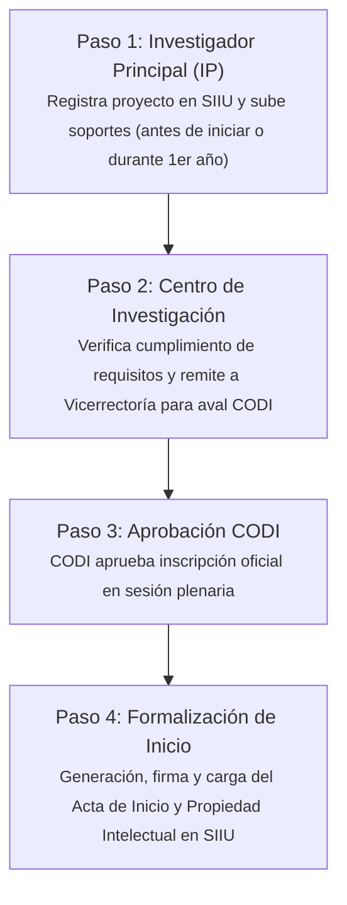

# PROCEDIMIENTO DE INSCRIPCIÓN DE PROYECTOS EN EL SISTEMA UNIVERSITARIO DE INVESTIGACIÓN – SUI

> [!NOTE] Información de Control Documental
> **Código**: PROC-CODI-INSCRIPCION-SUI  
> **Aprobado por**: Comité para el Desarrollo de la Investigación – CODI (Sesión 718 del 16 de febrero de 2016).  
> **Sistema**: Sistema de Información para la Investigación Universitaria – SIIU.  
> **Contacto de apoyo**: `apoyoviceinvestigacion@udea.edu.co`.

---

## 1. Introducción y Justificación

Permanentemente se originan en la Universidad proyectos de investigación que no han sido registrados en el Sistema Universitario de Investigación, ya sea porque tienen financiación externa y el trámite de aval fue realizado al interior de una dependencia, o porque se trata de proyectos realizados con recursos propios de los grupos y las dependencias académicas.

El presente procedimiento establece directrices para la inscripción de estos proyectos en el Sistema Universitario de Investigación a través del Sistema de Información para la Investigación Universitaria.

### Justificación Institucional
Para la Vicerrectoría de Investigación es importante contar con información del desarrollo de los proyectos que involucran recursos de la Universidad (por ejemplo, el tiempo laboral del investigador, uso de instalaciones y equipos, entre otros), de tal forma que se puedan visibilizar, institucionalizar y formalizar, además de rendir informes confiables a la sociedad.

El objetivo de este procedimiento es recopilar la mayor información posible de la actividad investigativa y propiciar un mínimo rigor en la formulación y ejecución de proyectos que involucren recursos de la Universidad, de tal forma que se promueva la gobernabilidad en el Sistema y se pueda dar cuenta de la responsabilidad con la cual se desarrolla la investigación en la Universidad de Antioquia.

Además de contar con información consolidada, los investigadores que inscriben sus proyectos en el Sistema Universitario de Investigación podrán beneficiarse de los diferentes fondos constituidos por el CODI para el fomento de la investigación en la Universidad.

---

## 2. Excepciones: Proyectos que NO se Inscriben al SUI

No se inscriben al Sistema Universitario de Investigación los siguientes tipos de proyectos:

1. **Actividades de Extensión:** Aquellas contempladas en el Estatuto Básico de Extensión (Acuerdo Superior 124 de 1997) sin componente científico.
2. **Proyectos Estudiantiles Puros:** Proyectos de estudiantes de pregrado y posgrado, **excepto cuando el estudiante de posgrado es un profesor vinculado a la Universidad**.

> [!NOTE] Nota sobre Proyectos de Extensión con Componente Investigativo
> Se pueden inscribir los proyectos de extensión que tengan componente investigativo, en los cuales la Universidad tenga derechos sobre la propiedad intelectual, y que contemplen compromisos de formación y divulgación científica. Estos proyectos deberán hacer los aportes económicos establecidos por la Universidad, según el Acuerdo Superior 124 de 1997 (artículo 47), lo cual deberá quedar explícito en el acta de inicio del proyecto.

---

## 3. Requisitos Mínimos para la Inscripción

1. **Participación Profesoral:** Se inscriben proyectos de investigación en los que participan profesores vinculados a la Universidad de Antioquia (de planta u ocasional, de tiempo completo o medio tiempo, profesor emérito), en calidad de Investigador Principal (IP) o coinvestigador.
2. **IP Externo:** En los casos en los cuales el investigador principal es de otra institución, el responsable del proyecto ante la Universidad es el **coinvestigador vinculado a la Universidad de Antioquia**.
3. **IP Profesor Ocasional:** Cuando el investigador principal sea profesor ocasional, **deberá adjuntar carta de apoyo de un profesor vinculado de planta**, quien se hará cargo del cumplimiento de los compromisos y de la finalización del proyecto en caso del retiro del IP antes de la fecha de culminación, lo cual quedará explícito en el acta de inicio.

---

## 4. Compromisos Mínimos

El proyecto debe pactar como mínimo alguno de los siguientes compromisos:
- **Vincular un estudiante en formación**, de pregrado o posgrado matriculado en la Universidad de Antioquia, **o**
- **Generar un producto de nuevo conocimiento** (según tipología Minciencias).

*Proyectos Financiados por Entidades Externas:* Prevalecerán los compromisos acordados con dicha entidad.

---

## 5. Documentación Obligatoria a Adjuntar

a. **Evaluaciones del proyecto tramitadas por el Comité Técnico:**  
   El Comité Técnico deberá nombrar un evaluador interno y uno externo o dos externos a la Universidad (Acuerdo Superior 395 de 2011 sobre conflicto de intereses).  
   > *Criterio de Aprobación:* Para su aprobación la evaluación deberá tener un puntaje promedio **superior a los 80 puntos**. En todo caso el Centro conservará el anonimato de los evaluadores. En proyectos financiados por entidad externa, bastará con el convenio/contrato debidamente legalizado.  
   > *Vigencia:* Las evaluaciones realizadas a proyectos presentados en convocatorias CODI son válidas para inscribir dichos proyectos **hasta por 24 meses**.

b. **Aprobación de horas de dedicación docente** por parte del Consejo de Facultad, Escuela o Instituto al cual pertenecen los investigadores.  
c. **Aval del Comité Técnico** del Centro de Investigación o quien haga sus veces.  
d. **Aval del Comité de Ética** (si aplica).  
e. **Copia del contrato o convenio** suscrito con la entidad externa que aprobó la financiación.  
f. **Carta de apoyo de un profesor vinculado**, cuando el IP sea profesor ocasional.

---

## 6. Procedimiento Operativo de Trámite en SIIU

- **Paso 1:** El investigador principal registra en el SIIU la información del proyecto y anexa los documentos soporte, preferiblemente antes de iniciar el proyecto o durante el primer año de ejecución.
- **Paso 2:** El Centro de Investigación verifica el cumplimiento de requisitos y envía el expediente a la Vicerrectoría para aprobación del CODI.
- **Paso 3:** Una vez efectuada la aprobación del CODI se genera en el SIIU el acta de inicio y acuerdo de propiedad intelectual.
- **Paso 4:** El acta es impresa, firmada, escaneada y cargada en el SIIU para iniciar formalmente el seguimiento institucional.

---

## 7. Disposiciones Generales

- La ejecución del proyecto debe sujetarse a los lineamientos del SUI en cuanto a presentación de informes de avance, informes finales, prórrogas y modificaciones presupuestales.
- Los proyectos financiados por entidades externas deberán realizar los trámites de novedades ante cada entidad según lo pactado y posteriormente registrar dichas novedades en el SIIU.
- Las situaciones no previstas y la interpretación del procedimiento serán resueltas privativamente por el **Comité para el Desarrollo de la Investigación – CODI**.
