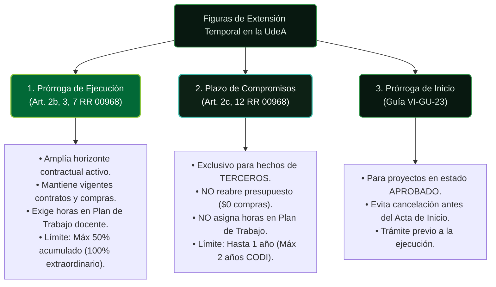
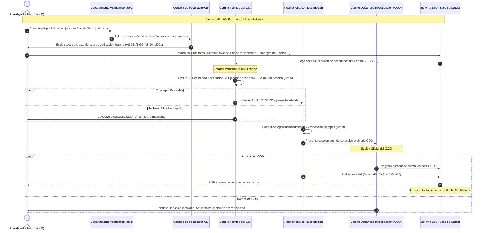

# SUSTENTO JURÍDICO-NORMATIVO DEL SISTEMA DE CONTROL Y MONITOREO DE PROYECTOS (SCMP)
## Manual Canónico de Prórrogas, Plazos de Compromisos, Gobernanza por Comités y Calibración del Semáforo
**Centro de Investigaciones y Consultorías (CIC) — Facultad de Ciencias Económicas**  
**Universidad de Antioquia**

---

> ### RESUMEN EJECUTIVO Y PROPÓSITO
> Este documento constituye el **soporte legal exhaustivo** del Sistema de Control y Monitoreo de Proyectos (SCMP) de la Facultad de Ciencias Económicas. Su propósito es respaldar normativamente cada campo, cálculo, plazo y estado visual del semáforo implementado en SharePoint (`Proyectos_Activos_CIC` e `Historial_Novedades_CIC`), así como orientar la actuación jurídica y administrativa del Comité Técnico del CIC, los Directores de Departamento, los Investigadores Principales (IP) y el Gestor del Sistema ante el CODI y la Vicerrectoría de Investigación.

---

## 1. MARCO NORMATIVO INSTITUCIONAL APLICABLE

La gestión de tiempos, modificaciones de cronograma, prórrogas y compromisos de investigación en la Universidad de Antioquia se encuentra regulada por un sistema jerárquico integrado:

1. **Resolución Rectoral 00968 del 30 de septiembre de 2026:**
   *Norma Matriz Especializada.* Reglamenta de manera unificada el trámite de prórrogas de ejecución, el otorgamiento de plazos adicionales para el cumplimiento de compromisos y las consecuencias del vencimiento e incumplimiento.
2. **Acuerdo Superior 204 del 6 de noviembre de 2001:**
   *Estatuto del Sistema Universitario de Investigación (SUI).* Define los principios de la investigación universitaria, la estructura descentralizada de los Centros de Investigación, las funciones de los Comités Técnicos (Art. 10) y las competencias de los Consejos de Facultad (Art. 12).
3. **Acuerdo Superior 083 del 29 de julio de 1996:**
   *Estatuto Profesoral de la Universidad de Antioquia.* Regula la dedicación de los profesores universitarios a las actividades de investigación a través de su plan de trabajo concertado (Art. 21 y concordantes).
4. **Acuerdo Superior 01 del 1 de agosto de 1994:**
   *Estatuto General de la Universidad de Antioquia.* Fija el principio de prevalencia de la investigación como función misional, el carácter de servidor público del docente y las responsabilidades por la custodia y administración diligente de los recursos públicos institucionales (Arts. 40 a 46).
5. **Acuerdo Superior 466 de 2020 y Acuerdo Superior 121 de 1997:**
   *Estatutos Presupuestal y Financiero.* Regulan el principio de anualidad presupuestal, los cierres de vigencia fiscal y las reservas presupuestales en proyectos de investigación.
6. **Guías Operativas del SIIU:**
   * **`VI-GU-23`:** *Guía para la solicitud de prórroga de proyectos en el SIIU* (Prórroga de Inicio y Prórroga de Ejecución).
   * **`VI-GU-22`:** *Guía para la solicitud de plazo en la entrega de compromisos en el SIIU*.
   * **`VI-GU-09` & `VI-IN-09`:** *Guía de seguimiento a proyectos y entrega de compromisos académicos* y *Procedimiento para el cierre formal y liquidación*.

---

## 2. DIFERENCIACIÓN JURÍDICA CANÓNICA ENTRE FIGURAS DE TIEMPO

Uno de los errores conceptuales más frecuentes en la gestión de proyectos es confundir la ampliación del tiempo de ejecución con la ampliación del plazo para entregar productos. La **Resolución Rectoral 00968 de 2026 (Art. 2)** establece una distinción tajante con efectos presupuestales, contractuales y de plan de trabajo docente diametralmente distintos:



### Tabla Comparativa Exegética

| Criterio Diferenciador | Prórroga de Ejecución (Art. 2b, 3, 7) | Plazo Cumplimiento Compromisos (Art. 2c, 12) |
| :--- | :--- | :--- |
| **Naturaleza Jurídica** | Extraordinaria y excepcional para ajustar el cronograma de actividades directas del equipo investigador. | Especialísima y residual, otorgada únicamente cuando el cumplimiento depende **exclusivamente de un tercero**. |
| **Causal Habilitante** | Circunstancias sobrevinientes técnicas, científicas, logísticas o de fuerza mayor que impidieron culminar las pruebas o análisis. | Sometimiento de manuscrito a revista indexada en revisión por pares (peer-review), trámite de concesión de patente ante la SIC, etc. |
| **Ejecución Presupuestal** | **Permitida:** Se mantienen activos los centros de costos y se pueden seguir ejecutando saldos en rubros aprobados. | **Prohibida:** No implica la reapertura de la ejecución presupuestal ni habilita la asignación de nuevos recursos. |
| **Plan de Trabajo Docente** | **Obligatoria:** Requiere autorización previa del Consejo de Facultad para la dedicación horaria del profesor (Art. 5). | **No Procede:** No implica asignación de actividades ni descarga horaria en el plan de trabajo profesoral (Art. 12). |
| **Límite Temporal Ordinario** | Hasta el **50% del plazo original** sumadas todas las prórrogas concedidas. | Hasta **un (1) año** calendario aprobado por el CODI previo aval del Centro. |
| **Límite Temporal Extraordinario** | Hasta el **100% del plazo original** (únicamente por fuerza mayor comprobada y avalada). | Hasta **dos (2) años** en total como tope infranqueable absoluto (Parágrafo 1, Art. 12). |
| **Instancia Aprobatoria** | CODI, previo aval del Comité Técnico del Centro y autorización horaria del Consejo de Facultad. | CODI, previo concepto y aval del Comité Técnico del Centro. |
| **Estatus en el SIIU** | Sigue en estado `En Ejecución` (con nueva fecha de vigencia contractual). | Pasa al estado formal: `Con plazo adicional autorizado para cumplimiento de compromisos` (Art. 12 Par. 2). |

---

## 3. LÍMITES TEMPORALES, ANTELACIÓN Y VENTANA DE ORO

### A. La Regla de los Dos (2) Meses de Antelación (Art. 6 RR 00968/2026)
La norma establece una carga perentoria de oportunidad:
> *"La solicitud de prórroga deberá presentarse al Comité Técnico de la respectiva dependencia o de la instancia que haga sus veces, **con una antelación mínima de dos (2) meses respecto de la fecha de finalización** prevista en el cronograma vigente del proyecto."*

* **Interpretación Operativa:** Dado que el mes legalmente se computa a 30 días, el límite mínimo para que un investigador radique su solicitud de prórroga formal sin incurrir en extemporaneidad es cuando faltan **60 días calendario** para vencer el proyecto.
* **Excepción de Extemporaneidad (Parágrafo Art. 6):** Si el hecho ocurre dentro de los últimos 60 días, el investigador está obligado a **acreditar y probar por qué no fue posible preverlo con anterioridad**. El Comité Técnico del Centro tiene el deber de emitir un pronunciamiento formal expreso sobre la *"razonabilidad del momento de radicación"*.

### B. Prohibición de Prórrogas Retroactivas
> *"En todos los casos, la solicitud de prórroga deberá radicarse **antes del vencimiento del plazo** fijado para la ejecución del proyecto."* (Art. 6 Parágrafo in fine).

Un proyecto que llega a `DiasVencimiento = 0` sin una solicitud radicada en el SIIU **pierde la viabilidad legal de ser prorrogado en su ejecución**. Ninguna autoridad universitaria (ni el Jefe de Centro, ni el Decano, ni el CODI) posee facultades reglamentarias para revivir un plazo de ejecución ya fenecido.

### C. Límites Máximos Acumulados (Art. 7 RR 00968/2026)
* Para un proyecto con duración inicial de **12 meses**:
  - La prórroga ordinaria acumulada máxima es de **6 meses** (50%).
  - La prórroga extraordinaria acumulada máxima es de **12 meses** (100%).
* Para un proyecto con duración inicial de **24 meses**:
  - La prórroga ordinaria acumulada máxima es de **12 meses** (50%).
  - La prórroga extraordinaria acumulada máxima es de **24 meses** (100%).
* **Cómputo en el SCMP:** El campo `NumeroConsecutivo` y `MesesOtorgados` en la lista `Historial_Novedades_CIC` permite auditar la sumatoria acumulada para bloquear solicitudes que pretendan superar el 50% sin concepto de fuerza mayor.

---

## 4. ECOSISTEMA DE GOBERNANZA: RUTA DE DECISIÓN POR COMITÉS

La decisión de prorrogar o conceder plazos no recae en un funcionario unipersonal. Involucra una cadena colegiada de gobernanza universitaria regulada por el **Acuerdo Superior 204 de 2001** y la **Resolución Rectoral 00968 de 2026**:



### Competencias Detalladas por Instancia:

1. **Investigador Principal (IP):**
   - Radicar oportunamente a través del SIIU adjuntando: a) Solicitud suscrita, b) Justificación causal, c) Informe técnico y financiero de avance, d) Cronograma ajustado, e) Aval horario del Consejo de Facultad.
2. **Consejo de Facultad (FCE):**
   - Competencia exclusiva para autorizar la **dedicación de tiempo lectivo/investigativo** de los profesores adscritos a sus departamentos durante el tiempo que durará la prórroga (AS 204/2001 Art. 12 literal e, AS 083/1996 Art. 21). Sin este soporte, el Comité Técnico no puede expedir aval.
3. **Comité Técnico del Centro (CIC FCE):**
   - Órgano colegiado de la unidad académica mayor. Verifica que el proyecto no supere los topes legales, que la ejecución presupuestal sea concordante con el avance físico, y emite el **Concepto Favorable o Aval de Centro** (AS 204/2001 Art. 10 literal k, RR 00968 Art. 5).
4. **Vicerrectoría de Investigación:**
   - Realiza la revisión técnica e institucional de cumplimiento de requisitos formales y consolida los expedientes para decisión central.
5. **Comité para el Desarrollo de la Investigación (CODI):**
   - Máxima autoridad investigativa de la Universidad. **Es la única instancia que aprueba o niega definitivamente las prórrogas y plazos adicionales de proyectos con recursos institucionales** (RR 00968 Art. 9 y 12).

---

## 5. SUSTENTO LEGAL DETALLADO DE CADA BANDA DEL SEMÁFORO SCMP

El semáforo visual programado en SharePoint mediante fórmulas de columna calculada `[$DiasVencimiento] = [FechaFinalVigente] - TODAY()` no es una mera convención cromática; **cada franja representa un estado procesal regido por la normativa universitaria:**

```text
  +-------------------------------------------------------------------------------------------------+
  |                                LÍNEA DE TIEMPO LEGAL DEL PROYECTO                               |
  +-------------------------------------------------------------------------------------------------+
           > 90 días           61 a 90 días             1 a 60 días           0 días       < 0 días
       [  VERDE 🟢  ]       [  ÁMBAR 🟡  ]          [  ROJO SUAVE 🔴  ]      [ NEGRO ⚫ ] [ ROJO ALARMA 🚨 ]
       Vigente Normal     Ventana de Radicación     Término Extemporáneo     Vence Hoy      Incumplimiento
       (Arts. 1-4)         Oportuna (Art. 6)        Excepcional (Par. Art 6)   (Art. 2)        (Art. 13)
```

---

### 🟢 Banda Verde: `> 90 días`
* **Definición en SCMP:** Proyecto en ejecución normal y regular.
* **Fundamento Legal:**
  - **RR 00968/2026 (Art. 1, 2a y 4):** El proyecto se encuentra dentro del plazo contractual inicialmente aprobado o prorrogado formalmente. Goza de presunción de normalidad técnica y presupuestal.
  - **AS 204/2001 (Art. 4b):** Preeminencia del trabajo por proyectos conforme al cronograma vigente.
* **Efectos Jurídicos:** El IP tiene plena autonomía para ejecutar rubros y adelantar compromisos. No se requiere intervención coercitiva del Centro de Investigaciones.
* **Acción del Gestor SCMP:** Monitoreo pasivo y verificación de carga regular de informes de avance programados en los términos de la convocatoria.

---

### 🟡 Banda Ámbar: `61 a 90 días` (La Ventana de Oro)
* **Definición en SCMP:** Alerta preventiva institucional de vencimiento próximo. Ventana reglamentaria para radicar prórroga o plazo de compromisos.
* **Fundamento Legal:**
  - **RR 00968/2026 (Artículo 6 — Oportunidad):**
    > *"La solicitud de prórroga deberá presentarse al Comité Técnico de la respectiva dependencia [...] con una **antelación mínima de dos (2) meses (60 días)** respecto de la fecha de finalización prevista en el cronograma vigente del proyecto."*
* **Razón de Ser del Rango 61 a 90 días:** Dado que a los 60 días exactos fenece el plazo ordinario de presentación, este mes intermedio (entre el día 90 y el día 61) es el **único momento oportuno** en que el IP puede:
  1. Tramitar con el Departamento y el Consejo de Facultad la aprobación del ajuste al Plan de Trabajo docente.
  2. Compilar el balance presupuestal y justificación técnica.
  3. Radicar formalmente en el SIIU para que el Comité Técnico del CIC lo incluya en el orden del día y emita su concepto antes de entrar a la zona crítica.
* **Efectos Jurídicos:** Es el periodo de máxima seguridad jurídica. Las prórrogas radicadas en esta banda no requieren justificar extemporaneidad ni son sospechosas de falta de planeación.
* **Acción del Gestor SCMP (Automatización Power Automate):**
  - Disparar la **Notificación Preventiva Nivel 1** al IP, notificándole los días exactos restantes y citando textualmente el Artículo 6 de la RR 00968.

---

### 🔴 Banda Rojo Suave: `1 a 60 días` (Zona Crítica de Extemporaneidad)
* **Definición en SCMP:** Término legal ordinario de solicitud de prórroga vencido. Zona de alto riesgo operativo.
* **Fundamento Legal:**
  - **RR 00968/2026 (Artículo 6, Parágrafo):**
    > *"Cuando la circunstancia que motiva la solicitud solo se haga evidente dentro de los dos (2) meses anteriores al vencimiento del plazo, la solicitud podrá presentarse tan pronto se conozca la misma. En todo caso, **el investigador deberá indicar y soportar expresamente la razón por la cual no fue posible anticiparla**, y el Comité Técnico deberá pronunciarse sobre la razonabilidad del momento de radicación como parte de su concepto."*
  - **RR 00968/2026 (Artículo 3):**
    > *"En ningún caso la prórroga podrá utilizarse para subsanar deficiencias de planeación, incumplimientos injustificados o retrasos atribuibles exclusivamente a la falta de gestión del equipo investigador."*
* **Efectos Jurídicos:**
  1. Si el IP radica prórroga en esta banda, la solicitud se tramita bajo **régimen excepcional y restrictivo**.
  2. Si no demuestra documentalmente la fuerza mayor o la imposibilidad de anticiparla, el Comité Técnico del CIC tiene la obligación jurídica de **negar el aval**.
  3. Si el IP no va a pedir prórroga de ejecución, este lapso es perentorio para consolidar el Informe Final de Investigación y radicar los productos en el SIIU.
  4. Si los productos dependen de un tercero (ej. artículo en revista), es la última oportunidad para solicitar formalmente el **Plazo para Cumplimiento de Compromisos (Art. 12)** antes de que el proyecto fenezca.
* **Acción del Gestor SCMP:**
  - Disparar la **Notificación Crítica Nivel 2** al IP y con copia al Jefe de Departamento, conminándolo a la radicación inmediata de justificación extraordinaria de prórroga o a la entrega del informe final.

---

### ⚫ Banda Negro Puro: `0 días` (Día del Vencimiento)
* **Definición en SCMP:** El proyecto cumple hoy su fecha contractual final vigente.
* **Fundamento Legal:**
  - **RR 00968/2026 (Art. 2a y Art. 6 Parágrafo in fine):** Fenecimiento total del término de ejecución acordado. A partir de las 23:59 horas de este día se extingue la facultad legal de radicar prórrogas de ejecución en el SIIU.
  - **AS 121/1997 y AS 466/2020:** Cierre de la capacidad de imputación presupuestal directa del proyecto.
* **Efectos Jurídicos:** Se congela la ejecución operativa. A partir de mañana el proyecto queda desprovisto de cobertura contractual activa a menos que exista un trámite debidamente aprobado por CODI en firme.
* **Acción del Gestor SCMP:** Verificar si existe solicitud en trámite en SIIU o si se procede con el protocolo de cierre técnico.

---

### 🚨 Banda Rojo Chilloso / Alarma: `< 0 días` (Vencido en Mora)
* **Definición en SCMP:** Proyecto vencido formalmente sin prórroga autorizada ni cierre ejecutado.
* **Fundamento Legal:**
  - **RR 00968/2026 (Artículo 13 — Vencimiento e Incumplimiento):**
    > *"Vencido el plazo de ejecución, incluida(s) la(s) prórroga(s) aprobada(s), sin evidencia del cumplimiento de los compromisos y sin que se haya autorizado plazo(s) de cumplimiento de compromisos conforme a la presente resolución, **el proyecto se calificará como 'incumplido' en los sistemas de información institucionales** dispuestos para dicho fin, y **se darán los traslados correspondientes ante las instancias competentes por el incumplimiento advertido**."*
  - **Acuerdo Superior 01 de 1994 (Estatuto General, Arts. 40 a 46):**
    Responsabilidad de los servidores públicos sobre los fondos universitarios. La omisión injustificada en la entrega de compromisos de investigación acarrea investigaciones administrativas, disciplinarias y eventual responsabilidad fiscal.
  - **Acuerdo Superior 083 de 1996 (Estatuto Profesoral):**
    Incumplimiento de las obligaciones funcionales derivadas del plan de trabajo profesoral concertado.
* **Efectos Jurídicos:**
  1. El IP queda administrativamente bloqueado para presentarse a nuevas convocatorias internas del CODI como investigador principal o coinvestigador.
  2. Imposibilidad de tramitar adiciones, traslados o prórrogas ordinarias en el SIIU.
  3. El Centro de Investigaciones queda facultado para emitir requerimiento de descargos y remitir el expediente a la Vicerrectoría de Investigación y a la Dirección de Asesoría Jurídica de la Universidad.
* **Acción del Gestor SCMP:**
  - Emisión de informe especial al Decano y al Comité Técnico del CIC para definir si procede intimación previa al IP o inicio formal del proceso de declaratoria de incumplimiento.

---

### ⚪ Banda Gris Neutro: `Finalizado` / `Con Plazo de Compromisos`
* **Definición en SCMP:** Proyecto culminado y cerrado, o amparado bajo el régimen especial de cumplimiento.
* **Fundamento Legal:**
  - **RR 00968/2026 (Art. 12 Parágrafo 2):**
    > *"Mientras se encuentre vigente un plazo para el cumplimiento de compromisos debidamente aprobado, **el proyecto se registrará en el estado de 'con plazo adicional autorizado para cumplimiento de compromisos' y no se calificará como atrasado**."*
  - **Guía VI-IN-09 y VI-GU-09:** Aprobación del informe final por el Comité Técnico del CIC y firma de acta de liquidación / paz y salvo con la Decanatura.
* **Efectos Jurídicos:** Seguridad jurídica total, liberación de las horas en el plan de trabajo docente del IP y paz y salvo investigativo institucional.

---

## 6. SÍNTESIS DE ARTICULACIÓN MATEMÁTICA Y LEGAL PARA AUTOMATIZACIONES

| Código de Color | Rango Matemático (`DiasVencimiento`) | Estado de Negocio | Articulado Rectoral Invocable | Plantilla Automática Aplicable en Power Automate |
| :---: | :---: | :---: | :---: | :---: |
| 🟢 `#2e7d32` | $> 90$ | Ejecución Regular | RR 00968 Art. 1-4; AS 204 Art. 4 | *Sin notificación activa (Estado OK).* |
| 🟡 `#f57c00` | $61 \leq x \leq 90$ | Alerta Oportuna (Ventana Oro) | **RR 00968 Art. 6 (Oportunidad 2 meses)** | **Plantilla Nivel 1:** *Invitación formal a radicación de prórroga con antelación reglamentaria.* |
| 🔴 `#e57373` | $1 \leq x \leq 60$ | Riesgo Crítico / Fenece Plazo | **RR 00968 Art. 6 Par. y Art. 3** | **Plantilla Nivel 2:** *Alerta crítica de extemporaneidad y conminación a informe final / Art. 12.* |
| ⚫ `#000000` | $0$ | Vencimiento Efectivo Hoy | **RR 00968 Art. 2a y 6 Par.** | **Plantilla Nivel 3:** *Notificación de cierre de ventana operativa y congelamiento de plazos.* |
| 🚨 `#b71c1c` | $< 0$ | Proyecto Vencido en Mora | **RR 00968 Art. 13; AS 01 Arts. 40-46** | **Plantilla Nivel 4:** *Requerimiento formal previo a calificación de "Incumplido" y traslado legal.* |
| ⚪ `#605e5c` | *Finalizado* | Cerrado / Plazo Art. 12 | **RR 00968 Art. 12 Par. 2; VI-IN-09** | *Registro histórico y paz y salvo.* |

---

## 7. CLÁUSULAS JURÍDICAS MODELO PARA LAS NOTIFICACIONES (POWER AUTOMATE)

Para dar estricto blindaje al actuar de la Facultad de Ciencias Económicas y evitar alegaciones de violación al debido proceso, las plantillas HTML de correo que disparará Power Automate deben incorporar los siguientes textos jurídicos estandarizados:

### Modelo A: Para la Banda Ámbar (61 a 90 días)
> *"Estimado(a) Investigador(a) Principal:*  
> *Le informamos que a su proyecto de investigación identificado con código SIIU **`@{items('Proyectos')?['CodigoProyecto']}`** le restan **`@{items('Proyectos')?['DiasVencimiento']}` días calendario** para cumplir su fecha final vigente de ejecución (**`@{items('Proyectos')?['FechaFinalVigente']}`**).*  
> *De conformidad con el **Artículo 6 de la Resolución Rectoral 00968 de 2026**, toda solicitud de prórroga debe radicarse a través del SIIU con una **antelación mínima de dos (2) meses (60 días)** ante el Comité Técnico del Centro, acompañada del aval de dedicación horaria otorgado por el Consejo de Facultad (Art. 5).*  
> *Le invitamos a ingresar al SIIU y gestionar oportunamente la novedad o preparar el informe final para evitar incurrir en extemporaneidad."*

### Modelo B: Para la Banda Roja Suave (1 a 60 días)
> *"ADVERTENCIA DE VENCIMIENTO INMINENTE — CÓDIGO SIIU: `@{items('Proyectos')?['CodigoProyecto']}`*  
> *Se notifica al Investigador Principal que el proyecto cuenta únicamente con **`@{items('Proyectos')?['DiasVencimiento']}` días de vigencia**.*  
> *Se advierte formalmente que, de acuerdo con el **Parágrafo del Artículo 6 de la Resolución Rectoral 00968 de 2026**, el término ordinario de dos meses para solicitar prórrogas ha fenecido. Cualquier solicitud que se radique en esta fecha tendrá carácter extemporáneo y obligará a acreditar formalmente motivos de fuerza mayor o circunstancias no imputables al equipo investigador, los cuales serán evaluados restrictivamente por el Comité Técnico del CIC y el CODI.*  
> *En caso de que las actividades técnicas hayan culminado y se esté únicamente a la espera de productos a cargo de terceros (ej. arbitraje de revistas o patentes), deberá tramitar formalmente la solicitud de **Plazo para Cumplimiento de Compromisos** regulada en el **Artículo 12** de la misma norma."*

### Modelo C: Para la Banda Roja Alarma (< 0 días)
> *"REQUERIMIENTO POR VENCIMIENTO DE TÉRMINOS — PROYECTO SIIU `@{items('Proyectos')?['CodigoProyecto']}`*  
> *Habiendo transcurrido la fecha final de vigencia sin que en los sistemas institucionales se registre prórroga aprobada por el CODI ni acta de informe final avalada, se pone en su conocimiento que, en cumplimiento del **Artículo 13 de la Resolución Rectoral 00968 de 2026**, el proyecto se encuentra en causal objetiva para ser calificado formalmente como **'INCUMPLIDO'** en el Sistema Integrado de Información Universitaria (SIIU).*  
> *Esta calificación genera inhabilidad para participar en nuevas convocatorias internas y da lugar a los traslados correspondientes ante las autoridades institucionales competentes de conformidad con los artículos 40 a 46 del Acuerdo Superior 01 de 1994 (Estatuto General).*  
> *Dispone de tres (3) días hábiles para allegar ante el Centro de Investigaciones y Consultorías (CIC) el estado de situación y soportes respectivos."*

---

## 8. REGISTRO Y CONTROL DEL DOCUMENTO
* **Elaborado por:** Centro de Investigaciones y Consultorías (CIC) — Facultad de Ciencias Económicas.
* **Fundamento Primario:** Resolución Rectoral 00968 de 2026 / Acuerdo Superior 204 de 2001 / Guías SIIU VI-GU-22 y VI-GU-23.
* **Destino Operativo:** Sistema SCMP, SharePoint Listas `Proyectos_Activos_CIC` e `Historial_Novedades_CIC`, y Flujos de Notificación Institucional.
